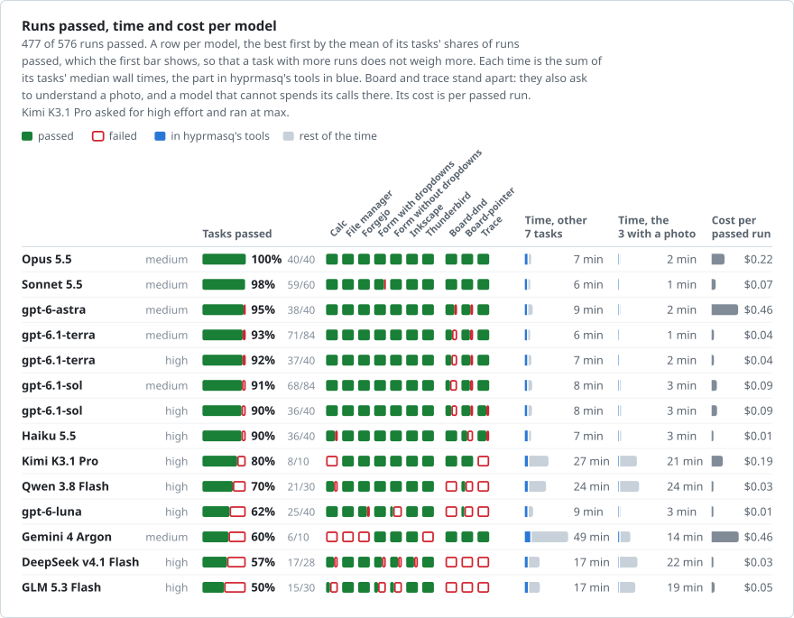

# hyprmasq

**Computer use and desktop automation for Hyprland that stays out of your way.**

hyprmasq lets AI agents and scripts see, click and type in Hyprland windows,
also on hidden workspaces, while you keep working in yours. Your cursor,
keyboard focus and workspace stay where they are.

https://github.com/user-attachments/assets/5e0b7789-3a4a-4e3b-b8c7-dffae121fdf0

Six agents at work at the same time, each in its own window: a real session
on one desktop, shown at double speed.

- **Background screenshots.** A screenshot renders a single window offscreen,
  with its popups and menus, whether or not its workspace is visible.
- **Your focus stays yours.** Each window gets its own
  [libei](https://gitlab.freedesktop.org/libinput/libei) input socket, and
  input goes to that window only. A driven window you are not using cannot
  grab your pointer or keyboard through its popups.
- **Made for agents.** An MCP server for Claude Code, Codex and other
  clients. One `act` call clicks and types, waits for the window to redraw,
  and returns what changed.
- **Several agents at once.** Agents can work side by side, each in its own
  window. Input to different apps runs at the same time, and windows of one
  app [take turns](docs/mcp.md#several-agents-at-once).
- **Recordings.** When you ask for one, an agent records what it does as
  slides or as a video, with its pointer, clicks and keys drawn in and a
  caption per step, also in windows that a screen recorder cannot see. See
  [recording a demo](docs/mcp.md#recording-a-demo).
- **Desktop automation.** The same from the shell with `hyprctl hyprmasq`,
  `hyprmasq-input` and `hyprmasq-launch`, for [scripts](#in-a-script) and
  tests that drive real apps in your session, without a VM.

## Install

hyprmasq is built for one Hyprland release: `main` for 0.57.2 and the
`hyprland-0.56` branch for 0.56.2. `hyprctl version` shows yours.

**Arch and Omarchy.** Build a pacman package from a clone:

```sh
# Hyprland 0.57.2
git clone https://github.com/nyrda/hyprmasq && cd hyprmasq && makepkg -si
# Hyprland 0.56.2
git clone -b hyprland-0.56 https://github.com/nyrda/hyprmasq && cd hyprmasq && makepkg -si
```

The plugin must be built against the exact Hyprland that loads it, and
refuses to load into any other. So after each Hyprland update, `git switch`
the clone to the branch for it, run `git pull && makepkg -sif` and restart
Hyprland. Until then, Hyprland runs without the plugin.

**NixOS.** Add the flake input, pass `inputs` through `specialArgs`, and
enable the module. It installs the plugin, the tools and the Hyprland build
they were compiled against:

```nix
# flake.nix: inputs.hyprmasq.url = "github:nyrda/hyprmasq";
{ inputs, ... }: {
  imports = [ inputs.hyprmasq.nixosModules.default ];
  programs.hyprmasq.enable = true;
}
```

**Load it** from `hyprland.lua`:

```lua
dofile("/etc/xdg/hypr/hyprmasq_plugin.lua")
```

On Arch with `hyprland.conf`, add `plugin = /usr/lib/hyprmasq/hyprmasq.so`
instead. [Installation](docs/installation.md) covers `hyprland.conf` on NixOS,
other Nix setups, older Hyprland releases and manual builds.

**hyprpm** installs the plugin alone, without the tools and the MCP server,
which then come from a clone. See [hyprpm](docs/installation.md#hyprpm).

## Use

### With an agent

Register the MCP server with your agent, for example Claude Code:

```sh
claude mcp add --scope user hyprmasq -- hyprmasq-mcp
```

For Codex, add it to `~/.codex/config.toml`. Without `env_vars`, Codex shows
the model no hyprmasq tools:

```toml
[mcp_servers.hyprmasq]
command = "hyprmasq-mcp"
env_vars = ["XDG_RUNTIME_DIR", "HYPRLAND_INSTANCE_SIGNATURE"]
```

[Installation](docs/installation.md#mcp-server) has the other clients.

Then ask for work that needs a window. The agent starts the app on a hidden
workspace and you keep yours:

```text
Start the app of this repository, export a report as PDF through its menu,
and record a video of that for the pull request.
```

### In a script

A screenshot of a window on another workspace, without switching to it:

```sh
addr=$(hyprctl -j clients | jq -r '.[] | select(.class == "firefox") | .address' | head -n 1)
hyprctl hyprmasq screenshot "$addr" /tmp/firefox.png
```

A window on a hidden workspace shows what it drew last, and with
`hyprctl -j` the reply says when that may be an older frame. See
[screenshots](docs/automation.md#screenshots).

Or start an app in the background and drive it:

```sh
addr=$(hyprmasq-launch -- foot)                        # start foot on a hidden workspace
socket=$(hyprctl hyprmasq eis open "$addr")            # give it an input socket
hyprmasq-input --socket "$socket" type 'echo hello<enter>'
hyprctl hyprmasq wait "$addr"                          # wait for foot to redraw
hyprctl hyprmasq screenshot "$addr" /tmp/foot.png      # render just that window
hyprctl hyprmasq eis close "$addr"
```

## Benchmarks

Twelve models on ten desktop tasks in an offline VM. Current Anthropic and
OpenAI models passed 90 to 100% of their tasks' runs, all but the small
`gpt-6-luna`, and no run of any model changed the user's focus or
workspace. See the [benchmarks](docs/benchmarks.md).

Beside three other computer use tools for Linux, hyprmasq was the one that
left the user's view alone in every run, and the others took 1.5 to 3.4
times as long. hyprmasq's author ran that series: the
[comparison](docs/comparison.md) has its rules, its limits and every run.

<picture>
  <source media="(prefers-color-scheme: dark)" srcset="docs/benchmarks/glance-dark.svg">
  
</picture>

## Limits and trust

- Reliable work needs a current model from Anthropic or OpenAI, such as
  Opus 5.5. Others fail more often on anything but forms and keyboard work.
  See the [tested models](docs/benchmarks.md#models).
- Wayland windows are the main target. XWayland windows work with
  [caveats](docs/automation.md#x11-windows).
- Tested on x86_64 Linux.
- The plugin runs inside Hyprland and hooks its internals. A bug in it can
  crash your session.
- hyprmasq keeps an agent out of your way, not out of your session. Whoever
  can reach a window's socket controls that window, so give it only to
  agents you would trust with your shell. See the
  [security model](docs/automation.md#security-model).

## Documentation

| | |
| --- | --- |
| [Installation](docs/installation.md) | Install, load, register the MCP server |
| [MCP server](docs/mcp.md) | The agent's tools and options |
| [Automation](docs/automation.md) | The command-line tools and plugin options |
| [Benchmarks](docs/benchmarks.md) | How agents do on real desktop tasks |
| [Comparison](docs/comparison.md) | hyprmasq beside other computer use tools |
| [Development](docs/development.md) | Building, testing and contributing |
| [Contributing](CONTRIBUTING.md) | What a pull request needs |
| [Security](SECURITY.md) | Reporting a vulnerability |

## License

[MIT](LICENSE). The photo of the benchmark's trace task has
[its own licence](bench/README.md#trace).
