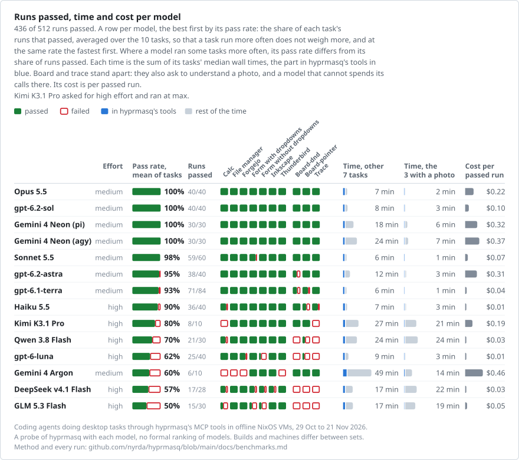

# hyprmasq

**Computer use and desktop automation for Hyprland that stays out of your way.**

hyprmasq lets AI agents and scripts see, click and type in Hyprland windows,
also on hidden workspaces, while you keep working in yours. Your cursor,
keyboard focus and workspace stay where they are.

https://github.com/user-attachments/assets/5e0b7789-3a4a-4e3b-b8c7-dffae121fdf0

Six agents at work at the same time, each in its own window: a real session
on one desktop, shown at double speed.

- **Background screenshots.** A screenshot renders a single window offscreen,
  with its popups and menus, whether or not its workspace is visible.
- **Your focus stays yours.** Each window gets its own
  [libei](https://gitlab.freedesktop.org/libinput/libei) input socket, and
  input goes to that window only. A driven window you are not using cannot
  grab your pointer or keyboard through its popups.
- **Made for agents.** An MCP server for Claude Code, Codex and other
  clients. One `act` call clicks and types, waits for the window to redraw,
  and returns what changed.
- **Several agents at once.** Agents can work side by side, each in its own
  window. Input to different apps runs at the same time, and windows of one
  app [take turns](docs/mcp.md#several-agents-at-once).
- **Recordings.** When you ask for one, an agent records what it does as
  slides or as a video, with its pointer, clicks and keys drawn in and a
  caption per step, also in windows that a screen recorder cannot see. See
  [recording a demo](docs/mcp.md#recording-a-demo).
- **Desktop automation.** The same from the shell with `hyprctl hyprmasq`,
  `hyprmasq-input` and `hyprmasq-launch`, for [scripts](#in-a-script) and
  tests that drive real apps in your session, without a VM.

## Install

hyprmasq builds against Hyprland 0.57.2 and 0.56.2 from the same source, and
a branch against Hyprland `main`, see
[Hyprland main](docs/installation.md#hyprland-main).
`hyprctl version` shows yours.

**Arch and Omarchy.** Install from the AUR, and load the plugin from
`~/.config/hypr/hyprland.lua`:

```sh
yay -S hyprmasq                 # or hyprmasq-bin, which builds nothing on your machine
```

```lua
pcall(dofile, "/etc/xdg/hypr/hyprmasq_plugin.lua")
```

The plugin comes prebuilt for the Hyprland that Arch and Omarchy ship, so
Hyprland updates need nothing from you: `yay -Syu`, or `omarchy update` on
Omarchy, keeps both in step. See
[Arch and Omarchy](docs/installation.md#arch-and-omarchy), also for a build
from a clone.

**NixOS.** Add the flake input, pass `inputs` through `specialArgs`, and
enable the module. It installs the plugin, the tools and the Hyprland build
they were compiled against:

```nix
# flake.nix: inputs.hyprmasq.url = "github:nyrda/hyprmasq";
{ inputs, ... }: {
  imports = [ inputs.hyprmasq.nixosModules.default ];
  programs.hyprmasq.enable = true;
}
```

Add `hyprland.cachix.org` to your substituters so Nix fetches Hyprland
prebuilt instead of compiling it from source. See
[NixOS module](docs/installation.md#nixos-module).

**Load it** from `hyprland.lua`:

```lua
dofile("/etc/xdg/hypr/hyprmasq_plugin.lua")
```

Hyprland 0.57 reads only `hyprland.lua`. On Arch with Hyprland 0.56.2 and
`hyprland.conf`, add `plugin = /usr/lib/hyprmasq/0.56.2/hyprmasq.so` for the
AUR package (or `/usr/lib/hyprmasq/hyprmasq.so` for a build from a clone).
[Installation](docs/installation.md) covers `hyprland.conf` on NixOS, other
Nix setups, older Hyprland releases and manual builds.

**hyprpm** installs the plugin alone, without the tools and the MCP server,
which then come from a clone. See [hyprpm](docs/installation.md#hyprpm).

## Use

### With an agent

`hyprmasq-mcp --check`, run inside the Hyprland session, says whether the
plugin, its hooks and the tools are ready, and what is missing if not.

Register the MCP server with your agent, for example Claude Code:

```sh
claude mcp add --scope user hyprmasq -- hyprmasq-mcp
```

For Codex, add it to `~/.codex/config.toml`. Without `env_vars`, Codex shows
the model no hyprmasq tools:

```toml
[mcp_servers.hyprmasq]
command = "hyprmasq-mcp"
env_vars = ["XDG_RUNTIME_DIR", "HYPRLAND_INSTANCE_SIGNATURE"]
```

Any other stdio MCP client works the same way (`{"command": "hyprmasq-mcp"}`,
inheriting `XDG_RUNTIME_DIR` and `HYPRLAND_INSTANCE_SIGNATURE`).
[Installation](docs/installation.md#mcp-server) has `pi` and the other client
options.

Then ask for work that needs a window. The agent starts the app on a hidden
workspace and you keep yours:

```text
Start the app of this repository, export a report as PDF through its menu,
and record a video of that for the pull request.
```

### In a script

A screenshot of a window on another workspace, without switching to it:

```sh
addr=$(hyprctl -j clients | jq -r '.[] | select(.class == "firefox") | .address' | head -n 1)
hyprctl hyprmasq screenshot "$addr" /tmp/firefox.png
```

A window on a hidden workspace shows what it drew last, and with
`hyprctl -j` the reply says when that may be an older frame. See
[screenshots](docs/automation.md#screenshots).

Or start an app in the background and drive it:

```sh
addr=$(hyprmasq-launch -- foot)                        # start foot on a hidden workspace
socket=$(hyprctl hyprmasq eis open "$addr")            # give it an input socket
hyprmasq-input --socket "$socket" type 'echo hello<enter>'
hyprctl hyprmasq wait "$addr"                          # wait for foot to redraw
hyprctl hyprmasq screenshot "$addr" /tmp/foot.png      # render just that window
hyprctl hyprmasq eis close "$addr"
```

## How it works

hyprmasq has two halves: a **Hyprland plugin** that isolates each window
inside the compositor, and an **MCP server** built around a single `act` loop.

Because the plugin runs inside Hyprland, it can render any window offscreen
and route input directly to that window while your cursor, focus, clipboard
and workspace stay untouched. Hidden windows keep redrawing while driven, and
new dialogs or popups open silently on the driven window's workspace instead
of yours.

On top of that, `hyprmasq-mcp` folds the usual click → wait → screenshot cycle
into one `act` call, which is why runs take fewer turns and far less context:

- **Batch in shot pixels.** Every screenshot has a short ID (`s4`), and `act`
  takes coordinates directly in that image's pixels (full window or zoomed
  crop), so the model can batch visible clicks, typing, drags and scrolls in
  one call without converting coordinates.
- **Guard rails before input.** Before sending anything, `act` validates every
  key and coordinate, checks that the target has not moved or resized since
  the shot, and holds back a click that would miss an open menu or dropdown.
- **Wait for real redraws, not fixed sleeps.** After input, it waits for the
  window to draw its response and settle, ignoring blinking carets, spinners
  and fading scrollbars, and reports any new dialog or popup that appeared.
- **Return only what changed.** Instead of sending a fresh full-screen capture
  every turn, `act` compares the window to the earlier shot and returns small
  crops of the changed areas, switching to a full window shot only when a
  scroll or large update needs one. See [act](docs/mcp.md#act).

## Benchmarks

Fourteen models on ten desktop tasks in an offline VM. Current Anthropic and
OpenAI models passed 90 to 100% of each task's runs on average, all but the
small `gpt-6-luna`, and no run of any model changed the user's focus or
workspace. See the [benchmarks](docs/benchmarks.md).

Beside three other computer use tools for Linux, hyprmasq was the one that
left the user's view alone in every run, and the others took 1.5 to 3.4
times as long. hyprmasq's author ran that series: the
[comparison](docs/comparison.md) has its rules, its limits and every run, and
an [addendum on macOS](docs/comparison-macos.md) sets four of the tasks beside
OpenAI's and Claude's computer use and Cua Driver on a Mac.

<picture>
  <source media="(prefers-color-scheme: dark)" srcset="docs/benchmarks/glance-dark.svg">
  
</picture>

## Limits and trust

- Reliable work needs a current model from Anthropic or OpenAI, such as
  Opus 5.5. Others fail more often on anything but forms and keyboard work.
  See the [tested models](docs/benchmarks.md#models).
- Wayland windows are the main target. XWayland windows work with
  [caveats](docs/automation.md#x11-windows).
- Tested on x86_64 Linux.
- The plugin runs inside Hyprland and hooks its internals. A bug in it can
  crash your session.
- hyprmasq keeps an agent out of your way, not out of your session. Whoever
  can reach a window's socket controls that window, so give it only to
  agents you would trust with your shell. See the
  [security model](docs/automation.md#security-model).

## Documentation

| | |
| --- | --- |
| [Installation](docs/installation.md) | Install, load, register the MCP server |
| [MCP server](docs/mcp.md) | The agent's tools and options |
| [Automation](docs/automation.md) | The command-line tools and plugin options |
| [Benchmarks](docs/benchmarks.md) | How agents do on real desktop tasks |
| [Comparison](docs/comparison.md) | hyprmasq beside other computer use tools |
| [Development](docs/development.md) | Building, testing and contributing |
| [Contributing](CONTRIBUTING.md) | What a pull request needs |
| [Security](SECURITY.md) | Reporting a vulnerability |

## License

[MIT](LICENSE). The photos of the benchmark's trace and pano tasks have
their own licences, see [trace](bench/README.md#trace) and
[pano](bench/README.md#pano).
