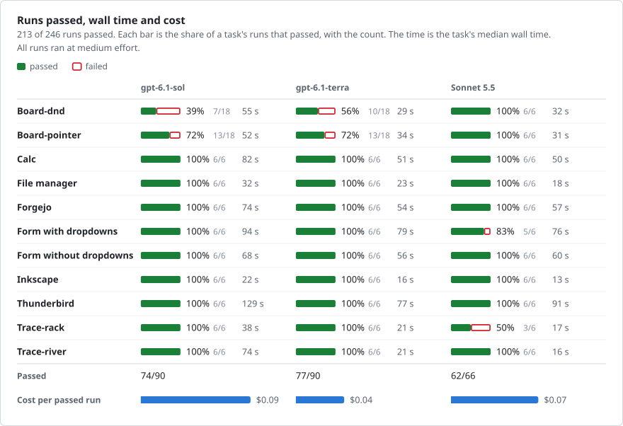
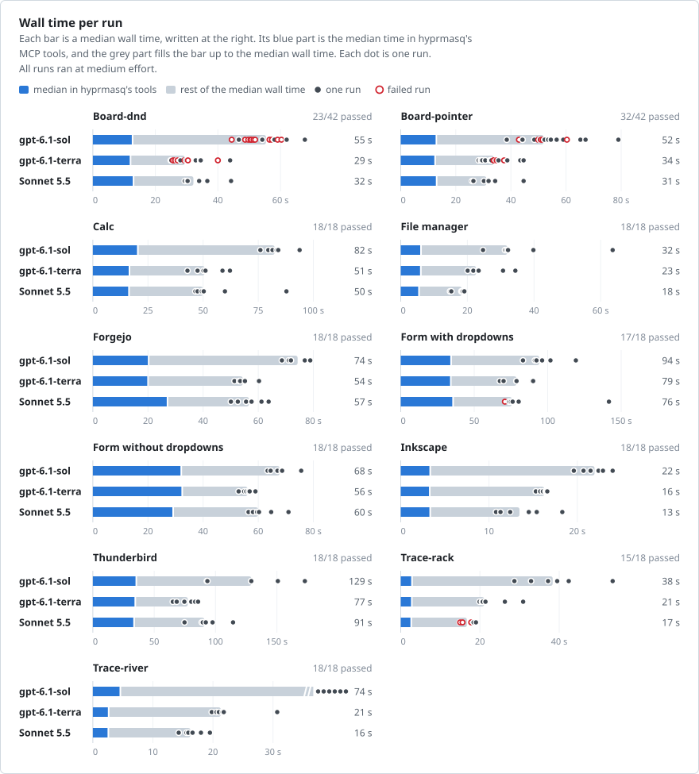
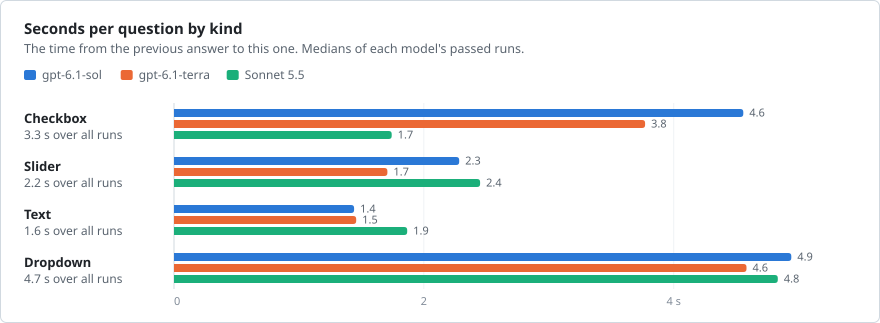
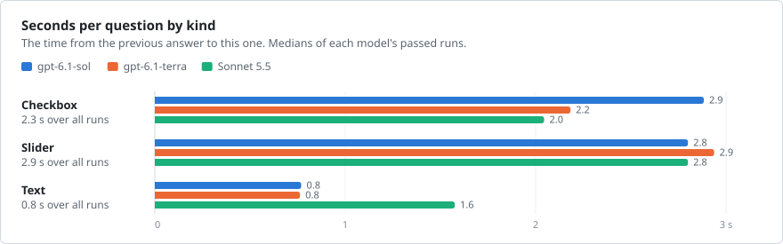
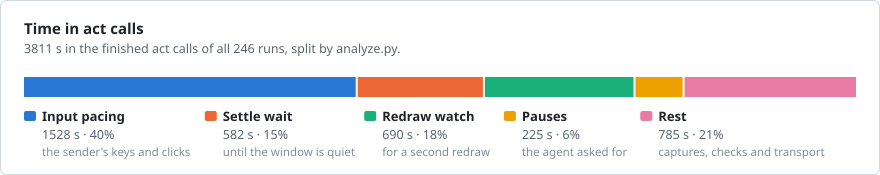
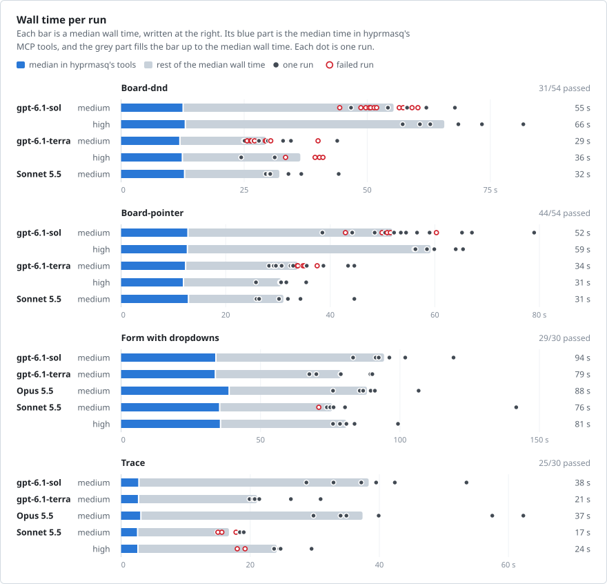
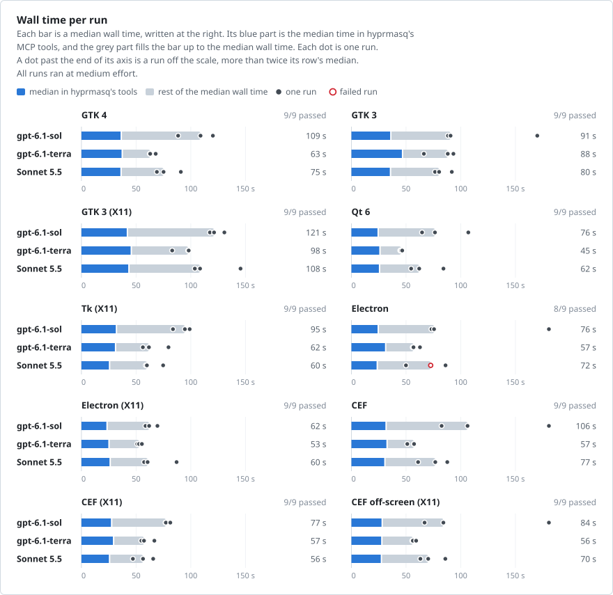
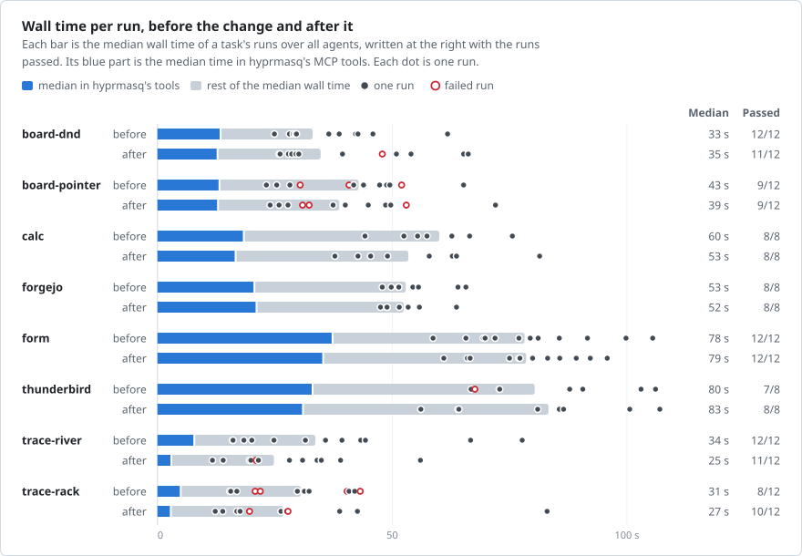
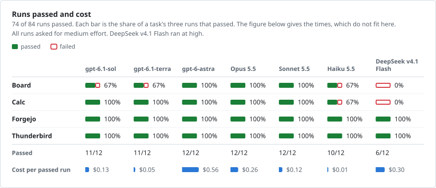
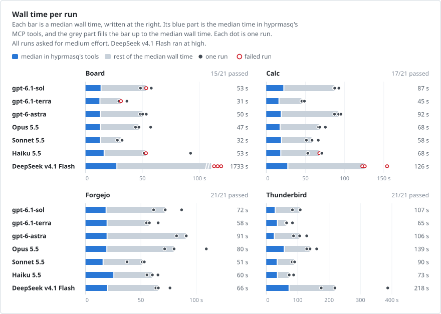

# Benchmarks

Coding agents doing desktop tasks through hyprmasq's MCP tools, in an offline NixOS VM, while the user's own work
stays on the visible workspace. Results are one set on one build, and [Changes](#changes) keeps earlier sets and
studies of single changes, each on its own build and date, which [Method](#method) gives. Every run is in
[benchmarks/data](benchmarks/data), and [bench/README.md](../bench/README.md) has the tasks and how to run them.
[Comparisons](comparison.md) puts hyprmasq beside other tools.

## Results

Three models on eleven tasks, six runs each and eighteen of Sol and Terra on board, all on one build: hyprmasq
[`210dfbe`](https://github.com/nyrda/hyprmasq/commit/210dfbef3e8133907ea5ef3036493237e410edc8) with Hyprland 0.57.0,
at `medium` effort, on 29 Oct 2026.

<!-- render baseline-0.57.0 scoreboard -->
<picture>
  <source media="(prefers-color-scheme: dark)" srcset="benchmarks/baseline-0.57.0-scoreboard-dark.svg">
  
</picture>
<!-- /render -->

**Every failed run is the model's error:** the agent aimed at the wrong part, and hyprmasq delivered its input where it
aimed. The notes below list each.

<!-- render baseline-0.57.0 time -->
<picture>
  <source media="(prefers-color-scheme: dark)" srcset="benchmarks/baseline-0.57.0-time-dark.svg">
  
</picture>
<!-- /render -->

Notes: the tasks, and the failed runs

| Task | What the agent does |
| --- | --- |
| Board | Places nine labels on a motherboard photo in Firefox, by HTML5 drag-and-drop (`dnd`) or by pointer events (`pointer`). |
| Calc | Reads five intranet reports in Firefox, then fills, calculates and saves a LibreOffice sheet. |
| File manager | Renames a report and moves it into another folder in Nautilus. |
| Forgejo | Uploads a file in Chromium and connects a release dashboard through an OAuth popup, while the user types notes in another window of the same browser. |
| Form | Answers a 25-question GTK 4 questionnaire and submits it, with dropdowns among its questions or without them. |
| Inkscape | Moves a rectangle exactly 2 px to the right and saves the drawing. |
| Thunderbird | Sets up the mail account, finds the answer in the inbox and replies in the right thread. |
| Trace | Draws along a line of a photo in Firefox: a river's bank (`river`) or the rack of a rack railway (`rack`). |

Every failed run was the model's error. hyprmasq delivered the input of each where the agent aimed it.

| Task | Agent | Runs | What happened |
| --- | --- | --- | --- |
| Board | gpt-6.1-sol | 9 `dnd`, 5 `pointer` | Put the CPU power headers' label on the 5-pin header beside the memory slots, a part the task names as a lookalike. One `pointer` run also put the M.2 slots' label beside its part. |
| Board | gpt-6.1-sol | 2 `dnd` | Put the M.2 slots' label beside its part, and in the other run the CPU power headers' label on the fan headers and the SATA ports' label beside their part. |
| Board | gpt-6.1-terra | 8 `dnd`, 5 `pointer` | Put the CPU power headers' label on the lookalike. One `dnd` run also put the BMC chip's label beside its part. |
| Trace-rack | Sonnet 5.5 | 3 | Drew the rack in one path, which left part of its upper end uncovered and ran beside it there. |
| Form with dropdowns | Sonnet 5.5 | 1 | Ticked Anvil instead of Kettle in question 9. |

The two board variants differ only in how the page takes a drag, by HTML5 drag-and-drop or by pointer events. The
agents saw the same screenshots in both and placed every label once, so the variant did not decide where they aimed.
In their first six runs of each, Sol and Terra chose the lookalike in 9 of 12 `dnd` runs and 3 of 12 `pointer` runs.
Twelve more runs of each, which is why they ran board eighteen times, chose it in 8 of 24 and 7 of 24.

Where the time goes: per kind of question, and inside hyprmasq's tool

<!-- render baseline-0.57.0 kinds form -->
<picture>
  <source media="(prefers-color-scheme: dark)" srcset="benchmarks/baseline-0.57.0-kinds-form-dark.svg">
  
</picture>
<!-- /render -->

<!-- render baseline-0.57.0 kinds form-no-dropdowns -->
<picture>
  <source media="(prefers-color-scheme: dark)" srcset="benchmarks/baseline-0.57.0-kinds-form-no-dropdowns-dark.svg">
  
</picture>
<!-- /render -->

The second figure splits the time of `act`, hyprmasq's tool that sends input and returns what changed.

<!-- render baseline-0.57.0 act -->
<picture>
  <source media="(prefers-color-scheme: dark)" srcset="benchmarks/baseline-0.57.0-act-dark.svg">
  
</picture>
<!-- /render -->

Numbers per task, and tokens and cost

<!-- render baseline-0.57.0 table board-dnd -->

Numbers: Board-dnd

**Outcome and time**

| Agent | Effort | Passed | Wall s | In tools s | Turn s | Calls | Actions | Images |
| --- | --- | --- | --- | --- | --- | --- | --- | --- |
| gpt-6.1-sol | medium | 7/18 | 55 (44–68) | 12 (12–15) | 5.8 (4.6–9.2) | 5 (4–7) | 9 (9–11) | 4 (3–8) |
| gpt-6.1-terra | medium | 10/18 | 29 (25–44) | 12 (11–13) | 4.3 (3.1–5.8) | 3 (2–7) | 9 (9–10) | 6 (2–12) |
| Sonnet 5.5 | medium | 6/6 | 32 (29–44) | 13 (12–19) | 3.3 (3.0–4.8) | 4 (3–7) | 9 (9–13) | 10 (8–12) |

**Tokens and cost**

| Agent | Effort | Input k | Cached % | Output k | Cost $ |
| --- | --- | --- | --- | --- | --- |
| gpt-6.1-sol | medium | 99 (81–135) | 86 (77–93) | 1 (1–1) | 0.046 (0.031–0.074) |
| gpt-6.1-terra | medium | 65 (49–136) | 78 (68–88) | 1 (0–1) | 0.019 (0.016–0.045) |
| Sonnet 5.5 | medium | 64 (42–95) | 88 (75–90) | 1 (1–2) | 0.039 (0.029–0.050) |

<!-- /render -->
<!-- render baseline-0.57.0 table board-pointer -->

Numbers: Board-pointer

**Outcome and time**

| Agent | Effort | Passed | Wall s | In tools s | Turn s | Calls | Actions | Images |
| --- | --- | --- | --- | --- | --- | --- | --- | --- |
| gpt-6.1-sol | medium | 13/18 | 52 (38–79) | 13 (12–15) | 5.3 (3.5–8.5) | 6 (5–9) | 9 (9–11) | 5 (4–8) |
| gpt-6.1-terra | medium | 13/18 | 34 (28–45) | 12 (12–14) | 3.9 (2.2–5.2) | 4 (2–8) | 9 (9–10) | 8 (3–15) |
| Sonnet 5.5 | medium | 6/6 | 31 (26–45) | 13 (12–13) | 3.4 (2.4–5.2) | 4 (3–6) | 9 (9–10) | 10 (7–14) |

**Tokens and cost**

| Agent | Effort | Input k | Cached % | Output k | Cost $ |
| --- | --- | --- | --- | --- | --- |
| gpt-6.1-sol | medium | 114 (98–174) | 87 (71–93) | 1 (1–2) | 0.049 (0.034–0.074) |
| gpt-6.1-terra | medium | 80 (49–157) | 82 (58–89) | 1 (1–1) | 0.023 (0.018–0.033) |
| Sonnet 5.5 | medium | 64 (42–89) | 87 (82–89) | 1 (1–2) | 0.038 (0.026–0.065) |

<!-- /render -->
<!-- render baseline-0.57.0 table calc -->

Numbers: Calc

**Outcome and time**

| Agent | Effort | Passed | Wall s | In tools s | Turn s | Calls | Actions | Images |
| --- | --- | --- | --- | --- | --- | --- | --- | --- |
| gpt-6.1-sol | medium | 6/6 | 82 (76–94) | 20 (18–22) | 3.0 (2.1–3.7) | 17 (15–17) | 28 (18–29) | 20 (18–27) |
| gpt-6.1-terra | medium | 6/6 | 51 (43–62) | 16 (15–17) | 1.9 (1.5–2.6) | 13 (12–14) | 17 (15–21) | 26 (17–28) |
| Sonnet 5.5 | medium | 6/6 | 50 (46–88) | 16 (15–28) | 2.2 (1.7–3.3) | 13 (12–16) | 16 (14–33) | 18 (15–26) |

**Tokens and cost**

| Agent | Effort | Input k | Cached % | Output k | Cost $ |
| --- | --- | --- | --- | --- | --- |
| gpt-6.1-sol | medium | 321 (276–330) | 89 (86–90) | 2 (2–2) | 0.116 (0.096–0.140) |
| gpt-6.1-terra | medium | 261 (237–300) | 87 (84–92) | 1 (1–2) | 0.054 (0.046–0.056) |
| Sonnet 5.5 | medium | 210 (196–311) | 91 (91–93) | 3 (3–4) | 0.094 (0.090–0.130) |

<!-- /render -->
<!-- render baseline-0.57.0 table files -->

Numbers: File manager

**Outcome and time**

| Agent | Effort | Passed | Wall s | In tools s | Turn s | Calls | Actions | Images |
| --- | --- | --- | --- | --- | --- | --- | --- | --- |
| gpt-6.1-sol | medium | 6/6 | 32 (25–64) | 6 (5–12) | 2.5 (1.9–7.2) | 6 (5–10) | 8 (8–19) | 11 (7–17) |
| gpt-6.1-terra | medium | 6/6 | 23 (20–34) | 6 (5–12) | 2.0 (1.6–2.4) | 6 (5–10) | 8 (7–18) | 12 (12–19) |
| Sonnet 5.5 | medium | 6/6 | 18 (15–19) | 5 (5–6) | 2.0 (1.6–2.1) | 5 (4–6) | 14 (7–14) | 6 (4–8) |

**Tokens and cost**

| Agent | Effort | Input k | Cached % | Output k | Cost $ |
| --- | --- | --- | --- | --- | --- |
| gpt-6.1-sol | medium | 110 (92–184) | 85 (75–94) | 0 (0–1) | 0.048 (0.041–0.061) |
| gpt-6.1-terra | medium | 105 (92–179) | 86 (81–89) | 1 (0–1) | 0.021 (0.019–0.042) |
| Sonnet 5.5 | medium | 66 (47–73) | 92 (91–93) | 1 (0–1) | 0.026 (0.019–0.029) |

<!-- /render -->
<!-- render baseline-0.57.0 table forgejo -->

Numbers: Forgejo

**Outcome and time**

| Agent | Effort | Passed | Wall s | In tools s | Turn s | Calls | Actions | Images |
| --- | --- | --- | --- | --- | --- | --- | --- | --- |
| gpt-6.1-sol | medium | 6/6 | 74 (69–79) | 20 (18–22) | 2.8 (2.6–3.1) | 16 (14–18) | 21 (21–26) | 26 (26–29) |
| gpt-6.1-terra | medium | 6/6 | 54 (51–60) | 20 (18–24) | 1.7 (1.6–2.1) | 15 (14–16) | 22 (22–25) | 26 (26–26) |
| Sonnet 5.5 | medium | 6/6 | 57 (50–64) | 27 (24–31) | 2.3 (1.8–2.6) | 12 (12–13) | 26 (25–28) | 10 (9–11) |

**Tokens and cost**

| Agent | Effort | Input k | Cached % | Output k | Cost $ |
| --- | --- | --- | --- | --- | --- |
| gpt-6.1-sol | medium | 317 (274–363) | 91 (89–92) | 1 (1–1) | 0.102 (0.084–0.105) |
| gpt-6.1-terra | medium | 293 (274–315) | 92 (86–92) | 1 (1–1) | 0.044 (0.044–0.059) |
| Sonnet 5.5 | medium | 176 (160–190) | 91 (90–91) | 2 (2–2) | 0.075 (0.068–0.082) |

<!-- /render -->
<!-- render baseline-0.57.0 table form -->

Numbers: Form with dropdowns

**Outcome and time**

| Agent | Effort | Passed | Wall s | In tools s | Turn s | Calls | Actions | Images | All right at s |
| --- | --- | --- | --- | --- | --- | --- | --- | --- | --- |
| gpt-6.1-sol | medium | 6/6 | 94 (83–119) | 34 (32–40) | 2.9 (2.6–3.5) | 17 (16–22) | 62 (57–69) | 34 (17–36) | 86 (72–100) |
| gpt-6.1-terra | medium | 6/6 | 79 (68–90) | 34 (30–35) | 2.2 (1.7–2.4) | 20 (13–20) | 64 (59–70) | 37 (18–50) | 74 (61–83) |
| Sonnet 5.5 | medium | 5/6 | 76 (71–142) | 35 (34–46) | 2.6 (2.3–2.7) | 15 (14–36) | 58 (56–74) | 37 (27–61) | 66 (65–122) |

**Tokens and cost**

| Agent | Effort | Input k | Cached % | Output k | Cost $ |
| --- | --- | --- | --- | --- | --- |
| gpt-6.1-sol | medium | 356 (337–480) | 91 (89–95) | 2 (1–2) | 0.114 (0.100–0.122) |
| gpt-6.1-terra | medium | 413 (276–441) | 91 (87–94) | 2 (1–2) | 0.059 (0.045–0.081) |
| Sonnet 5.5 | medium | 312 (257–983) | 93 (92–96) | 2 (2–5) | 0.107 (0.096–0.247) |

<!-- /render -->
<!-- render baseline-0.57.0 table form-no-dropdowns -->

Numbers: Form without dropdowns

**Outcome and time**

| Agent | Effort | Passed | Wall s | In tools s | Turn s | Calls | Actions | Images | All right at s |
| --- | --- | --- | --- | --- | --- | --- | --- | --- | --- |
| gpt-6.1-sol | medium | 6/6 | 68 (63–76) | 32 (32–34) | 3.2 (2.9–3.6) | 8 (7–12) | 61 (60–64) | 16 (13–29) | 58 (55–65) |
| gpt-6.1-terra | medium | 6/6 | 56 (53–59) | 32 (32–35) | 2.5 (2.0–2.7) | 7 (7–7) | 58 (56–59) | 12 (12–16) | 48 (46–52) |
| Sonnet 5.5 | medium | 6/6 | 60 (56–71) | 29 (27–30) | 2.6 (2.1–3.1) | 10 (9–15) | 55 (54–60) | 27 (17–33) | 52 (48–60) |

**Tokens and cost**

| Agent | Effort | Input k | Cached % | Output k | Cost $ |
| --- | --- | --- | --- | --- | --- |
| gpt-6.1-sol | medium | 174 (156–244) | 87 (86–91) | 1 (1–1) | 0.066 (0.056–0.102) |
| gpt-6.1-terra | medium | 157 (156–159) | 86 (76–86) | 1 (1–1) | 0.034 (0.032–0.049) |
| Sonnet 5.5 | medium | 191 (146–255) | 92 (91–92) | 2 (1–2) | 0.075 (0.059–0.099) |

<!-- /render -->
<!-- render baseline-0.57.0 table inkscape -->

Numbers: Inkscape

**Outcome and time**

| Agent | Effort | Passed | Wall s | In tools s | Turn s | Calls | Actions | Images |
| --- | --- | --- | --- | --- | --- | --- | --- | --- |
| gpt-6.1-sol | medium | 6/6 | 22 (20–24) | 3 (3–4) | 3.1 (2.2–3.4) | 4 (4–4) | 6 (6–6) | 11 (7–11) |
| gpt-6.1-terra | medium | 6/6 | 16 (15–17) | 3 (3–4) | 2.5 (2.3–3.3) | 3 (3–3) | 6 (6–6) | 11 (11–11) |
| Sonnet 5.5 | medium | 6/6 | 13 (11–18) | 3 (3–4) | 2.3 (1.7–3.1) | 3 (3–4) | 4 (3–9) | 11 (7–11) |

**Tokens and cost**

| Agent | Effort | Input k | Cached % | Output k | Cost $ |
| --- | --- | --- | --- | --- | --- |
| gpt-6.1-sol | medium | 80 (80–82) | 83 (70–90) | 0 (0–0) | 0.037 (0.027–0.057) |
| gpt-6.1-terra | medium | 65 (65–65) | 81 (69–81) | 0 (0–0) | 0.017 (0.016–0.024) |
| Sonnet 5.5 | medium | 43 (42–55) | 88 (85–90) | 0 (0–1) | 0.023 (0.019–0.025) |

<!-- /render -->
<!-- render baseline-0.57.0 table thunderbird -->

Numbers: Thunderbird

**Outcome and time**

| Agent | Effort | Passed | Wall s | In tools s | Turn s | Calls | Actions | Images |
| --- | --- | --- | --- | --- | --- | --- | --- | --- |
| gpt-6.1-sol | medium | 6/6 | 129 (93–173) | 35 (27–42) | 2.8 (2.6–3.4) | 26 (19–32) | 41 (24–45) | 32 (26–46) |
| gpt-6.1-terra | medium | 6/6 | 77 (65–86) | 34 (27–40) | 1.8 (1.5–2.4) | 18 (17–20) | 31 (23–33) | 23 (19–25) |
| Sonnet 5.5 | medium | 6/6 | 91 (75–114) | 33 (30–36) | 2.5 (2.0–3.4) | 20 (17–23) | 30 (27–36) | 22 (18–28) |

**Tokens and cost**

| Agent | Effort | Input k | Cached % | Output k | Cost $ |
| --- | --- | --- | --- | --- | --- |
| gpt-6.1-sol | medium | 641 (450–836) | 92 (91–95) | 2 (2–3) | 0.177 (0.137–0.193) |
| gpt-6.1-terra | medium | 397 (369–446) | 92 (85–93) | 2 (1–2) | 0.063 (0.053–0.087) |
| Sonnet 5.5 | medium | 500 (332–547) | 94 (92–94) | 3 (3–4) | 0.160 (0.119–0.170) |

<!-- /render -->
<!-- render baseline-0.57.0 table trace-rack -->

Numbers: Trace-rack

**Outcome and time**

| Agent | Effort | Passed | Wall s | In tools s | Turn s | Calls | Actions | Images |
| --- | --- | --- | --- | --- | --- | --- | --- | --- |
| gpt-6.1-sol | medium | 6/6 | 38 (29–54) | 3 (2–6) | 3.9 (3.1–5.0) | 6 (5–8) | 1 (1–3) | 5 (4–7) |
| gpt-6.1-terra | medium | 6/6 | 21 (20–31) | 3 (2–5) | 4.3 (3.9–5.2) | 3 (3–5) | 1 (1–3) | 6 (4–6) |
| Sonnet 5.5 | medium | 3/6 | 17 (15–19) | 2 (2–3) | 3.2 (2.8–3.6) | 4 (3–4) | 1 (1–1) | 6 (6–7) |

**Tokens and cost**

| Agent | Effort | Input k | Cached % | Output k | Cost $ |
| --- | --- | --- | --- | --- | --- |
| gpt-6.1-sol | medium | 107 (98–158) | 88 (79–91) | 1 (1–1) | 0.045 (0.033–0.074) |
| gpt-6.1-terra | medium | 66 (64–100) | 73 (68–83) | 1 (1–1) | 0.025 (0.019–0.032) |
| Sonnet 5.5 | medium | 47 (41–54) | 88 (88–90) | 1 (1–1) | 0.025 (0.021–0.029) |

<!-- /render -->
<!-- render baseline-0.57.0 table trace-river -->

Numbers: Trace-river

**Outcome and time**

| Agent | Effort | Passed | Wall s | In tools s | Turn s | Calls | Actions | Images |
| --- | --- | --- | --- | --- | --- | --- | --- | --- |
| gpt-6.1-sol | medium | 6/6 | 74 (42–96) | 4 (2–6) | 5.6 (3.2–6.4) | 7 (5–9) | 2 (1–3) | 6 (4–8) |
| gpt-6.1-terra | medium | 6/6 | 21 (20–31) | 2 (2–6) | 4.7 (4.0–4.9) | 3 (3–5) | 1 (1–3) | 6 (3–10) |
| Sonnet 5.5 | medium | 6/6 | 16 (14–20) | 2 (2–3) | 3.2 (2.5–3.7) | 3 (3–4) | 1 (1–2) | 6 (6–7) |

**Tokens and cost**

| Agent | Effort | Input k | Cached % | Output k | Cost $ |
| --- | --- | --- | --- | --- | --- |
| gpt-6.1-sol | medium | 139 (100–186) | 86 (78–93) | 2 (1–2) | 0.059 (0.044–0.092) |
| gpt-6.1-terra | medium | 65 (65–98) | 80 (69–85) | 1 (1–1) | 0.019 (0.019–0.026) |
| Sonnet 5.5 | medium | 41 (41–55) | 87 (86–88) | 1 (1–1) | 0.025 (0.024–0.031) |

<!-- /render -->
<!-- render baseline-0.57.0 costs -->

Tokens and cost per agent

| Agent | Passed | Input M | Cached % | Output k | Cost $ | Cost per passed run $ |
| --- | --- | --- | --- | --- | --- | --- |
| gpt-6.1-sol | 74/90 | 17.48 | 89 | 102 | 6.39 | 0.09 |
| gpt-6.1-terra | 77/90 | 13.72 | 86 | 82 | 2.93 | 0.04 |
| Sonnet 5.5 | 62/66 | 10.89 | 92 | 106 | 4.26 | 0.07 |

<!-- /render -->

### More reasoning, and Opus

Where a model failed runs, it ran the task six more times at `high` effort, and Sonnet's tasks, form and trace-rack,
also with Opus. The figure's Trace is trace-rack.

<!-- render escalation-0.57.0 time -->
<picture>
  <source media="(prefers-color-scheme: dark)" srcset="benchmarks/escalation-0.57.0-time-dark.svg">
  
</picture>
<!-- /render -->

Notes and numbers

Terra still put the CPU power headers' label on the lookalike in three `dnd` runs at `high`, and the SATA ports'
label on the M.2 slots in one. Sonnet's two failed trace-rack runs at `high` left the rack's upper end uncovered, as
at `medium`. hyprmasq delivered every input where the agent aimed it.

<!-- render escalation-0.57.0 table board-dnd -->

Numbers: Board-dnd

**Outcome and time**

| Agent | Effort | Passed | Wall s | In tools s | Turn s | Calls | Actions | Images |
| --- | --- | --- | --- | --- | --- | --- | --- | --- |
| gpt-6.1-sol | medium | 7/18 | 55 (44–68) | 12 (12–15) | 5.8 (4.6–9.2) | 5 (4–7) | 9 (9–11) | 4 (3–8) |
| gpt-6.1-sol | high | 6/6 | 66 (57–82) | 13 (12–14) | 7.1 (5.2–8.4) | 6 (5–7) | 9 (9–9) | 5 (4–9) |
| gpt-6.1-terra | medium | 10/18 | 29 (25–44) | 12 (11–13) | 4.3 (3.1–5.8) | 3 (2–7) | 9 (9–10) | 6 (2–12) |
| gpt-6.1-terra | high | 2/6 | 36 (24–41) | 12 (12–13) | 4.5 (2.9–5.5) | 4 (2–7) | 9 (9–10) | 8 (3–15) |
| Sonnet 5.5 | medium | 6/6 | 32 (29–44) | 13 (12–19) | 3.3 (3.0–4.8) | 4 (3–7) | 9 (9–13) | 10 (8–12) |

**Tokens and cost**

| Agent | Effort | Input k | Cached % | Output k | Cost $ |
| --- | --- | --- | --- | --- | --- |
| gpt-6.1-sol | medium | 99 (81–135) | 86 (77–93) | 1 (1–1) | 0.046 (0.031–0.074) |
| gpt-6.1-sol | high | 120 (99–138) | 88 (80–92) | 1 (1–2) | 0.048 (0.040–0.082) |
| gpt-6.1-terra | medium | 65 (49–136) | 78 (68–88) | 1 (0–1) | 0.019 (0.016–0.045) |
| gpt-6.1-terra | high | 81 (49–130) | 75 (60–88) | 1 (0–1) | 0.027 (0.023–0.038) |
| Sonnet 5.5 | medium | 64 (42–95) | 88 (75–90) | 1 (1–2) | 0.039 (0.029–0.050) |

<!-- /render -->
<!-- render escalation-0.57.0 table board-pointer -->

Numbers: Board-pointer

**Outcome and time**

| Agent | Effort | Passed | Wall s | In tools s | Turn s | Calls | Actions | Images |
| --- | --- | --- | --- | --- | --- | --- | --- | --- |
| gpt-6.1-sol | medium | 13/18 | 52 (38–79) | 13 (12–15) | 5.3 (3.5–8.5) | 6 (5–9) | 9 (9–11) | 5 (4–8) |
| gpt-6.1-sol | high | 6/6 | 59 (56–65) | 13 (12–13) | 6.5 (6.0–7.6) | 5 (5–6) | 9 (9–9) | 4 (4–7) |
| gpt-6.1-terra | medium | 13/18 | 34 (28–45) | 12 (12–14) | 3.9 (2.2–5.2) | 4 (2–8) | 9 (9–10) | 8 (3–15) |
| gpt-6.1-terra | high | 6/6 | 31 (26–35) | 12 (12–12) | 5.1 (4.6–6.9) | 3 (2–3) | 9 (9–9) | 3 (2–7) |
| Sonnet 5.5 | medium | 6/6 | 31 (26–45) | 13 (12–13) | 3.4 (2.4–5.2) | 4 (3–6) | 9 (9–10) | 10 (7–14) |

**Tokens and cost**

| Agent | Effort | Input k | Cached % | Output k | Cost $ |
| --- | --- | --- | --- | --- | --- |
| gpt-6.1-sol | medium | 114 (98–174) | 87 (71–93) | 1 (1–2) | 0.049 (0.034–0.074) |
| gpt-6.1-sol | high | 99 (99–117) | 87 (78–92) | 1 (1–1) | 0.049 (0.039–0.064) |
| gpt-6.1-terra | medium | 80 (49–157) | 82 (58–89) | 1 (1–1) | 0.023 (0.018–0.033) |
| gpt-6.1-terra | high | 65 (49–65) | 64 (56–80) | 1 (1–1) | 0.023 (0.019–0.034) |
| Sonnet 5.5 | medium | 64 (42–89) | 87 (82–89) | 1 (1–2) | 0.038 (0.026–0.065) |

<!-- /render -->
<!-- render escalation-0.57.0 table form -->

Numbers: Form with dropdowns

**Outcome and time**

| Agent | Effort | Passed | Wall s | In tools s | Turn s | Calls | Actions | Images | All right at s |
| --- | --- | --- | --- | --- | --- | --- | --- | --- | --- |
| gpt-6.1-sol | medium | 6/6 | 94 (83–119) | 34 (32–40) | 2.9 (2.6–3.5) | 17 (16–22) | 62 (57–69) | 34 (17–36) | 86 (72–100) |
| gpt-6.1-terra | medium | 6/6 | 79 (68–90) | 34 (30–35) | 2.2 (1.7–2.4) | 20 (13–20) | 64 (59–70) | 37 (18–50) | 74 (61–83) |
| Opus 5.5 | medium | 6/6 | 88 (76–107) | 38 (34–40) | 3.0 (2.3–3.4) | 16 (14–23) | 60 (56–64) | 25 (22–46) | 78 (67–89) |
| Sonnet 5.5 | medium | 5/6 | 76 (71–142) | 35 (34–46) | 2.6 (2.3–2.7) | 15 (14–36) | 58 (56–74) | 37 (27–61) | 66 (65–122) |
| Sonnet 5.5 | high | 6/6 | 81 (76–99) | 35 (33–38) | 2.5 (2.3–2.9) | 18 (14–22) | 58 (56–65) | 32 (21–49) | 72 (64–81) |

**Tokens and cost**

| Agent | Effort | Input k | Cached % | Output k | Cost $ |
| --- | --- | --- | --- | --- | --- |
| gpt-6.1-sol | medium | 356 (337–480) | 91 (89–95) | 2 (1–2) | 0.114 (0.100–0.122) |
| gpt-6.1-terra | medium | 413 (276–441) | 91 (87–94) | 2 (1–2) | 0.059 (0.045–0.081) |
| Opus 5.5 | medium | 349 (294–502) | 93 (90–93) | 2 (2–3) | 0.248 (0.213–0.323) |
| Sonnet 5.5 | medium | 312 (257–983) | 93 (92–96) | 2 (2–5) | 0.107 (0.096–0.247) |
| Sonnet 5.5 | high | 354 (285–538) | 93 (90–94) | 3 (2–3) | 0.132 (0.106–0.165) |

<!-- /render -->
<!-- render escalation-0.57.0 table trace -->

Numbers: Trace

**Outcome and time**

| Agent | Effort | Passed | Wall s | In tools s | Turn s | Calls | Actions | Images |
| --- | --- | --- | --- | --- | --- | --- | --- | --- |
| gpt-6.1-sol | medium | 6/6 | 38 (29–54) | 3 (2–6) | 3.9 (3.1–5.0) | 6 (5–8) | 1 (1–3) | 5 (4–7) |
| gpt-6.1-terra | medium | 6/6 | 21 (20–31) | 3 (2–5) | 4.3 (3.9–5.2) | 3 (3–5) | 1 (1–3) | 6 (4–6) |
| Opus 5.5 | medium | 6/6 | 37 (30–62) | 3 (2–8) | 4.6 (3.1–6.1) | 7 (5–9) | 1 (1–5) | 10 (8–18) |
| Sonnet 5.5 | medium | 3/6 | 17 (15–19) | 2 (2–3) | 3.2 (2.8–3.6) | 4 (3–4) | 1 (1–1) | 6 (6–7) |
| Sonnet 5.5 | high | 4/6 | 24 (18–30) | 2 (2–3) | 3.3 (2.6–4.5) | 5 (4–5) | 1 (1–1) | 8 (7–8) |

**Tokens and cost**

| Agent | Effort | Input k | Cached % | Output k | Cost $ |
| --- | --- | --- | --- | --- | --- |
| gpt-6.1-sol | medium | 107 (98–158) | 88 (79–91) | 1 (1–1) | 0.045 (0.033–0.074) |
| gpt-6.1-terra | medium | 66 (64–100) | 73 (68–83) | 1 (1–1) | 0.025 (0.019–0.032) |
| Opus 5.5 | medium | 103 (69–147) | 91 (78–91) | 2 (1–3) | 0.113 (0.082–0.152) |
| Sonnet 5.5 | medium | 47 (41–54) | 88 (88–90) | 1 (1–1) | 0.025 (0.021–0.029) |
| Sonnet 5.5 | high | 69 (54–70) | 89 (78–90) | 1 (1–1) | 0.036 (0.028–0.054) |

<!-- /render -->

## Toolkits

The same questionnaire in ten UI toolkits, on Wayland and on X11.

<!-- render form-toolkits toolkits -->
<picture>
  <source media="(prefers-color-scheme: dark)" srcset="benchmarks/form-toolkits-toolkits-dark.svg">
  
</picture>
<!-- /render -->

Notes: the toolkits, and the failed and notable runs

The same questionnaire in GTK 3, Qt 6, Tk, and as an HTML page in Electron and CEF. GTK 3,
Electron and CEF also ran on X11 through XWayland, Tk only there, and CEF also rendering
off-screen. Three agents ran each toolkit three times, at `medium`. GTK spends the most
time in tools because its windows take longest to settle after input: 6 to 9 s a run
against 2 to 4 s for the other toolkits.

| Toolkit | Agent | Run | What happened |
| --- | --- | --- | --- |
| Electron | Sonnet | 1 | Failed: ticked Anvil as well as Kettle and Lantern on question 9. |
| Electron, CEF, CEF off-screen | Sol | 1 | Passed, after 179 s, 355 s and 146 s before the first desktop call, which wall time includes. |
| | all agents | | Four tool errors were corrected in the runs and count: three invalid arguments and one call to a window that had closed. |

<!-- render form-toolkits toolkits-table -->

Numbers per toolkit and agent

**Outcome and time**

| Toolkit | Agent | Passed | Wall s | In tools s | Settle wait s | Turn s | Calls | Actions | Corrections |
| --- | --- | --- | --- | --- | --- | --- | --- | --- | --- |
| GTK 4 | gpt-6.1-sol | 3/3 | 109 (88–120) | 36 (35–43) | 7 (6–9) | 3.4 (3.0–3.9) | 14 (13–23) | 62 (60–72) | 1 |
| GTK 4 | gpt-6.1-terra | 3/3 | 63 (62–68) | 37 (36–37) | 6 (6–7) | 1.6 (1.5–1.6) | 13 (12–13) | 59 (58–60) | 0 |
| GTK 4 | Sonnet 5.5 | 3/3 | 75 (69–91) | 36 (32–36) | 6 (6–6) | 2.6 (2.4–3.3) | 15 (13–17) | 57 (54–59) | 4 |
| GTK 3 | gpt-6.1-sol | 3/3 | 91 (88–170) | 35 (35–46) | 7 (6–12) | 3.1 (3.0–3.4) | 15 (14–26) | 70 (67–72) | 3 |
| GTK 3 | gpt-6.1-terra | 3/3 | 88 (66–93) | 46 (35–48) | 8 (7–9) | 1.7 (1.5–1.8) | 21 (14–22) | 74 (69–81) | 2 |
| GTK 3 | Sonnet 5.5 | 3/3 | 80 (76–92) | 35 (33–35) | 6 (6–8) | 2.5 (2.3–2.5) | 19 (17–22) | 70 (65–71) | 8 |
| GTK 3 (X11) | gpt-6.1-sol | 3/3 | 121 (118–131) | 41 (41–49) | 6 (6–9) | 3.0 (2.7–3.3) | 21 (21–25) | 65 (59–72) | 0 |
| GTK 3 (X11) | gpt-6.1-terra | 3/3 | 98 (83–98) | 45 (43–48) | 8 (6–8) | 1.4 (1.4–1.5) | 26 (22–26) | 68 (68–69) | 0 |
| GTK 3 (X11) | Sonnet 5.5 | 3/3 | 108 (104–146) | 43 (42–50) | 9 (7–10) | 2.3 (2.3–2.6) | 30 (27–37) | 72 (70–73) | 19 |
| Qt 6 | gpt-6.1-sol | 3/3 | 76 (65–107) | 24 (24–24) | 2 (2–3) | 3.0 (2.9–4.3) | 10 (10–12) | 67 (64–69) | 2 |
| Qt 6 | gpt-6.1-terra | 3/3 | 45 (45–46) | 26 (23–26) | 2 (2–2) | 1.7 (1.4–1.8) | 8 (8–10) | 67 (66–70) | 3 |
| Qt 6 | Sonnet 5.5 | 3/3 | 62 (55–84) | 25 (24–29) | 3 (2–4) | 2.9 (2.0–3.5) | 15 (10–18) | 68 (66–68) | 13 |
| Tk (X11) | gpt-6.1-sol | 3/3 | 95 (84–99) | 31 (30–33) | 3 (3–5) | 2.9 (2.1–3.1) | 18 (17–19) | 64 (60–70) | 0 |
| Tk (X11) | gpt-6.1-terra | 3/3 | 62 (56–80) | 31 (29–31) | 4 (2–4) | 1.5 (1.4–2.2) | 15 (14–19) | 67 (62–69) | 0 |
| Tk (X11) | Sonnet 5.5 | 3/3 | 60 (59–75) | 25 (25–28) | 3 (3–3) | 2.5 (2.3–2.6) | 12 (12–21) | 60 (58–64) | 2 |
| Electron | gpt-6.1-sol | 3/3 | 76 (73–239) | 24 (23–27) | 4 (3–4) | 2.7 (2.5–3.1) | 13 (12–13) | 68 (66–71) | 2 |
| Electron | gpt-6.1-terra | 3/3 | 57 (56–63) | 31 (30–32) | 4 (4–4) | 1.7 (1.7–2.2) | 9 (9–10) | 70 (70–72) | 3 |
| Electron | Sonnet 5.5 | 2/3 | 72 (50–86) | 23 (22–27) | 3 (3–4) | 3.2 (2.4–3.6) | 12 (10–17) | 61 (57–61) | 7 |
| Electron (X11) | gpt-6.1-sol | 3/3 | 62 (59–70) | 23 (22–31) | 3 (3–4) | 2.7 (1.9–2.7) | 11 (11–14) | 71 (69–71) | 3 |
| Electron (X11) | gpt-6.1-terra | 3/3 | 53 (51–55) | 25 (24–26) | 3 (3–3) | 1.6 (1.5–1.7) | 12 (12–14) | 84 (71–85) | 3 |
| Electron (X11) | Sonnet 5.5 | 3/3 | 60 (57–87) | 26 (24–30) | 4 (3–5) | 2.2 (2.1–2.4) | 14 (14–22) | 64 (63–76) | 6 |
| CEF | gpt-6.1-sol | 3/3 | 106 (82–427) | 31 (28–32) | 4 (4–4) | 3.6 (3.2–4.3) | 12 (11–13) | 71 (65–74) | 2 |
| CEF | gpt-6.1-terra | 3/3 | 57 (51–57) | 32 (30–32) | 4 (4–4) | 1.8 (1.7–1.9) | 10 (8–10) | 72 (66–74) | 3 |
| CEF | Sonnet 5.5 | 3/3 | 77 (61–88) | 30 (25–30) | 4 (4–4) | 2.5 (2.4–3.3) | 15 (11–21) | 67 (64–70) | 8 |
| CEF (X11) | gpt-6.1-sol | 3/3 | 77 (77–81) | 27 (24–28) | 3 (3–3) | 3.3 (2.8–3.7) | 12 (11–13) | 69 (68–71) | 3 |
| CEF (X11) | gpt-6.1-terra | 3/3 | 57 (55–67) | 29 (24–38) | 4 (3–5) | 1.6 (1.6–2.0) | 13 (12–14) | 74 (73–78) | 3 |
| CEF (X11) | Sonnet 5.5 | 3/3 | 56 (47–66) | 25 (22–26) | 3 (2–4) | 2.2 (1.9–2.4) | 14 (11–15) | 63 (62–64) | 6 |
| CEF off-screen (X11) | gpt-6.1-sol | 3/3 | 84 (67–206) | 28 (26–29) | 2 (2–3) | 3.1 (2.6–3.3) | 12 (10–14) | 70 (67–76) | 3 |
| CEF off-screen (X11) | gpt-6.1-terra | 3/3 | 56 (56–59) | 27 (27–28) | 2 (2–3) | 1.8 (1.6–1.8) | 12 (11–12) | 70 (70–72) | 3 |
| CEF off-screen (X11) | Sonnet 5.5 | 3/3 | 70 (63–86) | 27 (27–34) | 3 (3–4) | 2.4 (2.4–2.9) | 15 (13–17) | 71 (68–78) | 8 |

**Tokens and cost**

| Toolkit | Agent | Input k | Cached % | Cost $ |
| --- | --- | --- | --- | --- |
| GTK 4 | gpt-6.1-sol | 293 (267–529) | 91 (86–91) | 0.112 (0.095–0.164) |
| GTK 4 | gpt-6.1-terra | 247 (241–248) | 87 (83–91) | 0.050 (0.040–0.058) |
| GTK 4 | Sonnet 5.5 | 291 (259–337) | 92 (90–93) | 0.117 (0.095–0.126) |
| GTK 3 | gpt-6.1-sol | 294 (286–565) | 94 (94–95) | 0.075 (0.073–0.149) |
| GTK 3 | gpt-6.1-terra | 472 (290–509) | 92 (89–94) | 0.062 (0.044–0.091) |
| GTK 3 | Sonnet 5.5 | 367 (316–523) | 93 (93–94) | 0.122 (0.113–0.172) |
| GTK 3 (X11) | gpt-6.1-sol | 482 (472–571) | 91 (91–94) | 0.142 (0.141–0.150) |
| GTK 3 (X11) | gpt-6.1-terra | 630 (486–653) | 95 (94–95) | 0.074 (0.061–0.078) |
| GTK 3 (X11) | Sonnet 5.5 | 651 (598–781) | 95 (94–95) | 0.192 (0.172–0.230) |
| Qt 6 | gpt-6.1-sol | 191 (190–230) | 94 (85–94) | 0.053 (0.053–0.102) |
| Qt 6 | gpt-6.1-terra | 178 (178–190) | 88 (88–90) | 0.035 (0.033–0.035) |
| Qt 6 | Sonnet 5.5 | 246 (175–372) | 93 (91–93) | 0.089 (0.074–0.131) |
| Tk (X11) | gpt-6.1-sol | 374 (372–407) | 91 (91–92) | 0.119 (0.113–0.128) |
| Tk (X11) | gpt-6.1-terra | 307 (281–405) | 92 (92–93) | 0.046 (0.042–0.056) |
| Tk (X11) | Sonnet 5.5 | 245 (244–378) | 91 (91–91) | 0.097 (0.097–0.144) |
| Electron | gpt-6.1-sol | 256 (243–256) | 88 (81–89) | 0.096 (0.093–0.122) |
| Electron | gpt-6.1-terra | 208 (207–232) | 88 (88–89) | 0.040 (0.038–0.042) |
| Electron | Sonnet 5.5 | 218 (167–382) | 91 (88–93) | 0.106 (0.072–0.129) |
| Electron (X11) | gpt-6.1-sol | 217 (217–290) | 93 (87–93) | 0.061 (0.061–0.116) |
| Electron (X11) | gpt-6.1-terra | 229 (229–271) | 88 (88–90) | 0.044 (0.039–0.052) |
| Electron (X11) | Sonnet 5.5 | 300 (294–577) | 92 (92–94) | 0.110 (0.109–0.174) |
| CEF | gpt-6.1-sol | 257 (235–261) | 92 (89–93) | 0.073 (0.072–0.093) |
| CEF | gpt-6.1-terra | 232 (183–232) | 89 (87–89) | 0.041 (0.038–0.041) |
| CEF | Sonnet 5.5 | 305 (215–498) | 93 (90–93) | 0.108 (0.092–0.168) |
| CEF (X11) | gpt-6.1-sol | 234 (216–255) | 91 (90–94) | 0.075 (0.063–0.083) |
| CEF (X11) | gpt-6.1-terra | 284 (226–317) | 91 (89–91) | 0.044 (0.037–0.056) |
| CEF (X11) | Sonnet 5.5 | 283 (169–319) | 91 (91–92) | 0.110 (0.072–0.117) |
| CEF off-screen (X11) | gpt-6.1-sol | 232 (192–281) | 93 (90–94) | 0.072 (0.056–0.081) |
| CEF off-screen (X11) | gpt-6.1-terra | 223 (213–234) | 91 (86–91) | 0.038 (0.035–0.048) |
| CEF off-screen (X11) | Sonnet 5.5 | 296 (235–357) | 92 (90–93) | 0.118 (0.092–0.126) |

<!-- /render -->

## Changes

Studies of a change against the build before it, and results that newer runs replaced.

Path and enlarged zooms (#88, #90): every task before and after

The trace runs of this study are of main at
[9685fcf](https://github.com/nyrda/hyprmasq/commit/9685fcf), with `act`'s `path` action,
which replaced `drag` ([#88](https://github.com/nyrda/hyprmasq/pull/88)), and zooms under
768 pixels enlarged by a whole factor ([#90](https://github.com/nyrda/hyprmasq/pull/90)).
The same agents ran every task on the build before them too. Before the change, trace
took a median of 11 to 20 clicks and strokes a run, and 5–8 s in tools instead of 3 s.
The other tasks took about as long on both builds.

<!-- render path-zoom-after compare path-zoom-before -->
<picture>
  <source media="(prefers-color-scheme: dark)" srcset="benchmarks/path-zoom-after-compare-path-zoom-before-dark.svg">
  
</picture>
<!-- /render -->

| Task | Build | What happened in the failed runs |
| --- | --- | --- |
| trace-rack | both | Every failure left part of the rack's upper half uncovered. |
| trace-river | after | Sonnet covered 92% of the waterline and left its lowest 19 rows uncovered. |
| board | both | Every failure, in both variants, was the same model error: gpt-6.1-sol or gpt-6.1-terra aimed the CPU power headers' label at the 5-pin header beside the memory slots. After the change, the agents moved every label with `path`. |
| thunderbird | before | A reply left out the room. |

<!-- render path-zoom-after compare-table path-zoom-before -->

Numbers before → after

| Task | Passed | Wall s | In tools s | Turn s | Calls | Actions | Images |
| --- | --- | --- | --- | --- | --- | --- | --- |
| Board-dnd | 12/12 → 11/12 | 33 → 35 | 13 → 13 | 3.9 → 3.5 | 4 → 4 | 9 → 9 | 10 → 8 |
| Board-pointer | 9/12 → 9/12 | 43 → 39 | 13 → 13 | 3.7 → 4.4 | 6 → 5 | 9 → 9 | 10 → 7 |
| Calc | 8/8 → 8/8 | 60 → 53 | 18 → 16 | 2.0 → 1.8 | 16 → 16 | 19 → 16 | 24 → 24 |
| Forgejo | 8/8 → 8/8 | 53 → 52 | 20 → 21 | 1.8 → 1.8 | 15 → 15 | 22 → 22 | 20 → 20 |
| Form with dropdowns | 12/12 → 12/12 | 78 → 79 | 37 → 35 | 1.9 → 2.1 | 18 → 18 | 62 → 62 | 36 → 26 |
| Thunderbird | 7/8 → 8/8 | 80 → 83 | 33 → 31 | 2.0 → 2.1 | 18 → 20 | 26 → 28 | 22 → 24 |
| Trace-river | 12/12 → 11/12 | 34 → 25 | 8 → 3 | 4.2 → 4.0 | 4 → 4 | 20 → 1 | 6 → 6 |
| Trace-rack | 8/12 → 10/12 | 31 → 27 | 5 → 3 | 3.8 → 3.0 | 4 → 5 | 11 → 1 | 7 → 6 |

<!-- /render -->

The release set of 19–27 Oct 2026: seven models on four tasks

The six models of the initial baseline at `9ae9280` on 19 Oct, and Terra on later builds, as
[Method](#method) gives.

<!-- render release-0.1.0,terra-tasks scoreboard -->
<picture>
  <source media="(prefers-color-scheme: dark)" srcset="benchmarks/scoreboard-dark.svg">
  
</picture>

Terra ran on later builds than the other models: fa3f170 on 26–27 Oct 2026, and Forgejo on 05ce488, with #87, on 27 Oct. The others ran the initial baseline, 9ae9280, on 19 Oct 2026.
<!-- /render -->

<!-- render release-0.1.0,terra-tasks time -->
<picture>
  <source media="(prefers-color-scheme: dark)" srcset="benchmarks/time-dark.svg">
  
</picture>
<!-- /render -->

| Task | What the agent does |
| --- | --- |
| Board | Places nine labels on a motherboard photo in Firefox, with HTML5 drag-and-drop. |
| Calc | Reads five intranet reports in Firefox, then fills, calculates and saves a LibreOffice sheet. |
| Forgejo | Uploads a file in Chromium and connects a release dashboard through an OAuth popup, while the user types notes in another window of the same browser. |
| Thunderbird | Sets up the mail account, finds the answer in the inbox and replies in the right thread. |

Every Forgejo run kept the notes the user typed in the same browser meanwhile. Terra ran
on a later build than the other models, so its times reflect both the model and
hyprmasq's changes since ([Setup](#method)).

| Task | Agent | Run | What happened |
| --- | --- | --- | --- |
| Board | all baseline agents | | 140 of the 150 drags landed where they had to. The other 10 were the models' target errors, none hyprmasq's, and the agents corrected all but the three below in their runs. |
| Board | Haiku | 1 | Failed: left the SATA ports off their part. |
| Board | Sol | 2 | Failed: misplaced the CPU power headers and the M.2 slots. |
| Board | Terra | 1 | Failed: put the CPU power headers' label on the five-pin header beside the memory slots, where the agent had aimed it. |
| Board | DeepSeek | 1–3 | Failed: ended at the provider's limit of 64 images, after 1733, 1741 and 624 s and 65, 61 and 57 calls, with 0, 1 and 5 labels placed right. |
| Calc | Haiku | 3 | Failed: selected E14 and saved the summary formulas in E14 and E15 instead of B14 and B15. The input reached the cells it aimed at, the model chose the wrong column. |
| Calc | DeepSeek | 1, 3 | Failed: ended at the provider's limit of 64 images with the sheet unsaved. |
| Calc | DeepSeek | 2 | Counts as failed: saved a correct sheet, which the VM's check passes, but ended at the provider's limit of 64 images before the agent finished. |
| Calc | Sonnet | | Passed after asking for `triple_click`, which `act` does not take. The server refused it without sending input. |
| Forgejo | Terra | | Passed its three runs on `05ce488`. Its earlier attempt that failed, and why, is under [Changes](#changes). |
| Forgejo | baseline agents | 17 of 18 | The GTK portal's file chooser mapped 0.36–0.72 s after the `act` that opened it had returned. The result did not show the chooser, so the agent needed another look. |
| Forgejo | Haiku | 1, 2 | Passed. The first recovered from a `stale_shot` refusal, the second added 15 s of pauses, which count as tool time. |
| Thunderbird | Opus | 2 | Passed, with quiet waits of 0.5–3 s set on 18 calls, 47.4 s in all. |
| Thunderbird | DeepSeek | 1 | Passed, with 36.7 s of pauses. |
| Thunderbird | Terra | 3 | Passed after a refused 10-second pause and a wrong reply target at first. Those calls and their time count. |

<!-- render release-0.1.0,terra-tasks table board -->

Numbers: Board

**Outcome and time**

| Agent | Effort | Passed | Wall s | In tools s | Turn s | Calls | Actions | Images |
| --- | --- | --- | --- | --- | --- | --- | --- | --- |
| gpt-6.1-sol | medium | 2/3 | 53 (48–58) | 13 (12–13) | 6.0 (5.1–7.1) | 6 (5–6) | 9 (9–9) | 8 (7–8) |
| gpt-6.1-terra | medium | 2/3 | 31 (29–36) | 12 (12–13) | 4.2 (3.9–4.9) | 3 (3–5) | 9 (9–9) | 10 (3–12) |
| gpt-6-astra | medium | 3/3 | 50 (48–53) | 12 (12–12) | 6.2 (5.7–6.3) | 5 (5–5) | 9 (9–9) | 7 (7–8) |
| Opus 5.5 | medium | 3/3 | 47 (44–57) | 13 (12–13) | 6.4 (6.0–6.9) | 5 (4–6) | 9 (9–9) | 6 (5–7) |
| Sonnet 5.5 | medium | 3/3 | 32 (28–32) | 12 (12–13) | 3.1 (2.4–4.7) | 4 (4–5) | 9 (9–10) | 9 (8–11) |
| Haiku 5.5 | medium | 2/3 | 53 (52–92) | 16 (15–27) | 2.9 (2.5–4.6) | 9 (7–21) | 11 (9–15) | 12 (10–30) |
| DeepSeek v4.1 Flash | medium, ran high | 0/3 | 1733 (624–1741) | 27 (19–43) | 17.6 (11.1–28.3) | 61 (57–65) | 26 (17–38) | 65 (65–65) |

**Tokens and cost**

| Agent | Effort | Input k | Cached % | Output k | Cost $ |
| --- | --- | --- | --- | --- | --- |
| gpt-6.1-sol | medium | 119 (101–119) | 82 (77–86) | 1 (1–1) | 0.055 (0.054–0.073) |
| gpt-6.1-terra | medium | 64 (63–94) | 80 (79–86) | 1 (1–1) | 0.019 (0.018–0.022) |
| gpt-6-astra | medium | 101 (100–101) | 82 (82–89) | 1 (1–1) | 0.304 (0.231–0.305) |
| Opus 5.5 | medium | 55 (53–84) | 74 (73–81) | 2 (2–3) | 0.124 (0.118–0.153) |
| Sonnet 5.5 | medium | 52 (52–53) | 74 (74–74) | 1 (1–1) | 0.051 (0.048–0.053) |
| Haiku 5.5 | medium | 164 (115–439) | 85 (82–93) | 5 (5–9) | 0.007 (0.006–0.012) |
| DeepSeek v4.1 Flash | medium, ran high | 1906 (1210–1956) | 95 (93–95) | 40 (33–59) | 0.345 (0.237–0.382) |

<!-- /render -->
<!-- render release-0.1.0,terra-tasks table calc -->

Numbers: Calc

**Outcome and time**

| Agent | Effort | Passed | Wall s | In tools s | Turn s | Calls | Actions | Images |
| --- | --- | --- | --- | --- | --- | --- | --- | --- |
| gpt-6.1-sol | medium | 3/3 | 87 (87–93) | 22 (20–23) | 3.4 (3.2–4.2) | 17 (16–17) | 31 (28–36) | 23 (21–27) |
| gpt-6.1-terra | medium | 3/3 | 45 (45–49) | 16 (15–17) | 1.7 (1.4–1.7) | 14 (13–14) | 17 (15–19) | 27 (25–28) |
| gpt-6-astra | medium | 3/3 | 92 (87–95) | 18 (17–19) | 3.7 (3.7–4.4) | 16 (15–16) | 19 (18–23) | 19 (17–20) |
| Opus 5.5 | medium | 3/3 | 68 (67–76) | 17 (16–18) | 3.2 (3.0–3.4) | 16 (13–17) | 15 (14–18) | 15 (12–16) |
| Sonnet 5.5 | medium | 3/3 | 58 (51–66) | 19 (19–20) | 2.4 (2.1–2.5) | 14 (13–16) | 16 (16–24) | 14 (14–15) |
| Haiku 5.5 | medium | 2/3 | 68 (53–71) | 18 (18–22) | 1.9 (1.5–2.3) | 17 (17–19) | 15 (15–28) | 19 (14–31) |
| DeepSeek v4.1 Flash | medium, ran high | 0/3 | 126 (123–154) | 27 (27–32) | 3.1 (2.5–3.4) | 30 (28–31) | 71 (64–79) | 65 (65–69) |

**Tokens and cost**

| Agent | Effort | Input k | Cached % | Output k | Cost $ |
| --- | --- | --- | --- | --- | --- |
| gpt-6.1-sol | medium | 327 (301–328) | 88 (84–92) | 2 (2–2) | 0.127 (0.102–0.140) |
| gpt-6.1-terra | medium | 269 (256–302) | 86 (84–87) | 2 (1–2) | 0.057 (0.052–0.069) |
| gpt-6-astra | medium | 279 (275–303) | 93 (93–94) | 2 (2–2) | 0.546 (0.539–0.570) |
| Opus 5.5 | medium | 234 (225–261) | 88 (88–89) | 4 (3–4) | 0.254 (0.247–0.264) |
| Sonnet 5.5 | medium | 221 (196–278) | 88 (87–89) | 3 (3–4) | 0.118 (0.111–0.139) |
| Haiku 5.5 | medium | 358 (299–375) | 91 (88–91) | 7 (6–7) | 0.011 (0.010–0.011) |
| DeepSeek v4.1 Flash | medium, ran high | 523 (450–565) | 88 (88–89) | 10 (9–11) | 0.106 (0.093–0.112) |

<!-- /render -->
<!-- render release-0.1.0,terra-tasks table forgejo -->

Numbers: Forgejo

**Outcome and time**

| Agent | Effort | Passed | Wall s | In tools s | Turn s | Calls | Actions | Images |
| --- | --- | --- | --- | --- | --- | --- | --- | --- |
| gpt-6.1-sol | medium | 3/3 | 72 (62–87) | 18 (18–21) | 3.0 (2.4–3.7) | 15 (15–17) | 22 (22–22) | 26 (26–28) |
| gpt-6.1-terra | medium | 3/3 | 58 (55–66) | 19 (18–19) | 2.1 (1.7–2.2) | 15 (15–15) | 22 (22–22) | 26 (26–26) |
| gpt-6-astra | medium | 3/3 | 91 (82–91) | 19 (19–19) | 3.5 (3.5–3.9) | 16 (16–16) | 21 (21–21) | 24 (20–28) |
| Opus 5.5 | medium | 3/3 | 80 (72–109) | 19 (19–24) | 3.3 (2.8–3.8) | 17 (16–22) | 22 (21–28) | 14 (14–26) |
| Sonnet 5.5 | medium | 3/3 | 51 (38–53) | 15 (15–16) | 2.3 (1.8–3.1) | 14 (11–16) | 19 (16–20) | 12 (9–14) |
| Haiku 5.5 | medium | 3/3 | 60 (56–65) | 25 (21–34) | 1.8 (1.4–2.1) | 21 (16–21) | 23 (20–39) | 16 (14–23) |
| DeepSeek v4.1 Flash | medium, ran high | 3/3 | 66 (64–76) | 20 (19–22) | 2.4 (2.2–2.5) | 18 (18–20) | 24 (23–27) | 20 (19–22) |

**Tokens and cost**

| Agent | Effort | Input k | Cached % | Output k | Cost $ |
| --- | --- | --- | --- | --- | --- |
| gpt-6.1-sol | medium | 305 (305–349) | 88 (88–89) | 2 (2–2) | 0.115 (0.114–0.124) |
| gpt-6.1-terra | medium | 291 (291–291) | 89 (88–90) | 1 (1–1) | 0.051 (0.050–0.054) |
| gpt-6-astra | medium | 331 (328–332) | 93 (91–93) | 2 (2–2) | 0.609 (0.606–0.676) |
| Opus 5.5 | medium | 304 (276–449) | 90 (89–92) | 3 (3–4) | 0.264 (0.254–0.338) |
| Sonnet 5.5 | medium | 194 (158–251) | 86 (86–88) | 2 (2–3) | 0.107 (0.087–0.122) |
| Haiku 5.5 | medium | 345 (295–409) | 91 (90–91) | 4 (3–4) | 0.009 (0.008–0.010) |
| DeepSeek v4.1 Flash | medium, ran high | 211 (203–246) | 86 (86–86) | 4 (3–5) | 0.043 (0.042–0.053) |

<!-- /render -->
<!-- render release-0.1.0,terra-tasks table thunderbird -->

Numbers: Thunderbird

**Outcome and time**

| Agent | Effort | Passed | Wall s | In tools s | Turn s | Calls | Actions | Images |
| --- | --- | --- | --- | --- | --- | --- | --- | --- |
| gpt-6.1-sol | medium | 3/3 | 107 (83–108) | 27 (23–28) | 3.0 (2.9–3.3) | 19 (18–21) | 30 (21–31) | 31 (24–33) |
| gpt-6.1-terra | medium | 3/3 | 65 (63–83) | 34 (27–36) | 1.5 (1.4–1.8) | 18 (17–20) | 30 (23–32) | 23 (19–25) |
| gpt-6-astra | medium | 3/3 | 106 (87–129) | 24 (21–29) | 3.7 (3.5–4.0) | 17 (15–21) | 24 (20–34) | 22 (19–28) |
| Opus 5.5 | medium | 3/3 | 139 (129–160) | 56 (46–70) | 3.9 (3.8–3.9) | 19 (19–22) | 35 (34–36) | 20 (20–22) |
| Sonnet 5.5 | medium | 3/3 | 90 (82–90) | 33 (33–35) | 2.3 (2.1–2.8) | 21 (20–24) | 30 (30–32) | 22 (21–25) |
| Haiku 5.5 | medium | 3/3 | 73 (73–87) | 34 (32–42) | 2.2 (1.8–2.2) | 17 (17–22) | 26 (23–26) | 21 (20–32) |
| DeepSeek v4.1 Flash | medium, ran high | 3/3 | 218 (175–387) | 71 (58–76) | 3.8 (3.0–5.7) | 35 (33–42) | 46 (35–54) | 41 (36–58) |

**Tokens and cost**

| Agent | Effort | Input k | Cached % | Output k | Cost $ |
| --- | --- | --- | --- | --- | --- |
| gpt-6.1-sol | medium | 459 (427–534) | 88 (88–89) | 2 (2–2) | 0.162 (0.154–0.198) |
| gpt-6.1-terra | medium | 398 (359–464) | 90 (90–92) | 2 (1–2) | 0.066 (0.052–0.075) |
| gpt-6-astra | medium | 389 (342–514) | 94 (89–94) | 2 (2–2) | 0.768 (0.703–0.891) |
| Opus 5.5 | medium | 446 (363–522) | 92 (90–93) | 5 (5–6) | 0.359 (0.345–0.397) |
| Sonnet 5.5 | medium | 434 (427–588) | 91 (91–93) | 4 (4–5) | 0.177 (0.174–0.208) |
| Haiku 5.5 | medium | 347 (343–488) | 91 (91–92) | 5 (4–6) | 0.009 (0.009–0.012) |
| DeepSeek v4.1 Flash | medium, ran high | 699 (557–980) | 91 (90–92) | 13 (8–14) | 0.133 (0.105–0.177) |

<!-- /render -->
<!-- render release-0.1.0,terra-tasks costs -->

Tokens and cost per agent

| Agent | Passed | Input M | Cached % | Output k | Cost $ | Cost per passed run $ |
| --- | --- | --- | --- | --- | --- | --- |
| gpt-6.1-sol | 11/12 | 3.67 | 88 | 20 | 1.42 | 0.13 |
| gpt-6.1-terra | 11/12 | 3.14 | 88 | 15 | 0.58 | 0.05 |
| gpt-6-astra | 12/12 | 3.40 | 92 | 18 | 6.75 | 0.56 |
| Opus 5.5 | 12/12 | 3.27 | 90 | 43 | 3.12 | 0.26 |
| Sonnet 5.5 | 12/12 | 2.90 | 89 | 33 | 1.40 | 0.12 |
| Haiku 5.5 | 10/12 | 3.98 | 91 | 64 | 0.11 | 0.01 |
| DeepSeek v4.1 Flash | 6/12 | 9.51 | 92 | 209 | 1.83 | 0.30 |

<!-- /render -->

Terra's Forgejo attempts on fa3f170, and the rerun with #87

On `fa3f170`, Terra passed eight of nine Forgejo attempts. The user held Shift for a capital at the moment of the
agent's click, which arrived as Shift+click, since the agent's window shares Chromium's Wayland connection with the
user's. The typed message went into the folder field, and the agent's fix took a second commit, which fails the
task. #87 sends such a click with the sender's modifiers. A VM reproduction put the text in the folder field in 26
of 26 trials before the fix, and in the commit summary in 15 of 15 after it.

Terra's three Forgejo runs in the release set are on `05ce488`, with #87.
[terra-forgejo-attempts.json](benchmarks/data/terra-forgejo-attempts.json) keeps all twelve attempts.

Form at three efforts, 25–26 Oct 2026

<!-- render form-25 time -->
<picture>
  <source media="(prefers-color-scheme: dark)" srcset="benchmarks/form-25-time-dark.svg">
  
</picture>
<!-- /render -->

A questionnaire in a GTK 4 app with 25 questions, each of which says its answer: tick
checkboxes, set sliders, type texts and choose in dropdowns, then press Submit. It
measures speed alone. Three models ran at `low`, `medium` and `high` effort, three times
each. Every run passed with every answer right. Three runs per effort do not rank the
efforts. Two calls with invalid actions were refused before any input, and both runs
recovered.

<!-- render form-25 table form -->

Numbers: Form with dropdowns

**Outcome and time**

| Agent | Effort | Passed | Wall s | In tools s | Turn s | Calls | Actions | Images | All right at s |
| --- | --- | --- | --- | --- | --- | --- | --- | --- | --- |
| gpt-6.1-sol | low | 3/3 | 98 (90–144) | 36 (35–37) | 3.5 (2.7–3.8) | 15 (14–16) | 63 (57–70) | 36 (34–44) | 91 (84–136) |
| gpt-6.1-sol | medium | 3/3 | 112 (92–133) | 35 (34–36) | 3.2 (2.8–3.5) | 16 (13–19) | 69 (61–74) | 42 (34–43) | 105 (84–126) |
| gpt-6.1-sol | high | 3/3 | 95 (90–112) | 36 (36–38) | 3.2 (3.1–3.5) | 14 (13–15) | 61 (59–75) | 35 (34–35) | 88 (82–104) |
| gpt-6.1-terra | low | 3/3 | 66 (61–68) | 37 (35–37) | 1.5 (1.3–1.8) | 13 (13–14) | 58 (58–60) | 31 (17–36) | 62 (56–63) |
| gpt-6.1-terra | medium | 3/3 | 68 (67–69) | 37 (36–37) | 1.7 (1.7–1.8) | 13 (13–13) | 60 (60–66) | 35 (17–36) | 65 (61–66) |
| gpt-6.1-terra | high | 3/3 | 66 (62–75) | 37 (36–39) | 1.6 (1.5–1.7) | 13 (13–15) | 59 (54–64) | 17 (17–38) | 63 (60–72) |
| Sonnet 5.5 | low | 3/3 | 79 (66–114) | 34 (33–44) | 2.6 (2.4–2.8) | 15 (13–22) | 63 (54–79) | 47 (19–50) | 68 (60–96) |
| Sonnet 5.5 | medium | 3/3 | 80 (78–85) | 37 (33–38) | 2.8 (2.4–2.8) | 14 (14–17) | 62 (55–63) | 25 (25–39) | 72 (69–77) |
| Sonnet 5.5 | high | 3/3 | 74 (72–85) | 36 (34–36) | 2.3 (2.2–2.3) | 15 (15–20) | 56 (55–57) | 31 (20–45) | 67 (62–72) |

**Tokens and cost**

| Agent | Effort | Input k | Cached % | Output k | Cost $ |
| --- | --- | --- | --- | --- | --- |
| gpt-6.1-sol | low | 334 (293–336) | 92 (90–94) | 1 (1–1) | 0.096 (0.074–0.112) |
| gpt-6.1-sol | medium | 354 (265–435) | 91 (85–91) | 2 (1–2) | 0.114 (0.109–0.139) |
| gpt-6.1-sol | high | 296 (276–304) | 91 (86–92) | 1 (1–1) | 0.098 (0.091–0.116) |
| gpt-6.1-terra | low | 258 (246–304) | 91 (85–92) | 1 (1–1) | 0.044 (0.040–0.053) |
| gpt-6.1-terra | medium | 260 (247–278) | 91 (86–92) | 1 (1–1) | 0.041 (0.039–0.058) |
| gpt-6.1-terra | high | 247 (247–320) | 92 (90–92) | 1 (1–2) | 0.039 (0.039–0.056) |
| Sonnet 5.5 | low | 316 (256–576) | 92 (90–94) | 2 (2–4) | 0.129 (0.095–0.177) |
| Sonnet 5.5 | medium | 279 (276–373) | 92 (92–93) | 3 (2–3) | 0.106 (0.103–0.132) |
| Sonnet 5.5 | high | 320 (301–411) | 92 (90–93) | 2 (2–3) | 0.126 (0.117–0.137) |

<!-- /render -->

## Method

Scope

- **No run disturbed the user:** in none of the runs on this page did the user's focus
  or visible workspace change, or a window open on the user's workspace.
- **Six runs per model and task** in Results, three in the earlier sets, so the figures
  describe these runs and do not rank the models in general.
- **Each section lists its failed runs** and why they failed: the models' target
  errors, such as a label dropped on the wrong part, DeepSeek's runs that ended at its
  provider's limit of 64 images, and one Forgejo attempt whose cause
  [#87](https://github.com/nyrda/hyprmasq/pull/87) fixed. In none did hyprmasq deliver
  input elsewhere than the agent aimed it, apart from that attempt.
- **Models:** Sol, Terra and Astra are OpenAI's `gpt-6.1-sol`, `gpt-6.1-terra` and
  `gpt-6-astra` through Codex, Opus, Sonnet and Haiku Anthropic's Claude 5.5 models
  through Claude Code, and DeepSeek v4.1 Flash runs through pi. Costs are what the
  requests cost at the providers' API list prices, also where a subscription paid for
  them. The scoreboards' cost is per passed run: the cost of all runs over those that
  passed.

How the runs are read

A change is judged by what the agents did before and after it, from the MCP log, the
agent's transcript and Hyprland's events in the VM:

- whether the task passed, wall time, number of calls, time spent in tools and
  hyprmasq's own share of it
- extra looks: a `screenshot`, or an `act` without actions, right after a result that did
  not show the agent what it needed
- misses: input whose result shows no change, a wrong target, or a way back from a wrong
  page or entry
- the model's time from a result to its next call.

After each run the agent is asked where hyprmasq slowed it down. The debrief points to
where to look in the logs. It is no evidence on its own: an agent knows only the run it
had, and cannot compare it with a run of another version. The benchmark does not measure
the clipboard.

The tables show medians, with the range in brackets. Wall time runs from the agent's
start to its end, without the VM's boot and the debrief. In tools is the time inside MCP
calls. Turn is the median gap outside them: from the start to the first call, between
calls, and from the last result to the end. Input k counts the prompt tokens of all
requests in thousands, cache reads and writes included, and Cached % is the share read
from the cache. Output k includes thinking. Cost $ leaves out the debrief: Claude Code
and pi report their own, and for Codex, which runs on a ChatGPT subscription, it is what
the same requests would cost on OpenAI's API at its list prices on the day. Codex reports
no cache writes, so its estimate prices all uncached input at the input rate. Priced as
cache writes, the baseline Codex runs would cost up to 16% more for Sol and 10% more for
Astra.

The form task's seconds per question run from the previous final answer to this one, the
model's time included. Question 1 is a checkbox, so the checkbox column includes the time
from the start to the first answer. All right at s is when every answer on screen was
first right at once. Corrections are summed over a row's runs. Settle wait s is the time
a run's `act` calls waited for the window to be quiet after their input.

Results: the set on Hyprland 0.57.0

hyprmasq, its MCP server and the tasks are at
[`210dfbe`](https://github.com/nyrda/hyprmasq/commit/210dfbef3e8133907ea5ef3036493237e410edc8), main with Hyprland
0.57.0, in [baseline-0.57.0.json](benchmarks/data/baseline-0.57.0.json) and
[escalation-0.57.0.json](benchmarks/data/escalation-0.57.0.json), which `export.py --agent` takes from one results
directory. The runs took place on 2026-10-29 in offline VMs at `1920x1080@1`.

`bench/dispatch.py` spread them over three machines, eight VMs at once, each on two physical cores of its own: three
on an AMD Ryzen 7 5800X3D, three on a Ryzen 7 PRO 4750U and two on a Ryzen 5 5600X. `bench/calibrate.py` measured no
slower tool calls with that many VMs at once on each. Each machine took an equal share of each agent's runs of each
task, so that times compare between agents. 18 Codex runs failed at the start on one machine, whose login had
expired, before any call. They were removed and ran again on any of the three, so the machines ran 91, 82 and 73 of
the 246 runs at `medium`. Sol and Terra's twelve more runs of each board variant ran last, the same day.

- Codex CLI 0.165.0 with a ChatGPT login: `gpt-6.1-sol` and `gpt-6.1-terra`.
- Claude Code 2.1.312 with an Anthropic API key: `claude-sonnet-5-5` and `claude-opus-5-5`.

The 246 runs at `medium` cost an estimated $13.58 at API list prices, and the 48 at `high` and with Opus $4.18.

The release set: Board, Calc, Forgejo and Thunderbird

The six models of the initial baseline ran on 2026-10-19 at
[`9ae9280`](https://github.com/nyrda/hyprmasq/commit/9ae92806c9f8de43e428b0bdba9b17fbaeafe48f),
in [release-0.1.0.json](benchmarks/data/release-0.1.0.json), whose name is an internal
label, not a released version. Terra ran Board, Calc and Thunderbird at
[`fa3f170`](https://github.com/nyrda/hyprmasq/commit/fa3f1707359ec7cc260f951b2c8634e7ae10cc20)
on 2026-10-26 and 2026-10-27, and Forgejo at
[`05ce488`](https://github.com/nyrda/hyprmasq/commit/05ce4889b450b56b10b50a8a4ee4400333ae685b),
which adds #87, on 2026-10-27, in [terra-tasks.json](benchmarks/data/terra-tasks.json).
[terra-forgejo-attempts.json](benchmarks/data/terra-forgejo-attempts.json) keeps all
twelve of Terra's Forgejo attempts: the three on `fa3f170` with the failure, six
diagnostic repeats with a passive browser observer, which may affect their timing, and
the three on `05ce488`. The prompts, checkers, display and host are the same throughout.

The runs ran one after another in offline VMs at `1920x1080@1`, with Board's `dnd`
variant, on an AMD Ryzen 7 5800X3D with 16 threads and 31 GiB of memory. The VM draws in
software, so wall time and time in tools depend on the CPU. All asked for `medium`
effort, except pi with DeepSeek at `high`, the lowest its configuration takes. The 84
runs cost an estimated $15.23 at API list prices, and DeepSeek used the most input. Terra's
runs went through the four tasks in turn each repetition, with every driver built first.

- Codex with a ChatGPT login: Sol and Astra with CLI 0.163.0, Terra with 0.164.0.
- Claude Code 2.1.302 with an Anthropic API key: Opus 5.5, Sonnet 5.5 and Haiku 5.5.
- pi 1.3.0 with a TensorX API key: DeepSeek v4.1 Flash.

Form at three efforts, and Form in each toolkit

The plugin, server and tasks are at
[fa3f170](https://github.com/nyrda/hyprmasq/commit/fa3f1707359ec7cc260f951b2c8634e7ae10cc20),
with measured page scrolling, compact actions and faster repeated keys from #86, and the
harness at [bfe73cd](https://github.com/nyrda/hyprmasq/commit/bfe73cd9650be887cee51ceeb6d0744266df488e).
The runs took place on 2026-10-25 and 2026-10-26, one after another in offline VMs at
`1920x1080@1`, on the same host as the initial baseline, with every driver built before
the agents ran.

- Codex CLI 0.164.0 with a ChatGPT login: `gpt-6.1-sol` and `gpt-6.1-terra`.
- Claude Code 2.1.310 with an Anthropic API key: `claude-sonnet-5-5`.

Every run ran at the effort it asked for, by Codex's turn metadata and Claude Code's
request records, and the runner checked Sonnet's API-key login before and during its
runs. The form runs cost $2.48 at API list prices, and their agent time totalled 38.4
minutes, 16.3 of them in tools. In the
toolkit set, Sol and Sonnet took turns through the ten toolkits each repetition, and Terra
ran in the same order in a batch of its own. The toolkit set cost $8.00, and its agent time
totalled 125.2 minutes, 46.6 of them in tools, and its GTK 4 runs are separate from the form set's.

Path and enlarged zooms

The runs are of `5102b23`, a local merge of #88 and #90 whose code is that of main at
[9685fcf](https://github.com/nyrda/hyprmasq/commit/9685fcf), where they landed: only docs
and tests differ. Four agents ran each trace variant three times on 2026-10-28, in offline
VMs at `1920x1080@1`, and every other task too, two or three times, for the comparison
with the build before, [41ae05e](https://github.com/nyrda/hyprmasq/commit/41ae05e).
`bench/dispatch.py` spread the runs over an AMD Ryzen 7 5800X3D, a Ryzen 5 5600X and a
Ryzen 7 PRO 4750U. Each run of an agent, task and repetition ran on the same machine for
both builds, so the builds' times compare. Between agents they compare only roughly, as
their runs ran on different machines.

- Codex with a ChatGPT login: `gpt-6.1-sol` at `medium` and `gpt-6.1-terra` at `high`,
  CLI 0.163.0 to 0.165.0.
- Claude Code with a claude.ai login: `claude-opus-5-5` and `claude-sonnet-5-5` at
  `medium`, 2.1.302 to 2.1.312.

Every run ran at the effort it asked for, Terra at `high` and the others at `medium`. Costs
are at the list prices in `bench/report.py`, Codex's per request.

