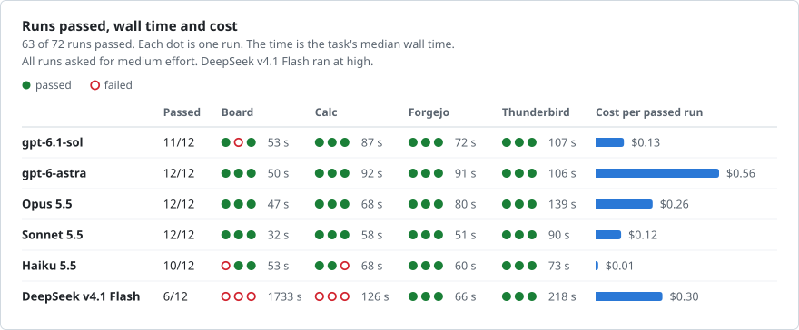
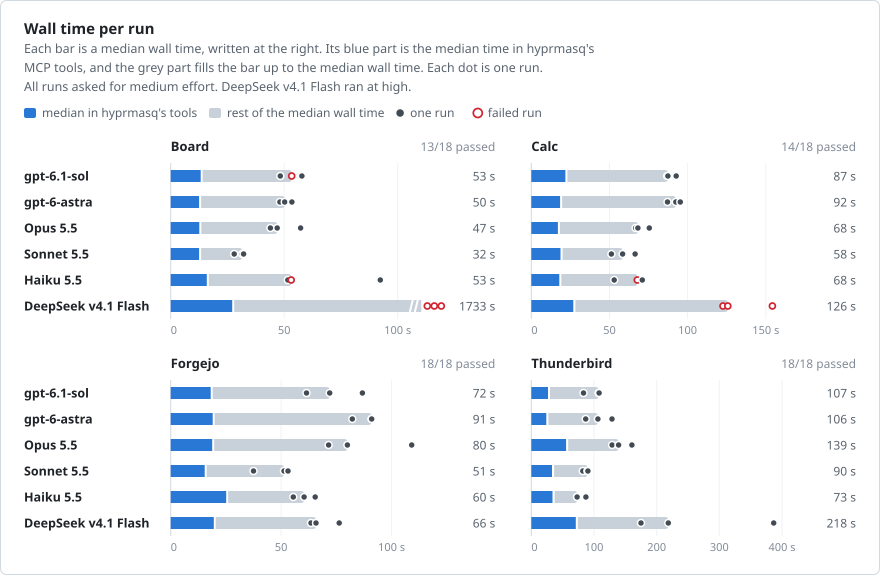
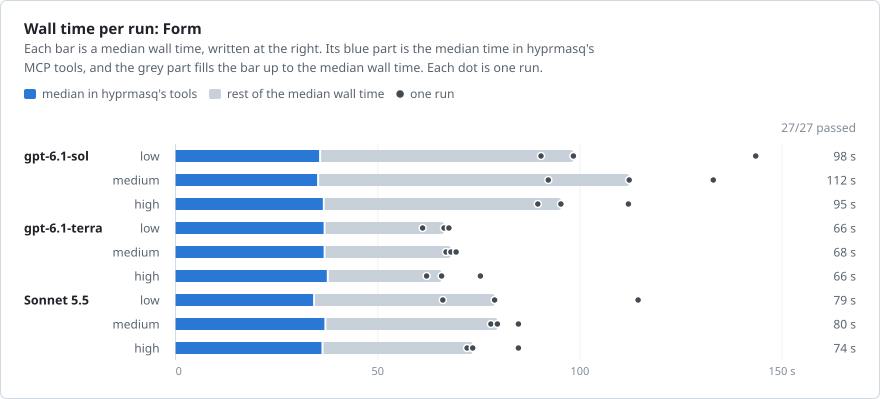
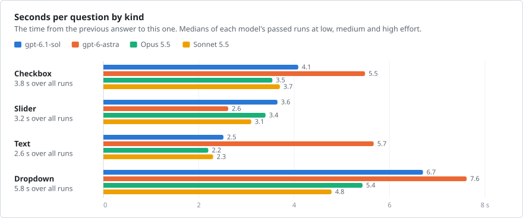
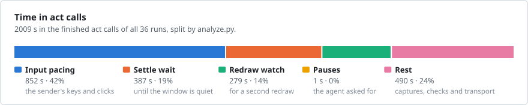

# Benchmarks

The benchmark measures how well coding agents work through `hyprmasq-mcp`.
Each run gives an agent a task in an offline NixOS VM, such as answering a
mail in Thunderbird or uploading a file to a Forgejo repository in a browser.
The agent's window sits on a hidden workspace while the user's own work stays
on the visible one. In the browser task, the user keeps typing into another
window of the same browser. The agent can use only hyprmasq's MCP tools. The
benchmark grades the result from the VM's state, times every call from both
sides of the MCP connection, and asks the agent afterwards where hyprmasq
slowed it down. [bench/README.md](../bench/README.md) describes the tasks, the
setup and how to run it.

## How the runs are read

A change is judged by what the agents did before and after it, from the MCP
log, the agent's transcript and Hyprland's events in the VM:

- whether the task passed, wall time, number of calls, time spent in tools
  and hyprmasq's own share of it
- extra looks: a `screenshot`, or an `act` without actions, right after a
  result that did not show the agent what it needed
- misses: input whose result shows no change, a wrong target, or a way back
  from a wrong page or entry
- the model's time from a result to its next call.

The agent's debrief points to where to look in the logs. It is no evidence
on its own: an agent knows only the run it had, and cannot compare it with a

The figures and tables below are generated from the run data in
[benchmarks/data](benchmarks/data). [Updating the results](#updating-the-results)
describes how.

## Release 0.1.0

Six agents ran four tasks three times each with hyprmasq 0.1.0. All asked for `medium`
effort. pi ran DeepSeek at `high`, the lowest level its model configuration supports.

In all 72 runs, the user's focus and visible workspace stayed unchanged, and no window
opened on the user's workspace. All 18 Forgejo checks preserved the user's typed notes.
The benchmark did not measure the clipboard.

<!-- render release-0.1.0 scoreboard -->
<picture>
  <source media="(prefers-color-scheme: dark)" srcset="benchmarks/release-0.1.0-scoreboard-dark.svg">
  
</picture>
<!-- /render -->

<!-- render release-0.1.0 time -->
<picture>
  <source media="(prefers-color-scheme: dark)" srcset="benchmarks/release-0.1.0-time-dark.svg">
  
</picture>
<!-- /render -->

- Sonnet 5.5 had the shortest median wall time on board, calc and forgejo. Haiku 5.5 had
  it on thunderbird.
- Sonnet passed all 12 runs at $0.12 a passed run. Haiku cost a cent a passed run and
  failed two runs on its own target errors.
- The median time in hyprmasq's tools was 12–27 s a run on board, calc and forgejo, and
  24–71 s on thunderbird. That is at most 46% of an agent's median wall time. The rest
  is the model's and the harness's time.
- All six DeepSeek runs of board and calc ended at the provider's limit of 64 images a
  request. They count as failed, including one Calc run whose saved sheet passed the
  VM's check.

### Board

Place nine labels on a motherboard photo in Firefox, using HTML5 drag-and-drop.

- The 150 drags were 140 correct drops and 10 target errors of the models. None was
  hyprmasq's. Haiku repetition 1 left SATA ports off its part. gpt-6.1-sol repetition 2
  misplaced CPU power headers and M.2 slots. The other target errors were corrected
  during their runs.
- All three DeepSeek runs ended at the provider's 64-image limit with 65 images, after 65,
  61 and 57 calls. They placed 0, 1 and 5 labels correctly. They count as failed and were
  not retried.

<!-- render release-0.1.0 table board -->
<details><summary>Numbers</summary>

| Agent | Effort | Passed | Wall s | In tools s | Turn s | Calls | Actions | Images | Input k | Cached % | Output k | Cost $ |
| --- | --- | --- | --- | --- | --- | --- | --- | --- | --- | --- | --- | --- |
| gpt-6.1-sol | medium | 2/3 | 53 (48–58) | 13 (12–13) | 6.0 (5.1–7.1) | 6 (5–6) | 9 (9–9) | 8 (7–8) | 119 (101–119) | 82 (77–86) | 1 (1–1) | 0.055 (0.054–0.073) |
| gpt-6-astra | medium | 3/3 | 50 (48–53) | 12 (12–12) | 6.2 (5.7–6.3) | 5 (5–5) | 9 (9–9) | 7 (7–8) | 101 (100–101) | 82 (82–89) | 1 (1–1) | 0.304 (0.231–0.305) |
| Opus 5.5 | medium | 3/3 | 47 (44–57) | 13 (12–13) | 6.4 (6.0–6.9) | 5 (4–6) | 9 (9–9) | 6 (5–7) | 55 (53–84) | 74 (73–81) | 2 (2–3) | 0.124 (0.118–0.153) |
| Sonnet 5.5 | medium | 3/3 | 32 (28–32) | 12 (12–13) | 3.1 (2.4–4.7) | 4 (4–5) | 9 (9–10) | 9 (8–11) | 52 (52–53) | 74 (74–74) | 1 (1–1) | 0.051 (0.048–0.053) |
| Haiku 5.5 | medium | 2/3 | 53 (52–92) | 16 (15–27) | 2.9 (2.5–4.6) | 9 (7–21) | 11 (9–15) | 12 (10–30) | 164 (115–439) | 85 (82–93) | 5 (5–9) | 0.007 (0.006–0.012) |
| DeepSeek v4.1 Flash | medium, ran high | 0/3 | 1733 (624–1741) | 27 (19–43) | 17.6 (11.1–28.3) | 61 (57–65) | 26 (17–38) | 65 (65–65) | 1906 (1210–1956) | 95 (93–95) | 40 (33–59) | 0.345 (0.237–0.382) |

</details>
<!-- /render -->

### Calc

Read five intranet reports in Firefox, then fill, calculate and save a LibreOffice sheet.

- Haiku repetition 3 selected E14 and saved the summary formulas in E14 and E15 instead
  of B14 and B15. The input reached the cells it targeted. The model chose the wrong
  column.
- DeepSeek hit the 64-image limit in all three runs, at 65 images and 28 calls, 65 and 30,
  and 69 and 31. Repetitions 1 and 3 left the sheet unsaved. Repetition 2 saved a correct
  sheet before the limit ended the run. The VM's check passes it, but it counts as failed
  here, which makes DeepSeek 0/3.
- One Sonnet run requested `triple_click`, which act does not support. The server refused
  it without sending input. The model recovered and passed.

<!-- render release-0.1.0 table calc -->
<details><summary>Numbers</summary>

| Agent | Effort | Passed | Wall s | In tools s | Turn s | Calls | Actions | Images | Input k | Cached % | Output k | Cost $ |
| --- | --- | --- | --- | --- | --- | --- | --- | --- | --- | --- | --- | --- |
| gpt-6.1-sol | medium | 3/3 | 87 (87–93) | 22 (20–23) | 3.4 (3.2–4.2) | 17 (16–17) | 31 (28–36) | 23 (21–27) | 327 (301–328) | 88 (84–92) | 2 (2–2) | 0.127 (0.102–0.140) |
| gpt-6-astra | medium | 3/3 | 92 (87–95) | 18 (17–19) | 3.7 (3.7–4.4) | 16 (15–16) | 19 (18–23) | 19 (17–20) | 279 (275–303) | 93 (93–94) | 2 (2–2) | 0.546 (0.539–0.570) |
| Opus 5.5 | medium | 3/3 | 68 (67–76) | 17 (16–18) | 3.2 (3.0–3.4) | 16 (13–17) | 15 (14–18) | 15 (12–16) | 234 (225–261) | 88 (88–89) | 4 (3–4) | 0.254 (0.247–0.264) |
| Sonnet 5.5 | medium | 3/3 | 58 (51–66) | 19 (19–20) | 2.4 (2.1–2.5) | 14 (13–16) | 16 (16–24) | 14 (14–15) | 221 (196–278) | 88 (87–89) | 3 (3–4) | 0.118 (0.111–0.139) |
| Haiku 5.5 | medium | 2/3 | 68 (53–71) | 18 (18–22) | 1.9 (1.5–2.3) | 17 (17–19) | 15 (15–28) | 19 (14–31) | 358 (299–375) | 91 (88–91) | 7 (6–7) | 0.011 (0.010–0.011) |
| DeepSeek v4.1 Flash | medium, ran high | 0/3 | 126 (123–154) | 27 (27–32) | 3.1 (2.5–3.4) | 30 (28–31) | 71 (64–79) | 65 (65–69) | 523 (450–565) | 88 (88–89) | 10 (9–11) | 0.106 (0.093–0.112) |

</details>
<!-- /render -->

### Forgejo

Upload a file in Chromium and connect a release dashboard through an OAuth popup.

- All 18 runs uploaded the correct file in one commit with the required message, and
  connected the dashboard to the account.
- In 17 of 18 runs, the GTK portal file chooser mapped 0.36–0.72 s after the `act` that
  opened it had returned. The result did not report the chooser, so the agent needed a
  separate window lookup. This was hyprmasq's recurring cost in this task.
- Haiku repetition 1 recovered from a `stale_shot` refusal. Haiku repetition 2 added 15 s
  of pause actions, which count as tool time.

<!-- render release-0.1.0 table forgejo -->
<details><summary>Numbers</summary>

| Agent | Effort | Passed | Wall s | In tools s | Turn s | Calls | Actions | Images | Input k | Cached % | Output k | Cost $ |
| --- | --- | --- | --- | --- | --- | --- | --- | --- | --- | --- | --- | --- |
| gpt-6.1-sol | medium | 3/3 | 72 (62–87) | 18 (18–21) | 3.0 (2.4–3.7) | 15 (15–17) | 22 (22–22) | 26 (26–28) | 305 (305–349) | 88 (88–89) | 2 (2–2) | 0.115 (0.114–0.124) |
| gpt-6-astra | medium | 3/3 | 91 (82–91) | 19 (19–19) | 3.5 (3.5–3.9) | 16 (16–16) | 21 (21–21) | 24 (20–28) | 331 (328–332) | 93 (91–93) | 2 (2–2) | 0.609 (0.606–0.676) |
| Opus 5.5 | medium | 3/3 | 80 (72–109) | 19 (19–24) | 3.3 (2.8–3.8) | 17 (16–22) | 22 (21–28) | 14 (14–26) | 304 (276–449) | 90 (89–92) | 3 (3–4) | 0.264 (0.254–0.338) |
| Sonnet 5.5 | medium | 3/3 | 51 (38–53) | 15 (15–16) | 2.3 (1.8–3.1) | 14 (11–16) | 19 (16–20) | 12 (9–14) | 194 (158–251) | 86 (86–88) | 2 (2–3) | 0.107 (0.087–0.122) |
| Haiku 5.5 | medium | 3/3 | 60 (56–65) | 25 (21–34) | 1.8 (1.4–2.1) | 21 (16–21) | 23 (20–39) | 16 (14–23) | 345 (295–409) | 91 (90–91) | 4 (3–4) | 0.009 (0.008–0.010) |
| DeepSeek v4.1 Flash | medium, ran high | 3/3 | 66 (64–76) | 20 (19–22) | 2.4 (2.2–2.5) | 18 (18–20) | 24 (23–27) | 20 (19–22) | 211 (203–246) | 86 (86–86) | 4 (3–5) | 0.043 (0.042–0.053) |

</details>
<!-- /render -->

### Thunderbird

Configure the mail account, find the answer in the inbox and reply to the right thread.

- All 18 runs sent one reply to the required recipient, in the right thread, with room
  4.12 in the answer. No run reached the image limit.
- Longer waits added to the tool time. Opus repetition 2 set quiet waits of 0.5–3 s on 18
  calls, 47.4 s of waiting in total. One call returned "still drawing" after 13.4 s with
  its input delivered, and the run passed. DeepSeek repetition 1 added 36.7 s
  of pause actions.

<!-- render release-0.1.0 table thunderbird -->
<details><summary>Numbers</summary>

| Agent | Effort | Passed | Wall s | In tools s | Turn s | Calls | Actions | Images | Input k | Cached % | Output k | Cost $ |
| --- | --- | --- | --- | --- | --- | --- | --- | --- | --- | --- | --- | --- |
| gpt-6.1-sol | medium | 3/3 | 107 (83–108) | 27 (23–28) | 3.0 (2.9–3.3) | 19 (18–21) | 30 (21–31) | 31 (24–33) | 459 (427–534) | 88 (88–89) | 2 (2–2) | 0.162 (0.154–0.198) |
| gpt-6-astra | medium | 3/3 | 106 (87–129) | 24 (21–29) | 3.7 (3.5–4.0) | 17 (15–21) | 24 (20–34) | 22 (19–28) | 389 (342–514) | 94 (89–94) | 2 (2–2) | 0.768 (0.703–0.891) |
| Opus 5.5 | medium | 3/3 | 139 (129–160) | 56 (46–70) | 3.9 (3.8–3.9) | 19 (19–22) | 35 (34–36) | 20 (20–22) | 446 (363–522) | 92 (90–93) | 5 (5–6) | 0.359 (0.345–0.397) |
| Sonnet 5.5 | medium | 3/3 | 90 (82–90) | 33 (33–35) | 2.3 (2.1–2.8) | 21 (20–24) | 30 (30–32) | 22 (21–25) | 434 (427–588) | 91 (91–93) | 4 (4–5) | 0.177 (0.174–0.208) |
| Haiku 5.5 | medium | 3/3 | 73 (73–87) | 34 (32–42) | 2.2 (1.8–2.2) | 17 (17–22) | 26 (23–26) | 21 (20–32) | 347 (343–488) | 91 (91–92) | 5 (4–6) | 0.009 (0.009–0.012) |
| DeepSeek v4.1 Flash | medium, ran high | 3/3 | 218 (175–387) | 71 (58–76) | 3.8 (3.0–5.7) | 35 (33–42) | 46 (35–54) | 41 (36–58) | 699 (557–980) | 91 (90–92) | 13 (8–14) | 0.133 (0.105–0.177) |

</details>
<!-- /render -->

### Tokens and cost

The 72 runs cost $14.62. Most of every prompt was read from the provider's cache, so the
cost follows the cache price more than the input price. Codex reported no cache writes,
so its estimate prices all uncached input at the input rate. Priced as cache writes, the
Codex runs would cost up to 16% more for gpt-6.1-sol and 10% more for gpt-6-astra.
DeepSeek used the most input because its board runs went on for up to 65 calls before
the image limit ended them.

<!-- render release-0.1.0 costs -->
<details><summary>Numbers</summary>

| Agent | Passed | Input M | Cached % | Output k | Cost $ | Cost per passed run $ |
| --- | --- | --- | --- | --- | --- | --- |
| gpt-6.1-sol | 11/12 | 3.67 | 88 | 20 | 1.42 | 0.13 |
| gpt-6-astra | 12/12 | 3.40 | 92 | 18 | 6.75 | 0.56 |
| Opus 5.5 | 12/12 | 3.27 | 90 | 43 | 3.12 | 0.26 |
| Sonnet 5.5 | 12/12 | 2.90 | 89 | 33 | 1.40 | 0.12 |
| Haiku 5.5 | 10/12 | 3.98 | 91 | 64 | 0.11 | 0.01 |
| DeepSeek v4.1 Flash | 6/12 | 9.51 | 92 | 209 | 1.83 | 0.30 |

</details>
<!-- /render -->

### Setup

hyprmasq 0.1.0 at commit
[9ae9280](https://github.com/nyrda/hyprmasq/commit/9ae92806c9f8de43e428b0bdba9b17fbaeafe48f),
run on 2026-10-19. The 72 runs ran one after another in offline VMs at `1920x1080@1`.
Board used its `dnd` variant. The host had an AMD Ryzen 7 5800X3D (8 cores, 16 threads)
and 31 GiB of memory. The VM draws in software, so wall time and time in tools depend on
the CPU.

- Codex with a ChatGPT login: `gpt-6.1-sol` and `gpt-6-astra`.
- Claude Code with an Anthropic API key, as `claude-api`: `claude-opus-5-5`,
  `claude-sonnet-5-5` and `claude-haiku-5-5`.
- pi with a TensorX API key: `tensorx/deepseek/deepseek-v4.1-flash-1017`.

The harness versions were Codex CLI 0.163.0, Claude Code 2.1.302 and pi 1.3.0. The whole
set took 4h 25m 46s, including builds, lock waits and debriefs. Agent wall time totalled
2h 46m 6s. No run was retried. pi retried one TensorX 504 inside the first board run by
itself and went on.

The tables show medians, with the range over three runs in brackets. Wall time excludes
VM boot and the debrief. In tools is the time inside MCP calls. Turn is the median gap
outside tool calls, which is the model's and the harness's time: from the agent's start
to its first call, between calls, and from the last result to the agent's exit.

Input k is the prompt tokens of all the run's requests in thousands, cache reads and
writes included. Cached % is the share of them read from the provider's cache. Output k
includes thinking. Cost $ is at list prices, without the debrief. For Claude Code and pi
it is the harness's own figure. The Codex runs used a ChatGPT subscription, so their cost
is what the same requests would have cost on OpenAI's API at its list prices on
2026-10-19.

## Form

The form task measures speed alone. A questionnaire in a native GTK 4 app has 25
questions, and each says its answer. Four kinds take turns: tick checkboxes, set a slider
to a number shown on its read-only value, type a given text, and choose in a dropdown.
Then the agent presses Submit. [bench/README.md](../bench/README.md#form) describes the
task. `--variant` sets 10 to 40 questions. The results here use the default of 25.

Four models ran at `low`, `medium` and `high` effort, three times each. All 36 runs
passed, with all 25 answers right and one submission each. No window other than the
questionnaire opened, and the user's focus and visible workspace stayed unchanged in all
36 runs. The 36 runs cost $12.60.

<!-- render form-25 time -->
<picture>
  <source media="(prefers-color-scheme: dark)" srcset="benchmarks/form-25-time-dark.svg">
  
</picture>
<!-- /render -->

- The questionnaire took 93 to 152 s at the medians. 51 to 65 s of that was in
  hyprmasq's tools, for every agent. The agents differ in the models' time outside the
  tools. Turn s ranges from 2.0 s (Sonnet, medium) to 5.5 s (gpt-6-astra, high).
- Every model was slowest at `high`. Higher effort was never faster, except for Sonnet,
  whose `medium` runs were faster than its `low` runs.

<!-- render form-25 kinds -->
<picture>
  <source media="(prefers-color-scheme: dark)" srcset="benchmarks/form-25-kinds-dark.svg">
  
</picture>
<!-- /render -->

- Dropdowns were the slowest kind for every agent. Agents opened a dropdown in one call,
  read the popover in the result, and chose in the next call.
- 203 of the 216 slider answers used the keyboard alone: Home or End, then arrow keys,
  with the step from the caption. 13 started with a click on the slider.

<!-- render form-25 act -->
<picture>
  <source media="(prefers-color-scheme: dark)" srcset="benchmarks/form-25-act-dark.svg">
  
</picture>
<!-- /render -->

- Key presses took the largest part of the time in `act`, through the sender's pacing of
  input.
- 12 of the 36 runs had one refused `act`. Each asked for a key `repeat` above the limit
  of 100, such as 147 presses for a slider. The server refused it before sending
  anything, and the agent split the presses.
- In the debriefs, 31 of 36 agents said that setting a slider or choosing in a dropdown
  by value would have made them fastest.

All right at s is the time after the agent's start when every answer on screen was first
right at once.

<!-- render form-25 table form -->
<details><summary>Numbers</summary>

| Agent | Effort | Passed | Wall s | In tools s | Turn s | Calls | Actions | Images | Input k | Cached % | Output k | Cost $ | All right at s |
| --- | --- | --- | --- | --- | --- | --- | --- | --- | --- | --- | --- | --- | --- |
| gpt-6.1-sol | low | 3/3 | 116 (93–141) | 53 (52–58) | 3.6 (2.3–4.2) | 15 (14–17) | 62 (59–81) | 29 (17–33) | 327 (293–364) | 91 (91–93) | 2 (2–2) | 0.106 (0.098–0.106) | 106 (86–122) |
| gpt-6.1-sol | medium | 3/3 | 121 (114–125) | 54 (50–54) | 4.0 (3.9–4.2) | 15 (14–16) | 77 (76–81) | 32 (24–38) | 320 (289–337) | 87 (85–90) | 2 (2–2) | 0.131 (0.116–0.140) | 109 (104–113) |
| gpt-6.1-sol | high | 3/3 | 122 (118–130) | 57 (53–65) | 3.7 (3.1–4.0) | 15 (14–19) | 71 (68–76) | 25 (14–41) | 301 (292–425) | 91 (86–93) | 2 (2–3) | 0.102 (0.090–0.182) | 113 (109–122) |
| gpt-6-astra | low | 3/3 | 131 (116–145) | 54 (53–54) | 4.6 (3.8–4.7) | 14 (14–17) | 60 (58–69) | 33 (33–36) | 304 (297–371) | 93 (87–94) | 2 (2–2) | 0.674 (0.585–0.752) | 117 (108–137) |
| gpt-6-astra | medium | 3/3 | 143 (131–167) | 51 (50–56) | 5.4 (4.8–6.6) | 14 (14–15) | 64 (62–73) | 18 (14–27) | 286 (282–313) | 89 (87–93) | 2 (2–2) | 0.710 (0.551–0.725) | 136 (127–155) |
| gpt-6-astra | high | 3/3 | 152 (144–165) | 55 (55–56) | 5.5 (5.2–5.5) | 18 (14–19) | 63 (61–76) | 17 (17–36) | 332 (293–387) | 91 (86–92) | 2 (2–2) | 0.768 (0.642–0.879) | 135 (129–142) |
| Opus 5.5 | low | 3/3 | 110 (106–112) | 54 (54–61) | 2.5 (2.5–3.4) | 17 (15–18) | 59 (57–69) | 28 (19–30) | 396 (311–425) | 93 (90–93) | 4 (4–4) | 0.372 (0.367–0.398) | 95 (91–97) |
| Opus 5.5 | medium | 3/3 | 110 (106–116) | 58 (57–62) | 2.6 (2.4–2.7) | 17 (16–19) | 66 (61–68) | 18 (16–23) | 397 (363–474) | 93 (93–94) | 4 (4–4) | 0.371 (0.355–0.419) | 97 (89–99) |
| Opus 5.5 | high | 3/3 | 122 (115–127) | 60 (60–64) | 2.4 (2.2–3.0) | 20 (19–22) | 59 (59–76) | 28 (17–41) | 494 (453–574) | 94 (94–94) | 4 (4–5) | 0.420 (0.407–0.467) | 101 (96–104) |
| Sonnet 5.5 | low | 3/3 | 101 (96–112) | 60 (57–61) | 2.4 (2.1–2.9) | 17 (15–17) | 61 (60–62) | 23 (22–27) | 361 (325–365) | 93 (93–93) | 4 (4–4) | 0.172 (0.164–0.179) | 87 (86–98) |
| Sonnet 5.5 | medium | 3/3 | 93 (86–96) | 55 (54–56) | 2.0 (1.9–2.0) | 17 (15–19) | 59 (58–61) | 21 (20–22) | 397 (295–414) | 93 (92–93) | 4 (3–4) | 0.186 (0.157–0.197) | 81 (73–86) |
| Sonnet 5.5 | high | 3/3 | 112 (106–121) | 65 (63–65) | 2.2 (1.9–3.0) | 19 (18–20) | 66 (65–77) | 32 (24–51) | 417 (410–481) | 93 (93–93) | 5 (4–5) | 0.203 (0.188–0.217) | 96 (90–99) |

</details>
<!-- /render -->

Seconds per question of each kind run from the previous final answer to this one.
Corrections are summed over all three runs (see `check.py` in
[bench/README.md](../bench/README.md#form)). Question 1 is a checkbox, so the checkbox
column includes the time from the agent's start to its first answer.

<!-- render form-25 kinds-table -->
<details><summary>Numbers</summary>

| Agent | Effort | Checkbox s | Slider s | Text s | Dropdown s | Corrections |
| --- | --- | --- | --- | --- | --- | --- |
| gpt-6.1-sol | low | 5.0 (4.2–5.3) | 3.7 (2.5–4.2) | 1.2 (1.2–2.1) | 6.7 (4.0–10.2) | 0 |
| gpt-6.1-sol | medium | 3.6 (2.8–4.1) | 3.6 (2.6–4.8) | 3.5 (1.2–6.0) | 7.1 (5.6–8.2) | 1 |
| gpt-6.1-sol | high | 3.8 (3.4–6.7) | 3.2 (2.7–3.7) | 4.9 (2.5–7.3) | 5.5 (5.1–6.7) | 4 |
| gpt-6-astra | low | 6.4 (3.1–7.1) | 2.6 (2.6–2.7) | 4.8 (2.2–5.7) | 7.4 (5.7–7.6) | 1 |
| gpt-6-astra | medium | 5.5 (4.4–5.5) | 2.8 (2.1–4.0) | 5.7 (3.8–7.6) | 8.3 (8.0–9.8) | 3 |
| gpt-6-astra | high | 4.6 (3.4–8.4) | 2.6 (2.5–3.3) | 6.8 (2.4–7.7) | 7.5 (7.0–9.2) | 3 |
| Opus 5.5 | low | 5.1 (2.9–5.4) | 3.4 (2.6–4.6) | 2.2 (2.0–3.1) | 4.2 (4.2–5.5) | 0 |
| Opus 5.5 | medium | 3.1 (2.4–4.0) | 4.6 (3.4–5.3) | 2.1 (2.0–4.1) | 5.1 (4.5–5.9) | 2 |
| Opus 5.5 | high | 3.5 (3.3–3.7) | 3.4 (3.2–4.7) | 2.8 (2.1–4.0) | 6.0 (5.4–6.7) | 0 |
| Sonnet 5.5 | low | 3.2 (2.9–3.7) | 3.1 (3.1–3.2) | 2.5 (1.9–2.7) | 5.8 (5.6–6.3) | 3 |
| Sonnet 5.5 | medium | 3.9 (2.7–5.3) | 2.6 (2.5–3.0) | 1.9 (1.2–2.7) | 4.2 (3.8–4.7) | 0 |
| Sonnet 5.5 | high | 3.7 (2.4–3.8) | 4.6 (4.1–4.8) | 2.3 (1.9–3.1) | 4.8 (4.7–5.9) | 3 |

</details>
<!-- /render -->

### Setup

hyprmasq's plugin and server at commit
[ea3d206](https://github.com/nyrda/hyprmasq/commit/ea3d206), which the form task does not
change. The task itself is at its branch's commit `144e845`. Run on 2026-10-21: 36 runs
one after another in offline VMs at `1920x1080@1`, on the same host as the release
results. A game was running on the host for at least part of the runs, so wall time and
time in tools may be somewhat longer than on an idle host.

- Codex with a ChatGPT login: `gpt-6.1-sol` and `gpt-6-astra`.
- Claude Code with a claude.ai login: `claude-opus-5-5` and `claude-sonnet-5-5`.

Every run ran at the effort it asked for, by the harnesses' own records. The harness
versions were Codex CLI 0.163.0 and Claude Code 2.1.304. Both logins are subscriptions.
Cost $ is Claude Code's own figure for the Anthropic API, and for Codex what the same
requests would cost on OpenAI's API at its list prices. The set took 1h 39m from the
first agent's start to the last one's end. Agent wall time totalled 1h 12m, 34m of it in
tools.

## Updating the results

[benchmarks/data](benchmarks/data) holds one JSON file per set of runs, with one run a
line. `bench/export.py` writes such a file from the results directories that
`bench/run.py` filled. It leaves out transcripts, answers, paths, host names and
accounts:

```sh
python3 bench/export.py --out docs/benchmarks/data/release-0.2.0.json \
  --fail calc/RUN="ended at the provider's limit of 64 images" \
  bench/results/release-0.2.0/board-dnd bench/results/release-0.2.0/calc
```

`--fail` counts a run as failed although the VM's check passed it, and records the
reason. `python3 bench/render.py` generates each block of this page between
`<!-- render DATASET VIEW [TASK] -->` and `<!-- /render -->` from a dataset. It also
writes the figures in [benchmarks](benchmarks), one for GitHub's light theme and one for
its dark theme. Its docstring lists the views. CI runs `python3 bench/render.py --check`,
which fails when the page or a figure no longer matches the data.
