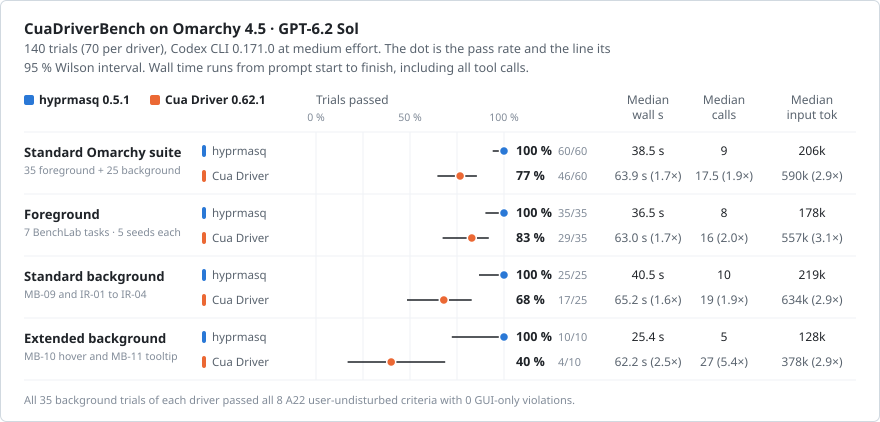
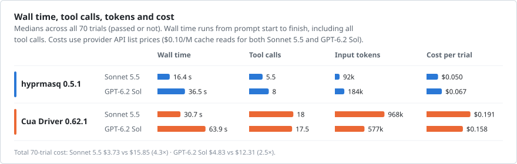
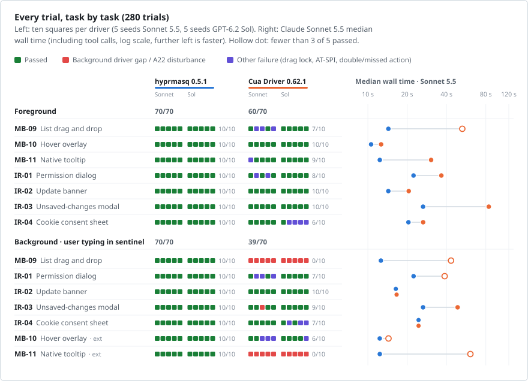
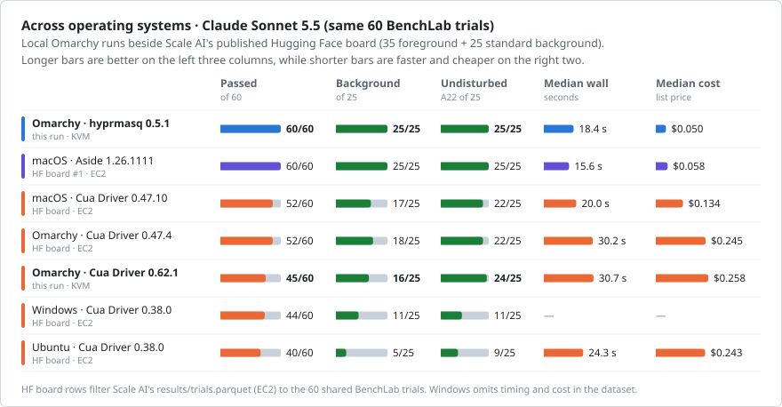

# CuaDriverBench on Omarchy

hyprmasq 0.5.1 beside [Cua Driver](https://github.com/trycua/cua) 0.62.1 inside Scale AI's
[CuaDriverBench-AgentEnv](https://huggingface.co/spaces/earakely-scale/CuaDriverBench-AgentEnv) harness on Omarchy 4.5
(Hyprland `0.56.2-1`, 1920×1080, KVM). Both drivers ran the canonical 60-trial Omarchy suite (all seven Linux BenchLab
tasks `MB-09`–`MB-11` and `IR-01`–`IR-04` in foreground, plus `MB-09` and `IR-01`–`IR-04` in background, five seeds
each) together with 10 author-added extended background trials (`MB-10` and `MB-11`, five seeds each) across two
models: **Claude Sonnet 5.5** (`tools = "driver"` on both drivers, matching Scale AI's headline Omarchy setup) and
**GPT-6.2 Sol** — 240 standard trials plus 40 extended trials (**280 trials total**), graded by trycua's evaluators,
GUI-only checks and A22 user-undisturbed sentinel under Scale AI's upstream pass rule.

<picture>
  <source media="(prefers-color-scheme: dark)" srcset="comparison-cua-driver-bench/scorecard-dark.svg">
  
</picture>

- **Standard 60-trial Omarchy suite (240 trials):** hyprmasq passed **120/120 (100.0 %)** (**60/60** Sonnet 5.5,
  **60/60** GPT-6.2 Sol) against **93/120 (77.5 %)** for Cua Driver 0.62.1 (**45/60** Sonnet, **48/60** Sol). Including
  the 40 extended `MB-10`/`MB-11` background trials (**20/20** vs **6/20**), totals are **140/140 (100.0 %)** vs
  **99/140 (70.7 %)** (**47/70** Sonnet, **52/70** Sol).
- **The user (A22 background isolation):** hyprmasq passed **70/70** background trials (**50/50** standard, **20/20**
  extended) with **70/70** undisturbed across all eight A22 criteria and 0 GUI-only violations in the tested
  `virtual_cursor = false` configuration. Cua Driver passed **39/70 (55.7 %)** background trials (**33/50** standard,
  **6/20** extended), failed `MB-09` (`0/10`) and `MB-11` (`0/10`) on every background run, and disturbed the user in
  **4/35** Sonnet background trials (`MB-11` r2–r4 and `IR-03` r3).
- **Time and cost (provider API list prices):** on the standard 60-trial suite, Cua Driver took **1.7×** the median
  wall time on both models (`30.7 s` vs `18.4 s` Sonnet, `63.9 s` vs `38.5 s` Sol), **1.9–3.0×** the tool calls (`18.0`
  vs `6.0` Sonnet, `17.5` vs `9.0` Sol) and **2.3–3.7×** the median cost (`$0.197` vs `$0.053` Sonnet, `$0.159` vs
  `$0.069` Sol). Across all 70 trials, Cua Driver took **1.75–1.87×** the median wall time, **2.19–3.27×** the tool
  calls and **2.38–3.80×** the median cost.

hyprmasq's author ran these trials locally with Scale AI's published harness and graders on unmodified `hyprmasq v0.5.1`.
See [Method](#method) for setup effects, pricing, stopping rules, pre-turn retries and
[all 280 trial records](../bench/cua-driver-bench/data).

## What a run costs

<picture>
  <source media="(prefers-color-scheme: dark)" srcset="comparison-cua-driver-bench/usage-dark.svg">
  
</picture>

- **Cost (all 70 trials, provider list prices):** median `$0.050` Sonnet / `$0.067` Sol for hyprmasq (`$3.73` / `$4.83`
  total) against `$0.191` / `$0.158` for Cua Driver (`$15.85` / `$12.31` total, **3.80×** / **2.38×** median, **4.25×**
  / **2.55×** mean, and **3.08×** / **2.51×** paired geometric mean across common passed cells). On Claude Sonnet 5.5,
  AgentEnv's default `ENABLE_TOOL_SEARCH=false` sends all 65 Cua tool schemas eagerly on every turn (see
  [Method](#method)).
- **Wall time and tool calls:** `16.4 s` and `5.5` calls (Sonnet) or `36.5 s` and `8.0` calls (Sol) for hyprmasq
  (`18.4 s` / `38.5 s` on the standard 60 suite), against `30.7 s` / `18.0` calls (**1.87×** / **3.27×**, paired
  **1.52×** / **2.30×**) and `63.9 s` / `17.5` calls (**1.75×** / **2.19×**, paired **1.86×** / **2.12×**).
- **Input tokens:** `92k` Sonnet / `184k` Sol for hyprmasq against `968k` (**10.55×**, paired **7.88×**) and `577k`
  (**3.13×**, paired **3.12×**) for Cua Driver. Medians cover all 70 trials (passed or failed), and 7 Cua Driver Sol
  runs that hit the 45-tool-call cap had usage marked `partial` by AgentEnv.

Suite breakdown by model

**Claude Sonnet 5.5 (`tools = "driver"` on both drivers, Anthropic API list prices)**

| Driver | Suite | Passed | User undisturbed (A22) | Median wall s | Median calls | Median input | Median uncached | Median output | Median cost | Mean cost |
| --- | --- | --- | --- | --- | --- | --- | --- | --- | --- | --- |
| hyprmasq 0.5.1 | Foreground (35) | 35/35 (100.0%) | - | 14.4 | 5.0 | 91k | 9k | 728 | $0.050 | $0.054 |
| hyprmasq 0.5.1 | Standard background (25) | 25/25 (100.0%) | 25/25 | 20.5 | 6.0 | 110k | 10k | 879 | $0.061 | $0.061 |
| hyprmasq 0.5.1 | Standard Omarchy suite (60) | 60/60 (100.0%) | 25/25 | 18.4 | 6.0 | 108k | 9k | 809 | $0.053 | $0.057 |
| hyprmasq 0.5.1 | Extended background MB-10/11 (10) | 10/10 (100.0%) | 10/10 | 12.3 | 3.5 | 63k | 6k | 440 | $0.031 | $0.031 |
| hyprmasq 0.5.1 | All trials (70) | 70/70 (100.0%) | 35/35 | 16.4 | 5.5 | 92k | 9k | 730 | $0.050 | $0.053 |
| Cua Driver 0.62.1 | Foreground (35) | 29/35 (82.9%) | - | 30.5 | 16.0 | 921k | 17k | 2,148 | $0.184 | $0.220 |
| Cua Driver 0.62.1 | Standard background (25) | 16/25 (64.0%) | 24/25 | 32.7 | 18.0 | 1,095k | 17k | 3,032 | $0.214 | $0.240 |
| Cua Driver 0.62.1 | Standard Omarchy suite (60) | 45/60 (75.0%) | 24/25 | 30.7 | 18.0 | 997k | 17k | 2,389 | $0.197 | $0.228 |
| Cua Driver 0.62.1 | Extended background MB-10/11 (10) | 2/10 (20.0%) | 7/10 | 26.7 | 12.5 | 686k | 13k | 2,268 | $0.139 | $0.215 |
| Cua Driver 0.62.1 | All trials (70) | 47/70 (67.1%) | 31/35 | 30.7 | 18.0 | 968k | 17k | 2,389 | $0.191 | $0.226 |

**GPT-6.2 Sol (OpenAI API list prices)**

| Driver | Suite | Passed | User undisturbed (A22) | Median wall s | Median calls | Median input | Median uncached | Median output | Median cost | Mean cost |
| --- | --- | --- | --- | --- | --- | --- | --- | --- | --- | --- |
| hyprmasq 0.5.1 | Foreground (35) | 35/35 (100.0%) | - | 36.5 | 8.0 | 178k | 20k | 501 | $0.066 | $0.065 |
| hyprmasq 0.5.1 | Standard background (25) | 25/25 (100.0%) | 25/25 | 40.5 | 10.0 | 219k | 23k | 561 | $0.071 | $0.078 |
| hyprmasq 0.5.1 | Standard Omarchy suite (60) | 60/60 (100.0%) | 25/25 | 38.5 | 9.0 | 206k | 22k | 527 | $0.069 | $0.071 |
| hyprmasq 0.5.1 | Extended background MB-10/11 (10) | 10/10 (100.0%) | 10/10 | 25.4 | 5.0 | 128k | 22k | 407 | $0.057 | $0.059 |
| hyprmasq 0.5.1 | All trials (70) | 70/70 (100.0%) | 35/35 | 36.5 | 8.0 | 184k | 22k | 504 | $0.067 | $0.069 |
| Cua Driver 0.62.1 | Foreground (35) | 31/35 (88.6%) | - | 63.0 | 16.0 | 557k | 47k | 1,310 | $0.158 | $0.171 |
| Cua Driver 0.62.1 | Standard background (25) | 17/25 (68.0%) | 25/25 | 65.2 | 19.0 | 634k | 51k | 1,497 | $0.177 | $0.194 |
| Cua Driver 0.62.1 | Standard Omarchy suite (60) | 48/60 (80.0%) | 25/25 | 63.9 | 17.5 | 590k | 48k | 1,386 | $0.159 | $0.181 |
| Cua Driver 0.62.1 | Extended background MB-10/11 (10) | 4/10 (40.0%) | 10/10 | 62.2 | 27.0 | 378k | 40k | 1,396 | $0.131 | $0.146 |
| Cua Driver 0.62.1 | All trials (70) | 52/70 (74.3%) | 35/35 | 63.9 | 17.5 | 577k | 44k | 1,386 | $0.158 | $0.176 |

## Task by task

<picture>
  <source media="(prefers-color-scheme: dark)" srcset="comparison-cua-driver-bench/tasks-dark.svg">
  
</picture>

- **Background pointer tasks:** hyprmasq passed `10/10` on `MB-09` (Wayland drag-and-drop), `10/10` on `MB-10` (hover
  overlay) and `10/10` on `MB-11` (native tooltip) without touching the user's focus or pointer. Upstream omits `MB-10`
  and `MB-11` from background mode because native hover and tooltip interactions normally rely on the shared pointer. In
  practice Cua Driver passed `6/10` on `MB-10` background undisturbed via synthetic hover and AT-SPI, while failing
  `0/10` on `MB-11` background because GTK3 popup tooltips do not appear in its background capture.
- **Foreground:** hyprmasq passed `35/35` on both models, while Cua Driver passed `29/35` on Sonnet 5.5 (failing
  `MB-09`, `IR-01` and `MB-11`) and `31/35` on GPT-6.2 Sol (failing `IR-04` four times, with two `IR-02` passes also
  hitting Codex's 45-tool-call cap after completing the task).
- **Wall time:** `wall_seconds` is quantized in ~`2.0 s` polling steps. On Sonnet 5.5, hyprmasq was faster in 12 of 14
  task-condition cells (`10.6–26.5 s`) and tied within polling resolution on `IR-02` (`16.4 s` vs `16.6 s`) and `IR-04`
  (`24.4 s` vs `24.5 s`) background. On GPT-6.2 Sol, hyprmasq was faster in all 14 cells (`18.7–50.6 s`).

Numbers: Claude Sonnet 5.5

Each cell shows passed trials out of 5, followed by median wall time, median tool calls and median Anthropic list-price
cost across all five seeds (`r1`–`r5`).

| Condition | Task | hyprmasq 0.5.1 | Cua Driver 0.62.1 |
| --- | --- | --- | --- |
| foreground | `MB-09` List drag and drop | 5/5 (14.4 s, 5 calls, $0.043) | 2/5 (52.9 s, 35 calls, $0.319) |
| foreground | `MB-10` Hover overlay | 5/5 (10.6 s, 4 calls, $0.036) | 5/5 (12.6 s, 6 calls, $0.073) |
| foreground | `MB-11` Native tooltip | 5/5 (12.3 s, 4 calls, $0.031) | 4/5 (30.5 s, 15 calls, $0.182) |
| foreground | `IR-01` Permission dialog | 5/5 (22.4 s, 8 calls, $0.067) | 3/5 (36.5 s, 24 calls, $0.229) |
| foreground | `IR-02` Update banner | 5/5 (14.3 s, 5 calls, $0.050) | 5/5 (20.6 s, 9 calls, $0.119) |
| foreground | `IR-03` Unsaved-changes modal | 5/5 (26.5 s, 10 calls, $0.084) | 5/5 (84.3 s, 35 calls, $0.421) |
| foreground | `IR-04` Cookie consent sheet | 5/5 (20.4 s, 9 calls, $0.066) | 5/5 (26.5 s, 16 calls, $0.167) |
| background | `MB-09` List drag and drop | 5/5 (12.6 s, 4 calls, $0.041) | 0/5 (43.3 s, 22 calls, $0.215) |
| background | `IR-01` Permission dialog | 5/5 (22.4 s, 8 calls, $0.061) | 2/5 (38.7 s, 26 calls, $0.297) |
| background | `IR-02` Update banner | 5/5 (16.4 s, 6 calls, $0.050) | 5/5 (16.6 s, 10 calls, $0.113) |
| background | `IR-03` Unsaved-changes modal | 5/5 (26.5 s, 9 calls, $0.078) | 4/5 (48.7 s, 32 calls, $0.342) |
| background | `IR-04` Cookie consent sheet | 5/5 (24.4 s, 9 calls, $0.067) | 5/5 (24.5 s, 16 calls, $0.164) |
| background | `MB-10` Hover overlay (ext) | 5/5 (12.3 s, 4 calls, $0.036) | 2/5 (14.4 s, 7 calls, $0.086) |
| background | `MB-11` Native tooltip (ext) | 5/5 (12.3 s, 3 calls, $0.031) | 0/5 (61.0 s, 29 calls, $0.372) |

Numbers: GPT-6.2 Sol

Each cell shows passed trials out of 5, followed by median wall time, median tool calls and median OpenAI list-price
cost across all five seeds (`r1`–`r5`). On Cua Driver `IR-02` foreground, `r4` and `r5` passed both upstream verifiers
(`task_score: 1.0`, `gui_only: true`) before hitting Codex's 45-tool-call cap.

| Condition | Task | hyprmasq 0.5.1 | Cua Driver 0.62.1 |
| --- | --- | --- | --- |
| foreground | `MB-09` List drag and drop | 5/5 (24.4 s, 4 calls, $0.045) | 5/5 (66.8 s, 15 calls, $0.134) |
| foreground | `MB-10` Hover overlay | 5/5 (18.7 s, 3 calls, $0.048) | 5/5 (34.5 s, 5 calls, $0.091) |
| foreground | `MB-11` Native tooltip | 5/5 (22.4 s, 4 calls, $0.055) | 5/5 (44.6 s, 9 calls, $0.160) |
| foreground | `IR-01` Permission dialog | 5/5 (50.6 s, 12 calls, $0.070) | 5/5 (80.8 s, 20 calls, $0.172) |
| foreground | `IR-02` Update banner | 5/5 (36.5 s, 8 calls, $0.069) | 5/5 (127.7 s, 34 calls, $0.294) |
| foreground | `IR-03` Unsaved-changes modal | 5/5 (46.5 s, 11 calls, $0.071) | 5/5 (62.7 s, 19 calls, $0.134) |
| foreground | `IR-04` Cookie consent sheet | 5/5 (42.6 s, 10 calls, $0.072) | 1/5 (63.0 s, 16 calls, $0.138) |
| background | `MB-09` List drag and drop | 5/5 (30.4 s, 5 calls, $0.054) | 0/5 (137.5 s, 24 calls, $0.309) |
| background | `IR-01` Permission dialog | 5/5 (44.6 s, 10 calls, $0.070) | 5/5 (70.9 s, 19 calls, $0.225) |
| background | `IR-02` Update banner | 5/5 (34.5 s, 9 calls, $0.077) | 5/5 (60.6 s, 13 calls, $0.181) |
| background | `IR-03` Unsaved-changes modal | 5/5 (50.6 s, 12 calls, $0.071) | 5/5 (65.2 s, 19 calls, $0.152) |
| background | `IR-04` Cookie consent sheet | 5/5 (40.9 s, 10 calls, $0.075) | 2/5 (52.6 s, 13 calls, $0.127) |
| background | `MB-10` Hover overlay (ext) | 5/5 (22.4 s, 3 calls, $0.060) | 4/5 (40.5 s, 7 calls, $0.106) |
| background | `MB-11` Native tooltip (ext) | 5/5 (28.4 s, 5 calls, $0.052) | 0/5 (93.4 s, 45 calls, $0.176) |

## Why runs failed

hyprmasq passed all 140 trials with zero failures. Under Scale AI's upstream pass rule, Cua Driver 0.62.1 failed **41
of 140** trials (23 on Claude Sonnet 5.5, 18 on GPT-6.2 Sol). Nearly half (20/41) are Wayland background failures on
`MB-09` (GTK3 drag-and-drop, `0/10`) and `MB-11` (uncomposited popup tooltips, `0/10`), and three more are a foreground
drag-lock bug in `MB-09` under `tools = "driver"`. Every failed trial's final BenchLab state, failed grader checks, A22
criteria and final message live in [bench/cua-driver-bench/data](../bench/cua-driver-bench/data).

All 41 failures by task

- **`MB-09` background (0/10 across both models, Wayland background drag limitation):** Every trial passed
  `hyprctl cua:status` (`configured`, `abi.match`, `transport.ready`) before starting, yet every background drag on both
  Sonnet 5.5 (`0/5`) and GPT-6.2 Sol (`0/5`) started GTK3 drags (`drag_begins: 1` to `9`) and dropped **zero** rows
  (`move_count: 0`). On Sonnet `r3`, manual press-and-hold also reported `"no native Wayland toplevel"` and missing
  multi-pointer socket support. Both models kept the user undisturbed and reported `BLOCKED` on all 10 trials. Scale
  AI's Omarchy notes for Cua Driver 0.47.4 reported the same `MB-09` background failure, and it remains unresolved in
  `0.62.1`. hyprmasq runs Wayland `wl_data_device` drag-and-drop privately inside unfocused windows and passed `10/10`.
- **`MB-11` background (0/10 across both models, popup tooltip capture limitation):** GTK3 draws tooltips on separate
  popup surfaces that Cua Driver's Hyprland background capture does not composite, and BenchLab's dynamic
  `query-tooltip` text is absent from the static AT-SPI tree. With GPT-6.2 Sol, all five trials hit Codex's
  45-tool-call cap (14–22 model calls) with zero submits. With Claude Sonnet 5.5, `r1` and `r5` ended with `BLOCKED`
  undisturbed, `r4` ended with `BLOCKED` after disturbing A22, and `r2` and `r3` passed BenchLab's task checks
  (`task_passed: true`, `failed_checks: null`) via foreground pointer fallback but failed A22 on `key_focus`, `typing`,
  `pointer` and `activation`. hyprmasq composites popup surfaces into its offscreen screenshot and holds a per-window
  pointer lease, passing `10/10` undisturbed.
- **`MB-09` foreground on Sonnet 5.5 with `tools = "driver"` (2/5, driver bug):** On `r2`, `r3` and `r5`, Cua Driver
  0.62.1's own drag posted without moving any row (`drag_begins: 2`, `move_count: 0`) and left BenchLab stuck in a drag
  state, causing subsequent clicks, key presses and drags to be refused with `primary_target_busy` or `foreground_dnd`.
  Together with the two `IR-01` foreground failures below, this explains most of the local `0.62.1` foreground drop
  (`29/35`) relative to Scale AI's `0.47.4` board (`34/35`).
- **`IR-01` on Sonnet 5.5 (3/5 fg, 2/5 bg — 5 failures):** On `r2` and `r4` foreground and `r2`, `r3` and `r5`
  background, BenchLab recorded `next_count: 2` and `prompt_answers: ["deny", "deny"]`, failing `permission_denied`
  which expects a single deny. With hyprmasq, Sonnet passed `10/10`.
- **`MB-10` background (2/5 Sonnet, 4/5 Sol — 4 failures):** On Sonnet `r3`, `r4` and `r5`, Sonnet first sent an
  accessibility click aimed at the hidden overlay button before hovering, then hovered (`hover_enter_count: 1`) and
  clicked it a second time once visible (`2 overlay click(s)`, failing `single_click`, with `r3` also reporting the
  first click as unverifiable). On Sol `r5`, the agent clicked the hidden `Share` button directly via AT-SPI without
  hovering (`hover_enter_count: 0`, `last_click_overlay_visible: false`).
- **`IR-04` on GPT-6.2 Sol (1/5 fg, 2/5 bg — 7 failures):** All seven failures hit the same event sequence
  (`submits_blocked: 1`, cookie consent rejected, `submit_count: 0`, agent replied `DONE`): Sol triggered a blocked
  submit while consent was open, rejected cookies, and stopped without pressing `Sign up` again. With Sonnet 5.5, Cua
  Driver passed `10/10` on `IR-04`.
- **Remaining 2 failures:** `IR-03` background on Sonnet (`r3` passed BenchLab's task checks `task_passed: true` before
  hitting 45 turns and failing A22 on `key_focus`, `typing`, `pointer` and `activation`), and `MB-11` foreground on
  Sonnet (`r1` batched typing and Submit into two submits, failing `submitted_once`). Separately, two passing Cua Driver
  Sol `IR-02` foreground trials (`r4`, `r5`) completed the task (`task_score: 1.0`, `gui_only: true`) before hitting
  Codex's 45-tool-call cap (`apply_count: 5` and `8`).

## Across operating systems

Filtering Scale AI's published Hugging Face dataset (`earakely-scale/CuaDriverBench-AgentEnv`, commit `ca3d569e`,
`results/trials.parquet`) to `on_board = true` and the exact same 60 BenchLab trials with Claude Sonnet 5.5 puts these
local Omarchy runs beside every OS on Scale AI's board.

<picture>
  <source media="(prefers-color-scheme: dark)" srcset="comparison-cua-driver-bench/cross-os-dark.svg">
  
</picture>

- **Pass rate and isolation:** on the 60 shared trials, hyprmasq 0.5.1 matches the #1 published setup (`macOS · Aside
  Computer Use 1.26.1111`, which scored `87/90` on its full macOS suite) at **60/60** passed, **25/25** background and
  **25/25** undisturbed, while also passing **10/10** on Sonnet `MB-10` and `MB-11` background.
- **Speed, calls and cost:** both tie at **6.0** median tool calls. Aside is faster (`15.6 s` EC2 `agent_window_s` vs
  `18.4 s` local KVM `prompt_agent` wall time, approximate across hosts and timing definitions), while hyprmasq is
  cheaper under Scale AI's uniform `export.py` pricing (`$0.050` median / `$0.054` mean vs `$0.058` / `$0.062`, with
  Cua Driver costing **2.7–5.7×** as much at the median across macOS, Omarchy, Windows and Ubuntu).
- **Scope note:** macOS, Windows and Ubuntu Linux also run three multi-app tasks (`G02`–`G04`) not yet ported to
  Omarchy, and Scale AI's published runs ran on EC2 hosts with earlier driver versions.

Numbers: across operating systems (60 BenchLab trials)

All five HF board rows use `agent_window_s` uniformly on EC2 (`results/trials.parquet`, commit `ca3d569e`). Both local
Omarchy rows use `prompt_agent` wall time on KVM. All seven rows use Scale AI's `export.py` `cost_usd` formula
(`$0.20/M` cache reads, `$2.50/M` cache writes) so the cost column is apples-to-apples across the board.

| Setup (Claude Sonnet 5.5, same 60 BenchLab trials) | FG (of 35) | BG (of 25) | Undisturbed | Median wall s | Median calls | Mean cost (`export.py`) | Median cost (`export.py`) |
| --- | ---: | ---: | ---: | ---: | ---: | ---: | ---: |
| macOS · Aside Computer Use `1.26.1111` *(HF board #1)* | **35/35** | **25/25** | **25/25** | **15.6 s** | **6.0** | $0.062 | $0.058 |
| **Omarchy · hyprmasq 0.5.1** *(this run)* | **35/35** | **25/25** | **25/25** | 18.4 s | **6.0** | **$0.054** | **$0.050** |
| macOS · Cua Driver `0.47.10` *(HF board)* | **35/35** | 17/25 | 22/25 | 20.0 s | 8.0 | $0.154 | $0.134 |
| Omarchy · Cua Driver `0.47.4` *(HF board)* | 34/35 | 18/25 | 22/25 | 30.2 s | 18.0 | $0.276 | $0.245 |
| **Omarchy · Cua Driver 0.62.1** *(this run)* | 29/35 | 16/25 | 24/25 | 30.7 s | 18.0 | $0.317 | $0.258 |
| Windows · Cua Driver `0.38.0` *(HF board)* | 33/35 | 11/25 | 11/25 | 21.8 s | 8.0 | $0.281 | $0.285 |
| Ubuntu Linux · Cua Driver `0.38.0` *(HF board)* | **35/35** | 5/25 | 9/25 | 27.3 s | 14.0 | $0.259 | $0.243 |

## Method

Both drivers ran the same seven Linux BenchLab tasks inside Scale AI's `agentenv-cua-driver-bench` bundle (commit
`f6bf2179`) on Omarchy 4.5 with five seeds per task and condition. Setup details, pricing, stopping rules and pre-turn
retries are folded below.

Known effects of the setup

- **No BenchLab tuning:** `hyprmasq v0.5.1` was compiled directly from its published release tarball and run unmodified
  with no task-specific logic in `driver.py`.
- **`ENABLE_TOOL_SEARCH=false` on Claude Sonnet 5.5:** Scale AI's `agentenv-framework` sets
  `ENABLE_TOOL_SEARCH=false` by default in `claude_bridge.py`, so Claude Code sends every MCP tool schema eagerly on
  every turn. On Sonnet 5.5, median `input_tokens / model_calls` was `41.4k` for Cua Driver's 65-tool manifest vs
  `10.8k` for hyprmasq's 6 tools (`3.85×`), compared with `28.9k` vs `16.9k` (`1.71×`) on Codex/Sol where tool loading
  is deferred. See [comparison.md](comparison.md#deferred-tool-loading-toolsearch) for a 384-run `ToolSearch` control
  measuring eager vs deferred schemas on Cua Driver.
- **`tools = "driver"` on Sonnet 5.5 vs stock `tools` on GPT-6.2 Sol:** On Sonnet 5.5, both drivers ran with
  `tools = "driver"` (`0` `computer_*` calls on either driver). On GPT-6.2 Sol, hyprmasq ran with `tools = "driver"` (6
  tools) while Cua Driver 0.62.1 kept `tools` unset in `desktop-benchlab-omarchy-cua-latest/env.toml` (matching stock
  `desktop-benchlab-omarchy/env.toml`). Auditing the 70 local Sol trajectories showed **0 `computer_*` calls across all
  35 background trials (739 calls)** and **57 `computer_*` calls across 18 of 35 foreground trials (9.5 % of 598
  foreground calls, 4.3 % of 1,337 total calls)**: `computer_screenshot` (32), `computer_drag` (15, used on all five
  `MB-09` foreground passes) and `computer_click` (10). All four `IR-04` foreground failures and both 45-call `IR-02`
  foreground passes also invoked `computer_*` tools (1–5 calls each). Because there is no Cua Sol `tools = "driver"`
  control arm, this is reported as an observation without causal claims. The published JSON stores per-trial totals in
  `computer_tool_calls`.
- **`virtual_cursor = false` (non-default):** hyprmasq's plugin default is `virtual_cursor = true` (see
  [automation.md](automation.md)). The benchmark drop-in sets `virtual_cursor = false` so hyprmasq does not draw a
  software cursor icon or click ripple over windows, and `place_new_windows = true` (already the default). The `70/70`
  background A22 result applies to this configuration and the six forwarded `hyprmasq-mcp` tools.
- **Extended background tasks (`MB-10`, `MB-11`):** Upstream omits `MB-10` and `MB-11` from background mode, so the
  headline, scorecard and every summary table separate the canonical 60-trial Omarchy suite from the 10 extended
  background trials.
- **Gate 3 conformance and `P6` probe waiver:** hyprmasq's AgentEnv driver adapter uses `grim` for whole-desktop probe
  capture and `wtype` for non-ASCII probe typing. It passed Gate 3 conformance with one self-declared probe-only waiver
  (`P6`, CJK Unicode via `wtype` under `fcitx5` on the active probe window, which only exercises `computer_type` while
  agents run with `tools = "driver"` and cannot call `computer_*`). Cua Driver 0.62.1 passed Gate 3 with zero waivers.
  Both drivers passed their background sentinel checks (`omarchy-hyprmasq-sentinel-background` and
  `omarchy-cua0621-sentinel-background`).
- **Stopping rules and partial usage:** Claude Code enforces a 45-turn limit (and passed trials with up to 50 tool
  calls), whereas Codex's `codex_bridge.py` enforces a 45-tool-call budget (7 Cua Driver Sol runs stopped at 45 tool
  calls after 14–36 model calls, and AgentEnv marked their token usage `partial`).
- **Statistical intervals:** Pooled 60-trial Wilson intervals treat runs as independent even though failures cluster by
  task and the same 35 task seeds are reused across foreground and background, so treat them as descriptive of this
  suite.
- **Local KVM host vs EC2:** Both local sweeps ran on the same Linux host (two concurrent KVM VMs per sweep). Scale
  AI's published Hugging Face runs ran on EC2 hosts with earlier driver releases and record `agent_window_s`, so
  cross-board wall times are only approximate.

VM, agents and driver setups

- **VM and compositor:** Scale AI's `agentenv-cua-driver-bench` bundle (commit
  `f6bf21798c76f5d0f01f22c586d17e1c2386f29b`, trycua taskpack commit `69b459b33ca0`, `agentenv-framework==0.9.1649`),
  Omarchy 4.5.0 base image under KVM (`1920×1080`, Hyprland `0.56.2-1`).
- **Claude Sonnet 5.5:** Claude Code `2.1.322`, `builtin_tools: {"only": ["Skill", "Read"]}`, default effort,
  `ENABLE_TOOL_SEARCH=false` (AgentEnv default), verbatim `tasks/omarchy-*.json` system prompt and briefs, 360 s
  timeout and 45-turn cap.
- **GPT-6.2 Sol:** Codex CLI `0.171.0`, `builtin_tools: {"disable": "*"}`, `medium` reasoning effort, verbatim Linux
  system prompt and briefs, 360 s timeout and 45-tool-call cap.
- **hyprmasq 0.5.1:** `hyprmasq.so` compiled from the verified `v0.5.1` source tarball against Omarchy's pinned
  `hyprland 0.56.2-1` headers (matching how the bundle compiles `cua-hyprland-plugin.so`), with prebuilt `v0.5.1` tools
  (`hyprmasq-input`, `hyprmasq-launch`, `hyprmasq-mcp`, `hyprmasq-reaper`), `virtual_cursor = false` and
  `place_new_windows = true`. Under `tools = "driver"`, the agent sees only `hyprmasq-mcp`'s six tools (`windows`,
  `screenshot`, `act`, `launch`, `release`, `close`).
- **Cua Driver 0.62.1:** `cua-driver-rs-v0.62.1` and its matching `cua-hyprland-plugin 0.62.1` built with its official
  build kit against Omarchy's `hyprland 0.56.2-1`, exposing its live 65-tool / 11-resource MCP manifest. The upgrade
  recipe lives in [bench/cua-driver-bench/cua-driver-0.62.1](../bench/cua-driver-bench/cua-driver-0.62.1).

Timing, cost, retries and reproducibility

- **Wall time:** `wall_seconds` measures the full `prompt_agent` step from prompt start to finish (including all model
  turns, settle waits, captures, AT-SPI walks and input), quantized in ~`2.0 s` polling steps, excluding only
  AgentEnv's fixed VM boot, snapshot and grading overhead.
- **Cost:** All local tables, headlines, `scorecard.svg` and `usage.svg` use provider API list prices:
  - **Claude Sonnet 5.5:** `$2.00` uncached input, `$0.10` cache read, `$4.00` 1-hour cache write and `$10.00` output
    per million tokens (matching [bench/laptop/analyze.py](../bench/laptop/analyze.py) and Claude Code's
    `cost_usd_reported` across all 140 Sonnet trials). Scale AI's `export.py` rate (`$0.20/M` cache read, `$2.50/M`
    cache write) is kept in `cost_usd_scale_export` and used uniformly across all seven rows of the cross-OS board
    comparison.
  - **GPT-6.2 Sol:** `$2.00` uncached input, `$0.10` cache read, `$2.50` cache write and `$10.00` output per million
    tokens (matching [bench/report.py](../bench/report.py), as Scale AI's pinned `export.py` has no GPT-6.2 Sol entry).
- **Paired ratios:** the geometric mean across task-condition cells where both drivers passed at least 3 of 5 trials
  (9 cells on Sonnet 5.5, 10 cells on GPT-6.2 Sol), taking the ratio of each cell's passed-trial medians.
- **Grading and pre-turn retries:** every trial was graded with upstream `artifacts/grader/grade.py` and
  `artifacts/gui_only/verify.py` using Scale AI's pass rule (`reward == 1.0 and gui_only is True`). Three trials hit
  pre-turn infrastructure errors before model turn 1 (`0` tool calls, `$0.00`) and were re-run once: two Cua Driver
  0.62.1 Sonnet `MB-10` foreground trials (`r2` and `r3`, `OAuth session expired`, both passed on retry) and one
  hyprmasq 0.5.1 Sol `MB-09` background trial (`r1`, MCP initialization failure, passed on retry 4 minutes later). No
  other trial was retried, excluded or overridden.
- **Reproducibility:** [bench/cua-driver-bench/README.md](../bench/cua-driver-bench/README.md) documents how to install
  both `hyprmasq 0.5.1` and the `cua-driver 0.62.1` upgrade overlay into `agentenv-cua-driver-bench` and run all four
  sweeps. `python3 bench/cua-driver-bench/summarize.py` recomputes every table on this page from
  [bench/cua-driver-bench/data](../bench/cua-driver-bench/data) and the pinned HF parquet snapshot, and
  `python3 bench/cua-driver-bench/render.py --check` verifies all eight SVG figures.

## More

- [Comparisons with other computer-use tools](comparison.md): hyprmasq beside Cua Driver, computer-use-linux and
  hypruse on hyprmasq's 16-task benchmark.
- [The tasks on macOS](comparison-macos.md): OpenAI's and Claude's computer use and Cua Driver on a Mac, beside
  hyprmasq in the VM.
- [Benchmarks](benchmarks.md): hyprmasq across 13 models on its own desktop tasks.
- [The data and driver](../bench/cua-driver-bench): the hyprmasq AgentEnv driver, the `cua-driver 0.62.1` upgrade
  recipe, all 280 per-trial JSON records, summary script and figure renderer.
