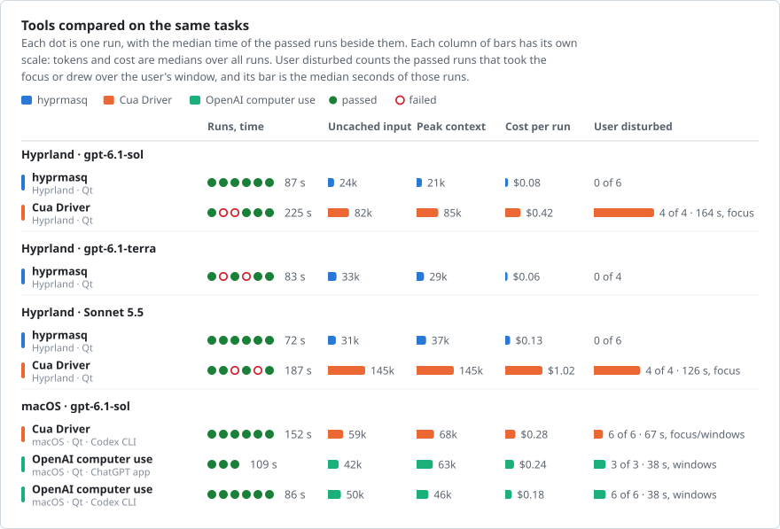
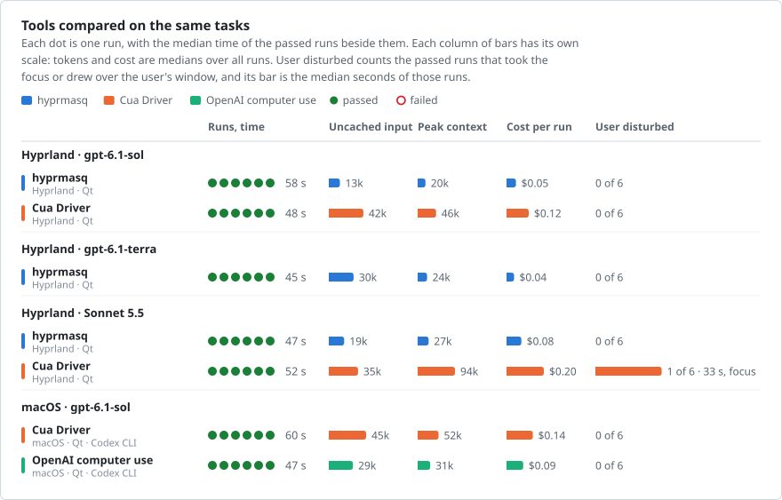
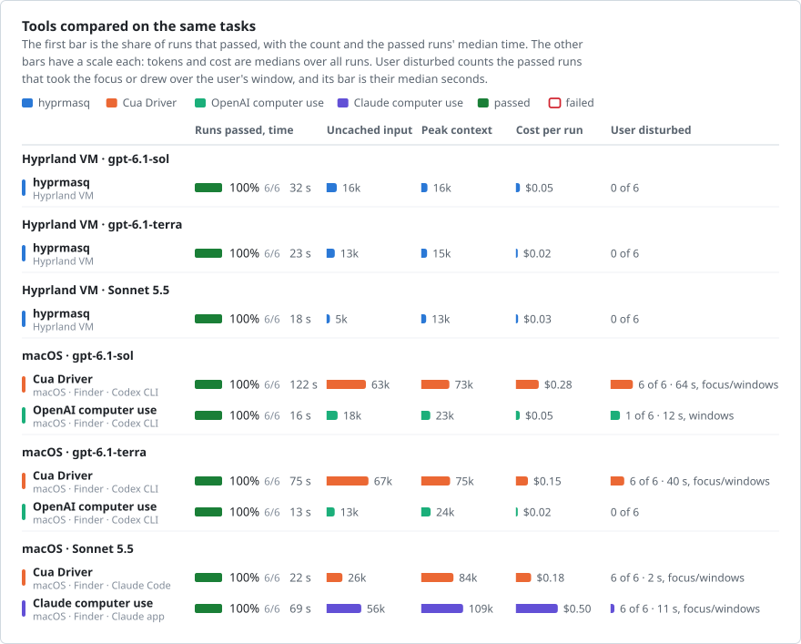
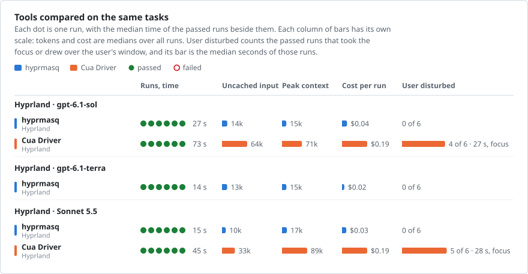

# The comparison's tasks on macOS

An addendum to [the comparison](comparison.md) of hyprmasq with other tools on Linux.

hyprmasq does not run on macOS. To see how the tools that do behave on the same work, four of the benchmark's tasks
ran on a Mac in its own apps, with OpenAI's computer use, Claude's computer use and Cua Driver, six times per task,
tool and agent: 144 runs, of which 143 passed. The figures set them beside hyprmasq's runs of the same tasks in the
benchmark's VM: the questionnaire's Qt port in both, Inkscape in both, and the file manager task in Nautilus in the
VM and in Finder on the Mac. The machines differ, so the times compare roughly. Nobody used the Mac during its runs,
while in the VM the user types meanwhile. On the Mac, disturbance counts windows drawn over the user's window as well
as the focus. [On the Mac](#on-the-mac) has the setup.

- **hyprmasq** had the smallest median peak context in every row and never disturbed the user. Its median cost per
  run was the lowest but in the file manager, where OpenAI's computer use cost a fraction of a cent less. With Sonnet
  it passed five of six runs of each form.
- **OpenAI's computer use** came close to it in tokens, and was the fastest in the file manager and, with Sol and
  Terra, on the form without dropdowns. Its dropdown lists showed over the user's window while it chose from them,
  and in Inkscape its clicks brought Inkscape to the front.
- **Claude's computer use** had the largest median peak context of each task, 107k to 152k tokens, and the highest
  median cost per run. Where its background input fell short, in the dropdowns and in Finder's drag, it took full
  control of the screen, which hides the user's other apps. It failed one Inkscape run, saving the rectangle with a
  `fill-opacity` it had not had.
- **Cua Driver** went to the foreground in the dropdowns, in Inkscape and in Finder, with Sonnet only briefly, and its
  median peak context was two to seven times hyprmasq's.

Part of the difference in context is there before the first action: the first request, with the harness's system
prompt and tool definitions, was 8k to 9k tokens for hyprmasq, 14k to 16k for OpenAI's computer use and Cua with
Codex, and 65k to 68k for Cua in Claude Code and Claude's computer use. The tables' **Beyond first request** leaves it
out: a run's input less its requests times the first request. hyprmasq's was the smallest in 11 of the 12 rows. Its
small screenshots of one window and its actions batched into few requests drive all these measures, so they agree
more than independent results would.

## Form with dropdowns

<!-- render vm-hyprmasq-qt,macos-tasks comparison form -->
<picture>
  <source media="(prefers-color-scheme: dark)" srcset="comparison/comparison-form-dark.svg">
  
</picture>
<!-- /render -->

<!-- render vm-hyprmasq-qt,macos-tasks comparison-table form -->

Numbers: Form with dropdowns

**Outcome and time**

| Agent | Tool | Where | Passed | Time s | In tools s | Calls | Failed calls | Focus away s | Windows over user s |
| --- | --- | --- | --- | --- | --- | --- | --- | --- | --- |
| gpt-6.1-sol | hyprmasq | Hyprland VM · Qt | 6/6 | 55 (52–59) | 27 (26–28) | 10 (10–13) | 0 (0–0) | 0 (0–0) | – |
| gpt-6.1-terra | hyprmasq | Hyprland VM · Qt | 6/6 | 51 (46–53) | 29 (27–30) | 8 (8–10) | 0 (0–0) | 0 (0–0) | – |
| Sonnet 5.5 | hyprmasq | Hyprland VM · Qt | 5/6 | 52 (48–72) | 28 (26–31) | 13 (10–16) | 0 (0–1) | 0 (0–0) | – |
| gpt-6.1-sol | Cua Driver | macOS · Qt · Codex CLI | 6/6 | 129 (104–244) | 42 (29–58) | 24 (17–36) | 0 (0–0) | 42 (37–157) | 54 (46–167) |
| gpt-6.1-sol | OpenAI computer use | macOS · Qt · Codex CLI | 6/6 | 62 (39–113) | 12 (10–25) | 18 (13–27) | 1 (1–2) | 0 (0–72) | 20 (12–44) |
| gpt-6.1-terra | Cua Driver | macOS · Qt · Codex CLI | 6/6 | 107 (71–130) | 44 (29–56) | 28 (20–40) | 0 (0–1) | 42 (23–61) | 58 (30–71) |
| gpt-6.1-terra | OpenAI computer use | macOS · Qt · Codex CLI | 6/6 | 56 (41–85) | 19 (10–21) | 20 (18–36) | 2 (1–3) | 0 (0–0) | 16 (13–43) |
| Sonnet 5.5 | Cua Driver | macOS · Qt · Claude Code | 6/6 | 118 (104–201) | 48 (39–84) | 46 (34–84) | 0 (0–2) | 52 (0–126) | 59 (45–134) |
| Sonnet 5.5 | Claude computer use | macOS · Qt · Claude app | 6/6 | 209 (126–306) | 69 (45–107) | 84 (41–125) | 6 (5–6) | 91 (83–167) | 21 (18–25) |

**Tokens and cost**

| Agent | Tool | Where | Input k | Uncached k | Peak context k | Requests | Beyond first request k | Cost $ |
| --- | --- | --- | --- | --- | --- | --- | --- | --- |
| gpt-6.1-sol | hyprmasq | Hyprland VM · Qt | 194 (187–264) | 17 (12–32) | 20 (19–22) | 12 (12–15) | 85 (78–128) | 0.06 (0.05–0.09) |
| gpt-6.1-terra | hyprmasq | Hyprland VM · Qt | 180 (179–206) | 18 (14–27) | 23 (19–25) | 10 (10–12) | 89 (78–107) | 0.03 (0.03–0.04) |
| Sonnet 5.5 | hyprmasq | Hyprland VM · Qt | 224 (170–315) | 18 (14–23) | 25 (23–31) | 13 (11–17) | 112 (75–173) | 0.12 (0.09–0.14) |
| gpt-6.1-sol | Cua Driver | macOS · Qt · Codex CLI | 1387 (931–2394) | 80 (55–117) | 88 (65–92) | 26 (18–37) | 955 (648–1846) | 0.31 (0.22–0.44) |
| gpt-6.1-sol | OpenAI computer use | macOS · Qt · Codex CLI | 551 (383–1125) | 34 (28–74) | 38 (34–64) | 18 (14–28) | 294 (188–735) | 0.13 (0.10–0.23) |
| gpt-6.1-terra | Cua Driver | macOS · Qt · Codex CLI | 1481 (938–2495) | 59 (48–94) | 71 (59–100) | 28 (21–41) | 1034 (609–1853) | 0.15 (0.10–0.23) |
| gpt-6.1-terra | OpenAI computer use | macOS · Qt · Codex CLI | 737 (630–1565) | 43 (35–68) | 51 (47–60) | 21 (19–37) | 446 (367–1052) | 0.09 (0.07–0.14) |
| Sonnet 5.5 | Cua Driver | macOS · Qt · Claude Code | 3135 (2634–5684) | 107 (73–150) | 151 (131–184) | 28 (25–44) | 1312 (1007–2821) | 0.87 (0.63–1.22) |
| Sonnet 5.5 | Claude computer use | macOS · Qt · Claude app | 7330 (3909–9156) | 99 (78–114) | 152 (131–167) | 59 (36–73) | 3338 (1473–4258) | 1.26 (0.77–1.50) |

<!-- /render -->

## Form without dropdowns

<!-- render vm-hyprmasq-qt,macos-tasks comparison form-no-dropdowns -->
<picture>
  <source media="(prefers-color-scheme: dark)" srcset="comparison/comparison-form-no-dropdowns-dark.svg">
  
</picture>
<!-- /render -->

<!-- render vm-hyprmasq-qt,macos-tasks comparison-table form-no-dropdowns -->

Numbers: Form without dropdowns

**Outcome and time**

| Agent | Tool | Where | Passed | Time s | In tools s | Calls | Failed calls | Focus away s | Windows over user s |
| --- | --- | --- | --- | --- | --- | --- | --- | --- | --- |
| gpt-6.1-sol | hyprmasq | Hyprland VM · Qt | 6/6 | 49 (46–56) | 25 (24–26) | 7 (7–11) | 0 (0–0) | 0 (0–0) | – |
| gpt-6.1-terra | hyprmasq | Hyprland VM · Qt | 6/6 | 39 (35–44) | 24 (24–25) | 6 (6–6) | 0 (0–0) | 0 (0–0) | – |
| Sonnet 5.5 | hyprmasq | Hyprland VM · Qt | 5/6 | 42 (42–51) | 24 (24–29) | 10 (9–16) | 0 (0–2) | 0 (0–0) | – |
| gpt-6.1-sol | Cua Driver | macOS · Qt · Codex CLI | 6/6 | 46 (40–58) | 16 (16–18) | 7 (7–11) | 0 (0–0) | 0 (0–0) | 0 (0–0) |
| gpt-6.1-sol | OpenAI computer use | macOS · Qt · Codex CLI | 6/6 | 36 (32–56) | 7 (6–8) | 10 (8–11) | 1 (1–1) | 0 (0–0) | 0 (0–0) |
| gpt-6.1-terra | Cua Driver | macOS · Qt · Codex CLI | 6/6 | 29 (27–33) | 15 (15–15) | 6 (6–8) | 0 (0–1) | 0 (0–0) | 0 (0–0) |
| gpt-6.1-terra | OpenAI computer use | macOS · Qt · Codex CLI | 6/6 | 22 (18–24) | 6 (6–6) | 8 (7–8) | 1 (0–1) | 0 (0–0) | 0 (0–0) |
| Sonnet 5.5 | Cua Driver | macOS · Qt · Claude Code | 6/6 | 44 (35–48) | 26 (15–27) | 6 (4–8) | 0 (0–0) | 0 (0–0) | 0 (0–0) |
| Sonnet 5.5 | Claude computer use | macOS · Qt · Claude app | 6/6 | 127 (98–218) | 38 (29–85) | 53 (41–115) | 2 (0–8) | 0 (0–98) | 0 (0–0) |

**Tokens and cost**

| Agent | Tool | Where | Input k | Uncached k | Peak context k | Requests | Beyond first request k | Cost $ |
| --- | --- | --- | --- | --- | --- | --- | --- | --- |
| gpt-6.1-sol | hyprmasq | Hyprland VM · Qt | 149 (149–217) | 23 (14–34) | 21 (21–21) | 9 (9–13) | 68 (67–99) | 0.07 (0.05–0.09) |
| gpt-6.1-terra | hyprmasq | Hyprland VM · Qt | 130 (129–130) | 14 (13–21) | 21 (21–21) | 8 (8–8) | 57 (57–57) | 0.02 (0.02–0.03) |
| Sonnet 5.5 | hyprmasq | Hyprland VM · Qt | 162 (153–265) | 13 (12–21) | 22 (21–29) | 10 (10–15) | 71 (66–136) | 0.08 (0.08–0.13) |
| gpt-6.1-sol | Cua Driver | macOS · Qt · Codex CLI | 295 (276–464) | 41 (33–46) | 47 (43–56) | 8 (8–12) | 169 (150–291) | 0.12 (0.10–0.14) |
| gpt-6.1-sol | OpenAI computer use | macOS · Qt · Codex CLI | 278 (208–316) | 25 (21–57) | 31 (27–33) | 11 (9–12) | 125 (90–149) | 0.09 (0.07–0.15) |
| gpt-6.1-terra | Cua Driver | macOS · Qt · Codex CLI | 261 (218–296) | 39 (34–50) | 46 (46–59) | 7 (7–9) | 144 (108–170) | 0.06 (0.05–0.06) |
| gpt-6.1-terra | OpenAI computer use | macOS · Qt · Codex CLI | 216 (180–216) | 19 (16–42) | 28 (26–28) | 9 (8–9) | 91 (76–92) | 0.03 (0.03–0.05) |
| Sonnet 5.5 | Cua Driver | macOS · Qt · Claude Code | 555 (404–709) | 43 (38–97) | 99 (97–107) | 6 (5–8) | 132 (65–189) | 0.25 (0.21–0.44) |
| Sonnet 5.5 | Claude computer use | macOS · Qt · Claude app | 3524 (2878–4408) | 74 (55–84) | 127 (116–137) | 36 (27–45) | 1201 (866–1769) | 0.71 (0.65–0.88) |

<!-- /render -->

## File manager

<!-- render vm-hyprmasq,macos-tasks comparison files -->
<picture>
  <source media="(prefers-color-scheme: dark)" srcset="comparison/comparison-files-dark.svg">
  
</picture>
<!-- /render -->

<!-- render vm-hyprmasq,macos-tasks comparison-table files -->

Numbers: File manager

**Outcome and time**

| Agent | Tool | Where | Passed | Time s | In tools s | Calls | Failed calls | Focus away s | Windows over user s |
| --- | --- | --- | --- | --- | --- | --- | --- | --- | --- |
| gpt-6.1-sol | hyprmasq | Hyprland VM | 6/6 | 32 (25–64) | 6 (5–12) | 6 (5–10) | 0 (0–0) | 0 (0–0) | – |
| gpt-6.1-terra | hyprmasq | Hyprland VM | 6/6 | 23 (20–34) | 6 (5–12) | 6 (5–10) | 0 (0–0) | 0 (0–0) | – |
| Sonnet 5.5 | hyprmasq | Hyprland VM | 6/6 | 18 (15–19) | 5 (5–6) | 5 (4–6) | 1 (0–1) | 0 (0–0) | – |
| gpt-6.1-sol | Cua Driver | macOS · Finder · Codex CLI | 6/6 | 122 (71–206) | 27 (15–52) | 25 (16–34) | 0 (0–0) | 63 (1–153) | 63 (0–152) |
| gpt-6.1-sol | OpenAI computer use | macOS · Finder · Codex CLI | 6/6 | 16 (12–24) | 4 (4–5) | 4 (4–6) | 0 (0–0) | 0 (0–0) | 0 (0–12) |
| gpt-6.1-terra | Cua Driver | macOS · Finder · Codex CLI | 6/6 | 75 (60–82) | 23 (20–31) | 26 (20–30) | 0 (0–1) | 39 (25–48) | 38 (23–46) |
| gpt-6.1-terra | OpenAI computer use | macOS · Finder · Codex CLI | 6/6 | 13 (11–39) | 4 (4–8) | 5 (5–10) | 1 (1–1) | 0 (0–0) | 0 (0–0) |
| Sonnet 5.5 | Cua Driver | macOS · Finder · Claude Code | 6/6 | 22 (17–40) | 7 (4–9) | 9 (6–14) | 1 (0–1) | 1 (1–1) | 2 (1–6) |
| Sonnet 5.5 | Claude computer use | macOS · Finder · Claude app | 6/6 | 69 (49–139) | 22 (17–38) | 32 (19–49) | 4 (1–7) | 11 (8–14) | 0 (0–0) |

**Tokens and cost**

| Agent | Tool | Where | Input k | Uncached k | Peak context k | Requests | Beyond first request k | Cost $ |
| --- | --- | --- | --- | --- | --- | --- | --- | --- |
| gpt-6.1-sol | hyprmasq | Hyprland VM | 110 (92–184) | 16 (11–24) | 16 (15–18) | 8 (7–12) | 37 (29–74) | 0.05 (0.04–0.06) |
| gpt-6.1-terra | hyprmasq | Hyprland VM | 105 (92–179) | 13 (12–30) | 15 (15–18) | 8 (7–12) | 33 (29–70) | 0.02 (0.02–0.04) |
| Sonnet 5.5 | hyprmasq | Hyprland VM | 66 (47–73) | 5 (4–6) | 13 (11–13) | 6 (5–7) | 13 (8–16) | 0.03 (0.02–0.03) |
| gpt-6.1-sol | Cua Driver | macOS · Finder · Codex CLI | 1351 (964–2313) | 63 (50–91) | 73 (60–90) | 26 (17–35) | 926 (697–1763) | 0.28 (0.23–0.44) |
| gpt-6.1-sol | OpenAI computer use | macOS · Finder · Codex CLI | 102 (101–147) | 18 (17–24) | 23 (22–24) | 5 (5–7) | 32 (31–49) | 0.05 (0.04–0.06) |
| gpt-6.1-terra | Cua Driver | macOS · Finder · Codex CLI | 1450 (878–1837) | 67 (43–83) | 75 (55–90) | 27 (21–31) | 1011 (549–1399) | 0.15 (0.09–0.18) |
| gpt-6.1-terra | OpenAI computer use | macOS · Finder · Codex CLI | 127 (127–258) | 13 (12–32) | 24 (24–28) | 6 (6–11) | 43 (43–106) | 0.02 (0.02–0.05) |
| Sonnet 5.5 | Cua Driver | macOS · Finder · Claude Code | 648 (526–1200) | 26 (24–31) | 84 (82–96) | 8 (7–14) | 95 (56–289) | 0.18 (0.15–0.27) |
| Sonnet 5.5 | Claude computer use | macOS · Finder · Claude app | 2368 (1624–3363) | 56 (50–68) | 109 (103–122) | 24 (17–32) | 744 (474–1197) | 0.50 (0.39–0.69) |

<!-- /render -->

## Inkscape

<!-- render vm-hyprmasq,macos-tasks comparison inkscape -->
<picture>
  <source media="(prefers-color-scheme: dark)" srcset="comparison/comparison-inkscape-dark.svg">
  
</picture>
<!-- /render -->

<!-- render vm-hyprmasq,macos-tasks comparison-table inkscape -->

Numbers: Inkscape

**Outcome and time**

| Agent | Tool | Where | Passed | Time s | In tools s | Calls | Failed calls | Focus away s | Windows over user s |
| --- | --- | --- | --- | --- | --- | --- | --- | --- | --- |
| gpt-6.1-sol | hyprmasq | Hyprland VM | 6/6 | 22 (20–24) | 3 (3–4) | 4 (4–4) | 0 (0–0) | 0 (0–0) | – |
| gpt-6.1-terra | hyprmasq | Hyprland VM | 6/6 | 16 (15–17) | 3 (3–4) | 3 (3–3) | 0 (0–0) | 0 (0–0) | – |
| Sonnet 5.5 | hyprmasq | Hyprland VM | 6/6 | 13 (11–18) | 3 (3–4) | 3 (3–4) | 0 (0–1) | 0 (0–0) | – |
| gpt-6.1-sol | Cua Driver | macOS · Codex CLI | 6/6 | 56 (36–97) | 14 (10–27) | 11 (9–19) | 0 (0–0) | 6 (2–34) | 4 (1–32) |
| gpt-6.1-sol | OpenAI computer use | macOS · Codex CLI | 6/6 | 30 (28–38) | 6 (6–10) | 7 (7–8) | 0 (0–0) | 20 (18–28) | 20 (18–28) |
| gpt-6.1-terra | Cua Driver | macOS · Codex CLI | 6/6 | 47 (39–76) | 16 (16–35) | 12 (11–16) | 0 (0–0) | 7 (4–18) | 5 (2–14) |
| gpt-6.1-terra | OpenAI computer use | macOS · Codex CLI | 6/6 | 25 (20–31) | 6 (6–8) | 8 (7–8) | 0 (0–0) | 17 (14–19) | 17 (14–19) |
| Sonnet 5.5 | Cua Driver | macOS · Claude Code | 6/6 | 45 (23–175) | 15 (9–63) | 23 (13–90) | 1 (1–2) | 3 (1–30) | 2 (0–26) |
| Sonnet 5.5 | Claude computer use | macOS · Claude app | 5/6 | 49 (20–60) | 14 (5–20) | 27 (7–35) | 2 (0–3) | 0 (0–0) | 0 (0–0) |

**Tokens and cost**

| Agent | Tool | Where | Input k | Uncached k | Peak context k | Requests | Beyond first request k | Cost $ |
| --- | --- | --- | --- | --- | --- | --- | --- | --- |
| gpt-6.1-sol | hyprmasq | Hyprland VM | 80 (80–82) | 14 (8–24) | 15 (15–16) | 6 (6–6) | 25 (25–27) | 0.04 (0.03–0.06) |
| gpt-6.1-terra | hyprmasq | Hyprland VM | 65 (65–65) | 12 (12–20) | 15 (15–15) | 5 (5–5) | 19 (19–19) | 0.02 (0.02–0.02) |
| Sonnet 5.5 | hyprmasq | Hyprland VM | 43 (42–55) | 6 (5–6) | 13 (12–14) | 4 (4–5) | 11 (9–15) | 0.02 (0.02–0.03) |
| gpt-6.1-sol | Cua Driver | macOS · Codex CLI | 449 (375–1065) | 42 (36–62) | 48 (46–70) | 12 (10–20) | 260 (217–750) | 0.14 (0.11–0.24) |
| gpt-6.1-sol | OpenAI computer use | macOS · Codex CLI | 218 (218–253) | 30 (30–36) | 35 (35–35) | 8 (8–9) | 107 (106–128) | 0.08 (0.08–0.10) |
| gpt-6.1-terra | Cua Driver | macOS · Codex CLI | 459 (434–671) | 45 (35–83) | 47 (47–52) | 12 (12–17) | 263 (246–404) | 0.07 (0.06–0.12) |
| gpt-6.1-terra | OpenAI computer use | macOS · Codex CLI | 230 (217–261) | 28 (23–40) | 35 (34–41) | 8 (8–9) | 112 (106–136) | 0.04 (0.03–0.05) |
| Sonnet 5.5 | Cua Driver | macOS · Claude Code | 1183 (591–4144) | 29 (21–84) | 88 (80–137) | 14 (8–42) | 193 (69–1406) | 0.26 (0.16–0.91) |
| Sonnet 5.5 | Claude computer use | macOS · Claude app | 1498 (631–2002) | 54 (44–61) | 107 (97–114) | 16 (7–20) | 448 (157–648) | 0.40 (0.25–0.50) |

<!-- /render -->

## On the Mac

Setup

- **Machine:** MacBook Pro (M1 Max, 32 GB), macOS 26.5.2, on October 31, 2026. Nobody used it during the runs. The
  user's window is a TextEdit note in front, or the app the agent runs in, with the task's app open behind it.
- **Tasks:** the questionnaire's Qt port (PySide6 6.8.3) with and without dropdowns, the file manager task in a
  Finder window on a fresh folder Project, and the Inkscape task in Inkscape 1.4.4 from Homebrew, whose prompt says
  Cmd+S. Each is graded by the VM's checker of the task, Finder's `.DS_Store` files left out, and with a rule against
  other apps in front in place of the VM's against other windows.
- **Agents:** `gpt-6.1-sol`, `gpt-6.1-terra` and Claude Sonnet 5.5, all at medium effort. Sol and Terra ran in the
  Codex CLI 0.166.0-alpha.5.1 that the ChatGPT app 26.1027.30824 bundles, in code mode, with the standard service
  tier, which the runner checked in each run's log. Sonnet ran Cua in Claude Code 2.1.310 on a Claude subscription.
  Costs are at the providers' API list prices.
- **OpenAI's computer use:** the ChatGPT app's Computer Use plugin 1.0.1001641 and its unified computer use
  26.1023.51421, from a Codex home of its own with the user's login and the plugin's settings, but none of the
  user's instructions or memories.
- **Claude's computer use:** a Code session of the Claude app (4.4212.0, Claude Code 2.1.309) at Sonnet 5.5 Medium,
  with the app as the user's window. It loads the owner's `CLAUDE.md` and claude.ai connectors, a small part of its
  68k-token first request, most of the rest the app's own tool definitions. The runner drives the app through macOS's
  accessibility API, without an agent: it opens the session, pastes the prompt, and answers Claude's requests for the
  task's app and for full control of the screen with "Allow for this session". The time those requests waited is left
  out of a run's time.
- **Cua Driver** 0.38.0 with its MCP server and skill, from homes of its own for Codex and Claude Code, using the
  user's Cua daemon, which holds its grants. Its daemons were stopped during Claude's runs: each keeps a window over
  the whole screen for its cursor, which Claude's full control cannot hide, and Claude stopped at it in a first run.
- **Measured disturbance:** the frontmost app and the task app's windows drawn over the user's window, normal-layer
  windows that overlap it and popup lists alike, combined without counting their overlap twice. A run fails when an
  app other than the user's and the task's comes to the front.
- **Runs left out:** four runs of Claude's computer use made while Cua's daemons were up, and one Cua run that a
  macOS prompt to let Cua Driver control Finder held up. All five ran again under the setup above.

[bench/laptop](../bench/laptop/README.md) has the runner, `run_mac.py`, and the series' script, `mac_series.sh`.

