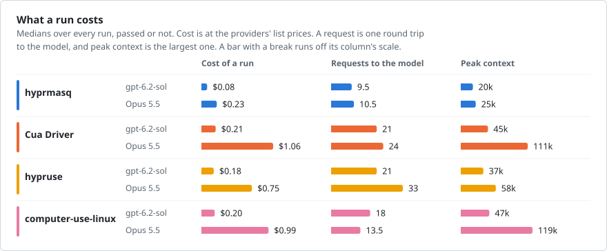
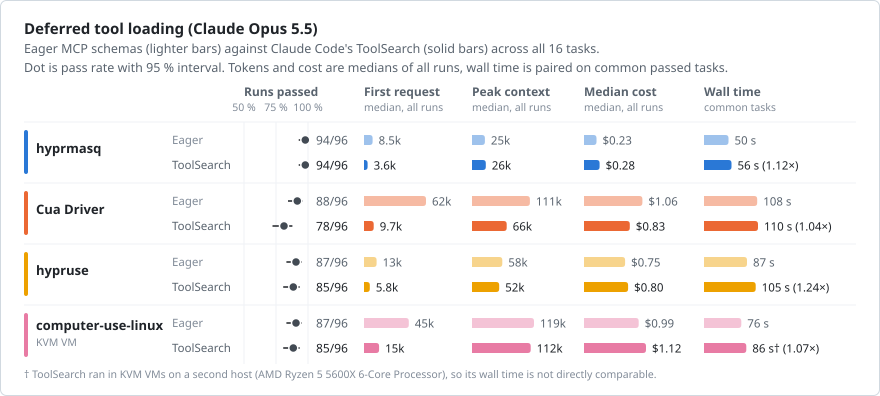
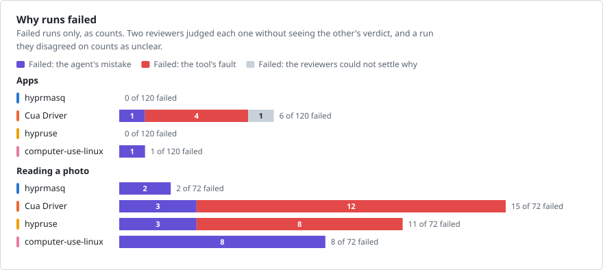

# Comparisons with other computer-use tools

hyprmasq beside [Cua Driver](https://github.com/trycua/cua) 0.56.0,
[computer-use-linux](https://github.com/agent-sh/computer-use-linux) 0.7.59 and
[hypruse](https://github.com/IlyasKhallouki/hypruse) 0.15.1 on the same 16 desktop tasks (November 2026 snapshot,
Hyprland 0.57.2, GPT-6.2 Sol and Claude Opus 5.5 at medium effort) while the user worked in their own window. `hyprmasq`, Cua Driver and hypruse ran
in rootless GPU containers on the same host, while `computer-use-linux` ran in KVM VMs on that host because on Hyprland
its pointer uses kernel `/dev/uinput`.

<!-- render v3-hyprmasq,v3-hyprmasq-chromium,v3-cua,v3-cua-chromium,v3-hypruse,v3-hypruse-chromium,v3-computer-use-linux,v3-computer-use-linux-chromium,v3-failures scorecard -->
<picture>
  <source media="(prefers-color-scheme: dark)" srcset="comparison/scorecard-dark.svg">
  
</picture>
<!-- /render -->

- **The user:** hyprmasq left the user's view alone in all 192 runs, with 0 lost characters in Forgejo. The other three
  took focus on half or more of their passed runs (Cua Driver 86/171, computer-use-linux 133/183, hypruse 173/181) and
  dropped user typing in Forgejo.
- **Runs passed:** hyprmasq passed 190/192 (96/96 Sol, 94/96 Opus). With Sol, hyprmasq (96/96) and computer-use-linux
  (96/96) are ahead of Cua Driver (83/96). With Opus, all four overlap (87–94/96).
- **Time and cost:** the other container tools took **1.7–2.0×** as long (and `computer-use-linux` **1.8–2.1×** in KVM
  VMs against hyprmasq in containers) at **2.2–5.2×** the cost (`$0.08` Sol / `$0.23` Opus median for hyprmasq vs
  `$0.18–$0.21` / `$0.75–$1.06`, with Opus using eager MCP schemas — **2.5–4.8×** under Claude Code `ToolSearch` below).

hyprmasq's author ran the benchmark and developed hyprmasq against these tasks. See [Method](#method) for setup
effects, statistical notes, rule changes and [all runs](comparison/data).

## Working in the background

Each tool handles the background differently, so read this as what each design costs a user who keeps working, not as a
defect. Every agent was told foreground input and focus changes were allowed when its tool needed them.

- **hyprmasq** gives each window its own input, so clicks and drags never touch the user's pointer or focus.
- **Cua Driver** has background routes and falls back to the foreground where an app refuses them.
- **hypruse** runs in its default automatic background mode, sending keys and accessibility clicks in the background
  while refusing the pointer there (falling back via `background=false` or `focus_window`). It also offers a strict
  `HYPRUSE_BACKGROUND=1` mode that refuses its own foreground and pointer actions to avoid stealing focus (launched
  apps can still take focus), at the cost of not being able to perform pointer-only tasks.
- **computer-use-linux** has an opt-in Hyprland background mode (`COMPUTER_USE_LINUX_HYPRLAND_BACKGROUND=1`) for
  screenshots (`grim -T`) and keys (`sendkeystate`), which the benchmark enabled, plus AT-SPI element actions. Its
  pointer is the user's own via `/dev/uinput`.

<!-- render v3-hyprmasq,v3-hyprmasq-chromium,v3-cua,v3-cua-chromium,v3-hypruse,v3-hypruse-chromium,v3-computer-use-linux,v3-computer-use-linux-chromium user-view -->
<picture>
  <source media="(prefers-color-scheme: dark)" srcset="comparison/user-view-dark.svg">
  
</picture>
<!-- /render -->

**View left alone** means no window opened on the user's workspace, the workspace did not switch and the focus never
left the user's window. **Focus away** is the median across all passed runs (including zeros): Cua Driver took focus on
86 of 171 passed runs (50.3 %), so its overall median lands at 3 s while its median across the 86 runs that took focus
is 55 s (against 41 s for computer-use-linux and 64 s for hypruse). In Forgejo, where the user types notes in their own
window meanwhile, hyprmasq kept the notes intact in **12/12** runs (0 lost characters), against **8/12** for Cua Driver
(55 lost), **6/12** for hypruse (84 lost) and **5/12** for computer-use-linux (129 lost). All 36 other-tool Forgejo
runs interrupted the user at least once, and typing is lost whenever a focus switch catches them mid-line rather than
during the 6 s pause between lines.

## What a run costs

<!-- render v3-hyprmasq,v3-hyprmasq-chromium,v3-cua,v3-cua-chromium,v3-hypruse,v3-hypruse-chromium,v3-computer-use-linux,v3-computer-use-linux-chromium usage -->
<picture>
  <source media="(prefers-color-scheme: dark)" srcset="comparison/usage-dark.svg">
  
</picture>
<!-- /render -->

- **Cost:** median `$0.08` Sol / `$0.23` Opus for hyprmasq, against `$0.18–$0.21` Sol and `$0.75–$1.06` Opus for the
  other three (`2.2–5.2×` by per-unit geometric mean).
- **Round trips:** `9.5` Sol / `10.5` Opus median requests for hyprmasq (batched `act` calls returning changed crops)
  against `18–21` Sol and `13.5–33` Opus for the others.
- **Peak context:** `20.1k` Sol / `24.7k` Opus for hyprmasq against `37.3k–47.3k` Sol and `57.9k–118.6k` Opus for the
  others, with 0 history compactions across all 768 runs.

Totals, first-request tokens and round-trip details

- **Total cost over 96 runs per agent:** hyprmasq `$8.7` Sol / `$24.1` Opus, hypruse `$18.3` / `$70.3`, Cua Driver
  `$23.5` / `$125.5`, computer-use-linux `$22.3` / `$141.7`.
- **First request (tool schemas and skills):** hyprmasq `10.5k` Sol / `8.5k` Opus, hypruse `10.5k` / `12.5k`, Cua
  Driver `13.2k` / `61.7k`, computer-use-linux `16.4k` / `44.6k`.
- **hypruse Opus requests:** `33` median requests include ~10.6 `Read` round trips per run to inspect `file`-mode
  screenshots through a read-only mount of the screenshot directory.

### Deferred tool loading (ToolSearch)

Codex deferred MCP tool schemas through its built-in tool search (`10.5k–16.4k` first request), whereas the Claude Opus
5.5 runs above sent every MCP tool schema eagerly on every turn because the harness's `--tools` flag omitted Claude
Code's built-in `ToolSearch` tool. Repeating all 384 Opus 5.5 runs (6 repetitions × 16 tasks × 4 tools) with
`ToolSearch` enabled shows how both modes compare ([full numbers](comparison-numbers.md#side-checks)):

<!-- render v3-hyprmasq,v3-hyprmasq-chromium,v3-cua,v3-cua-chromium,v3-hypruse,v3-hypruse-chromium,v3-computer-use-linux,v3-computer-use-linux-chromium,v3-ts-hyprmasq,v3-ts-hyprmasq-chromium,v3-ts-cua,v3-ts-cua-chromium,v3-ts-hypruse,v3-ts-hypruse-chromium,v3-ts-computer-use-linux,v3-ts-computer-use-linux-chromium toolsearch -->
<picture>
  <source media="(prefers-color-scheme: dark)" srcset="comparison/toolsearch-dark.svg">
  
</picture>
<!-- /render -->

- **Cua Driver** saw the largest context drop and the only cost reduction under `ToolSearch`: its 65-tool first request
  fell from `61.7k` to `9.7k`, peak context fell `40 %` (`110.8k` to `66.5k`), and per-task cost dropped `11 %` across
  all runs (`0.89×`, `$1.06` to `$0.83` pooled median, `$125.5` to `$102.5` total). Most of the total dollar drop
  (`$15.85` of `$23.0`) came from early-abandon failures on Thunderbird (`6/6` to `2/6`) and the Qt dropdown form
  (`6/6` to `3/6`), while passed-run cost fell `5 %` per task (`0.95×`). Its pass count dropped from `88/96` to `78/96`
  (overlapping intervals `84–96 %` vs `72–88 %`, within the noise), and paired on the 14 common passed tasks it was
  **`1.04×` slower** (`108.0 s` to `109.7 s`), not faster.
- **The other three tools got more expensive and slower under `ToolSearch`:** per-task cost rose for `hyprmasq`
  (`1.21×`, `$0.23` to `$0.28`), `hypruse` (`1.18×`, `$0.75` to `$0.80`, `+27 %` total cost from longer trajectories)
  and `computer-use-linux` (`1.12×`, `$0.99` to `$1.12`), and paired wall time rose on common tasks (`1.12×` hyprmasq,
  `1.24×` hypruse). Eager static prefixes reuse Anthropic's prompt cache across runs (`cache_read`), whereas
  `ToolSearch` pulls schemas in mid-conversation as per-run `cache_write` tokens plus extra search turns.
- **hyprmasq stays first in both modes:** with `ToolSearch`, hyprmasq passed `94/96` (`94/94` view left alone, vs
  `96/96` eager under the same merged SATA board target) at `$0.28` median (`$28.1` total) against `78–85/96` and
  `$0.80–$1.12` median (`$89.5–$149.7` total, `2.8–4.0×` median cost and `2.5–4.8×` per-task geometric mean) for the
  other three. The 42 `ToolSearch` failures were not separately reviewed by the two-reviewer panel.

## Task by task

<!-- render v3-hyprmasq,v3-hyprmasq-chromium,v3-cua,v3-cua-chromium,v3-hypruse,v3-hypruse-chromium,v3-computer-use-linux,v3-computer-use-linux-chromium,v3-failures unit-grid -->
<picture>
  <source media="(prefers-color-scheme: dark)" srcset="comparison/unit-grid-dark.svg">
  
</picture>
<!-- /render -->

- **Time:** hyprmasq was fastest on 15 of 16 tasks (`23.8–86.7 s`). Cua Driver was faster on the Qt form without
  dropdowns (`39.4 s` vs `55.4 s`), setting fields and checkboxes directly through AT-SPI.
- **Runs passed:** with 6 runs per agent, most differences are within the noise. The 95 % Wilson intervals separate
  against hyprmasq on three tasks, all in hyprmasq's favour:
  - **Label a photo, drag and drop · Firefox:** hyprmasq 6/6 vs Cua Driver 0/6 (both agents) and hypruse 0/6 (Opus).
  - **Form with dropdowns · Qt:** hyprmasq 6/6 vs Cua Driver 1/6 (Sol).
  - **Draw along a river bank · Firefox:** hyprmasq 6/6 vs computer-use-linux 1/6 (Opus).

## Why runs failed

Two independent reviewers (Claude Fable 5.2 and GPT-6.1 Sol) read every failed run of the 768-run primary series
without seeing each other's verdict or any pass rate, agreeing on **42 of 43** failures (1 disagreement became
`unclear`).

<!-- render v3-hyprmasq,v3-hyprmasq-chromium,v3-cua,v3-cua-chromium,v3-hypruse,v3-hypruse-chromium,v3-computer-use-linux,v3-computer-use-linux-chromium,v3-failures attribution -->
<picture>
  <source media="(prefers-color-scheme: dark)" srcset="comparison/attribution-dark.svg">
  
</picture>
<!-- /render -->

No failure of hyprmasq or computer-use-linux was traced to the tool under the review rubric. Firefox's HTML5
drag-and-drop board accounts for 12 of Cua Driver's 16 tool problems and all 8 of hypruse's, and Qt dropdown clicks
account for Cua Driver's remaining 4.

Each tool's failures

- **hyprmasq (2/192 failed, both model mistakes):** Opus missed the `SATA ports` target on Chromium's motherboard photo
  twice while hyprmasq delivered the drags to the requested coordinates. Sol passed 96/96.
- **computer-use-linux (9/192 failed, all model mistakes):** Opus had 8 river-trace drifts using straight-segment drags
  and 1 Qt dropdown run where AT-SPI `Toggle` returned `ok: true` on closed combo boxes without committing and Opus
  submitted after noting the boxes still read "Choose…". Sol passed 96/96.
- **hypruse (11/192 failed: 8 tool problems, 3 model mistakes):** All 8 tool problems are Firefox's HTML5 drag-and-drop
  board, where `pointer drag` reported `"drag ok"` without moving a label (Sol's 4 passes bypassed it via Firefox's Web
  Console JavaScript at `136.7 s` median). The 3 model mistakes are Firefox river-trace drifts (Opus). Apps passed
  120/120.
- **Cua Driver (21/192 failed: 16 tool problems, 4 model mistakes, 1 unclear):** 12 tool problems are Firefox's HTML5
  drag-and-drop board (0/12, background and desktop drags silently dropped while foreground drags were refused), and 4
  are Sol on the Qt form with dropdowns, where clicking closed combo-box items by accessibility token returned
  `selected: true` without committing (a fifth Qt run split the reviewers). The 4 model mistakes are 2 river-trace
  drifts (Opus), 1 Chromium board miss (Sol) and 1 Forgejo run where Sol spent its single `--user-reply` recovering
  from a focus-switch typing collision and then stopped at the OAuth consent page.

## Method

Every tool ran the same 16 [benchmark](benchmarks.md) tasks with the same tool-neutral prompt, its documented setup,
`--user-reply` on Forgejo and 6 runs per task and agent. Details are folded below.

Known effects of the setup

- **Benchmark overlap:** hyprmasq was developed against these 16 tasks (the benchmark is both the development set and
  the test set).
- **Design goals:** the user works in their own window throughout, which is hyprmasq's goal and not hypruse's or
  computer-use-linux's (both document pointer input in the foreground).
- **Against Cua Driver:** 6 of the 16 tasks are image tasks, 4 run in Firefox (where its foreground route is refused
  and its browser tools do not apply), its guide calls Hyprland experimental, and Chromium starts without remote
  debugging (tested separately under Side checks).
- **For Cua Driver:** running on the host GPU kept its AT-SPI walks fast (median 176–182 ms, 0 first walks cut, 36 of
  2,502 walks cut by time budget), its default cursor overlay stayed on, and hidden Chromium screenshots stayed fresh.
- **Containers vs KVM VMs:** `computer-use-linux` requires `/dev/uinput` for Hyprland pointer input, so it ran in
  3 × 2-core KVM VMs on the same Ryzen 7 5800X3D host rather than rootless GPU containers. Its times (marked `†`)
  include KVM and software-rendering overhead, and slower redraws (30 small-first-frame and 29 unchanged-frame flags)
  may add screenshots and tokens. In the `ToolSearch` rerun, `computer-use-linux` ran in 2 × 2-core KVM VMs on a second
  host (Ryzen 5 5600X).
- **Run order, host load and API stalls:** hyprmasq and Cua Driver were interleaved round by round while later runs ran
  sequentially on the same host, spanning two days of API variance. 100 early container runs (69 Cua Driver, 31
  hyprmasq) overlapped 1–2 outside bench VMs (~1.01–1.04× wall time), and 3 active Codex runs hit multi-minute API
  stalls (143–964 s) that medians shield but published ranges reflect.
- **Measurement limits:** `desktop_input_to_user_window` and `desktop_shortcuts` in the numbers table are instrumented
  from Cua Driver's logs only. Net cursor displacement compares start and end pointer position, so Hyprland's
  `focuswindow` warping the pointer back can record 0 px even when a run moved it.

Tasks, tools and statistical notes

- **Tasks:** 8 desktop apps (GTK 4 and Qt forms with and without dropdowns, Nautilus, Inkscape, Thunderbird, Forgejo
  with a concurrent user typing notes) plus 4 web tasks (board HTML5 drag-and-drop, board custom pointer drag, Calc,
  river trace) in both Firefox and Chromium. [bench/tasks](../bench/tasks) has every prompt and checker.
- **Tools:** `hyprmasq` (v0.5.0 plus the pre-release compact array `act` schema), Cua Driver 0.56.0 with its skill and
  `--grant existing-profile` on Chromium, `hypruse` 0.15.1 with `mcp 1.30.0` (matching its `<2` dependency so refusal
  messages pass through verbatim, `HYPRUSE_SCREENSHOT_MODE=file` + directory-scoped `Read` for Claude Code, and `image`
  mode for Codex), and `computer-use-linux` 0.7.59 with its skill and `COMPUTER_USE_LINUX_HYPRLAND_BACKGROUND=1`.
- **Agents and desktop:** Claude Opus 5.5 (Claude Code 2.1.330) and GPT-6.2 Sol (Codex 0.170.0), both pinned and at
  medium effort, on Hyprland 0.57.2 with the Omarchy configuration at 1920×1080. Every task workspace is shown until
  settled before a run starts.
- **Reading the numbers:** The [rules](../bench/comparison-series-v3.json) define the analysis. Time runs from agent
  start to end. A time ratio is the geometric mean over tasks of a tool's median over hyprmasq's, within each agent, on
  tasks where both passed at least 3 of 6 runs (hypruse `1.72×` Sol / `1.86×` Opus, Cua Driver `1.74×` / `2.04×`,
  computer-use-linux `2.13×` / `1.78×` in KVM VMs). Pooled 96-run Wilson intervals treat runs as independent even when
  failures cluster by task, and per-unit intervals have no multiplicity adjustment. Costs count every run at provider
  API list prices (cache reads at cache-read price). Peak context is the largest single request.

Rule changes and excluded runs

Post-start adjustments are logged in [the benchmark rules](../bench/comparison-series-v3.json):

- **Forgejo `--user-reply`:** forwarded `--user-reply` for Forgejo's broad OAuth consent prompt (superseding 24 early
  Forgejo runs without it, and disabled on all other tasks for the container tools so stalled drag-and-drop runs
  received no nudge), and fixed completion matching to ignore negated mentions of `Done`.
- **Board SATA target box:** merged two adjacent top SATA port boxes in `bench/tasks/board/regions.json` partway
  through. Earlier hyprmasq runs were not re-graded (keeping its 2 Chromium misses as failures), while one later
  hypruse run passed under the merged box.
- **Tool setup and load fixes:** superseded the initial 192 `hypruse` runs (`185/192`: 95/96 Sol, 90/96 Opus, where
  `--user-reply` had fired on Firefox drag-and-drop and `mcp 2.3.0` stripped refusal messages) with a clean series
  pinning `mcp 1.30.0`, `file`-mode screenshots for Claude Code and Forgejo-only `--user-reply`. Replaced 8 Cua Driver
  Firefox runs hit by a severe outside host load spike, added a 32-run hyprmasq KVM calibration round and the 384-run
  `ToolSearch` rerun, and recovered 238 clean `ToolSearch` container runs on the Ryzen 7 5800X3D host that repeated in
  fixed tool order only because an idle desktop VM tripped the external-QEMU guard.
- **Excluded runs and overrides:** alongside the 1,244 published runs, [the exclusion log](comparison/data/v3-exclusions.json)
  records all 15 individual excluded runs (2 Cua Driver Forgejo runs during an outside QEMU process, 8 Cua Driver
  Firefox runs during the host load spike, 1 hypruse Forgejo run hit by the negated-`Done` bug, 2 OAuth-revoked
  hyprmasq `ToolSearch` runs, and 2 Cua Driver Qt runs interrupted before shutting down the idle desktop VM), with each
  excluded run's outcome and replacement. Checking all 1,159 passed runs (`725` primary, `60` debugging-port, `32` VM
  calibration and `342` `ToolSearch`) against the prompt-violation rules yielded 0 overrides.

Side checks

- **Cua Driver with a debugging port:** starting Chromium with `--remote-debugging-port=0` on the 5 Chromium tasks
  raised Cua Driver from 57/60 (95 %) to **60/60 (100 %)** and lifted view left alone from 10/60 to 31/60 (18/18 for
  Opus on board and trace), though Forgejo still took focus on all 12 runs and dropped user typing on 4 of 12. Wall
  times (1.91–1.97× hyprmasq) and costs (2.73–4.56×) stayed similar.
- **hyprmasq in KVM VMs:** one full round of hyprmasq (32 runs, `n = 1` per task and agent) in the exact same
  3 × 2-core KVM VM setup as `computer-use-linux` passed **32/32 (100 %)** at a per-unit geometric mean of **1.03×
  (Sol)** and **1.07× (Opus)** of its container wall time (1.06× and 1.11× tool time). Because hyprmasq does not walk
  AT-SPI trees, its small VM overhead does not measure the VM cost for AT-SPI-heavy tools.

[The numbers](comparison-numbers.md#side-checks) have both tables.

## More

- [All the numbers](comparison-numbers.md): every table behind this page, per task, tool and agent.
- [The tasks on macOS](comparison-macos.md): OpenAI's and Claude's computer use and Cua Driver on a Mac, beside
  hyprmasq in the VM.
- [CuaDriverBench on Omarchy](comparison-cua-driver-bench.md): hyprmasq 0.5.1 beside Cua Driver 0.62.1 inside Scale AI's
  AgentEnv harness on Omarchy 4.5.
- [The data](comparison/data): every published run and both reviews of every primary failed run.
