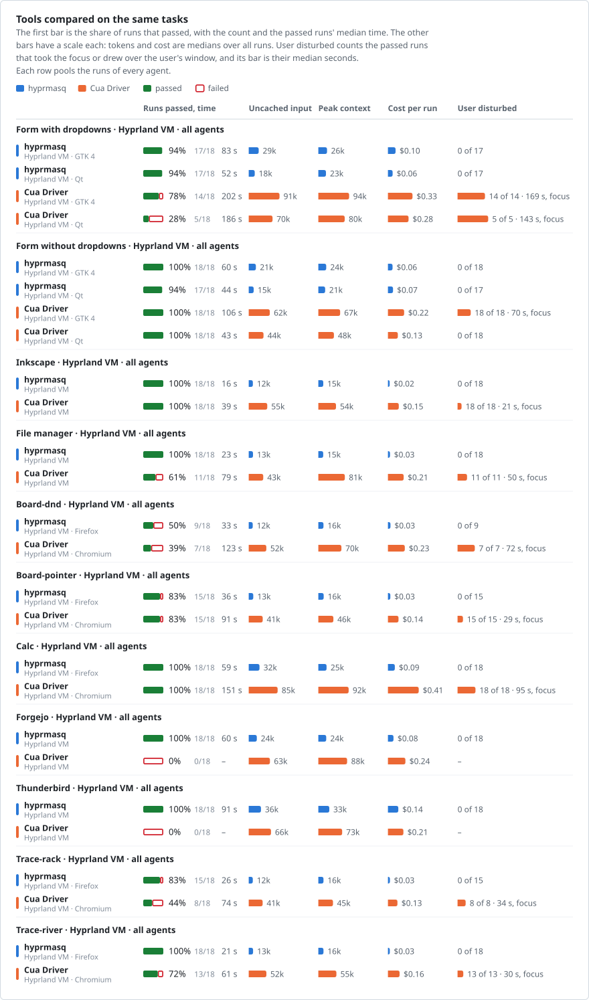
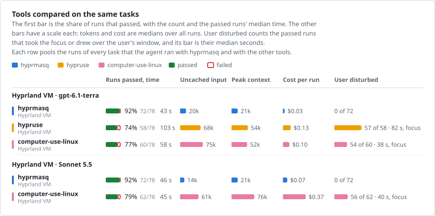
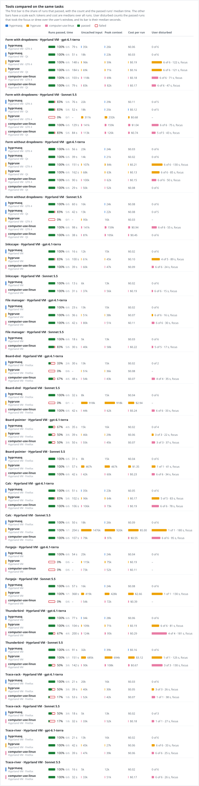
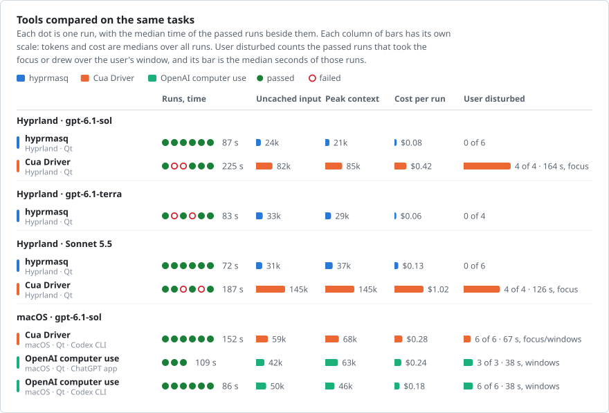
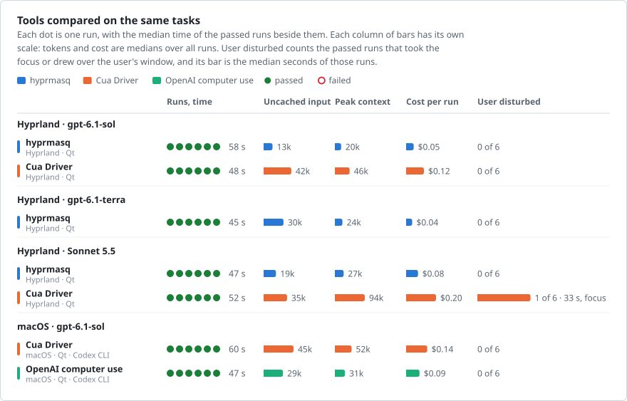
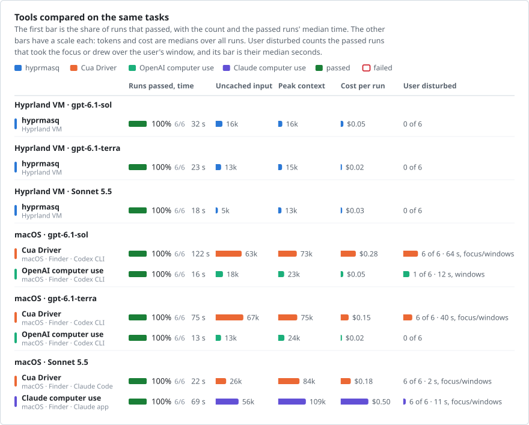
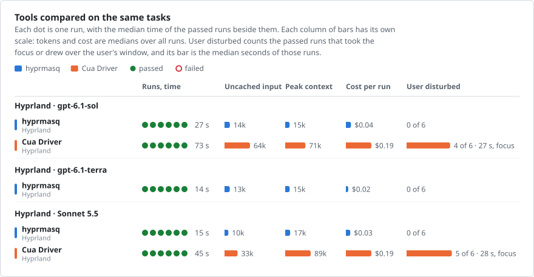

# Comparisons with other computer-use tools

hyprmasq beside three other tools that let an agent use a Linux desktop, on the eleven tasks of the
[benchmarks](benchmarks.md) in their VM, six runs per task and agent, while the user works on their own workspace:

- **[Cua Driver](https://github.com/trycua/cua)** passed 73 % of its runs on the nine tasks it can do, where hyprmasq
  passed 91 %, took 2.4 times as long and took the user's focus in most of them. It cannot act in Firefox or Thunderbird on Hyprland.
- **[computer-use-linux](https://github.com/agent-sh/computer-use-linux)** and
  **[hypruse](https://github.com/IlyasKhallouki/hypruse)** passed 77 % and 74 % with Terra where hyprmasq passed 92 %,
  took 1.7 and 2.0 times as long, and took the user's focus in nearly every passed run.

No hyprmasq run disturbed the user. Every failed hyprmasq run was the model's error, such as a label dropped on a
distractor in the board's photo, as [benchmarks](benchmarks.md) shows for the benchmark's runs: its failed runs look
like its passed ones, with as many calls and tokens and no failed tool call. Each tool ran as its authors document it,
run by hyprmasq's author. Every run is
in [comparison/data](comparison/data), and [Method](#method) has the tasks and the setups. An
[addendum](#addendum-the-tasks-on-macos) sets OpenAI's computer use, Claude's computer use and Cua Driver on a Mac
beside hyprmasq's runs of four of the tasks.

## hyprmasq and Cua Driver

<!-- render vm-hyprmasq,vm-hyprmasq-qt,vm-cua,vm-cua-qt,vm-cua-chromium comparison-pooled -->
<picture>
  <source media="(prefers-color-scheme: dark)" srcset="comparison/comparison-pooled-dark.svg">
  
</picture>
<!-- /render -->

On the nine tasks that both can do, with the form in both of its toolkits, hyprmasq passed 180 of 198 runs and Cua
145. For the same task, toolkit and agent, Cua's median time was 2.4 times hyprmasq's, its peak context 3.4 times and
its cost per run 3.9 times. Cua left the user undisturbed only in the Qt form without dropdowns, whose controls it
can set through accessibility. Elsewhere it fell back to input in the foreground, as its plugin sends input in the
background only to two exact Arch packages, none of which the VM has. On Thunderbird and Forgejo it passed no run.

What Cua Driver can drive, app by app

| App | Tasks | hyprmasq | Cua Driver |
| --- | --- | --- | --- |
| Firefox | Board, trace | In the background | Refused. Its foreground input refuses Firefox, which binds the user's seat more than once (`foreground_primary_binding`), and its browser tools take Chromium only. None of 72 runs passed. |
| Firefox and LibreOffice Calc | Calc | In the background | 16 of 18 runs passed, 12 of them in the foreground. The agents read the reports in Firefox through its accessibility tree, and entered them in Calc. |
| Chromium | Board, trace and calc, for Cua | Not run, the tasks use Firefox | In the foreground. Its browser tools refuse on Hyprland, as they attach through a GNOME Shell helper (`browser_wrong_target_refused`). The plugin refuses input while a drag and drop is active (`foreground_dnd`), which the board's dnd variant needs, and a trace's curve is straight strokes, as Cua has no path of several points on Hyprland. |
| Thunderbird | Thunderbird | In the background | Refused, as Firefox. None of 18 runs passed. |
| Chromium | Forgejo | In the background | None of 18 runs passed. Its browser tools refused, as above, and its foreground input refused while the user typed (`foreground_physical_keys`). |
| The Qt questionnaire | Form | In the background | Through accessibility, in the background: each run of the form without dropdowns left the user undisturbed. A list item of a Qt dropdown takes no accessibility selection, so its lists went to the foreground, and few runs with dropdowns passed. |
| The GTK 4 questionnaire | Form | In the background | Its checkboxes expose no accessibility action, which Cua told the agent, so it clicked them in the foreground, in every run. |
| Nautilus and Inkscape | File manager, Inkscape | In the background | Through accessibility, and in the foreground where accessibility fell short, such as a drag or a field's text. |

Board, trace and calc ran for Cua in Chromium, where it can act. The
[Firefox runs](comparison/data/vm-cua-firefox.json) are kept, and [bench's README](../bench/README.md) has how each
refusal comes about, with the places in Cua's source.

<!-- render vm-hyprmasq,vm-hyprmasq-qt,vm-cua,vm-cua-qt,vm-cua-chromium comparison-table -->

Numbers

**Outcome and time**

| Task | Agent | Tool | Where | Passed | Time s | In tools s | Calls | Failed calls | Focus away s | Windows over user s |
| --- | --- | --- | --- | --- | --- | --- | --- | --- | --- | --- |
| Form with dropdowns | gpt-6.1-sol | hyprmasq | Hyprland VM · GTK 4 | 6/6 | 94 (83–119) | 34 (32–40) | 17 (16–22) | 0 (0–0) | 0 (0–0) | – |
| Form with dropdowns | gpt-6.1-sol | hyprmasq | Hyprland VM · Qt | 6/6 | 55 (52–59) | 27 (26–28) | 10 (10–13) | 0 (0–0) | 0 (0–0) | – |
| Form with dropdowns | gpt-6.1-sol | Cua Driver | Hyprland VM · GTK 4 | 6/6 | 361 (310–411) | 156 (127–205) | 41 (31–48) | 10 (7–14) | 307 (243–369) | – |
| Form with dropdowns | gpt-6.1-sol | Cua Driver | Hyprland VM · Qt | 4/6 | 209 (180–282) | 80 (44–105) | 28 (10–47) | 10 (1–12) | 162 (88–195) | – |
| Form with dropdowns | gpt-6.1-terra | hyprmasq | Hyprland VM · GTK 4 | 6/6 | 79 (68–90) | 34 (30–35) | 20 (13–20) | 0 (0–0) | 0 (0–0) | – |
| Form with dropdowns | gpt-6.1-terra | hyprmasq | Hyprland VM · Qt | 6/6 | 51 (46–53) | 29 (27–30) | 8 (8–10) | 0 (0–0) | 0 (0–0) | – |
| Form with dropdowns | gpt-6.1-terra | Cua Driver | Hyprland VM · GTK 4 | 6/6 | 171 (157–220) | 64 (50–124) | 34 (29–39) | 6 (6–8) | 141 (122–177) | – |
| Form with dropdowns | gpt-6.1-terra | Cua Driver | Hyprland VM · Qt | 0/6 | – | – | 5 (5–11) | 0 (0–2) | – | – |
| Form with dropdowns | Sonnet 5.5 | hyprmasq | Hyprland VM · GTK 4 | 5/6 | 76 (74–142) | 36 (34–46) | 15 (14–36) | 0 (0–0) | 0 (0–0) | – |
| Form with dropdowns | Sonnet 5.5 | hyprmasq | Hyprland VM · Qt | 5/6 | 52 (48–72) | 28 (26–31) | 13 (10–16) | 0 (0–1) | 0 (0–0) | – |
| Form with dropdowns | Sonnet 5.5 | Cua Driver | Hyprland VM · GTK 4 | 2/6 | 148 (143–152) | 30 (20–40) | 26 (16–59) | 8 (5–14) | 125 (124–127) | – |
| Form with dropdowns | Sonnet 5.5 | Cua Driver | Hyprland VM · Qt | 1/6 | 92 | 23 | 12 (7–49) | 0 (0–11) | 59 | – |
| Form without dropdowns | gpt-6.1-sol | hyprmasq | Hyprland VM · GTK 4 | 6/6 | 68 (63–76) | 32 (32–34) | 8 (7–12) | 0 (0–0) | 0 (0–0) | – |
| Form without dropdowns | gpt-6.1-sol | hyprmasq | Hyprland VM · Qt | 6/6 | 49 (46–56) | 25 (24–26) | 7 (7–11) | 0 (0–0) | 0 (0–0) | – |
| Form without dropdowns | gpt-6.1-sol | Cua Driver | Hyprland VM · GTK 4 | 6/6 | 160 (120–194) | 66 (44–94) | 17 (14–21) | 2 (2–4) | 91 (75–112) | – |
| Form without dropdowns | gpt-6.1-sol | Cua Driver | Hyprland VM · Qt | 6/6 | 46 (44–49) | 12 (11–15) | 9 (7–9) | 1 (0–2) | 0 (0–0) | – |
| Form without dropdowns | gpt-6.1-terra | hyprmasq | Hyprland VM · GTK 4 | 6/6 | 56 (53–59) | 32 (32–35) | 7 (7–7) | 0 (0–0) | 0 (0–0) | – |
| Form without dropdowns | gpt-6.1-terra | hyprmasq | Hyprland VM · Qt | 6/6 | 39 (35–44) | 24 (24–25) | 6 (6–6) | 0 (0–0) | 0 (0–0) | – |
| Form without dropdowns | gpt-6.1-terra | Cua Driver | Hyprland VM · GTK 4 | 6/6 | 92 (63–104) | 34 (20–53) | 15 (11–18) | 2 (0–2) | 46 (32–70) | – |
| Form without dropdowns | gpt-6.1-terra | Cua Driver | Hyprland VM · Qt | 6/6 | 28 (21–30) | 9 (8–11) | 4 (4–6) | 0 (0–0) | 0 (0–0) | – |
| Form without dropdowns | Sonnet 5.5 | hyprmasq | Hyprland VM · GTK 4 | 6/6 | 60 (56–71) | 29 (27–30) | 10 (9–15) | 0 (0–2) | 0 (0–0) | – |
| Form without dropdowns | Sonnet 5.5 | hyprmasq | Hyprland VM · Qt | 5/6 | 42 (42–51) | 24 (24–29) | 10 (9–16) | 0 (0–2) | 0 (0–0) | – |
| Form without dropdowns | Sonnet 5.5 | Cua Driver | Hyprland VM · GTK 4 | 6/6 | 101 (50–118) | 23 (11–35) | 30 (18–67) | 2 (1–6) | 61 (29–91) | – |
| Form without dropdowns | Sonnet 5.5 | Cua Driver | Hyprland VM · Qt | 6/6 | 45 (37–61) | 14 (11–20) | 10 (8–14) | 1 (0–3) | 0 (0–0) | – |
| Inkscape | gpt-6.1-sol | hyprmasq | Hyprland VM | 6/6 | 22 (20–24) | 3 (3–4) | 4 (4–4) | 0 (0–0) | 0 (0–0) | – |
| Inkscape | gpt-6.1-sol | Cua Driver | Hyprland VM | 6/6 | 72 (45–82) | 20 (15–29) | 8 (7–9) | 2 (1–3) | 29 (15–49) | – |
| Inkscape | gpt-6.1-terra | hyprmasq | Hyprland VM | 6/6 | 16 (15–17) | 3 (3–4) | 3 (3–3) | 0 (0–0) | 0 (0–0) | – |
| Inkscape | gpt-6.1-terra | Cua Driver | Hyprland VM | 6/6 | 38 (33–39) | 11 (6–11) | 6 (4–6) | 1 (0–1) | 18 (12–21) | – |
| Inkscape | Sonnet 5.5 | hyprmasq | Hyprland VM | 6/6 | 13 (11–18) | 3 (3–4) | 3 (3–4) | 0 (0–1) | 0 (0–0) | – |
| Inkscape | Sonnet 5.5 | Cua Driver | Hyprland VM | 6/6 | 37 (29–73) | 8 (6–28) | 16 (15–20) | 2 (2–3) | 22 (17–52) | – |
| File manager | gpt-6.1-sol | hyprmasq | Hyprland VM | 6/6 | 32 (25–64) | 6 (5–12) | 6 (5–10) | 0 (0–0) | 0 (0–0) | – |
| File manager | gpt-6.1-sol | Cua Driver | Hyprland VM | 5/6 | 96 (54–170) | 19 (18–38) | 14 (10–19) | 4 (3–5) | 50 (26–124) | – |
| File manager | gpt-6.1-terra | hyprmasq | Hyprland VM | 6/6 | 23 (20–34) | 6 (5–12) | 6 (5–10) | 0 (0–0) | 0 (0–0) | – |
| File manager | gpt-6.1-terra | Cua Driver | Hyprland VM | 4/6 | 72 (56–79) | 24 (13–26) | 16 (14–22) | 4 (4–6) | 44 (32–58) | – |
| File manager | Sonnet 5.5 | hyprmasq | Hyprland VM | 6/6 | 18 (15–19) | 5 (5–6) | 5 (4–6) | 1 (0–1) | 0 (0–0) | – |
| File manager | Sonnet 5.5 | Cua Driver | Hyprland VM | 2/6 | 109 (104–114) | 21 (9–33) | 28 (22–42) | 15 (12–17) | 96 (92–102) | – |
| Board-dnd | gpt-6.1-sol | hyprmasq | Hyprland VM · Firefox | 1/6 | 47 | 12 | 5 (5–7) | 0 (0–0) | 0 | – |
| Board-dnd | gpt-6.1-sol | Cua Driver | Hyprland VM · Chromium | 3/6 | 123 (106–123) | 14 (12–17) | 17 (16–19) | 2 (2–7) | 49 (46–58) | – |
| Board-dnd | gpt-6.1-terra | hyprmasq | Hyprland VM · Firefox | 2/6 | 30 (27–33) | 12 (11–12) | 2 (2–3) | 0 (0–0) | 0 (0–0) | – |
| Board-dnd | gpt-6.1-terra | Cua Driver | Hyprland VM · Chromium | 0/6 | – | – | 8 (7–10) | 3 (2–4) | – | – |
| Board-dnd | Sonnet 5.5 | hyprmasq | Hyprland VM · Firefox | 6/6 | 32 (29–44) | 13 (12–19) | 4 (3–7) | 0 (0–1) | 0 (0–0) | – |
| Board-dnd | Sonnet 5.5 | Cua Driver | Hyprland VM · Chromium | 4/6 | 128 (101–137) | 18 (13–29) | 28 (17–48) | 6 (5–6) | 80 (72–98) | – |
| Board-pointer | gpt-6.1-sol | hyprmasq | Hyprland VM · Firefox | 5/6 | 48 (38–52) | 12 (12–13) | 5 (5–6) | 0 (0–0) | 0 (0–0) | – |
| Board-pointer | gpt-6.1-sol | Cua Driver | Hyprland VM · Chromium | 6/6 | 93 (88–101) | 18 (11–20) | 10 (9–11) | 1 (1–2) | 30 (24–40) | – |
| Board-pointer | gpt-6.1-terra | hyprmasq | Hyprland VM · Firefox | 4/6 | 35 (33–39) | 13 (12–13) | 4 (4–5) | 0 (0–0) | 0 (0–0) | – |
| Board-pointer | gpt-6.1-terra | Cua Driver | Hyprland VM · Chromium | 4/6 | 48 (44–52) | 11 (10–14) | 8 (7–9) | 1 (0–1) | 18 (15–28) | – |
| Board-pointer | Sonnet 5.5 | hyprmasq | Hyprland VM · Firefox | 6/6 | 31 (26–45) | 13 (12–13) | 4 (3–6) | 0 (0–0) | 0 (0–0) | – |
| Board-pointer | Sonnet 5.5 | Cua Driver | Hyprland VM · Chromium | 5/6 | 104 (71–122) | 10 (8–13) | 23 (16–37) | 5 (1–10) | 40 (29–75) | – |
| Calc | gpt-6.1-sol | hyprmasq | Hyprland VM · Firefox | 6/6 | 82 (76–94) | 20 (18–22) | 17 (15–17) | 0 (0–0) | 0 (0–0) | – |
| Calc | gpt-6.1-sol | Cua Driver | Hyprland VM · Chromium | 6/6 | 259 (156–299) | 117 (60–144) | 32 (25–38) | 3 (1–4) | 158 (57–195) | – |
| Calc | gpt-6.1-terra | hyprmasq | Hyprland VM · Firefox | 6/6 | 51 (43–62) | 16 (15–17) | 13 (12–14) | 0 (0–0) | 0 (0–0) | – |
| Calc | gpt-6.1-terra | Cua Driver | Hyprland VM · Chromium | 6/6 | 124 (111–236) | 61 (45–134) | 22 (17–31) | 1 (0–3) | 78 (29–120) | – |
| Calc | Sonnet 5.5 | hyprmasq | Hyprland VM · Firefox | 6/6 | 50 (46–88) | 16 (15–28) | 13 (12–16) | 0 (0–1) | 0 (0–0) | – |
| Calc | Sonnet 5.5 | Cua Driver | Hyprland VM · Chromium | 6/6 | 123 (83–204) | 23 (16–59) | 38 (28–52) | 0 (0–2) | 96 (64–182) | – |
| Forgejo | gpt-6.1-sol | hyprmasq | Hyprland VM | 6/6 | 74 (69–79) | 20 (18–22) | 16 (14–18) | 0 (0–0) | 0 (0–0) | – |
| Forgejo | gpt-6.1-sol | Cua Driver | Hyprland VM | 0/6 | – | – | 15 (9–39) | 3 (1–5) | – | – |
| Forgejo | gpt-6.1-terra | hyprmasq | Hyprland VM | 6/6 | 54 (51–60) | 20 (18–24) | 15 (14–16) | 0 (0–0) | 0 (0–0) | – |
| Forgejo | gpt-6.1-terra | Cua Driver | Hyprland VM | 0/6 | – | – | 27 (15–37) | 3 (1–8) | – | – |
| Forgejo | Sonnet 5.5 | hyprmasq | Hyprland VM | 6/6 | 57 (50–64) | 27 (24–31) | 12 (12–13) | 0 (0–0) | 0 (0–0) | – |
| Forgejo | Sonnet 5.5 | Cua Driver | Hyprland VM | 0/6 | – | – | 20 (14–29) | 4 (2–5) | – | – |
| Thunderbird | gpt-6.1-sol | hyprmasq | Hyprland VM | 6/6 | 129 (93–173) | 35 (27–42) | 26 (19–32) | 0 (0–0) | 0 (0–0) | – |
| Thunderbird | gpt-6.1-sol | Cua Driver | Hyprland VM | 0/6 | – | – | 18 (16–27) | 5 (4–6) | – | – |
| Thunderbird | gpt-6.1-terra | hyprmasq | Hyprland VM | 6/6 | 77 (65–86) | 34 (27–40) | 18 (17–20) | 1 (0–1) | 0 (0–0) | – |
| Thunderbird | gpt-6.1-terra | Cua Driver | Hyprland VM | 0/6 | – | – | 8 (7–11) | 4 (2–4) | – | – |
| Thunderbird | Sonnet 5.5 | hyprmasq | Hyprland VM | 6/6 | 91 (75–114) | 33 (30–36) | 20 (17–23) | 1 (0–1) | 0 (0–0) | – |
| Thunderbird | Sonnet 5.5 | Cua Driver | Hyprland VM | 0/6 | – | – | 16 (12–22) | 6 (4–10) | – | – |
| Trace-rack | gpt-6.1-sol | hyprmasq | Hyprland VM · Firefox | 6/6 | 38 (29–54) | 3 (2–6) | 6 (5–8) | 0 (0–0) | 0 (0–0) | – |
| Trace-rack | gpt-6.1-sol | Cua Driver | Hyprland VM · Chromium | 5/6 | 74 (55–125) | 9 (5–13) | 10 (8–11) | 2 (1–2) | 30 (11–75) | – |
| Trace-rack | gpt-6.1-terra | hyprmasq | Hyprland VM · Firefox | 6/6 | 21 (20–31) | 3 (2–5) | 3 (3–5) | 0 (0–0) | 0 (0–0) | – |
| Trace-rack | gpt-6.1-terra | Cua Driver | Hyprland VM · Chromium | 1/6 | 58 | 15 | 8 (6–11) | 1 (1–2) | 34 | – |
| Trace-rack | Sonnet 5.5 | hyprmasq | Hyprland VM · Firefox | 3/6 | 18 (15–19) | 2 (2–3) | 4 (3–4) | 0 (0–0) | 0 (0–0) | – |
| Trace-rack | Sonnet 5.5 | Cua Driver | Hyprland VM · Chromium | 2/6 | 76 (73–78) | 8 (8–8) | 12 (7–25) | 2 (1–3) | 51 (50–52) | – |
| Trace-river | gpt-6.1-sol | hyprmasq | Hyprland VM · Firefox | 6/6 | 74 (42–96) | 4 (2–6) | 7 (5–9) | 0 (0–0) | 0 (0–0) | – |
| Trace-river | gpt-6.1-sol | Cua Driver | Hyprland VM · Chromium | 6/6 | 84 (57–180) | 13 (6–31) | 11 (8–20) | 2 (1–2) | 35 (9–134) | – |
| Trace-river | gpt-6.1-terra | hyprmasq | Hyprland VM · Firefox | 6/6 | 21 (20–31) | 2 (2–6) | 3 (3–5) | 0 (0–0) | 0 (0–0) | – |
| Trace-river | gpt-6.1-terra | Cua Driver | Hyprland VM · Chromium | 5/6 | 49 (40–61) | 12 (7–19) | 8 (6–9) | 1 (1–1) | 14 (7–33) | – |
| Trace-river | Sonnet 5.5 | hyprmasq | Hyprland VM · Firefox | 6/6 | 16 (14–20) | 2 (2–3) | 3 (3–4) | 0 (0–0) | 0 (0–0) | – |
| Trace-river | Sonnet 5.5 | Cua Driver | Hyprland VM · Chromium | 2/6 | 76 (52–100) | 10 (8–12) | 11 (8–20) | 2 (1–2) | 50 (27–72) | – |

**Tokens and cost**

| Task | Agent | Tool | Where | Input k | Uncached k | Peak context k | Requests | Beyond first request k | Cost $ |
| --- | --- | --- | --- | --- | --- | --- | --- | --- | --- |
| Form with dropdowns | gpt-6.1-sol | hyprmasq | Hyprland VM · GTK 4 | 356 (337–480) | 33 (22–38) | 25 (24–28) | 19 (18–24) | 187 (165–262) | 0.11 (0.10–0.12) |
| Form with dropdowns | gpt-6.1-sol | hyprmasq | Hyprland VM · Qt | 194 (187–264) | 17 (12–32) | 20 (19–22) | 12 (12–15) | 85 (78–128) | 0.06 (0.05–0.09) |
| Form with dropdowns | gpt-6.1-sol | Cua Driver | Hyprland VM · GTK 4 | 2526 (1657–4320) | 89 (67–116) | 95 (74–114) | 40 (34–54) | 2066 (1232–3653) | 0.47 (0.35–0.71) |
| Form with dropdowns | gpt-6.1-sol | Cua Driver | Hyprland VM · Qt | 1930 (580–3003) | 70 (48–89) | 74 (56–93) | 33 (14–49) | 1520 (407–2391) | 0.37 (0.16–0.52) |
| Form with dropdowns | gpt-6.1-terra | hyprmasq | Hyprland VM · GTK 4 | 413 (276–441) | 35 (25–52) | 26 (22–27) | 22 (15–23) | 219 (131–234) | 0.06 (0.05–0.08) |
| Form with dropdowns | gpt-6.1-terra | hyprmasq | Hyprland VM · Qt | 180 (179–206) | 18 (14–27) | 23 (19–25) | 10 (10–12) | 89 (78–107) | 0.03 (0.03–0.04) |
| Form with dropdowns | gpt-6.1-terra | Cua Driver | Hyprland VM · GTK 4 | 1975 (1804–3095) | 121 (107–146) | 85 (60–102) | 37 (35–44) | 1486 (1374–2548) | 0.24 (0.21–0.29) |
| Form with dropdowns | gpt-6.1-terra | Cua Driver | Hyprland VM · Qt | 299 (258–819) | 72 (61–93) | 50 (47–79) | 9 (8–16) | 187 (160–623) | 0.09 (0.07–0.14) |
| Form with dropdowns | Sonnet 5.5 | hyprmasq | Hyprland VM · GTK 4 | 312 (257–983) | 22 (19–41) | 29 (26–48) | 16 (15–33) | 179 (138–723) | 0.11 (0.10–0.25) |
| Form with dropdowns | Sonnet 5.5 | hyprmasq | Hyprland VM · Qt | 224 (170–315) | 18 (14–23) | 25 (23–31) | 13 (11–17) | 112 (75–173) | 0.12 (0.09–0.14) |
| Form with dropdowns | Sonnet 5.5 | Cua Driver | Hyprland VM · GTK 4 | 1981 (1255–4174) | 44 (37–91) | 100 (93–148) | 24 (15–43) | 478 (294–1423) | 0.35 (0.28–0.71) |
| Form with dropdowns | Sonnet 5.5 | Cua Driver | Hyprland VM · Qt | 1076 (589–2984) | 59 (46–111) | 111 (103–139) | 12 (7–28) | 283 (114–1084) | 0.47 (0.27–0.71) |
| Form without dropdowns | gpt-6.1-sol | hyprmasq | Hyprland VM · GTK 4 | 174 (156–244) | 21 (17–34) | 24 (23–24) | 10 (9–14) | 83 (74–117) | 0.07 (0.06–0.10) |
| Form without dropdowns | gpt-6.1-sol | hyprmasq | Hyprland VM · Qt | 149 (149–217) | 23 (14–34) | 21 (21–21) | 9 (9–13) | 68 (67–99) | 0.07 (0.05–0.09) |
| Form without dropdowns | gpt-6.1-sol | Cua Driver | Hyprland VM · GTK 4 | 967 (717–1056) | 51 (44–70) | 55 (51–73) | 21 (18–24) | 694 (494–795) | 0.22 (0.18–0.26) |
| Form without dropdowns | gpt-6.1-sol | Cua Driver | Hyprland VM · Qt | 432 (349–453) | 41 (38–70) | 46 (45–52) | 12 (10–12) | 284 (224–303) | 0.13 (0.12–0.19) |
| Form without dropdowns | gpt-6.1-terra | hyprmasq | Hyprland VM · GTK 4 | 157 (156–159) | 23 (21–38) | 24 (23–24) | 9 (9–9) | 76 (75–78) | 0.03 (0.03–0.05) |
| Form without dropdowns | gpt-6.1-terra | hyprmasq | Hyprland VM · Qt | 130 (129–130) | 14 (13–21) | 21 (21–21) | 8 (8–8) | 57 (57–57) | 0.02 (0.02–0.03) |
| Form without dropdowns | gpt-6.1-terra | Cua Driver | Hyprland VM · GTK 4 | 774 (596–1228) | 72 (67–98) | 54 (51–77) | 20 (16–22) | 525 (399–958) | 0.12 (0.10–0.17) |
| Form without dropdowns | gpt-6.1-terra | Cua Driver | Hyprland VM · Qt | 272 (205–313) | 60 (47–83) | 39 (39–53) | 8 (7–10) | 162 (118–192) | 0.07 (0.06–0.10) |
| Form without dropdowns | Sonnet 5.5 | hyprmasq | Hyprland VM · GTK 4 | 191 (146–255) | 16 (13–21) | 24 (20–28) | 12 (10–14) | 98 (67–144) | 0.08 (0.06–0.10) |
| Form without dropdowns | Sonnet 5.5 | hyprmasq | Hyprland VM · Qt | 162 (153–265) | 13 (12–21) | 22 (21–29) | 10 (10–15) | 71 (66–136) | 0.08 (0.08–0.13) |
| Form without dropdowns | Sonnet 5.5 | Cua Driver | Hyprland VM · GTK 4 | 1833 (1134–2349) | 55 (44–63) | 111 (100–120) | 22 (14–26) | 458 (238–686) | 0.39 (0.26–0.46) |
| Form without dropdowns | Sonnet 5.5 | Cua Driver | Hyprland VM · Qt | 915 (665–1227) | 43 (39–44) | 100 (96–101) | 11 (8–14) | 204 (122–277) | 0.29 (0.27–0.34) |
| Inkscape | gpt-6.1-sol | hyprmasq | Hyprland VM | 80 (80–82) | 14 (8–24) | 15 (15–16) | 6 (6–6) | 25 (25–27) | 0.04 (0.03–0.06) |
| Inkscape | gpt-6.1-sol | Cua Driver | Hyprland VM | 437 (342–631) | 50 (35–60) | 52 (41–65) | 12 (10–13) | 293 (206–470) | 0.15 (0.11–0.19) |
| Inkscape | gpt-6.1-terra | hyprmasq | Hyprland VM | 65 (65–65) | 12 (12–20) | 15 (15–15) | 5 (5–5) | 19 (19–19) | 0.02 (0.02–0.02) |
| Inkscape | gpt-6.1-terra | Cua Driver | Hyprland VM | 324 (236–344) | 61 (53–64) | 45 (39–49) | 10 (8–10) | 200 (137–221) | 0.08 (0.06–0.08) |
| Inkscape | Sonnet 5.5 | hyprmasq | Hyprland VM | 43 (42–55) | 6 (5–6) | 13 (12–14) | 4 (4–5) | 11 (9–15) | 0.02 (0.02–0.03) |
| Inkscape | Sonnet 5.5 | Cua Driver | Hyprland VM | 775 (740–979) | 31 (26–86) | 84 (82–95) | 10 (10–12) | 120 (99–210) | 0.18 (0.16–0.30) |
| File manager | gpt-6.1-sol | hyprmasq | Hyprland VM | 110 (92–184) | 16 (11–24) | 16 (15–18) | 8 (7–12) | 37 (29–74) | 0.05 (0.04–0.06) |
| File manager | gpt-6.1-sol | Cua Driver | Hyprland VM | 653 (448–1259) | 40 (38–90) | 46 (40–76) | 17 (13–23) | 424 (275–972) | 0.16 (0.13–0.28) |
| File manager | gpt-6.1-terra | hyprmasq | Hyprland VM | 105 (92–179) | 13 (12–30) | 15 (15–18) | 8 (7–12) | 33 (29–70) | 0.02 (0.02–0.04) |
| File manager | gpt-6.1-terra | Cua Driver | Hyprland VM | 1092 (728–1805) | 131 (88–150) | 94 (71–105) | 20 (17–26) | 863 (504–1481) | 0.19 (0.14–0.24) |
| File manager | Sonnet 5.5 | hyprmasq | Hyprland VM | 66 (47–73) | 5 (4–6) | 13 (11–13) | 6 (5–7) | 13 (8–16) | 0.03 (0.02–0.03) |
| File manager | Sonnet 5.5 | Cua Driver | Hyprland VM | 1983 (1343–3006) | 32 (24–45) | 88 (81–101) | 25 (18–37) | 385 (191–637) | 0.32 (0.23–0.45) |
| Board-dnd | gpt-6.1-sol | hyprmasq | Hyprland VM · Firefox | 98 (98–132) | 14 (9–18) | 16 (16–17) | 7 (7–9) | 35 (34–50) | 0.05 (0.03–0.05) |
| Board-dnd | gpt-6.1-sol | Cua Driver | Hyprland VM · Chromium | 901 (763–1353) | 66 (49–136) | 73 (55–90) | 21 (18–27) | 657 (528–1021) | 0.24 (0.19–0.42) |
| Board-dnd | gpt-6.1-terra | hyprmasq | Hyprland VM · Firefox | 57 (49–65) | 13 (12–13) | 15 (14–16) | 4 (4–5) | 16 (13–20) | 0.02 (0.02–0.02) |
| Board-dnd | gpt-6.1-terra | Cua Driver | Hyprland VM · Chromium | 379 (337–475) | 58 (49–86) | 39 (37–41) | 12 (12–15) | 218 (188–291) | 0.08 (0.07–0.11) |
| Board-dnd | Sonnet 5.5 | hyprmasq | Hyprland VM · Firefox | 64 (42–95) | 8 (5–14) | 15 (13–17) | 6 (4–8) | 19 (9–32) | 0.04 (0.03–0.05) |
| Board-dnd | Sonnet 5.5 | Cua Driver | Hyprland VM · Chromium | 1724 (1193–1956) | 35 (25–51) | 92 (82–108) | 22 (16–25) | 305 (169–421) | 0.36 (0.25–0.42) |
| Board-pointer | gpt-6.1-sol | hyprmasq | Hyprland VM · Firefox | 98 (98–115) | 12 (9–19) | 16 (16–17) | 7 (7–8) | 35 (34–43) | 0.04 (0.03–0.05) |
| Board-pointer | gpt-6.1-sol | Cua Driver | Hyprland VM · Chromium | 509 (357–581) | 40 (37–49) | 46 (41–49) | 16 (13–17) | 315 (197–371) | 0.14 (0.14–0.15) |
| Board-pointer | gpt-6.1-terra | hyprmasq | Hyprland VM · Firefox | 81 (79–99) | 15 (13–19) | 16 (16–17) | 6 (6–7) | 27 (25–35) | 0.02 (0.02–0.03) |
| Board-pointer | gpt-6.1-terra | Cua Driver | Hyprland VM · Chromium | 346 (335–415) | 60 (49–74) | 39 (37–41) | 12 (11–14) | 199 (188–242) | 0.08 (0.07–0.10) |
| Board-pointer | Sonnet 5.5 | hyprmasq | Hyprland VM · Firefox | 64 (42–89) | 8 (6–16) | 15 (13–17) | 6 (4–7) | 20 (10–32) | 0.04 (0.03–0.07) |
| Board-pointer | Sonnet 5.5 | Cua Driver | Hyprland VM · Chromium | 1214 (1097–1578) | 37 (31–41) | 94 (88–98) | 16 (14–20) | 199 (149–298) | 0.31 (0.24–0.36) |
| Calc | gpt-6.1-sol | hyprmasq | Hyprland VM · Firefox | 321 (276–330) | 35 (27–47) | 25 (24–26) | 17 (15–17) | 164 (138–173) | 0.12 (0.10–0.14) |
| Calc | gpt-6.1-sol | Cua Driver | Hyprland VM · Chromium | 2196 (1290–2546) | 85 (62–126) | 88 (69–95) | 36 (27–39) | 1748 (953–2054) | 0.43 (0.28–0.49) |
| Calc | gpt-6.1-terra | hyprmasq | Hyprland VM · Firefox | 261 (237–300) | 35 (25–39) | 23 (23–24) | 15 (14–17) | 124 (109–145) | 0.05 (0.05–0.06) |
| Calc | gpt-6.1-terra | Cua Driver | Hyprland VM · Chromium | 1230 (1046–1931) | 104 (90–119) | 80 (71–100) | 25 (21–33) | 930 (766–1516) | 0.18 (0.15–0.23) |
| Calc | Sonnet 5.5 | hyprmasq | Hyprland VM · Firefox | 210 (196–311) | 18 (18–23) | 26 (25–31) | 12 (12–16) | 107 (99–178) | 0.09 (0.09–0.13) |
| Calc | Sonnet 5.5 | Cua Driver | Hyprland VM · Chromium | 2546 (1565–3586) | 61 (47–71) | 118 (104–127) | 26 (18–36) | 841 (406–1269) | 0.48 (0.32–0.62) |
| Forgejo | gpt-6.1-sol | hyprmasq | Hyprland VM | 317 (274–363) | 29 (24–32) | 24 (24–25) | 18 (16–20) | 151 (127–179) | 0.10 (0.08–0.11) |
| Forgejo | gpt-6.1-sol | Cua Driver | Hyprland VM | 779 (715–2365) | 63 (43–69) | 50 (49–73) | 20 (18–45) | 533 (475–1805) | 0.21 (0.18–0.41) |
| Forgejo | gpt-6.1-terra | hyprmasq | Hyprland VM | 293 (274–315) | 25 (24–38) | 24 (24–24) | 17 (16–18) | 138 (128–151) | 0.04 (0.04–0.06) |
| Forgejo | gpt-6.1-terra | Cua Driver | Hyprland VM | 1932 (831–3139) | 113 (51–200) | 94 (55–131) | 32 (20–40) | 1539 (583–2637) | 0.22 (0.10–0.32) |
| Forgejo | Sonnet 5.5 | hyprmasq | Hyprland VM | 176 (160–190) | 16 (15–18) | 24 (22–25) | 12 (11–12) | 81 (72–91) | 0.08 (0.07–0.08) |
| Forgejo | Sonnet 5.5 | Cua Driver | Hyprland VM | 1363 (1083–2347) | 45 (33–88) | 92 (88–116) | 18 (14–26) | 238 (183–676) | 0.31 (0.24–0.46) |
| Thunderbird | gpt-6.1-sol | hyprmasq | Hyprland VM | 641 (450–836) | 45 (39–52) | 35 (31–37) | 28 (21–33) | 389 (259–535) | 0.18 (0.14–0.19) |
| Thunderbird | gpt-6.1-sol | Cua Driver | Hyprland VM | 1119 (872–1308) | 71 (65–90) | 73 (65–98) | 22 (18–26) | 868 (646–986) | 0.27 (0.23–0.31) |
| Thunderbird | gpt-6.1-terra | hyprmasq | Hyprland VM | 397 (369–446) | 34 (29–61) | 28 (27–29) | 20 (19–22) | 216 (196–247) | 0.06 (0.05–0.09) |
| Thunderbird | gpt-6.1-terra | Cua Driver | Hyprland VM | 496 (290–754) | 88 (58–97) | 53 (35–61) | 12 (10–16) | 330 (165–556) | 0.11 (0.09–0.12) |
| Thunderbird | Sonnet 5.5 | hyprmasq | Hyprland VM | 500 (332–547) | 32 (25–34) | 39 (33–41) | 22 (17–23) | 327 (193–363) | 0.16 (0.12–0.17) |
| Thunderbird | Sonnet 5.5 | Cua Driver | Hyprland VM | 1110 (797–1569) | 28 (22–30) | 85 (79–86) | 14 (11–20) | 180 (92–287) | 0.21 (0.16–0.27) |
| Trace-rack | gpt-6.1-sol | hyprmasq | Hyprland VM · Firefox | 107 (98–158) | 14 (9–24) | 17 (17–20) | 8 (7–10) | 39 (34–66) | 0.04 (0.03–0.07) |
| Trace-rack | gpt-6.1-sol | Cua Driver | Hyprland VM · Chromium | 495 (311–585) | 41 (32–68) | 42 (39–47) | 15 (10–17) | 309 (186–372) | 0.15 (0.10–0.18) |
| Trace-rack | gpt-6.1-terra | hyprmasq | Hyprland VM · Firefox | 66 (64–100) | 20 (14–24) | 16 (15–18) | 5 (5–7) | 20 (19–36) | 0.03 (0.02–0.03) |
| Trace-rack | gpt-6.1-terra | Cua Driver | Hyprland VM · Chromium | 396 (287–586) | 57 (52–65) | 41 (37–46) | 12 (10–17) | 241 (164–377) | 0.08 (0.07–0.10) |
| Trace-rack | Sonnet 5.5 | hyprmasq | Hyprland VM · Firefox | 47 (41–54) | 5 (5–6) | 13 (12–13) | 4 (4–5) | 11 (8–14) | 0.02 (0.02–0.03) |
| Trace-rack | Sonnet 5.5 | Cua Driver | Hyprland VM · Chromium | 837 (479–1389) | 24 (17–32) | 80 (73–89) | 12 (7–18) | 99 (30–234) | 0.19 (0.11–0.28) |
| Trace-river | gpt-6.1-sol | hyprmasq | Hyprland VM · Firefox | 139 (100–186) | 20 (10–28) | 19 (17–22) | 9 (7–11) | 57 (36–86) | 0.06 (0.04–0.09) |
| Trace-river | gpt-6.1-sol | Cua Driver | Hyprland VM · Chromium | 570 (446–970) | 52 (40–62) | 52 (47–69) | 16 (12–23) | 370 (296–684) | 0.17 (0.15–0.23) |
| Trace-river | gpt-6.1-terra | hyprmasq | Hyprland VM · Firefox | 65 (65–98) | 13 (13–20) | 16 (15–17) | 5 (5–7) | 20 (19–35) | 0.02 (0.02–0.03) |
| Trace-river | gpt-6.1-terra | Cua Driver | Hyprland VM · Chromium | 409 (303–527) | 61 (56–85) | 42 (38–68) | 12 (10–14) | 254 (178–354) | 0.09 (0.07–0.11) |
| Trace-river | Sonnet 5.5 | hyprmasq | Hyprland VM · Firefox | 41 (41–55) | 5 (5–6) | 12 (12–14) | 4 (4–5) | 9 (8–14) | 0.02 (0.02–0.03) |
| Trace-river | Sonnet 5.5 | Cua Driver | Hyprland VM · Chromium | 710 (565–1091) | 25 (22–38) | 81 (79–94) | 10 (8–14) | 69 (51–193) | 0.17 (0.14–0.29) |

<!-- /render -->

## hyprmasq, computer-use-linux and hypruse

<!-- render vm-hyprmasq,vm-hyprmasq-qt,vm-computer-use-linux,vm-computer-use-linux-qt,vm-hypruse,vm-hypruse-qt,vm-hypruse-sonnet probe -->
<picture>
  <source media="(prefers-color-scheme: dark)" srcset="comparison/probe-dark.svg">
  
</picture>
<!-- /render -->

Both act through accessibility where they can, and otherwise through the user's focus: computer-use-linux brings a
window to the front even for its screenshot, and hypruse's pointer works only in the foreground.

- **Terra:** hyprmasq passed 72 of 78 runs, computer-use-linux 60 and hypruse 58. Task by task, computer-use-linux
  took 1.7 times as long as hyprmasq and hypruse 2.0 times, with 2.7 and 2.5 times hyprmasq's peak context. Only
  computer-use-linux's runs of the Qt form without dropdowns and one Inkscape run of hypruse left the user
  undisturbed.
- **Sonnet:** computer-use-linux passed 62 of 78 against hyprmasq's 72, took 1.6 times as long, with 4.1 times the
  peak context, and cost $0.37 a run against hyprmasq's $0.07.
- **Forgejo,** where the user types in their own browser window meanwhile: computer-use-linux passed none of its
  runs and hypruse none with Terra, as the user's typing went into the agent's sign-in form and addresses. hyprmasq
  passed each.

hypruse ran with Terra only. Its first seven runs with Sonnet, in the table, reached 18 times hyprmasq's peak context,
as in Claude Code it returns each screenshot twice, as an image and as base64 text.

Each task

<!-- render vm-hyprmasq,vm-hyprmasq-qt,vm-computer-use-linux,vm-computer-use-linux-qt,vm-hypruse,vm-hypruse-qt,vm-hypruse-sonnet probe-tasks -->
<picture>
  <source media="(prefers-color-scheme: dark)" srcset="comparison/probe-tasks-dark.svg">
  
</picture>
<!-- /render -->

<!-- render vm-hyprmasq,vm-hyprmasq-qt,vm-computer-use-linux,vm-computer-use-linux-qt,vm-hypruse,vm-hypruse-qt,vm-hypruse-sonnet probe-table -->

Numbers

**Outcome and time**

| Task | Agent | Tool | Where | Passed | Time s | In tools s | Calls | Failed calls | Focus away s | Windows over user s |
| --- | --- | --- | --- | --- | --- | --- | --- | --- | --- | --- |
| Form with dropdowns | gpt-6.1-terra | hyprmasq | Hyprland VM · GTK 4 | 6/6 | 79 (68–90) | 34 (30–35) | 20 (13–20) | 0 (0–0) | 0 (0–0) | – |
| Form with dropdowns | gpt-6.1-terra | hyprmasq | Hyprland VM · Qt | 6/6 | 51 (46–53) | 29 (27–30) | 8 (8–10) | 0 (0–0) | 0 (0–0) | – |
| Form with dropdowns | gpt-6.1-terra | hypruse | Hyprland VM · GTK 4 | 6/6 | 148 (113–221) | 47 (37–112) | 102 (37–208) | 4 (4–6) | 122 (99–200) | – |
| Form with dropdowns | gpt-6.1-terra | hypruse | Hyprland VM · Qt | 6/6 | 184 (151–251) | 115 (74–170) | 258 (188–407) | 0 (0–1) | 121 (99–169) | – |
| Form with dropdowns | gpt-6.1-terra | computer-use-linux | Hyprland VM · GTK 4 | 6/6 | 103 (95–143) | 52 (43–96) | 78 (73–89) | 0 (0–0) | 71 (65–104) | – |
| Form with dropdowns | gpt-6.1-terra | computer-use-linux | Hyprland VM · Qt | 6/6 | 79 (64–124) | 29 (18–40) | 72 (54–89) | 0 (0–0) | 47 (37–66) | – |
| Form with dropdowns | Sonnet 5.5 | hyprmasq | Hyprland VM · GTK 4 | 5/6 | 76 (74–142) | 36 (34–46) | 15 (14–36) | 0 (0–0) | 0 (0–0) | – |
| Form with dropdowns | Sonnet 5.5 | hyprmasq | Hyprland VM · Qt | 5/6 | 52 (48–72) | 28 (26–31) | 13 (10–16) | 0 (0–1) | 0 (0–0) | – |
| Form with dropdowns | Sonnet 5.5 | hypruse | Hyprland VM · GTK 4 | 0/1 | – | – | 10 | 0 | – | – |
| Form with dropdowns | Sonnet 5.5 | computer-use-linux | Hyprland VM · GTK 4 | 6/6 | 129 (85–148) | 38 (28–44) | 69 (53–89) | 0 (0–0) | 75 (55–87) | – |
| Form with dropdowns | Sonnet 5.5 | computer-use-linux | Hyprland VM · Qt | 5/6 | 84 (82–116) | 20 (16–23) | 58 (41–66) | 0 (0–2) | 43 (41–58) | – |
| Form without dropdowns | gpt-6.1-terra | hyprmasq | Hyprland VM · GTK 4 | 6/6 | 56 (53–59) | 32 (32–35) | 7 (7–7) | 0 (0–0) | 0 (0–0) | – |
| Form without dropdowns | gpt-6.1-terra | hyprmasq | Hyprland VM · Qt | 6/6 | 39 (35–44) | 24 (24–25) | 6 (6–6) | 0 (0–0) | 0 (0–0) | – |
| Form without dropdowns | gpt-6.1-terra | hypruse | Hyprland VM · GTK 4 | 6/6 | 151 (95–245) | 54 (33–103) | 96 (53–234) | 5 (5–6) | 130 (80–219) | – |
| Form without dropdowns | gpt-6.1-terra | hypruse | Hyprland VM · Qt | 6/6 | 162 (133–198) | 111 (76–125) | 180 (31–288) | 0 (0–1) | 85 (68–118) | – |
| Form without dropdowns | gpt-6.1-terra | computer-use-linux | Hyprland VM · GTK 4 | 6/6 | 90 (68–212) | 40 (28–154) | 78 (71–92) | 0 (0–17) | 50 (36–72) | – |
| Form without dropdowns | gpt-6.1-terra | computer-use-linux | Hyprland VM · Qt | 6/6 | 29 (24–78) | 4 (3–37) | 42 (41–95) | 0 (0–17) | 0 (0–0) | – |
| Form without dropdowns | Sonnet 5.5 | hyprmasq | Hyprland VM · GTK 4 | 6/6 | 60 (56–71) | 29 (27–30) | 10 (9–15) | 0 (0–2) | 0 (0–0) | – |
| Form without dropdowns | Sonnet 5.5 | hyprmasq | Hyprland VM · Qt | 5/6 | 42 (42–51) | 24 (24–29) | 10 (9–16) | 0 (0–2) | 0 (0–0) | – |
| Form without dropdowns | Sonnet 5.5 | hypruse | Hyprland VM · GTK 4 | 0/1 | – | – | 4 | 0 | – | – |
| Form without dropdowns | Sonnet 5.5 | computer-use-linux | Hyprland VM · GTK 4 | 6/6 | 98 (74–128) | 27 (20–33) | 59 (53–63) | 0 (0–0) | 55 (46–79) | – |
| Form without dropdowns | Sonnet 5.5 | computer-use-linux | Hyprland VM · Qt | 6/6 | 38 (33–44) | 4 (4–4) | 40 (39–41) | 0 (0–0) | 0 (0–0) | – |
| Inkscape | gpt-6.1-terra | hyprmasq | Hyprland VM | 6/6 | 16 (15–17) | 3 (3–4) | 3 (3–3) | 0 (0–0) | 0 (0–0) | – |
| Inkscape | gpt-6.1-terra | hypruse | Hyprland VM | 5/6 | 100 (28–166) | 51 (8–81) | 38 (6–69) | 0 (0–2) | 82 (0–144) | – |
| Inkscape | gpt-6.1-terra | computer-use-linux | Hyprland VM | 6/6 | 39 (34–62) | 14 (11–17) | 9 (9–9) | 0 (0–0) | 24 (22–38) | – |
| Inkscape | Sonnet 5.5 | hyprmasq | Hyprland VM | 6/6 | 13 (11–18) | 3 (3–4) | 3 (3–4) | 0 (0–1) | 0 (0–0) | – |
| Inkscape | Sonnet 5.5 | computer-use-linux | Hyprland VM | 6/6 | 31 (25–38) | 12 (11–17) | 8 (8–9) | 0 (0–0) | 15 (12–20) | – |
| File manager | gpt-6.1-terra | hyprmasq | Hyprland VM | 6/6 | 23 (20–34) | 6 (5–12) | 6 (5–10) | 0 (0–0) | 0 (0–0) | – |
| File manager | gpt-6.1-terra | hypruse | Hyprland VM | 6/6 | 36 (30–46) | 9 (7–10) | 15 (12–16) | 0 (0–0) | 16 (14–19) | – |
| File manager | gpt-6.1-terra | computer-use-linux | Hyprland VM | 6/6 | 42 (33–54) | 12 (10–16) | 11 (10–11) | 0 (0–0) | 30 (25–38) | – |
| File manager | Sonnet 5.5 | hyprmasq | Hyprland VM | 6/6 | 18 (15–19) | 5 (5–6) | 5 (4–6) | 1 (0–1) | 0 (0–0) | – |
| File manager | Sonnet 5.5 | computer-use-linux | Hyprland VM | 5/6 | 30 (27–31) | 11 (8–12) | 14 (11–19) | 0 (0–1) | 17 (17–21) | – |
| Board-dnd | gpt-6.1-terra | hyprmasq | Hyprland VM · Firefox | 2/6 | 30 (27–33) | 12 (11–12) | 2 (2–3) | 0 (0–0) | 0 (0–0) | – |
| Board-dnd | gpt-6.1-terra | hypruse | Hyprland VM · Firefox | 0/6 | – | – | 10 (8–10) | 0 (0–0) | – | – |
| Board-dnd | gpt-6.1-terra | computer-use-linux | Hyprland VM · Firefox | 4/6 | 48 (43–55) | 20 (18–22) | 13 (13–13) | 0 (0–0) | 35 (33–41) | – |
| Board-dnd | Sonnet 5.5 | hyprmasq | Hyprland VM · Firefox | 6/6 | 32 (29–44) | 13 (12–19) | 4 (3–7) | 0 (0–1) | 0 (0–0) | – |
| Board-dnd | Sonnet 5.5 | hypruse | Hyprland VM · Firefox | 0/1 | – | – | 17 | 0 | – | – |
| Board-dnd | Sonnet 5.5 | computer-use-linux | Hyprland VM · Firefox | 6/6 | 42 (37–52) | 16 (15–20) | 13 (13–13) | 0 (0–0) | 33 (29–40) | – |
| Board-pointer | gpt-6.1-terra | hyprmasq | Hyprland VM · Firefox | 4/6 | 35 (33–39) | 13 (12–13) | 4 (4–5) | 0 (0–0) | 0 (0–0) | – |
| Board-pointer | gpt-6.1-terra | hypruse | Hyprland VM · Firefox | 3/6 | 39 (33–43) | 9 (8–13) | 14 (13–16) | 0 (0–0) | 22 (18–31) | – |
| Board-pointer | gpt-6.1-terra | computer-use-linux | Hyprland VM · Firefox | 3/6 | 50 (43–53) | 21 (17–22) | 13 (12–14) | 0 (0–0) | 37 (33–38) | – |
| Board-pointer | Sonnet 5.5 | hyprmasq | Hyprland VM · Firefox | 6/6 | 31 (26–45) | 13 (12–13) | 4 (3–6) | 0 (0–0) | 0 (0–0) | – |
| Board-pointer | Sonnet 5.5 | hypruse | Hyprland VM · Firefox | 1/1 | 57 | 9 | 14 | 0 | 41 | – |
| Board-pointer | Sonnet 5.5 | computer-use-linux | Hyprland VM · Firefox | 6/6 | 42 (35–55) | 16 (15–28) | 12 (11–15) | 0 (0–1) | 34 (25–41) | – |
| Calc | gpt-6.1-terra | hyprmasq | Hyprland VM · Firefox | 6/6 | 51 (43–62) | 16 (15–17) | 13 (12–14) | 0 (0–0) | 0 (0–0) | – |
| Calc | gpt-6.1-terra | hypruse | Hyprland VM · Firefox | 5/6 | 102 (76–145) | 33 (21–48) | 33 (24–69) | 0 (0–2) | 83 (59–124) | – |
| Calc | gpt-6.1-terra | computer-use-linux | Hyprland VM · Firefox | 6/6 | 106 (74–189) | 41 (21–108) | 46 (24–59) | 1 (1–2) | 78 (54–167) | – |
| Calc | Sonnet 5.5 | hyprmasq | Hyprland VM · Firefox | 6/6 | 50 (46–88) | 16 (15–28) | 13 (12–16) | 0 (0–1) | 0 (0–0) | – |
| Calc | Sonnet 5.5 | hypruse | Hyprland VM · Firefox | 1/1 | 204 | 15 | 46 | 0 | 180 | – |
| Calc | Sonnet 5.5 | computer-use-linux | Hyprland VM · Firefox | 6/6 | 107 (78–160) | 52 (36–88) | 43 (38–58) | 1 (1–2) | 95 (67–138) | – |
| Forgejo | gpt-6.1-terra | hyprmasq | Hyprland VM | 6/6 | 54 (51–60) | 20 (18–24) | 15 (14–16) | 0 (0–0) | 0 (0–0) | – |
| Forgejo | gpt-6.1-terra | hypruse | Hyprland VM | 0/6 | – | – | 37 (27–50) | 0 (0–1) | – | – |
| Forgejo | gpt-6.1-terra | computer-use-linux | Hyprland VM | 0/6 | – | – | 25 (13–31) | 2 (0–4) | – | – |
| Forgejo | Sonnet 5.5 | hyprmasq | Hyprland VM | 6/6 | 57 (50–64) | 27 (24–31) | 12 (12–13) | 0 (0–0) | 0 (0–0) | – |
| Forgejo | Sonnet 5.5 | hypruse | Hyprland VM | 1/1 | 368 | 120 | 107 | 2 | 130 | – |
| Forgejo | Sonnet 5.5 | computer-use-linux | Hyprland VM | 0/6 | – | – | 25 (12–35) | 2 (0–4) | – | – |
| Thunderbird | gpt-6.1-terra | hyprmasq | Hyprland VM | 6/6 | 77 (65–86) | 34 (27–40) | 18 (17–20) | 1 (0–1) | 0 (0–0) | – |
| Thunderbird | gpt-6.1-terra | hypruse | Hyprland VM | 6/6 | 104 (90–115) | 34 (25–36) | 48 (47–53) | 0 (0–0) | 81 (62–92) | – |
| Thunderbird | gpt-6.1-terra | computer-use-linux | Hyprland VM | 4/6 | 200 (159–325) | 89 (54–108) | 80 (18–109) | 4 (1–9) | 181 (144–304) | – |
| Thunderbird | Sonnet 5.5 | hyprmasq | Hyprland VM | 6/6 | 91 (75–114) | 33 (30–36) | 20 (17–23) | 1 (0–1) | 0 (0–0) | – |
| Thunderbird | Sonnet 5.5 | hypruse | Hyprland VM | 1/1 | 151 | 32 | 60 | 1 | 125 | – |
| Thunderbird | Sonnet 5.5 | computer-use-linux | Hyprland VM | 3/6 | 142 (142–142) | 51 (45–55) | 54 (23–88) | 6 (6–7) | 130 (129–131) | – |
| Trace-rack | gpt-6.1-terra | hyprmasq | Hyprland VM · Firefox | 6/6 | 21 (20–31) | 3 (2–5) | 3 (3–5) | 0 (0–0) | 0 (0–0) | – |
| Trace-rack | gpt-6.1-terra | hypruse | Hyprland VM · Firefox | 3/6 | 39 (31–47) | 11 (8–16) | 14 (5–18) | 0 (0–0) | 26 (24–33) | – |
| Trace-rack | gpt-6.1-terra | computer-use-linux | Hyprland VM · Firefox | 1/6 | 53 | 12 | 10 (10–12) | 0 (0–0) | 38 | – |
| Trace-rack | Sonnet 5.5 | hyprmasq | Hyprland VM · Firefox | 3/6 | 18 (15–19) | 2 (2–3) | 4 (3–4) | 0 (0–0) | 0 (0–0) | – |
| Trace-rack | Sonnet 5.5 | computer-use-linux | Hyprland VM · Firefox | 1/6 | 32 | 10 | 10 (7–22) | 0 (0–0) | 27 | – |
| Trace-river | gpt-6.1-terra | hyprmasq | Hyprland VM · Firefox | 6/6 | 21 (20–31) | 2 (2–6) | 3 (3–5) | 0 (0–0) | 0 (0–0) | – |
| Trace-river | gpt-6.1-terra | hypruse | Hyprland VM · Firefox | 6/6 | 42 (37–60) | 20 (12–29) | 22 (5–26) | 0 (0–0) | 33 (23–48) | – |
| Trace-river | gpt-6.1-terra | computer-use-linux | Hyprland VM · Firefox | 6/6 | 39 (30–41) | 17 (14–20) | 16 (14–20) | 0 (0–0) | 25 (20–29) | – |
| Trace-river | Sonnet 5.5 | hyprmasq | Hyprland VM · Firefox | 6/6 | 16 (14–20) | 2 (2–3) | 3 (3–4) | 0 (0–0) | 0 (0–0) | – |
| Trace-river | Sonnet 5.5 | computer-use-linux | Hyprland VM · Firefox | 6/6 | 32 (24–87) | 13 (10–30) | 12 (9–25) | 0 (0–0) | 26 (18–80) | – |

**Tokens and cost**

| Task | Agent | Tool | Where | Input k | Uncached k | Peak context k | Requests | Beyond first request k | Cost $ |
| --- | --- | --- | --- | --- | --- | --- | --- | --- | --- |
| Form with dropdowns | gpt-6.1-terra | hyprmasq | Hyprland VM · GTK 4 | 413 (276–441) | 35 (25–52) | 26 (22–27) | 22 (15–23) | 219 (131–234) | 0.06 (0.05–0.08) |
| Form with dropdowns | gpt-6.1-terra | hyprmasq | Hyprland VM · Qt | 180 (179–206) | 18 (14–27) | 23 (19–25) | 10 (10–12) | 89 (78–107) | 0.03 (0.03–0.04) |
| Form with dropdowns | gpt-6.1-terra | hypruse | Hyprland VM · GTK 4 | 1516 (1354–3947) | 96 (78–151) | 59 (55–111) | 36 (33–57) | 1195 (1055–3432) | 0.19 (0.17–0.37) |
| Form with dropdowns | gpt-6.1-terra | hypruse | Hyprland VM · Qt | 1446 (1063–2475) | 69 (48–102) | 71 (49–85) | 36 (30–42) | 1116 (786–2095) | 0.16 (0.12–0.24) |
| Form with dropdowns | gpt-6.1-terra | computer-use-linux | Hyprland VM · GTK 4 | 1255 (1095–1354) | 118 (108–173) | 69 (66–73) | 24 (22–26) | 940 (798–1007) | 0.18 (0.17–0.24) |
| Form with dropdowns | gpt-6.1-terra | computer-use-linux | Hyprland VM · Qt | 1647 (1202–2110) | 83 (79–88) | 82 (73–89) | 30 (20–32) | 1251 (932–1683) | 0.17 (0.15–0.20) |
| Form with dropdowns | Sonnet 5.5 | hyprmasq | Hyprland VM · GTK 4 | 312 (257–983) | 22 (19–41) | 29 (26–48) | 16 (15–33) | 179 (138–723) | 0.11 (0.10–0.25) |
| Form with dropdowns | Sonnet 5.5 | hyprmasq | Hyprland VM · Qt | 224 (170–315) | 18 (14–23) | 25 (23–31) | 13 (11–17) | 112 (75–173) | 0.12 (0.09–0.14) |
| Form with dropdowns | Sonnet 5.5 | hypruse | Hyprland VM · GTK 4 | 1512 | 311 | 232 | 11 | 1392 | 0.68 |
| Form with dropdowns | Sonnet 5.5 | computer-use-linux | Hyprland VM · GTK 4 | 3765 (2278–4971) | 141 (120–184) | 159 (138–202) | 30 (23–39) | 2914 (1614–3846) | 1.04 (0.76–1.27) |
| Form with dropdowns | Sonnet 5.5 | computer-use-linux | Hyprland VM · Qt | 2522 (991–3448) | 113 (102–124) | 126 (120–142) | 25 (12–32) | 1803 (645–2526) | 0.74 (0.61–0.91) |
| Form without dropdowns | gpt-6.1-terra | hyprmasq | Hyprland VM · GTK 4 | 157 (156–159) | 23 (21–38) | 24 (23–24) | 9 (9–9) | 76 (75–78) | 0.03 (0.03–0.05) |
| Form without dropdowns | gpt-6.1-terra | hyprmasq | Hyprland VM · Qt | 130 (129–130) | 14 (13–21) | 21 (21–21) | 8 (8–8) | 57 (57–57) | 0.02 (0.02–0.03) |
| Form without dropdowns | gpt-6.1-terra | hypruse | Hyprland VM · GTK 4 | 1690 (1065–2913) | 107 (88–141) | 84 (56–95) | 34 (27–50) | 1378 (821–2461) | 0.21 (0.15–0.29) |
| Form without dropdowns | gpt-6.1-terra | hypruse | Hyprland VM · Qt | 984 (928–1678) | 68 (40–116) | 63 (47–92) | 28 (26–34) | 735 (675–1371) | 0.13 (0.10–0.21) |
| Form without dropdowns | gpt-6.1-terra | computer-use-linux | Hyprland VM · GTK 4 | 872 (757–1178) | 100 (95–112) | 62 (61–65) | 19 (17–26) | 617 (531–827) | 0.15 (0.14–0.16) |
| Form without dropdowns | gpt-6.1-terra | computer-use-linux | Hyprland VM · Qt | 479 (401–511) | 50 (44–74) | 52 (49–55) | 12 (10–12) | 318 (266–351) | 0.08 (0.07–0.09) |
| Form without dropdowns | Sonnet 5.5 | hyprmasq | Hyprland VM · GTK 4 | 191 (146–255) | 16 (13–21) | 24 (20–28) | 12 (10–14) | 98 (67–144) | 0.08 (0.06–0.10) |
| Form without dropdowns | Sonnet 5.5 | hyprmasq | Hyprland VM · Qt | 162 (153–265) | 13 (12–21) | 22 (21–29) | 10 (10–15) | 71 (66–136) | 0.08 (0.08–0.13) |
| Form without dropdowns | Sonnet 5.5 | hypruse | Hyprland VM · GTK 4 | 156 | 95 | 16 | 5 | 100 | 0.03 |
| Form without dropdowns | Sonnet 5.5 | computer-use-linux | Hyprland VM · GTK 4 | 2957 (2498–3916) | 141 (128–158) | 159 (146–176) | 24 (22–30) | 2229 (1864–2956) | 0.94 (0.82–1.08) |
| Form without dropdowns | Sonnet 5.5 | computer-use-linux | Hyprland VM · Qt | 685 (523–827) | 87 (71–94) | 105 (89–112) | 10 (8–11) | 411 (293–510) | 0.45 (0.37–0.49) |
| Inkscape | gpt-6.1-terra | hyprmasq | Hyprland VM | 65 (65–65) | 12 (12–20) | 15 (15–15) | 5 (5–5) | 19 (19–19) | 0.02 (0.02–0.02) |
| Inkscape | gpt-6.1-terra | hypruse | Hyprland VM | 762 (229–1171) | 61 (28–82) | 45 (34–70) | 20 (9–32) | 563 (138–881) | 0.10 (0.04–0.14) |
| Inkscape | gpt-6.1-terra | computer-use-linux | Hyprland VM | 493 (424–505) | 60 (52–92) | 47 (43–48) | 13 (12–13) | 319 (262–329) | 0.09 (0.07–0.12) |
| Inkscape | Sonnet 5.5 | hyprmasq | Hyprland VM | 43 (42–55) | 6 (5–6) | 13 (12–14) | 4 (4–5) | 11 (9–15) | 0.02 (0.02–0.03) |
| Inkscape | Sonnet 5.5 | computer-use-linux | Hyprland VM | 405 (354–488) | 37 (37–38) | 56 (55–56) | 8 (8–10) | 159 (123–198) | 0.19 (0.19–0.21) |
| File manager | gpt-6.1-terra | hyprmasq | Hyprland VM | 105 (92–179) | 13 (12–30) | 15 (15–18) | 8 (7–12) | 33 (29–70) | 0.02 (0.02–0.04) |
| File manager | gpt-6.1-terra | hypruse | Hyprland VM | 372 (342–551) | 51 (33–60) | 38 (34–62) | 14 (12–15) | 240 (224–415) | 0.07 (0.05–0.09) |
| File manager | gpt-6.1-terra | computer-use-linux | Hyprland VM | 532 (455–587) | 80 (62–92) | 51 (44–53) | 14 (13–14) | 352 (279–400) | 0.11 (0.09–0.12) |
| File manager | Sonnet 5.5 | hyprmasq | Hyprland VM | 66 (47–73) | 5 (4–6) | 13 (11–13) | 6 (5–7) | 13 (8–16) | 0.03 (0.02–0.03) |
| File manager | Sonnet 5.5 | computer-use-linux | Hyprland VM | 473 (418–608) | 40 (37–43) | 58 (55–61) | 10 (9–12) | 183 (160–261) | 0.22 (0.20–0.23) |
| Board-dnd | gpt-6.1-terra | hyprmasq | Hyprland VM · Firefox | 57 (49–65) | 13 (12–13) | 15 (14–16) | 4 (4–5) | 16 (13–20) | 0.02 (0.02–0.02) |
| Board-dnd | gpt-6.1-terra | hypruse | Hyprland VM · Firefox | 406 (315–465) | 51 (39–75) | 36 (31–40) | 14 (13–15) | 275 (197–329) | 0.08 (0.06–0.09) |
| Board-dnd | gpt-6.1-terra | computer-use-linux | Hyprland VM · Firefox | 302 (254–314) | 54 (48–79) | 43 (41–47) | 9 (8–9) | 181 (147–192) | 0.07 (0.06–0.09) |
| Board-dnd | Sonnet 5.5 | hyprmasq | Hyprland VM · Firefox | 64 (42–95) | 8 (5–14) | 15 (13–17) | 6 (4–8) | 19 (9–32) | 0.04 (0.03–0.05) |
| Board-dnd | Sonnet 5.5 | hypruse | Hyprland VM · Firefox | 6594 | 918 | 918 | 15 | 6426 | 2.94 |
| Board-dnd | Sonnet 5.5 | computer-use-linux | Hyprland VM · Firefox | 353 (326–411) | 44 (37–62) | 62 (55–63) | 7 (7–8) | 151 (124–180) | 0.24 (0.21–0.31) |
| Board-pointer | gpt-6.1-terra | hyprmasq | Hyprland VM · Firefox | 81 (79–99) | 15 (13–19) | 16 (16–17) | 6 (6–7) | 27 (25–35) | 0.02 (0.02–0.03) |
| Board-pointer | gpt-6.1-terra | hypruse | Hyprland VM · Firefox | 260 (212–305) | 46 (34–64) | 29 (26–32) | 12 (9–12) | 156 (127–196) | 0.06 (0.05–0.08) |
| Board-pointer | gpt-6.1-terra | computer-use-linux | Hyprland VM · Firefox | 304 (255–354) | 55 (48–75) | 45 (43–46) | 9 (8–10) | 183 (148–219) | 0.07 (0.06–0.09) |
| Board-pointer | Sonnet 5.5 | hyprmasq | Hyprland VM · Firefox | 64 (42–89) | 8 (6–16) | 15 (13–17) | 6 (4–7) | 20 (10–32) | 0.04 (0.03–0.07) |
| Board-pointer | Sonnet 5.5 | hypruse | Hyprland VM · Firefox | 1908 | 467 | 467 | 8 | 1821 | 1.35 |
| Board-pointer | Sonnet 5.5 | computer-use-linux | Hyprland VM · Firefox | 354 (288–502) | 42 (39–45) | 60 (57–63) | 7 (6–10) | 141 (115–213) | 0.23 (0.21–0.25) |
| Calc | gpt-6.1-terra | hyprmasq | Hyprland VM · Firefox | 261 (237–300) | 35 (25–39) | 23 (23–24) | 15 (14–17) | 124 (109–145) | 0.05 (0.05–0.06) |
| Calc | gpt-6.1-terra | hypruse | Hyprland VM · Firefox | 1270 (871–2239) | 96 (68–127) | 64 (52–105) | 28 (22–38) | 1036 (669–1891) | 0.17 (0.13–0.24) |
| Calc | gpt-6.1-terra | computer-use-linux | Hyprland VM · Firefox | 1436 (1283–1867) | 106 (75–119) | 73 (67–80) | 27 (23–32) | 1070 (973–1431) | 0.19 (0.15–0.21) |
| Calc | Sonnet 5.5 | hyprmasq | Hyprland VM · Firefox | 210 (196–311) | 18 (18–23) | 26 (25–31) | 12 (12–16) | 107 (99–178) | 0.09 (0.09–0.13) |
| Calc | Sonnet 5.5 | hypruse | Hyprland VM · Firefox | 10677 | 1476 | 926 | 27 | – | 5.00 |
| Calc | Sonnet 5.5 | computer-use-linux | Hyprland VM · Firefox | 1740 (1299–2376) | 79 (60–99) | 97 (78–117) | 24 (21–30) | 1053 (656–1586) | 0.55 (0.43–0.70) |
| Forgejo | gpt-6.1-terra | hyprmasq | Hyprland VM | 293 (274–315) | 25 (24–38) | 24 (24–24) | 17 (16–18) | 138 (128–151) | 0.04 (0.04–0.06) |
| Forgejo | gpt-6.1-terra | hypruse | Hyprland VM | 1230 (907–1578) | 115 (103–142) | 75 (67–77) | 27 (23–32) | 983 (697–1285) | 0.19 (0.15–0.21) |
| Forgejo | gpt-6.1-terra | computer-use-linux | Hyprland VM | 677 (450–1079) | 73 (63–119) | 52 (43–57) | 16 (13–25) | 447 (275–742) | 0.11 (0.09–0.17) |
| Forgejo | Sonnet 5.5 | hyprmasq | Hyprland VM | 176 (160–190) | 16 (15–18) | 24 (22–25) | 12 (11–12) | 81 (72–91) | 0.08 (0.07–0.08) |
| Forgejo | Sonnet 5.5 | hypruse | Hyprland VM | 14777 | 419 | 428 | 54 | 14164 | 2.66 |
| Forgejo | Sonnet 5.5 | computer-use-linux | Hyprland VM | 1070 (558–1657) | 54 (35–72) | 72 (53–90) | 18 (12–29) | 530 (208–811) | 0.39 (0.21–0.47) |
| Thunderbird | gpt-6.1-terra | hyprmasq | Hyprland VM | 397 (369–446) | 34 (29–61) | 28 (27–29) | 20 (19–22) | 216 (196–247) | 0.06 (0.05–0.09) |
| Thunderbird | gpt-6.1-terra | hypruse | Hyprland VM | 1721 (1336–2196) | 109 (85–142) | 71 (65–99) | 39 (32–42) | 1354 (1046–1833) | 0.19 (0.18–0.24) |
| Thunderbird | gpt-6.1-terra | computer-use-linux | Hyprland VM | 2969 (793–3776) | 124 (92–139) | 95 (84–118) | 42 (17–53) | 2340 (563–3057) | 0.29 (0.13–0.33) |
| Thunderbird | Sonnet 5.5 | hyprmasq | Hyprland VM | 500 (332–547) | 32 (25–34) | 39 (33–41) | 22 (17–23) | 327 (193–363) | 0.16 (0.12–0.17) |
| Thunderbird | Sonnet 5.5 | hypruse | Hyprland VM | 13984 | 685 | 694 | 35 | 13597 | 3.12 |
| Thunderbird | Sonnet 5.5 | computer-use-linux | Hyprland VM | 2444 (1038–4504) | 90 (65–130) | 108 (83–148) | 30 (16–43) | 1530 (574–3257) | 0.67 (0.39–1.05) |
| Trace-rack | gpt-6.1-terra | hyprmasq | Hyprland VM · Firefox | 66 (64–100) | 20 (14–24) | 16 (15–18) | 5 (5–7) | 20 (19–36) | 0.03 (0.02–0.03) |
| Trace-rack | gpt-6.1-terra | hypruse | Hyprland VM · Firefox | 217 (177–251) | 40 (33–43) | 30 (27–32) | 9 (8–12) | 136 (104–152) | 0.05 (0.05–0.06) |
| Trace-rack | gpt-6.1-terra | computer-use-linux | Hyprland VM · Firefox | 270 (180–617) | 52 (44–68) | 42 (38–51) | 8 (6–16) | 162 (99–400) | 0.07 (0.05–0.09) |
| Trace-rack | Sonnet 5.5 | hyprmasq | Hyprland VM · Firefox | 47 (41–54) | 5 (5–6) | 13 (12–13) | 4 (4–5) | 11 (8–14) | 0.02 (0.02–0.03) |
| Trace-rack | Sonnet 5.5 | computer-use-linux | Hyprland VM · Firefox | 313 (279–699) | 33 (30–59) | 52 (48–77) | 8 (7–12) | 72 (55–350) | 0.18 (0.16–0.34) |
| Trace-river | gpt-6.1-terra | hyprmasq | Hyprland VM · Firefox | 65 (65–98) | 13 (13–20) | 16 (15–17) | 5 (5–7) | 20 (19–35) | 0.02 (0.02–0.03) |
| Trace-river | gpt-6.1-terra | hypruse | Hyprland VM · Firefox | 177 (140–246) | 45 (28–74) | 27 (24–32) | 8 (7–10) | 104 (76–155) | 0.06 (0.04–0.08) |
| Trace-river | gpt-6.1-terra | computer-use-linux | Hyprland VM · Firefox | 211 (180–285) | 47 (44–82) | 39 (38–47) | 7 (6–8) | 117 (99–178) | 0.06 (0.05–0.09) |
| Trace-river | Sonnet 5.5 | hyprmasq | Hyprland VM · Firefox | 41 (41–55) | 5 (5–6) | 12 (12–14) | 4 (4–5) | 9 (8–14) | 0.02 (0.02–0.03) |
| Trace-river | Sonnet 5.5 | computer-use-linux | Hyprland VM · Firefox | 277 (168–902) | 33 (22–42) | 51 (41–60) | 6 (5–19) | 74 (23–351) | 0.17 (0.12–0.30) |

<!-- /render -->

## Method

Tasks

The tasks, their VM, their grading and their measures are those of the [benchmarks](benchmarks.md): the user types in
a terminal on their own workspace, the task's apps are on another, and the agent works through the tool's MCP server
alone. Only the tool differs, and the prompt.

| Task | App | What the agent does |
| --- | --- | --- |
| Form with dropdowns | A questionnaire, in GTK 4 and in its Qt port | Answers 25 questions, checkboxes, sliders, text fields and dropdowns, and presses Submit. |
| Form without dropdowns | The same | The same with 25 questions of the other three kinds. |
| Inkscape | Inkscape | Moves a rectangle from x=120 to x=122 px and saves the drawing. |
| File manager | Nautilus | Renames `report-draft.txt` to `report-final.txt` and moves it into the folder `Archive`. |
| Board-dnd | A web page in Firefox | Drags nine labels onto their parts in a photo of a motherboard, with the page's HTML drag and drop. |
| Board-pointer | The same | The same with pointer events, as a custom widget takes a drag. |
| Calc | Firefox and LibreOffice Calc | Reads three months of revenue of each regional office from reports in Firefox's tabs, and enters them in a sheet. |
| Forgejo | Chromium | Signs in to Forgejo, uploads a file into a repository's folder with a given commit message, and connects a dashboard to the account through its OAuth popup. |
| Thunderbird | Thunderbird | Adds a mail account, then answers a colleague's question with what it finds in the inbox. |
| Trace-rack | A web page in Firefox | Draws a line with a brush along the rack of a mountain railway in a photo. |
| Trace-river | The same | Draws a line along a river's bank where it lies in the shadow of a hill. |

[bench/tasks](../bench/tasks) has each task's prompt, app and grading.

hyprmasq's author chose these tasks and developed hyprmasq against them. They cover common kinds of work on a
desktop, forms with dropdowns, drags, files, copying data between apps, mail, a sign-in with a popup and drawing, but
the results are hyprmasq's best case. Tasks chosen and fixed before any run, which no tool was tuned on, would test
them further.

Scope

- **Same session:** the agent works in the user's own session, beside them. Cua's separate desktop, a Cua Space,
  is not tested.
- **Cua on Hyprland** ran its opt-in input build, which its documentation calls experimental. The plugin package it
  documents for Arch sends no input of its own: with it, Cua filled text fields and sliders through accessibility,
  but could not tick checkboxes or pick from dropdowns ([run data](comparison/data/omarchy-form-codex-cua-documented.json)). OpenAI's
  computer use offers no desktop tool on Linux.
- **Runs:** six for each task, agent and tool, and seven of hypruse with Sonnet. They describe these runs, not a
  general ranking. The runs were spread over three desktop machines, so their times compare roughly.
- **Models:** Sol and Terra are OpenAI's `gpt-6.1-sol` and `gpt-6.1-terra` in Codex, Sonnet is Claude Sonnet 5.5 in
  Claude Code, all at medium effort. Costs are at the providers' API list prices.

Reading the figures

Time runs from the agent's start to its end, the median of the passed runs. Uncached input is the input tokens the
provider did not serve from its cache, summed over a run's requests. Cost is what the requests would cost at the
provider's list prices, cache reads at their lower price, for Codex too, which ran on a ChatGPT subscription. Peak
context is the largest single request. The user was disturbed while the focus was away from their window: the figures
count the passed runs that did, with the median seconds of those runs. Tokens, cost and calls count every run, failed ones too. The tables give the range in brackets, and the
per-run data is in [comparison/data](comparison/data).

The tools and their setups

- **hyprmasq:** the runs of the [benchmark set on Hyprland 0.57.0](benchmarks.md), the first six of each task and
  agent at medium effort, with the task's own prompt. The Qt questionnaire ran on a later build, with
  [#102](https://github.com/nyrda/hyprmasq/pull/102) to [#104](https://github.com/nyrda/hyprmasq/pull/104), and its
  Sonnet runs, as each of Cua's, computer-use-linux's and hypruse's in Qt, in Claude Code on a Claude subscription.
- **Cua Driver** 0.38.0, built from its release source as its documentation builds it on Linux, with the plugin's
  input build, on Hyprland 0.56.2: the plugin's input build refuses any other Hyprland, and its driver sees no window
  of Hyprland 0.57.0. Its skill is installed as `cua-driver skills install` installs it and named at the start of the
  prompt. Its server runs with `CUA_DRIVER_RS_ENABLE_WAYLAND=1`, as its Linux guide asks. The user's Chromium starts
  with `--force-renderer-accessibility`, as its browser guide asks, and Cua's server gets `--grant
  existing-profile` for Forgejo. Board, trace and calc ran in Chromium.
- **hypruse** 0.13.0 and **computer-use-linux** 0.7.32 on Hyprland 0.57.0, without hyprmasq's plugin, with their
  defaults. hypruse returns its screenshots as images, its mode for clients that cannot read its files, as the agent
  on the host cannot read the VM's. Terra ran in Codex on a ChatGPT subscription, Sonnet in Claude Code on a Claude
  subscription for computer-use-linux and through the Anthropic API for hypruse. Codex updated itself from 0.165.0
  to 0.166.0 and Claude Code from 2.1.312 to 2.1.314 during these series.
- **Prompt:** for every tool but hyprmasq, the task's comparison prompt, the same for each: the user
  works in another window, has authorized foreground input and focus changes if a tool needs them, and prefers that
  their window is left alone. hyprmasq's runs had the task's own prompt, which says that the tool works in the
  background. [bench's README](../bench/README.md) lists each tool's setup against its documentation.
- **Measured disturbance:** the focus away from the user's terminal, from Hyprland's events, as in the benchmarks.

## Addendum: the tasks on macOS

hyprmasq does not run on macOS. To see how the tools that do behave on the same work, four of the benchmark's tasks
ran on a Mac in its own apps, with OpenAI's computer use, Claude's computer use and Cua Driver, six times per task,
tool and agent: 144 runs, of which 143 passed. The figures set them beside hyprmasq's runs of the same tasks in the
benchmark's VM: the questionnaire's Qt port in both, Inkscape in both, and the file manager task in Nautilus in the
VM and in Finder on the Mac. The machines differ, so the times compare roughly. Context, tokens, cost and disturbance
compare better. [On the Mac](#on-the-mac) has the setup.

- **hyprmasq** had the smallest median peak context in every row and never disturbed the user. Its median cost per
  run was the lowest but in the file manager, where OpenAI's computer use cost a fraction of a cent less. With Sonnet
  it passed five of six runs of each form, its failures the model's errors.
- **OpenAI's computer use** came close to it in tokens, and was the fastest in the file manager and, with Sol and
  Terra, on the form without dropdowns. Its dropdown lists showed over the user's window while it chose from them,
  and in Inkscape its clicks brought Inkscape to the front.
- **Claude's computer use** had the largest median peak context of each task, 107k to 152k tokens, and the highest
  median cost per run. Where its background input fell short, in the dropdowns and in Finder's drag, it took full
  control of the screen, which hides the user's other apps. It failed one Inkscape run, saving the rectangle with a
  `fill-opacity` it had not had.
- **Cua Driver** went to the foreground in the dropdowns, in Inkscape and in Finder, with Sonnet only briefly, and its
  median peak context was two to seven times hyprmasq's.

Part of the difference in context is there before the first action: the first request, with the harness's system
prompt and tool definitions, was 8k to 9k tokens for hyprmasq, 14k to 16k for OpenAI's computer use and Cua with
Codex, and 65k to 68k for Cua in Claude Code and Claude's computer use. The tables' **Beyond first request** leaves it
out: a run's input less its requests times the first request. hyprmasq's was the smallest in 11 of the 12 rows. Its
small screenshots of one window and its actions batched into few requests drive all these measures, so they agree
more than independent results would.

### Form with dropdowns

<!-- render vm-hyprmasq-qt,macos-tasks comparison form -->
<picture>
  <source media="(prefers-color-scheme: dark)" srcset="comparison/comparison-form-dark.svg">
  
</picture>
<!-- /render -->

<!-- render vm-hyprmasq-qt,macos-tasks comparison-table form -->

Numbers: Form with dropdowns

**Outcome and time**

| Agent | Tool | Where | Passed | Time s | In tools s | Calls | Failed calls | Focus away s | Windows over user s |
| --- | --- | --- | --- | --- | --- | --- | --- | --- | --- |
| gpt-6.1-sol | hyprmasq | Hyprland VM · Qt | 6/6 | 55 (52–59) | 27 (26–28) | 10 (10–13) | 0 (0–0) | 0 (0–0) | – |
| gpt-6.1-terra | hyprmasq | Hyprland VM · Qt | 6/6 | 51 (46–53) | 29 (27–30) | 8 (8–10) | 0 (0–0) | 0 (0–0) | – |
| Sonnet 5.5 | hyprmasq | Hyprland VM · Qt | 5/6 | 52 (48–72) | 28 (26–31) | 13 (10–16) | 0 (0–1) | 0 (0–0) | – |
| gpt-6.1-sol | Cua Driver | macOS · Qt · Codex CLI | 6/6 | 129 (104–244) | 42 (29–58) | 24 (17–36) | 0 (0–0) | 42 (37–157) | 54 (46–167) |
| gpt-6.1-sol | OpenAI computer use | macOS · Qt · Codex CLI | 6/6 | 62 (39–113) | 12 (10–25) | 18 (13–27) | 1 (1–2) | 0 (0–72) | 20 (12–44) |
| gpt-6.1-terra | Cua Driver | macOS · Qt · Codex CLI | 6/6 | 107 (71–130) | 44 (29–56) | 28 (20–40) | 0 (0–1) | 42 (23–61) | 58 (30–71) |
| gpt-6.1-terra | OpenAI computer use | macOS · Qt · Codex CLI | 6/6 | 56 (41–85) | 19 (10–21) | 20 (18–36) | 2 (1–3) | 0 (0–0) | 16 (13–43) |
| Sonnet 5.5 | Cua Driver | macOS · Qt · Claude Code | 6/6 | 118 (104–201) | 48 (39–84) | 46 (34–84) | 0 (0–2) | 52 (0–126) | 59 (45–134) |
| Sonnet 5.5 | Claude computer use | macOS · Qt · Claude app | 6/6 | 209 (126–306) | 69 (45–107) | 84 (41–125) | 6 (5–6) | 91 (83–167) | 21 (18–25) |

**Tokens and cost**

| Agent | Tool | Where | Input k | Uncached k | Peak context k | Requests | Beyond first request k | Cost $ |
| --- | --- | --- | --- | --- | --- | --- | --- | --- |
| gpt-6.1-sol | hyprmasq | Hyprland VM · Qt | 194 (187–264) | 17 (12–32) | 20 (19–22) | 12 (12–15) | 85 (78–128) | 0.06 (0.05–0.09) |
| gpt-6.1-terra | hyprmasq | Hyprland VM · Qt | 180 (179–206) | 18 (14–27) | 23 (19–25) | 10 (10–12) | 89 (78–107) | 0.03 (0.03–0.04) |
| Sonnet 5.5 | hyprmasq | Hyprland VM · Qt | 224 (170–315) | 18 (14–23) | 25 (23–31) | 13 (11–17) | 112 (75–173) | 0.12 (0.09–0.14) |
| gpt-6.1-sol | Cua Driver | macOS · Qt · Codex CLI | 1387 (931–2394) | 80 (55–117) | 88 (65–92) | 26 (18–37) | 955 (648–1846) | 0.31 (0.22–0.44) |
| gpt-6.1-sol | OpenAI computer use | macOS · Qt · Codex CLI | 551 (383–1125) | 34 (28–74) | 38 (34–64) | 18 (14–28) | 294 (188–735) | 0.13 (0.10–0.23) |
| gpt-6.1-terra | Cua Driver | macOS · Qt · Codex CLI | 1481 (938–2495) | 59 (48–94) | 71 (59–100) | 28 (21–41) | 1034 (609–1853) | 0.15 (0.10–0.23) |
| gpt-6.1-terra | OpenAI computer use | macOS · Qt · Codex CLI | 737 (630–1565) | 43 (35–68) | 51 (47–60) | 21 (19–37) | 446 (367–1052) | 0.09 (0.07–0.14) |
| Sonnet 5.5 | Cua Driver | macOS · Qt · Claude Code | 3135 (2634–5684) | 107 (73–150) | 151 (131–184) | 28 (25–44) | 1312 (1007–2821) | 0.87 (0.63–1.22) |
| Sonnet 5.5 | Claude computer use | macOS · Qt · Claude app | 7330 (3909–9156) | 99 (78–114) | 152 (131–167) | 59 (36–73) | 3338 (1473–4258) | 1.26 (0.77–1.50) |

<!-- /render -->

### Form without dropdowns

<!-- render vm-hyprmasq-qt,macos-tasks comparison form-no-dropdowns -->
<picture>
  <source media="(prefers-color-scheme: dark)" srcset="comparison/comparison-form-no-dropdowns-dark.svg">
  
</picture>
<!-- /render -->

<!-- render vm-hyprmasq-qt,macos-tasks comparison-table form-no-dropdowns -->

Numbers: Form without dropdowns

**Outcome and time**

| Agent | Tool | Where | Passed | Time s | In tools s | Calls | Failed calls | Focus away s | Windows over user s |
| --- | --- | --- | --- | --- | --- | --- | --- | --- | --- |
| gpt-6.1-sol | hyprmasq | Hyprland VM · Qt | 6/6 | 49 (46–56) | 25 (24–26) | 7 (7–11) | 0 (0–0) | 0 (0–0) | – |
| gpt-6.1-terra | hyprmasq | Hyprland VM · Qt | 6/6 | 39 (35–44) | 24 (24–25) | 6 (6–6) | 0 (0–0) | 0 (0–0) | – |
| Sonnet 5.5 | hyprmasq | Hyprland VM · Qt | 5/6 | 42 (42–51) | 24 (24–29) | 10 (9–16) | 0 (0–2) | 0 (0–0) | – |
| gpt-6.1-sol | Cua Driver | macOS · Qt · Codex CLI | 6/6 | 46 (40–58) | 16 (16–18) | 7 (7–11) | 0 (0–0) | 0 (0–0) | 0 (0–0) |
| gpt-6.1-sol | OpenAI computer use | macOS · Qt · Codex CLI | 6/6 | 36 (32–56) | 7 (6–8) | 10 (8–11) | 1 (1–1) | 0 (0–0) | 0 (0–0) |
| gpt-6.1-terra | Cua Driver | macOS · Qt · Codex CLI | 6/6 | 29 (27–33) | 15 (15–15) | 6 (6–8) | 0 (0–1) | 0 (0–0) | 0 (0–0) |
| gpt-6.1-terra | OpenAI computer use | macOS · Qt · Codex CLI | 6/6 | 22 (18–24) | 6 (6–6) | 8 (7–8) | 1 (0–1) | 0 (0–0) | 0 (0–0) |
| Sonnet 5.5 | Cua Driver | macOS · Qt · Claude Code | 6/6 | 44 (35–48) | 26 (15–27) | 6 (4–8) | 0 (0–0) | 0 (0–0) | 0 (0–0) |
| Sonnet 5.5 | Claude computer use | macOS · Qt · Claude app | 6/6 | 127 (98–218) | 38 (29–85) | 53 (41–115) | 2 (0–8) | 0 (0–98) | 0 (0–0) |

**Tokens and cost**

| Agent | Tool | Where | Input k | Uncached k | Peak context k | Requests | Beyond first request k | Cost $ |
| --- | --- | --- | --- | --- | --- | --- | --- | --- |
| gpt-6.1-sol | hyprmasq | Hyprland VM · Qt | 149 (149–217) | 23 (14–34) | 21 (21–21) | 9 (9–13) | 68 (67–99) | 0.07 (0.05–0.09) |
| gpt-6.1-terra | hyprmasq | Hyprland VM · Qt | 130 (129–130) | 14 (13–21) | 21 (21–21) | 8 (8–8) | 57 (57–57) | 0.02 (0.02–0.03) |
| Sonnet 5.5 | hyprmasq | Hyprland VM · Qt | 162 (153–265) | 13 (12–21) | 22 (21–29) | 10 (10–15) | 71 (66–136) | 0.08 (0.08–0.13) |
| gpt-6.1-sol | Cua Driver | macOS · Qt · Codex CLI | 295 (276–464) | 41 (33–46) | 47 (43–56) | 8 (8–12) | 169 (150–291) | 0.12 (0.10–0.14) |
| gpt-6.1-sol | OpenAI computer use | macOS · Qt · Codex CLI | 278 (208–316) | 25 (21–57) | 31 (27–33) | 11 (9–12) | 125 (90–149) | 0.09 (0.07–0.15) |
| gpt-6.1-terra | Cua Driver | macOS · Qt · Codex CLI | 261 (218–296) | 39 (34–50) | 46 (46–59) | 7 (7–9) | 144 (108–170) | 0.06 (0.05–0.06) |
| gpt-6.1-terra | OpenAI computer use | macOS · Qt · Codex CLI | 216 (180–216) | 19 (16–42) | 28 (26–28) | 9 (8–9) | 91 (76–92) | 0.03 (0.03–0.05) |
| Sonnet 5.5 | Cua Driver | macOS · Qt · Claude Code | 555 (404–709) | 43 (38–97) | 99 (97–107) | 6 (5–8) | 132 (65–189) | 0.25 (0.21–0.44) |
| Sonnet 5.5 | Claude computer use | macOS · Qt · Claude app | 3524 (2878–4408) | 74 (55–84) | 127 (116–137) | 36 (27–45) | 1201 (866–1769) | 0.71 (0.65–0.88) |

<!-- /render -->

### File manager

<!-- render vm-hyprmasq,macos-tasks comparison files -->
<picture>
  <source media="(prefers-color-scheme: dark)" srcset="comparison/comparison-files-dark.svg">
  
</picture>
<!-- /render -->

<!-- render vm-hyprmasq,macos-tasks comparison-table files -->

Numbers: File manager

**Outcome and time**

| Agent | Tool | Where | Passed | Time s | In tools s | Calls | Failed calls | Focus away s | Windows over user s |
| --- | --- | --- | --- | --- | --- | --- | --- | --- | --- |
| gpt-6.1-sol | hyprmasq | Hyprland VM | 6/6 | 32 (25–64) | 6 (5–12) | 6 (5–10) | 0 (0–0) | 0 (0–0) | – |
| gpt-6.1-terra | hyprmasq | Hyprland VM | 6/6 | 23 (20–34) | 6 (5–12) | 6 (5–10) | 0 (0–0) | 0 (0–0) | – |
| Sonnet 5.5 | hyprmasq | Hyprland VM | 6/6 | 18 (15–19) | 5 (5–6) | 5 (4–6) | 1 (0–1) | 0 (0–0) | – |
| gpt-6.1-sol | Cua Driver | macOS · Finder · Codex CLI | 6/6 | 122 (71–206) | 27 (15–52) | 25 (16–34) | 0 (0–0) | 63 (1–153) | 63 (0–152) |
| gpt-6.1-sol | OpenAI computer use | macOS · Finder · Codex CLI | 6/6 | 16 (12–24) | 4 (4–5) | 4 (4–6) | 0 (0–0) | 0 (0–0) | 0 (0–12) |
| gpt-6.1-terra | Cua Driver | macOS · Finder · Codex CLI | 6/6 | 75 (60–82) | 23 (20–31) | 26 (20–30) | 0 (0–1) | 39 (25–48) | 38 (23–46) |
| gpt-6.1-terra | OpenAI computer use | macOS · Finder · Codex CLI | 6/6 | 13 (11–39) | 4 (4–8) | 5 (5–10) | 1 (1–1) | 0 (0–0) | 0 (0–0) |
| Sonnet 5.5 | Cua Driver | macOS · Finder · Claude Code | 6/6 | 22 (17–40) | 7 (4–9) | 9 (6–14) | 1 (0–1) | 1 (1–1) | 2 (1–6) |
| Sonnet 5.5 | Claude computer use | macOS · Finder · Claude app | 6/6 | 69 (49–139) | 22 (17–38) | 32 (19–49) | 4 (1–7) | 11 (8–14) | 0 (0–0) |

**Tokens and cost**

| Agent | Tool | Where | Input k | Uncached k | Peak context k | Requests | Beyond first request k | Cost $ |
| --- | --- | --- | --- | --- | --- | --- | --- | --- |
| gpt-6.1-sol | hyprmasq | Hyprland VM | 110 (92–184) | 16 (11–24) | 16 (15–18) | 8 (7–12) | 37 (29–74) | 0.05 (0.04–0.06) |
| gpt-6.1-terra | hyprmasq | Hyprland VM | 105 (92–179) | 13 (12–30) | 15 (15–18) | 8 (7–12) | 33 (29–70) | 0.02 (0.02–0.04) |
| Sonnet 5.5 | hyprmasq | Hyprland VM | 66 (47–73) | 5 (4–6) | 13 (11–13) | 6 (5–7) | 13 (8–16) | 0.03 (0.02–0.03) |
| gpt-6.1-sol | Cua Driver | macOS · Finder · Codex CLI | 1351 (964–2313) | 63 (50–91) | 73 (60–90) | 26 (17–35) | 926 (697–1763) | 0.28 (0.23–0.44) |
| gpt-6.1-sol | OpenAI computer use | macOS · Finder · Codex CLI | 102 (101–147) | 18 (17–24) | 23 (22–24) | 5 (5–7) | 32 (31–49) | 0.05 (0.04–0.06) |
| gpt-6.1-terra | Cua Driver | macOS · Finder · Codex CLI | 1450 (878–1837) | 67 (43–83) | 75 (55–90) | 27 (21–31) | 1011 (549–1399) | 0.15 (0.09–0.18) |
| gpt-6.1-terra | OpenAI computer use | macOS · Finder · Codex CLI | 127 (127–258) | 13 (12–32) | 24 (24–28) | 6 (6–11) | 43 (43–106) | 0.02 (0.02–0.05) |
| Sonnet 5.5 | Cua Driver | macOS · Finder · Claude Code | 648 (526–1200) | 26 (24–31) | 84 (82–96) | 8 (7–14) | 95 (56–289) | 0.18 (0.15–0.27) |
| Sonnet 5.5 | Claude computer use | macOS · Finder · Claude app | 2368 (1624–3363) | 56 (50–68) | 109 (103–122) | 24 (17–32) | 744 (474–1197) | 0.50 (0.39–0.69) |

<!-- /render -->

### Inkscape

<!-- render vm-hyprmasq,macos-tasks comparison inkscape -->
<picture>
  <source media="(prefers-color-scheme: dark)" srcset="comparison/comparison-inkscape-dark.svg">
  
</picture>
<!-- /render -->

<!-- render vm-hyprmasq,macos-tasks comparison-table inkscape -->

Numbers: Inkscape

**Outcome and time**

| Agent | Tool | Where | Passed | Time s | In tools s | Calls | Failed calls | Focus away s | Windows over user s |
| --- | --- | --- | --- | --- | --- | --- | --- | --- | --- |
| gpt-6.1-sol | hyprmasq | Hyprland VM | 6/6 | 22 (20–24) | 3 (3–4) | 4 (4–4) | 0 (0–0) | 0 (0–0) | – |
| gpt-6.1-terra | hyprmasq | Hyprland VM | 6/6 | 16 (15–17) | 3 (3–4) | 3 (3–3) | 0 (0–0) | 0 (0–0) | – |
| Sonnet 5.5 | hyprmasq | Hyprland VM | 6/6 | 13 (11–18) | 3 (3–4) | 3 (3–4) | 0 (0–1) | 0 (0–0) | – |
| gpt-6.1-sol | Cua Driver | macOS · Codex CLI | 6/6 | 56 (36–97) | 14 (10–27) | 11 (9–19) | 0 (0–0) | 6 (2–34) | 4 (1–32) |
| gpt-6.1-sol | OpenAI computer use | macOS · Codex CLI | 6/6 | 30 (28–38) | 6 (6–10) | 7 (7–8) | 0 (0–0) | 20 (18–28) | 20 (18–28) |
| gpt-6.1-terra | Cua Driver | macOS · Codex CLI | 6/6 | 47 (39–76) | 16 (16–35) | 12 (11–16) | 0 (0–0) | 7 (4–18) | 5 (2–14) |
| gpt-6.1-terra | OpenAI computer use | macOS · Codex CLI | 6/6 | 25 (20–31) | 6 (6–8) | 8 (7–8) | 0 (0–0) | 17 (14–19) | 17 (14–19) |
| Sonnet 5.5 | Cua Driver | macOS · Claude Code | 6/6 | 45 (23–175) | 15 (9–63) | 23 (13–90) | 1 (1–2) | 3 (1–30) | 2 (0–26) |
| Sonnet 5.5 | Claude computer use | macOS · Claude app | 5/6 | 49 (20–60) | 14 (5–20) | 27 (7–35) | 2 (0–3) | 0 (0–0) | 0 (0–0) |

**Tokens and cost**

| Agent | Tool | Where | Input k | Uncached k | Peak context k | Requests | Beyond first request k | Cost $ |
| --- | --- | --- | --- | --- | --- | --- | --- | --- |
| gpt-6.1-sol | hyprmasq | Hyprland VM | 80 (80–82) | 14 (8–24) | 15 (15–16) | 6 (6–6) | 25 (25–27) | 0.04 (0.03–0.06) |
| gpt-6.1-terra | hyprmasq | Hyprland VM | 65 (65–65) | 12 (12–20) | 15 (15–15) | 5 (5–5) | 19 (19–19) | 0.02 (0.02–0.02) |
| Sonnet 5.5 | hyprmasq | Hyprland VM | 43 (42–55) | 6 (5–6) | 13 (12–14) | 4 (4–5) | 11 (9–15) | 0.02 (0.02–0.03) |
| gpt-6.1-sol | Cua Driver | macOS · Codex CLI | 449 (375–1065) | 42 (36–62) | 48 (46–70) | 12 (10–20) | 260 (217–750) | 0.14 (0.11–0.24) |
| gpt-6.1-sol | OpenAI computer use | macOS · Codex CLI | 218 (218–253) | 30 (30–36) | 35 (35–35) | 8 (8–9) | 107 (106–128) | 0.08 (0.08–0.10) |
| gpt-6.1-terra | Cua Driver | macOS · Codex CLI | 459 (434–671) | 45 (35–83) | 47 (47–52) | 12 (12–17) | 263 (246–404) | 0.07 (0.06–0.12) |
| gpt-6.1-terra | OpenAI computer use | macOS · Codex CLI | 230 (217–261) | 28 (23–40) | 35 (34–41) | 8 (8–9) | 112 (106–136) | 0.04 (0.03–0.05) |
| Sonnet 5.5 | Cua Driver | macOS · Claude Code | 1183 (591–4144) | 29 (21–84) | 88 (80–137) | 14 (8–42) | 193 (69–1406) | 0.26 (0.16–0.91) |
| Sonnet 5.5 | Claude computer use | macOS · Claude app | 1498 (631–2002) | 54 (44–61) | 107 (97–114) | 16 (7–20) | 448 (157–648) | 0.40 (0.25–0.50) |

<!-- /render -->

### On the Mac

Setup

- **Machine:** MacBook Pro (M1 Max, 32 GB), macOS 26.5.2, on October 31, 2026. Nobody used it during the runs. The
  user's window is a TextEdit note in front, or the app the agent runs in, with the task's app open behind it.
- **Tasks:** the questionnaire's Qt port (PySide6 6.8.3) with and without dropdowns, the file manager task in a
  Finder window on a fresh folder Project, and the Inkscape task in Inkscape 1.4.4 from Homebrew, whose prompt says
  Cmd+S. Each is graded by the VM's checker of the task, Finder's `.DS_Store` files left out, and with a rule against
  other apps in front in place of the VM's against other windows.
- **Agents:** `gpt-6.1-sol`, `gpt-6.1-terra` and Claude Sonnet 5.5, all at medium effort. Sol and Terra ran in the
  Codex CLI 0.166.0-alpha.5.1 that the ChatGPT app 26.1027.30824 bundles, in code mode, with the standard service
  tier, which the runner checked in each run's log. Sonnet ran Cua in Claude Code 2.1.310 on a Claude subscription.
  Costs are at the providers' API list prices.
- **OpenAI's computer use:** the ChatGPT app's Computer Use plugin 1.0.1001641 and its unified computer use
  26.1023.51421, from a Codex home of its own with the user's login and the plugin's settings, but none of the
  user's instructions or memories.
- **Claude's computer use:** a Code session of the Claude app (4.4212.0, Claude Code 2.1.309) at Sonnet 5.5 Medium,
  with the app as the user's window. It loads the owner's `CLAUDE.md` and claude.ai connectors, a small part of its
  68k-token first request, most of the rest the app's own tool definitions. The runner drives the app through macOS's
  accessibility API, without an agent: it opens the session, pastes the prompt, and answers Claude's requests for the
  task's app and for full control of the screen with "Allow for this session". The time those requests waited is left
  out of a run's time.
- **Cua Driver** 0.38.0 with its MCP server and skill, from homes of its own for Codex and Claude Code, using the
  user's Cua daemon, which holds its grants. Its daemons were stopped during Claude's runs: each keeps a window over
  the whole screen for its cursor, which Claude's full control cannot hide, and Claude stopped at it in a first run.
- **Measured disturbance:** the frontmost app and the task app's windows drawn over the user's window, normal-layer
  windows that overlap it and popup lists alike, combined without counting their overlap twice. A run fails when an
  app other than the user's and the task's comes to the front.
- **Runs left out:** four runs of Claude's computer use made while Cua's daemons were up, and one Cua run that a
  macOS prompt to let Cua Driver control Finder held up. All five ran again under the setup above.

[bench/laptop](../bench/laptop/README.md) has the runner, `run_mac.py`, and the series' script, `mac_series.sh`.

