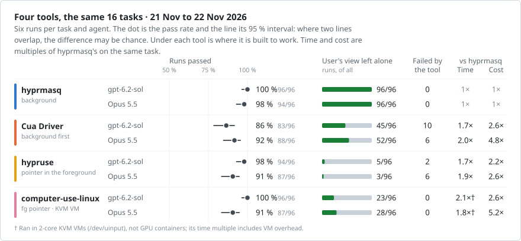
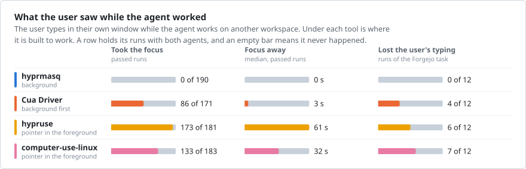
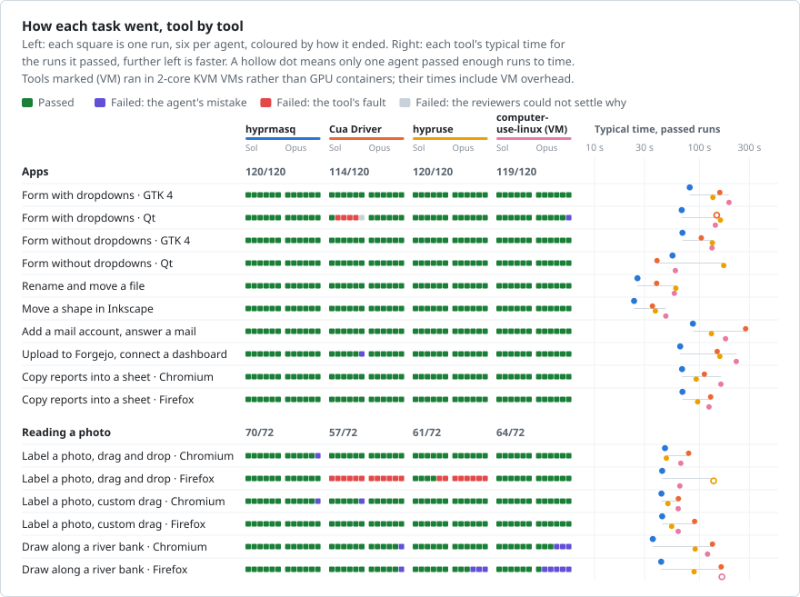

# Comparisons with other computer-use tools

hyprmasq beside [Cua Driver](https://github.com/trycua/cua) 0.56.0,
[computer-use-linux](https://github.com/agent-sh/computer-use-linux) 0.7.59 and
[hypruse](https://github.com/IlyasKhallouki/hypruse) 0.15.1 on the same 16 desktop tasks (Hyprland 0.57.2, machine C,
GPT-6.2 Sol and Claude Opus 5.5 at medium effort) while the user worked in their own window. `hyprmasq`, Cua Driver and
hypruse ran in rootless GPU containers; computer-use-linux ran in KVM VMs on the same host because on Hyprland its
pointer uses kernel `/dev/uinput`.

<!-- render v3-hyprmasq,v3-hyprmasq-chromium,v3-cua,v3-cua-chromium,v3-hypruse,v3-hypruse-chromium,v3-computer-use-linux,v3-computer-use-linux-chromium,v3-failures scorecard -->
<picture>
  <source media="(prefers-color-scheme: dark)" srcset="comparison/scorecard-dark.svg">
  
</picture>
<!-- /render -->

- **The user:** hyprmasq left the user's view alone in all 192 runs, with 0 lost characters in Forgejo. The other three
  took focus on half or more of their passed runs (Cua Driver 86/171, computer-use-linux 133/183, hypruse 173/181) and
  dropped user typing in Forgejo.
- **Runs passed:** hyprmasq passed 190/192 (96/96 Sol, 94/96 Opus; 0 overrides). With Sol, hyprmasq (96/96) and
  computer-use-linux (96/96) are ahead of Cua Driver (83/96); with Opus, all four overlap (87–94/96).
- **Time and cost:** the other GPU-container tools took **1.7–2.0×** as long (and `computer-use-linux` **1.8–2.1×** in
  KVM VMs against hyprmasq in containers) at **2.2–5.2×** the cost (`$0.08`/`$0.23` median for hyprmasq vs
  `$0.18–$0.21` / `$0.75–$1.06`).

These tasks are also hyprmasq's own benchmark suite. See [Method](#method) for setup notes, statistical caveats,
amendments and [all runs](comparison/data).

## Working in the background

Each tool takes a different approach to the background, so read this as what each design costs a user who keeps
working, not as a defect. Every agent was allowed to use the foreground when its tool needed it.

<!-- render v3-hyprmasq,v3-hyprmasq-chromium,v3-cua,v3-cua-chromium,v3-hypruse,v3-hypruse-chromium,v3-computer-use-linux,v3-computer-use-linux-chromium user-view -->
<picture>
  <source media="(prefers-color-scheme: dark)" srcset="comparison/user-view-dark.svg">
  
</picture>
<!-- /render -->

In Forgejo, where the user types notes in their own window meanwhile, hyprmasq kept the notes intact in all **12/12**
runs (0 lost characters), against **8/12** for Cua Driver (55 lost), **6/12** for hypruse (84 lost) and **5/12** for
computer-use-linux (129 lost).

How each tool handles the background and focus

- **hyprmasq** gives each window its own input, so clicks and drags never touch the user's pointer or focus.
- **Cua Driver** has background routes and falls back to the foreground where an app refuses them.
- **hypruse** runs in its default automatic background mode, sending keys and accessibility clicks in the background
  while refusing the pointer there (with foreground fallback via `background=false` or `focus_window`). It also offers
  a strict `HYPRUSE_BACKGROUND=1` mode that refuses all foreground and pointer actions to guarantee zero focus changes,
  at the cost of not being able to perform pointer-only tasks.
- **computer-use-linux** has an opt-in Hyprland background mode (`COMPUTER_USE_LINUX_HYPRLAND_BACKGROUND=1`) for
  screenshots (`grim -T`) and keys (`sendkeystate`), which the series turned on, plus AT-SPI element actions. Its
  pointer is the user's own via `/dev/uinput`.

**View left alone** means no window opened on the user's workspace, the workspace did not switch and the focus never
left the user's window. **Focus away** is the median across all passed runs (including zeros): because Cua Driver took
focus on 86 of 171 passed runs (50.3 %), its all-passed median lands at 3 s while its median across the 86 runs that
took focus is 55 s (against 41 s for computer-use-linux and 64 s for hypruse).

## What a run costs

<!-- render v3-hyprmasq,v3-hyprmasq-chromium,v3-cua,v3-cua-chromium,v3-hypruse,v3-hypruse-chromium,v3-computer-use-linux,v3-computer-use-linux-chromium usage -->
<picture>
  <source media="(prefers-color-scheme: dark)" srcset="comparison/usage-dark.svg">
  
</picture>
<!-- /render -->

- **Cost:** median `$0.08` Sol / `$0.23` Opus for hyprmasq, against `$0.18–$0.21` Sol and `$0.75–$1.06` Opus for the
  other three (`2.2–5.2×` by per-unit geometric mean). The main v3 Opus runs used eager MCP schemas because `run.py`
  omitted Claude Code's `ToolSearch` tool (see [Deferred tool loading](#deferred-tool-loading-toolsearch-vs-eager-schemas)
  below for the full 384-run `ToolSearch` comparison).
- **Round trips:** `9.5` Sol / `10.5` Opus median requests for hyprmasq (batched `act` calls returning changed crops)
  against `18–21` Sol and `13.5–33` Opus for the others.
- **Peak context:** `20.1k` Sol / `24.7k` Opus for hyprmasq against `37.3k–47.3k` Sol and `57.9k–118.6k` Opus for the
  others, with 0 history compactions across all 768 runs.

Totals, first-request tokens and round-trip details

- **Total cost over 96 runs per agent:** hyprmasq `$8.7` Sol / `$24.1` Opus, hypruse `$18.3` / `$70.3`, Cua Driver
  `$23.5` / `$125.5`, computer-use-linux `$22.3` / `$141.7`.
- **First request (tool schemas and skills):** hyprmasq `10.5k` Sol / `8.5k` Opus, hypruse `10.5k` / `12.5k`, Cua
  Driver `13.2k` / `61.7k`, computer-use-linux `16.4k` / `44.6k`.
- **hypruse Opus requests:** `33` median requests include ~10.6 `Read` round trips per run to inspect `file`-mode
  screenshots through a read-only mount of the screenshot directory.

These measures share causes, so they agree more than independent results would.

### Deferred tool loading (ToolSearch vs eager schemas)

In the main v3 series, Codex deferred MCP tool definitions automatically across all four tools (`10.5k–16.4k` first
request), whereas `bench/run.py`'s `--tools` flag omitted Claude Code's built-in `ToolSearch` tool (which is enabled by
default in Claude Code). Omitting `ToolSearch` forced Claude Code to send every MCP tool schema eagerly on every turn,
which penalized Cua Driver's 65-tool surface (`61.7k` first-request tokens) and `computer-use-linux`'s 19 tools
(`44.6k`) against hyprmasq's 6 (`8.5k`).

After adding `ToolSearch` to `bench/run.py`, all 384 Claude Opus 5.5 runs (6 repetitions × 16 units × 4 tools,
`--no-debrief`) were repeated at the same pinned `d9fe738` source and Claude Code 2.1.330, with `hyprmasq`, Cua Driver
and `hypruse` interleaved in 4 GPU containers on machine C and `computer-use-linux` in 2 × 2-core KVM VMs on machine D
(Ryzen 5 5600X). Showing both modes makes the tradeoff explicit:

<!-- render v3-hyprmasq,v3-hyprmasq-chromium,v3-cua,v3-cua-chromium,v3-hypruse,v3-hypruse-chromium,v3-computer-use-linux,v3-computer-use-linux-chromium,v3-ts-hyprmasq,v3-ts-hyprmasq-chromium,v3-ts-cua,v3-ts-cua-chromium,v3-ts-hypruse,v3-ts-hypruse-chromium,v3-ts-computer-use-linux,v3-ts-computer-use-linux-chromium toolsearch -->

Numbers: Claude Opus 5.5 with eager schemas vs ToolSearch

| Tool | Mode | Passed (95 % interval) | No view change, passed | First req k | Peak ctx k | Requests | Med cost | Total cost | Wall s, passed |
| --- | --- | --- | --- | --- | --- | --- | --- | --- | --- |
| hyprmasq | Eager schemas | 94/96 (93–99 %) | 94/94 | 8.5 | 24.7 | 10.5 | $0.23 | $24.1 | 52.0 s |
| hyprmasq | ToolSearch | 94/96 (93–99 %) | 94/94 | 3.6 | 26.4 | 13.0 | $0.28 | $28.1 | 59.5 s |
| Cua Driver | Eager schemas | 88/96 (84–96 %) | 45/88 | 61.7 | 110.8 | 24.0 | $1.06 | $125.5 | 104.7 s |
| Cua Driver | ToolSearch | 78/96 (72–88 %) | 38/78 | 9.7 | 66.5 | 22.0 | $0.83 | $102.5 | 96.8 s |
| hypruse | Eager schemas | 87/96 (83–95 %) | 3/87 | 12.5 | 57.9 | 33.0 | $0.75 | $70.3 | 89.0 s |
| hypruse | ToolSearch | 85/96 (81–93 %) | 14/85 | 5.8 | 52.1 | 32.0 | $0.80 | $89.5 | 103.4 s |
| computer-use-linux | Eager schemas | 87/96 (83–95 %) | 27/87 | 44.6 | 118.6 | 13.5 | $0.99 | $141.7 | 81.2 s |
| computer-use-linux | ToolSearch | 85/96 (81–93 %) | 27/85 | 15.0 | 112.3 | 16.0 | $1.12 | $149.7 | 80.1 s |

<!-- /render -->

- **Cua Driver** is the only tool that saved cost and context under `ToolSearch`: first-request tokens dropped from
  `61.7k` to `9.7k`, peak context fell `40 %` (`110.8k` to `66.5k`), and median cost dropped `22 %` (`$1.06` to `$0.83`,
  total `$125.5` to `$102.5`). At the same time, its pass rate dropped from `88/96` to `78/96` (`thunderbird` `6/6` to
  `2/6`, `form:qt-25` `6/6` to `3/6`, `trace:river:chromium` `5/6` to `3/6`, and `board:pointer:firefox` `6/6` to
  `5/6`).
- **The other three tools got slightly more expensive under `ToolSearch`** (`hyprmasq` `$0.23` to `$0.28`, `hypruse`
  `$0.75` to `$0.80`, `computer-use-linux` `$0.99` to `$1.12`): eager static prefixes hit Anthropic's prompt cache
  across consecutive runs (`cache_read`), whereas `ToolSearch` pulls schemas in mid-conversation as fresh per-run
  `cache_write` tokens plus extra `ToolSearch` round trips.
- **Under both modes, the ranking holds:** with `ToolSearch`, hyprmasq passed `94/96` (`94/94` view untouched) at
  `$0.28` median (`$28.1` total) against `78–85/96` and `$0.80–$1.12` median (`$89.5–$149.7` total, `2.9–4.0×` median
  cost) for the other three.

## Task by task

<!-- render v3-hyprmasq,v3-hyprmasq-chromium,v3-cua,v3-cua-chromium,v3-hypruse,v3-hypruse-chromium,v3-computer-use-linux,v3-computer-use-linux-chromium,v3-failures unit-grid -->
<picture>
  <source media="(prefers-color-scheme: dark)" srcset="comparison/unit-grid-dark.svg">
  
</picture>
<!-- /render -->

- **Time:** hyprmasq was fastest on 15 of 16 tasks (`23.8–86.7 s`). Cua Driver was faster on the Qt form without
  dropdowns (`39.4 s` vs `55.4 s`), setting fields and checkboxes directly through AT-SPI.
- **Runs passed:** with 6 runs per agent, most differences are within the noise. Against hyprmasq, the 95 % Wilson
  intervals separate on three tasks, all in hyprmasq's favour:
  - **Label a photo, drag and drop · Firefox:** hyprmasq 6/6 vs Cua Driver 0/6 (both agents) and hypruse 0/6 (Opus).
  - **Form with dropdowns · Qt:** hyprmasq 6/6 vs Cua Driver 1/6 (Sol).
  - **Draw along a river bank · Firefox:** hyprmasq 6/6 vs computer-use-linux 1/6 (Opus).

## Why runs failed

Two independent non-series reviewers (Claude Fable 5.2 and GPT-6.1 Sol) read every failed run without seeing each
other's verdict, any pass rate or the v2 capability table, agreeing on **42 of 43** failures (1 disagreement became
`unclear`).

<!-- render v3-hyprmasq,v3-hyprmasq-chromium,v3-cua,v3-cua-chromium,v3-hypruse,v3-hypruse-chromium,v3-computer-use-linux,v3-computer-use-linux-chromium,v3-failures attribution -->
<picture>
  <source media="(prefers-color-scheme: dark)" srcset="comparison/attribution-dark.svg">
  
</picture>
<!-- /render -->

No failure of hyprmasq or computer-use-linux was traced to the tool under the review rubric. Firefox's HTML5
drag-and-drop board accounts for 12 of Cua Driver's 16 tool problems and all 8 of hypruse's; Qt dropdown element clicks
account for Cua Driver's remaining 4.

Each tool's failures

- **hyprmasq:** 2 failures in 192 runs, both judged model mistakes (both with Opus 5.5 on Chromium's motherboard photo,
  `board:dnd` rep 5 and `board:pointer` rep 1), where Opus placed the `SATA ports` label between the original split
  port boxes and the tool delivered the drag to the requested coordinates. GPT-6.2 Sol passed 96/96.
- **computer-use-linux:** 9 failures in 192 runs, all 9 judged model mistakes (all with Opus 5.5): 8 on tracing the
  river bank (5 Firefox, 3 Chromium) where Opus drew coarse straight-segment drags by eye that drifted off the
  waterline (computer-use-linux's drag takes only start and end points, not a polyline), and 1 on the Qt form with
  dropdowns where Opus invoked AT-SPI `Toggle` on all six closed combo-box items (hitting the same Qt closed-combo
  AT-SPI quirk as Cua Driver: `Toggle` returned `ok: true` without committing), saw a stale hidden-window screenshot,
  explicitly noted in its final message that all six boxes still read "Choose…", and submitted anyway. GPT-6.2 Sol
  passed 96/96.
- **hypruse:** 11 failures in 192 runs — 8 tool problems and 3 model mistakes (120/120 on Apps). All 8 tool problems
  are Firefox's HTML5 drag-and-drop board (0/6 Opus, 4/6 Sol), where `pointer drag` reported `"drag ok"` while moving
  no label (0 of 12 runs moved a label with `pointer drag`; Sol's 4 passes worked around it by opening Firefox's Web
  Console with `Ctrl+Shift+K` and dispatching synthetic JavaScript drag/drop events, at 136.7 s median wall time). The
  3 model mistakes are Firefox river-trace drifts (Opus).
- **Cua Driver:** 21 failures in 192 runs — 16 tool problems, 4 model mistakes and 1 unclear (reviewer disagreement).
  12 tool problems are Firefox's HTML5 drag-and-drop board (0/12 across both models: background and desktop drags were
  silently dropped while foreground drags were refused), and 4 are GPT-6.2 Sol on the Qt form with dropdowns, where
  clicking list items of closed combo boxes by accessibility token returned `"click ok"` and `selected: true` without
  committing the dropdown values (a fifth Qt failure split the reviewers; Cua Driver's trees also showed the combo
  boxes still labelled "Choose…", but unlike computer-use-linux's `Toggle`, Cua Driver explicitly claimed
  `selected: true` on the clicked items). The 4 model mistakes are 2 river-trace drifts (Opus, 1 Firefox and 1
  Chromium), 1 Chromium board aim miss (Sol) and 1 Forgejo run where Sol first stopped after Cua's focus switch
  redirected Mara's typing into the Forgejo username field, spent the run's single `--user-reply` to retry and finish
  the upload, and then stopped at the OAuth consent page without clicking Authorize (both reviewers evaluated turn 2's
  OAuth stop in isolation without attributing turn 1's typing collision as the root cause).

## Method

Every tool ran the same 16 [benchmark](benchmarks.md) tasks with the same tool-neutral prompt, its documented setup,
`--user-reply` on Forgejo and 6 runs per task and agent. Everything else is folded below.

Known effects of the setup

General setup effects:

- hyprmasq was developed against these 16 tasks (the benchmark is both the development set and the test set).
- `main` interleaved hyprmasq and Cua Driver round by round; the later slices (`forgejo-user-reply`,
  `cua-firefox-r1-clean`, `cua-attach`, `hypruse-v2`, `hypruse-forgejo-opus-fix`, `computer-use-linux` and
  `hyprmasq-vm`) ran sequentially on machine C rather than interleaved across all four tools, so wall times span two
  days of API variance.
- The user works in their own window throughout, which is hyprmasq's design goal and not hypruse's or
  computer-use-linux's; both document pointer input in the foreground, so their background keys and screenshots spare
  the user's focus only on keyboard/AT-SPI tasks.
- `--user-reply` policy sensitivity: `--user-reply` was disabled outside Forgejo for hyprmasq, Cua Driver and hypruse
  (and enabled on all units with 0 non-Forgejo triggers for computer-use-linux and `cua-attach`), keeping non-Forgejo
  runs uniform with `main`, where all 20 failed Firefox drag-and-drop runs (12 Cua Driver, 8 hypruse) ended without an
  affirmative "Done" and got no nudge. In the superseded `hypruse` v1 series where `--user-reply` was on everywhere, it
  fired 5 times on Firefox drag-and-drop and rescued 3 runs (2 Opus + 1 Sol; Opus was 3/6 overall vs 0/6 in
  `hypruse-v2`).

Against Cua Driver:

- 6 of the 16 task units are image tasks (board drag-and-drop and river trace).
- 4 task units run in Firefox, where Cua Driver's foreground route is refused and its browser tools do not apply.
- Cua Driver's guide calls Hyprland experimental.
- The main series starts Chromium without remote debugging. A slice with `--remote-debugging-port=0` is among the side
  checks below.

For Cua Driver:

- Running in rootless containers on the host GPU eliminated v2's VM accessibility slowdown: Cua Driver's median AT-SPI
  walk was 176–182 ms (against 622–1,008 ms in v2's VMs), with 0 first walks cut and 36 of 2,502 walks cut by a time
  budget.
- Its default agent cursor overlay stayed enabled (matching real-machine use on a GPU).
- In the nested Hyprland container, its screenshots of a hidden Chromium window stay fresh.

Container vs KVM VM (`computer-use-linux`):

- Because computer-use-linux uses kernel `/dev/uinput` for Hyprland pointer input, it cannot be isolated inside a
  `systemd-nspawn` container without injecting events into the host desktop, so it ran in KVM VMs (3 slots × 2 pinned
  cores) on the same machine C rather than GPU containers. Its wall and tool times include KVM/software-rendering
  overhead (and are marked `†` in the figures and tables); pass rates and user-view disturbance are less directly tied
  to container vs VM, though slower VM redraws (30 small-first-frame and 29 unchanged-frame flags) may plausibly add
  extra screenshots and tokens.
- One full round of hyprmasq (32 runs, `n = 1` per unit/agent) ran in the exact same 3 × 2-core KVM VM setup
  (`hyprmasq-vm`, below): hyprmasq passed 32/32 at 1.03× Sol / 1.07× Opus of its container wall time (1.06× / 1.11×
  tool time; single-unit ratios span 0.68–2.60×, with Forgejo Sol slowed by a 143 s API gap). Because hyprmasq does
  not walk AT-SPI trees, its low VM overhead does not bound computer-use-linux's VM cost — as v2→v3 showed for Cua
  Driver's AT-SPI walks, software-rendered VMs are expected to penalize AT-SPI/screenshot-heavy tools more.

Host load and API stalls:

- Machine C was not completely idle throughout: 69 active Cua Driver and 31 hyprmasq runs in `main` overlapped 1–2
  external `hyprmasq-bench-vm-` QEMU VMs. The series' rerun rule was not applied to those 100 container runs because
  `series.py`'s `other_load()` did not check `max_own_qemu` in container mode (fixed after the runs); per-unit wall
  slowdown for overlapped vs clean runs was small (~1.02–1.04× Cua Driver, ~1.01–1.03× hyprmasq). In addition, 6 runs
  in `forgejo-user-reply` rounds 3–4 peaked at `load1 = 18–25` (all passed with normal times).
- Three active Codex runs hit multi-minute provider stalls that did not abort the run (and so were not auto-excluded):
  `computer-use-linux` `firefox/trace-river` Sol rep 2 (`964 s` gap with an explicit OpenAI `"at capacity"` reconnect,
  `1,755 s` wall), `computer-use-linux` `form-qt-no-dropdowns` Sol rep 1 (`383 s` silent API gap, `452 s` wall), and
  `hyprmasq-vm` Forgejo Sol rep 1 (`143 s` silent API gap, `213 s` wall); two smaller `108–114 s` gaps also occurred.
  Medians shield the 6-rep headline ratios, though published ranges and the `n = 1` `hyprmasq-vm` ratio reflect them.

Measurement limits:

- `desktop_input_to_user_window` and `desktop_shortcuts` in the numbers table are instrumented from Cua Driver's logs
  only (`–` for hypruse and computer-use-linux).
- Net cursor displacement compares start and end pointer position; because Hyprland's `focuswindow` warps the pointer
  back onto the user's window when focus returns, a run that moved the pointer can still record 0 px net displacement.
- Failure-review evidence paths in `v3-failures.json` point to bundles built from the gitignored raw `bench/results/`
  logs rather than checked-in transcripts.

The host:

- All four tools ran on one machine, machine C (Ryzen 7 5800X3D, 8C/16T, 32 GiB, real host GPU): `hyprmasq`, Cua Driver
  and `hypruse` in 4 unpinned rootless `systemd-nspawn` containers, and `computer-use-linux` (plus the `hyprmasq-vm`
  side check) in 3 × 2-core KVM VMs, with at most 2 Codex and 2 Claude runs in flight at once.

Statistical notes and reading the numbers

- **Intervals and clustering:** Pooled 96-run Wilson intervals treat runs as independent even though failures cluster on
  specific tasks, and the `n = 6` per-unit comparisons carry no multiplicity adjustment across 96 unit pairs.
- **Sol overall pass rates:** `hyprmasq` 96/96 (`96.2–100.0 %`) and `computer-use-linux` 96/96 (`96.2–100.0 %`) are
  ahead of `Cua Driver` 83/96 (`78.2–91.9 %`). `hypruse` 94/96 (`92.7–99.4 %`) clears Cua Driver's upper bound by
  0.8 points under pooled intervals, and all 4 of its 4/6 Firefox drag-and-drop passes bypassed `pointer drag` via Web
  Console JavaScript (without those 4, hypruse is 90/96 [`87.0–97.1 %`], overlapping Cua Driver).
- **Opus overall pass rates:** All four overlap: `hyprmasq` 94/96 (`92.7–99.4 %`), `Cua Driver` 88/96 (`84.4–95.7 %`),
  `computer-use-linux` 87/96 (`83.1–95.0 %`), `hypruse` 87/96 (`83.1–95.0 %`).
- **Time and cost definitions:** The [v3 rules](../bench/comparison-series-v3.json) define the analysis. Time runs from
  the agent's start to its end. A time ratio is the geometric mean over task units of a tool's median over hyprmasq's,
  within each agent, on the units where both passed at least 3 of 6 runs (hypruse `1.72×` Sol / `1.86×` Opus; Cua
  Driver `1.74×` / `2.04×`; computer-use-linux `2.13×` / `1.78×` in KVM VMs). The task figure's typical time is the
  geometric mean of each agent's median over its passed runs, for agents passing at least 3 of 6. Failed runs' times
  stand apart. Tokens, cost and calls count every run, at provider API list prices (cache reads at cache-read price).
  Peak context is the largest single request.

Tasks

The 16 task units, their apps, grading and measures are those of the [benchmarks](benchmarks.md): 8 desktop apps
(GTK 4 and Qt forms with and without dropdowns, Nautilus file manager, Inkscape, Thunderbird, Forgejo with a concurrent
user typing notes) plus 4 web tasks (board HTML5 drag-and-drop, board custom pointer drag, Calc spreadsheet, river
trace) in both Firefox and Chromium. [bench/tasks](../bench/tasks) has each task's prompt, app and grading.

The tools and their setups

- **hyprmasq** at `4271e6e` (`origin/main` `af2f3f4`, v0.5.0 + #157 compact array schema) on Hyprland 0.57.2, in
  rootless GPU containers (and at `de524fa` for the 32-run `hyprmasq-vm` KVM side check; identical plugin and MCP
  server).
- **Cua Driver** 0.56.0 (`cua-driver-rs-v0.56.0`, commit `9c75001`) with its skill, default agent cursor overlay on,
  and `--grant existing-profile` where the user's browser is Chromium, in rootless GPU containers (`4271e6e` for `main`
  and `forgejo-user-reply`; `de524fa` for the 8-run `cua-firefox-r1-clean` replacement, identical Cua binary and
  Hyprland 0.57.2).
- **hypruse** 0.15.1 from its PyPI sdist with `mcp 1.30.0` (`<2`, matching its declared dependency so tool error and
  refusal messages pass through verbatim), in rootless GPU containers (`hypruse-v2` at `de524fa`, plus 1 replacement
  Forgejo Opus run at `d9fe738` with identical hypruse/Hyprland binaries). Claude Code runs with hypruse's documented
  `HYPRUSE_SCREENSHOT_MODE=file`, with the container's screenshot directory bind-mounted and `Read` scoped strictly to
  that directory; Codex runs with `HYPRUSE_SCREENSHOT_MODE=image`, where it displays inline images natively without
  duplication.
- **computer-use-linux** 0.7.59 (`v0.7.59`, commit `34bee24`) with its skill and
  `COMPUTER_USE_LINUX_HYPRLAND_BACKGROUND=1`, in KVM VMs on machine C (required for `/dev/uinput`).
- **Agents:** Claude Opus 5.5 in Claude Code 2.1.330 and GPT-6.2 Sol in Codex 0.170.0, both at medium effort, on the
  owner's subscriptions (pinned binaries so self-updates could not drift mid-series). Costs are at the providers' API
  list prices.
- **Prompt:** the same tool-neutral prompt for every tool: the user works in another window, has authorized foreground
  input and focus changes if a tool needs them, and prefers that their window is left alone.
- **The desktop:** Hyprland 0.57.2 with the Omarchy configuration at 1920×1080. Before each run, each task's workspace
  is shown until its window stops changing, for every tool, so that no tool starts with blank or stale windows.

[bench/README.md](../bench/README.md#the-comparison-series) has how a series runs.

Amendments, excluded runs and overrides

The initial two-tool [rules](../bench/comparison-series-v3.json) (`hyprmasq` vs Cua Driver) were committed before
`main`. Six post-start amendments were recorded:

1. **`--user-reply` on Forgejo:** `series.py` did not forward `--user-reply` during `main`, so GPT-6.2 Sol stopped on
   Forgejo's broad OAuth consent prompt to ask for approval (1/6 on hyprmasq, 0/6 on Cua Driver, while Opus passed 6/6
   on hyprmasq and 5/6 on Cua Driver). `user_reply` support was added to `series.py`, and a dedicated 24-run
   `forgejo-user-reply` slice replaced `main`'s Forgejo unit for both tools at the same commit (`4271e6e`).
2. **Board SATA port box (`85fce3b`):** after `main`, `bench/tasks/board/regions.json` merged the two adjacent top SATA
   port boxes into one box matching Memory slots and M.2 slots, used by `cua-attach`, `hypruse-v2`,
   `computer-use-linux`, `cua-firefox-r1-clean` and `hyprmasq-vm`. No post-hoc pass override is applied to `main`:
   hyprmasq's 2 Chromium misses at `(1387.8, 733)` and `(1379.3, 737.9)` stand as originally graded (190/192) and were
   reviewed with every other failure, while `hypruse-v2` Firefox `board:pointer` Opus rep 3 passed under the merged box
   at `(1387.9, 733.4)` (0.4 px away) — a cross-slice rubric split that cuts against hyprmasq (`-2`) and for hypruse
   (`+1`).
3. **Added hypruse and computer-use-linux:** expanded the v3 series from 2 tools to 4 on the same host and rules.
4. **Round 1 audit fixes (`de524fa`):**
   - Replaced `hypruse` with `hypruse-v2` (192 runs) after audits found that nixpkgs's `mcp 2.3.0` stripped 112/120
     hypruse error/refusal messages (fixed by pinning `mcp 1.30.0`), forced `image` mode broke Claude Code cost and
     context against hypruse's README ($5.15 median / $735 total, fixed via container-shared `file` mode + scoped
     `Read`), and `--user-reply` had been active outside Forgejo (restricted to Forgejo only).
   - Replaced round 1 of `main/cua/firefox` (8 runs) with `cua-firefox-r1-clean` after audits found an outside host
     load storm (`load1 = 78.05`) during that round, and added `max_load1 > 40` to `series.py`'s load guard.
   - Added the 32-run `hyprmasq-vm` KVM calibration slice and switched failure attribution to two non-series models
     (Claude Fable 5.2 and GPT-6.1 Sol) without bundling the stale v2 capability table.
5. **Round 2 audit `needs_reply()` fix (`d9fe738`):** `bench/run.py`'s `\bDone\b` regex falsely matched
   `so this isn't "Done" yet` in `hypruse-v2` Forgejo Opus rep 5, suppressing `--user-reply` at the OAuth consent
   prompt. Fixed `needs_reply()` to ignore negated mentions of `Done`, excluded the regex-bugged run in
   `v3-exclusions.json` with its outcome, and replaced it with 1 clean repetition (`hypruse-forgejo-opus-fix`, passed
   in 167.0 s).
6. **Claude Code `ToolSearch` comparison (`claude-toolsearch` and `claude-toolsearch-cul`):** added Claude Code's
   built-in `ToolSearch` tool to `bench/run.py`'s `--tools` and `--allowedTools` and ran all 384 Opus 5.5 runs
   (`--no-debrief`) at the same pinned `d9fe738` source and Claude Code 2.1.330, with `cua`, `hyprmasq` and `hypruse`
   in 4 GPU containers on machine C and `computer-use-linux` in 2 × 2-core KVM VMs on machine D (Ryzen 5 5600X). On
   machine C, an idle desktop libvirt VM (`ubuntu26.04`, ~1 % CPU, host `max_load1` median `2.05`, max `5.38`, Cua
   AT-SPI median `170 ms`) triggered `series.py`'s `max_other_qemu > 0` check and repeated round 1 five times (240
   runs). The 238 clean runs from attempts 0–4 were recovered as reps 1–5 (with unaltered `host_load`), the 2 genuine
   OAuth 401 `auth` failures in rep 3 were excluded and replaced, and after shutting down the desktop VM, rep 6 (48
   runs) ran with 0 other QEMU processes.

**Excluded runs:** A run ran again only after a logged infrastructure failure, host load storm or harness bug on the
same machine, the same rule for every tool. [comparison/data/v3-exclusions.json](comparison/data/v3-exclusions.json)
lists all 13 excluded runs across the 1,244 active v3 and `claude-toolsearch` runs (2 in round 4 of
`forgejo-user-reply` for Cua Driver when an outside QEMU process ran on the host — both passed on the excluded runs
and on their reruns — the 8 round-1 `main/cua/firefox` runs hit by the `load1 = 78.05` host load storm, the 1
regex-bugged `hypruse-v2` Forgejo Opus rep 5 run, and the 2 OAuth-revoked `claude-toolsearch` hyprmasq runs), all with
their retained outcomes. Every other completed run stands.

**Prompt-violation overrides:** All 817 passed runs across the 860 main v3 runs were checked against the rules'
`export_fail` list (extra or wrong-room mail in Thunderbird, extra commits or branches in Forgejo, extra files in the
file manager, Calc closed or moved tab, extra app windows in forms/files/Inkscape, river trace stopping short of the
bottom). None broke a requirement, so 0 passed runs were overridden to failed, and 0 failed runs were overridden to
passed.

Side check: Cua Driver with a debugging port

Cua Driver's browser tools attach only to a Chromium started with `--remote-debugging-port`, which a user rarely has.
Running the 5 Chromium units (`board:dnd`, `board:pointer`, `trace:river`, `calc`, `forgejo:reacting`) with
`--remote-debugging-port=0` raised Cua Driver from 57/60 (95 %) to **60/60 (100 %)** and lifted `no_view_change` from
10/60 to 31/60 (including 18/18 for Opus 5.5 on the board and trace tasks), though Forgejo still took the focus on all
12 runs and dropped user typing on 4 of 12. Wall times (1.91–1.97× hyprmasq) and costs (2.73–4.56× hyprmasq) stayed
similar to the main series. [The numbers](comparison-numbers.md#side-checks) have the full table.

Side check: hyprmasq in KVM VMs

Because computer-use-linux had to run in 3 × 2-core KVM VMs on machine C (for `/dev/uinput`), one full round of
hyprmasq (32 runs across all 16 units and both agents, `n = 1` per cell) ran in the exact same KVM VM setup. hyprmasq
passed **32/32 (100 %)** with pooled median wall times of 57.0 s (Sol) and 50.5 s (Opus), against 59.0 s and 52.0 s in
GPU containers — a per-unit geometric mean of **1.03× (Sol)** and **1.07× (Opus)** on wall time (1.06× and 1.11× on
tool time; single-unit ratios span 0.68–2.60×, with Forgejo Sol slowed by a 143 s API gap).
[The numbers](comparison-numbers.md#side-checks) have the full table.

## More

- [All the numbers](comparison-numbers.md): every table behind this page, per task, tool and agent.
- [The tasks on macOS](comparison-macos.md): OpenAI's and Claude's computer use and Cua Driver on a Mac, beside
  hyprmasq in the VM.
- [The data](comparison/data): every published run (including the superseded v2 series), and both reviews of every
  failed one.
