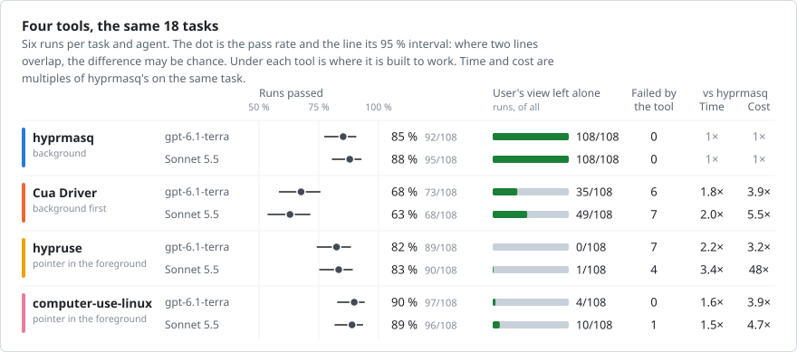
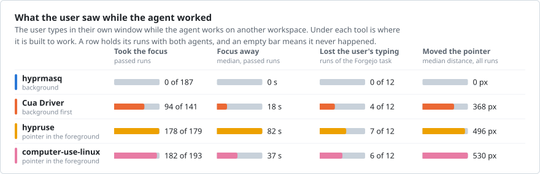
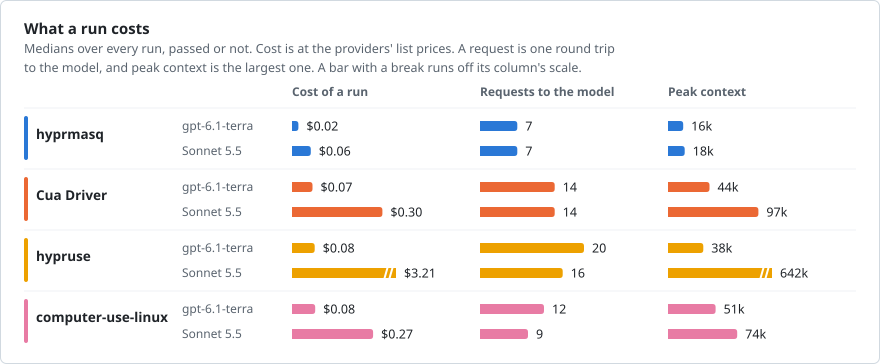
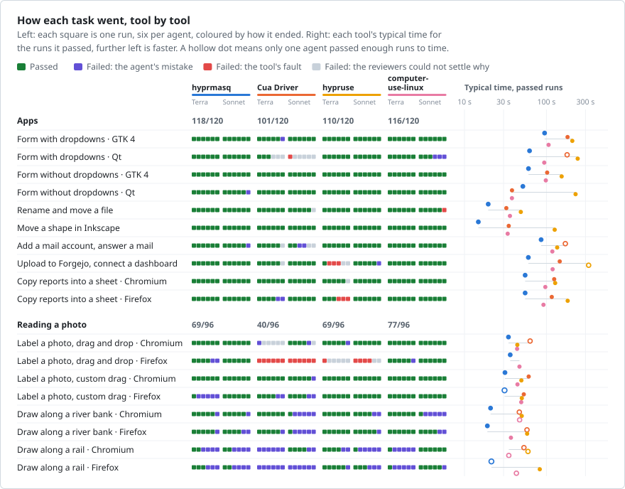
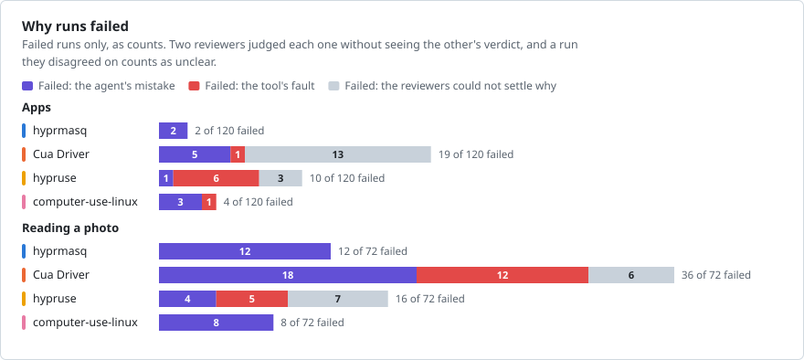

# Comparisons with other computer-use tools

hyprmasq beside three other tools that let an agent use a Linux desktop,
[Cua Driver](https://github.com/trycua/cua), [computer-use-linux](https://github.com/agent-sh/computer-use-linux) and
[hypruse](https://github.com/IlyasKhallouki/hypruse). Two agents, GPT-6.1 Terra and Claude Sonnet 5.5, ran the same 18
desktop tasks in a VM with each tool, while the user worked in their own window.

<!-- render v2-hyprmasq,v2-hyprmasq-chromium,v2-cua,v2-cua-chromium,v2-hypruse,v2-hypruse-chromium,v2-computer-use-linux,v2-computer-use-linux-chromium,v2-failures scorecard -->
<picture>
  <source media="(prefers-color-scheme: dark)" srcset="comparison/scorecard-dark.svg">
  
</picture>
<!-- /render -->

- **The user:** hyprmasq is built to work in the background, pointer included, and left the user's view alone in all
  216 runs. The other tools need the foreground for some or all pointer input, and took the focus in most of their
  passed runs.
- **Runs passed:** hyprmasq, computer-use-linux and hypruse are within the noise of each other, and hyprmasq passed more
  than Cua Driver with both agents.
- **Time and cost:** the other tools took 1.5 to 3.4 times as long and cost 3.2 to 48 times as much a run. The 48 is
  hypruse with Sonnet, which gets each screenshot twice, as an image and as text.
- **Photo tasks:** every tool failed most where a photo has to be read. hyprmasq passed 72 % of those runs, hypruse
  72 % and computer-use-linux 80 %, a difference within the noise.

hyprmasq's author ran the series and developed hyprmasq against these tasks, so the results show its best case, in a
VM setup with [known effects that favour either tool](#method). The [rules](../bench/comparison-series.json) were
committed before the runs, and every run is in [comparison/data](comparison/data).

## Working in the background

Each tool tries to spare the user in its own way, and they get different distances without the foreground. Read this
as what each design costs a user who keeps working, not as a defect.

- **hyprmasq** gives each window its own input, so clicks and drags never touch the user's pointer or focus.
- **Cua Driver** has background routes and falls back to the foreground where an app refuses them.
- **hypruse** sends keys in the background and refuses the pointer there by default.
- **computer-use-linux** has an opt-in background mode for screenshots and keys, which the series turned on. Its
  pointer is the user's own.

The prompt told every agent that foreground input and focus changes were allowed if its tool needed them.

<!-- render v2-hyprmasq,v2-hyprmasq-chromium,v2-cua,v2-cua-chromium,v2-hypruse,v2-hypruse-chromium,v2-computer-use-linux,v2-computer-use-linux-chromium user-view -->
<picture>
  <source media="(prefers-color-scheme: dark)" srcset="comparison/user-view-dark.svg">
  
</picture>
<!-- /render -->

**View left alone**, in the first figure, means that no window opened on the user's workspace, the workspace did not
switch and the focus never left the user's window. A run that did nothing leaves it alone too, so this figure counts
the runs that passed, and each of those that changed the view took the focus. In the Forgejo task the user types notes
in their own window meanwhile, and a run lost typing when not all of it arrived.

## What a run costs

<!-- render v2-hyprmasq,v2-hyprmasq-chromium,v2-cua,v2-cua-chromium,v2-hypruse,v2-hypruse-chromium,v2-computer-use-linux,v2-computer-use-linux-chromium usage -->
<picture>
  <source media="(prefers-color-scheme: dark)" srcset="comparison/usage-dark.svg">
  
</picture>
<!-- /render -->

- **Cost:** a run with hyprmasq cost 2 cents with Terra and 6 with Sonnet at the median. The others cost 7 to 30
  cents, and hypruse with Sonnet $3.21.
- **Fewer round trips:** one `act` call does several actions and returns what changed, so a run took 7 requests to
  the model where the others took 9 to 20.
- **Smaller context:** hyprmasq sends small screenshots of one window. Its peak context was 16k to 18k tokens, the
  others' 38k to 97k, and hypruse's with Sonnet 642k. Its first request, 9k, is as small as any: the others' were 9k to
  14k with Terra and 12k to 64k with Sonnet.
- **hypruse with Sonnet** gets each screenshot twice, as an image and as text, which is what its cost and context
  show. With Terra it costs about what the others do.

These measures share causes, so they agree more than independent results would.

## Task by task

<!-- render v2-hyprmasq,v2-hyprmasq-chromium,v2-cua,v2-cua-chromium,v2-hypruse,v2-hypruse-chromium,v2-computer-use-linux,v2-computer-use-linux-chromium,v2-failures unit-grid -->
<picture>
  <source media="(prefers-color-scheme: dark)" srcset="comparison/unit-grid-dark.svg">
  
</picture>
<!-- /render -->

- **Time:** hyprmasq was the fastest of the four on 16 of the 17 tasks it passed often enough to time, even from the
  slowest machine. On the Qt form without dropdowns, Cua Driver and computer-use-linux were faster, 38 s against
  hyprmasq's 52 s.
- **Runs passed:** with 6 runs per agent, most differences between the tools are noise. The 95 % intervals do not
  overlap on these alone.
- **hyprmasq ahead:** on labelling a photo by drag and drop, against Cua Driver in Chromium with Terra and in Firefox
  with Sonnet, and against hypruse in Firefox with Sonnet. On the Qt form with dropdowns, against Cua Driver with
  Sonnet. On Forgejo, against hypruse with Terra.
- **hyprmasq behind:** on labelling a photo by custom drag in Firefox with Terra, where it passed 1 of 6 runs and
  hypruse and computer-use-linux each passed 6. [Why runs failed](#why-runs-failed) traces this to how the model reads the
  image, not to hyprmasq.

## Why runs failed

Two reviewers, Claude Opus 5.5 and GPT-6.1 Sol, read every failed run and judged it a problem of the tool or a mistake
of the model, citing evidence from the run. Neither saw the other's verdict or any pass rate.

<!-- render v2-hyprmasq,v2-hyprmasq-chromium,v2-cua,v2-cua-chromium,v2-hypruse,v2-hypruse-chromium,v2-computer-use-linux,v2-computer-use-linux-chromium,v2-failures attribution -->
<picture>
  <source media="(prefers-color-scheme: dark)" srcset="comparison/attribution-dark.svg">
  
</picture>
<!-- /render -->

No failure of hyprmasq was traced to the tool, and nearly all of its failures are image misreads. Drags that
moved nothing or were refused make up 12 of Cua Driver's 13 tool problems and 5 of hypruse's 11. The reviewers disagreed
on 29 of 191 failed runs.

Each tool's failures

- **hyprmasq:** no failure was traced to the tool. Nearly every one is an image misread, such as a label on a
  look-alike part or a trace that drifts off its line.
- **computer-use-linux:** one failure was the tool's, in the file manager, where it clicked a file by an accessibility
  position that was wrong and reported success. The rest are image misreads, as with hyprmasq.
- **Cua Driver:** 12 of its 13 tool problems are labelling a photo by drag and drop in Firefox, where its drags moved
  nothing or were refused. The other is a Qt dropdown click that it reported as done but that changed nothing.
- **hypruse:** 5 of its 11 are the same task, where it reported drags that moved nothing, and 6 are input that went
  astray, 3 in Forgejo and 3 in Calc.
- **Unclear:** the reviewers disagreed on 29 of 191 failed runs, and 2 lacked evidence. 19 of those 31 are Cua
  Driver's.

The Firefox photo task: a probe at two image sizes and a replay of the first screenshot

One task went against hyprmasq. On labelling a photo by custom drag in Firefox, Terra passed 1 of 6 runs with it and
all 6 with hypruse and with computer-use-linux, each failure a label on the same look-alike header. hyprmasq's first
screenshot is also the smallest of the four, 1280×720 against up to 1920×1080.

A probe outside the series tested that, with Terra and Sol on the eight photo tasks, 6 runs each at hyprmasq's limit of
1280 and at 1920, on the same machine and build. Both limits passed 80 of 96 runs, and the agents moved in opposite
directions: Terra 38 and 42, Sol 42 and 38. At 1280 Terra passed the Firefox task above in all 6 runs, so its 1 of 6 in
the series was most likely chance. What does stand out is the browser: the look-alike header took 16 of the probe's
48 board runs in Firefox, at both limits, and 1 of 48 in Chromium. In the series it took 7 of hyprmasq's runs and 1 of
computer-use-linux's, all in Firefox. It is not the drag: the agents aimed the label at the look-alike part itself. Nor
is the picture visibly different: in Firefox the photo is 0.7 % larger and sits a few pixels higher, at the same
sharpness and colour. Split by agent and limit, the error gathers in two places, Terra at 1280 in Firefox, 10 of 24 runs,
and Sol at 1920 in Firefox, 10 of 12, and almost never elsewhere.

A replay found why. Given only the first screenshot and the task's prompt, with no VM, Sol put the label on the look-alike
in 17 of 20 tries with the Firefox screenshot at 1920 and in 1 of 20 with Chromium's. The browser's name in the prompt
changed nothing, and neither did the page's own rendering: Firefox's page under Chromium's toolbar was read right every
time. What mattered was where the photo sat in the image. Moved down by 3 to 16 pixels, the same Firefox screenshot was
read right in every try, and the error came back at 32 and 64 pixels. A period of 32 pixels fits how a vision model cuts
an image into patches. Firefox's toolbar is 6 pixels shorter than Chromium's, which puts the header at an unlucky place for
Sol at 1920. Terra at 1280 went from 6 of 20 to 0 to 2 of 15 when shifted. So the error is the model's, made systematic by
where the browser happens to put the photo, and not hyprmasq's or Firefox's. The probe's runs and every replay are in
[comparison/data](comparison/data/README.md#datasets), apart from the series.

## Method

The tasks, their VM and their grading are those of the [benchmarks](benchmarks.md). Every tool got the same
tool-neutral prompt, its documented setup and 6 runs per task and agent. The rest is folded below.

Known effects of the setup

Against Cua Driver:

- The VM's accessibility walks are 1.4 to 2.4 times as slow as a real Omarchy machine's, and are cut at Cua Driver's time
  budget.
- 8 of the 18 task units are image tasks.
- 5 task units run in Firefox, where Cua Driver's foreground is refused and its browser tools do not apply.
- Cua Driver's guide calls Hyprland experimental.
- The main series starts Chromium without remote debugging. A slice with it is among the side checks below.

Against hypruse and computer-use-linux:

- The user works in their own window throughout, which is hyprmasq's design goal and not theirs. Both document
  pointer input in the foreground.
- Most tasks need the pointer, so their background keys and screenshots rarely spare the user's focus.

For Cua Driver:

- In the VM, its screenshots of a hidden Chromium window stay fresh, which they do not on the real machine.
- In the VM, it types into Thunderbird in the background, which it does not on the real machine.
- In the VM, its desktop route clicks a GTK 3 dropdown's item, which it does not on the real machine.

The setup:

- Cua Driver, hypruse and computer-use-linux ran on machine A (Ryzen 5 5600X), hyprmasq on machine B (a laptop, Ryzen 7
  PRO 4750U).
- Other load on machine A's host sometimes takes most of a core. Each run records it.

Tasks

The tasks, their VM, their grading and their measures are those of the [benchmarks](benchmarks.md): the user works on their
own workspace, the task's apps are on another, and the agent works through the tool's MCP server alone.
[bench/tasks](../bench/tasks) has each task's prompt, app and grading. The tasks were picked to stress hyprmasq's image-based
approach, with common kinds of work on a desktop: forms with dropdowns, drags, files, copying data between apps, mail, a
sign-in with a popup and drawing.

The tools and their setups

- **hyprmasq** at `8935ac7`, the head of its Hyprland 0.56 branch with a fix for popups that closed apps on a real Omarchy.
  The VM does not trigger that defect.
- **Cua Driver** 0.42.1 (`cua-driver-rs-v0.42.1`) with its skill, `--no-overlay` and `--grant existing-profile` where the
  user's browser is Chromium.
- **hypruse** 0.13.0 from its PyPI sdist, in its image mode, as the agent cannot read the VM's files. With Sonnet, it
  returns each screenshot twice, as an image and as base64 text, which drives its peak context and cost.
- **computer-use-linux** 0.7.47 with its skill and `COMPUTER_USE_LINUX_HYPRLAND_BACKGROUND=1`.
- **Agents:** Claude Sonnet 5.5 in Claude Code 2.1.319 and GPT-6.1 Terra in Codex 0.167.0, at medium effort, on the owner's
  subscriptions. Costs are at the providers' API list prices.
- **Prompt:** the same tool-neutral prompt for every tool: the user works in another window, has authorized foreground
  input and focus changes if a tool needs them, and prefers that their window is left alone.
- **The VM:** Hyprland 0.56.2 with the Omarchy desktop's configuration at 1920x1080. Before each run, each task's workspace
  is shown until its window stops changing, for every tool, so that no tool starts with blank or stale windows.

[bench/README.md](../bench/README.md#the-comparison-series) has how a series runs.

Reading the numbers

The rules fix the analysis. Time runs from the agent's start to its end. A time ratio is the geometric mean over task
units of a tool's median over hyprmasq's, within each agent, on the units where both passed at least 3 of 6 runs, and
the table lists the units left out. The task figure's typical time is the geometric mean of each agent's median over its passed runs, for the agents that passed at
least 3 of 6. Failed runs' times stand apart, as a run that gave up early is not fast. Tokens,
cost and calls count every run. Cost is what the requests would cost at the provider's list prices, cache reads at
their lower price. Peak context is the largest single request.

Excluded runs and overrides

A run ran again only after a logged failure of the infrastructure, on the same machine, the same rule for every tool.
[comparison/data/v2-exclusions.json](comparison/data/v2-exclusions.json) lists all 71 excluded runs of Sonnet and Terra
with why: 61 stopped by a failed Claude login, 1 left without a summary, 1 cut when a series was stopped, and 8 of Forgejo
replaced because the start step gave the focus to the terminal, so the user's keys never reached their notes. A run that
the agent failed stands, whatever the reason.

The rules allowed failing a passed run that broke a stated requirement the checker does not grade. All 781 passed runs were
checked against that list: a second mail or a wrong room in Thunderbird, other commits or branches in Forgejo, other files
in the file manager, other windows in the forms, the file manager and Inkscape, a river that stops short of the bottom of
the photo. None did, so no run was overridden. Calc's tabs and files the checker grades itself. For Forgejo, the check reads
the commits and branches that the checker records, not each repository setting.

Side checks: a debugging port for Cua Driver, and the machines

- **Cua Driver with a debugging port.** Its browser tools attach only to a Chromium started with remote debugging,
  which a user rarely has. With the port it passed 49 of 72 runs, the same as without it. The clear gain is labelling a
  photo by drag and drop in Chromium with Terra, from 0 to 6 of 6.
- **The machines.** hyprmasq ran on machine B and the others on machine A, so a time ratio is that of these two
  deployments. One round of hyprmasq on machine A took about as long per call. A planned check of the tools on a third
  machine did not run.

[The numbers](comparison-numbers.md#side-checks) have both tables.

## More

- [All the numbers](comparison-numbers.md): every table behind this page, per task, tool and agent.
- [The tasks on macOS](comparison-macos.md): OpenAI's and Claude's computer use and Cua Driver on a Mac, beside
  hyprmasq in the VM.
- [The data](comparison/data): every run, and both reviews of every failed one.
