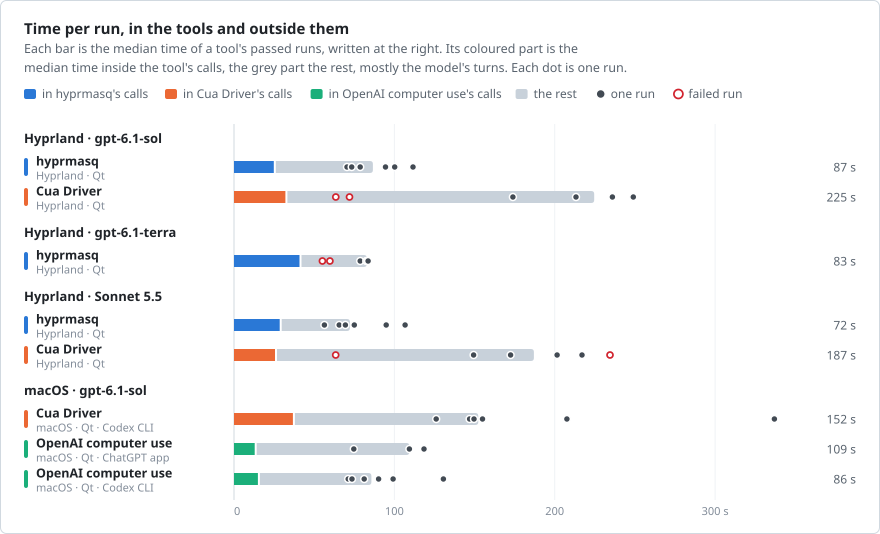
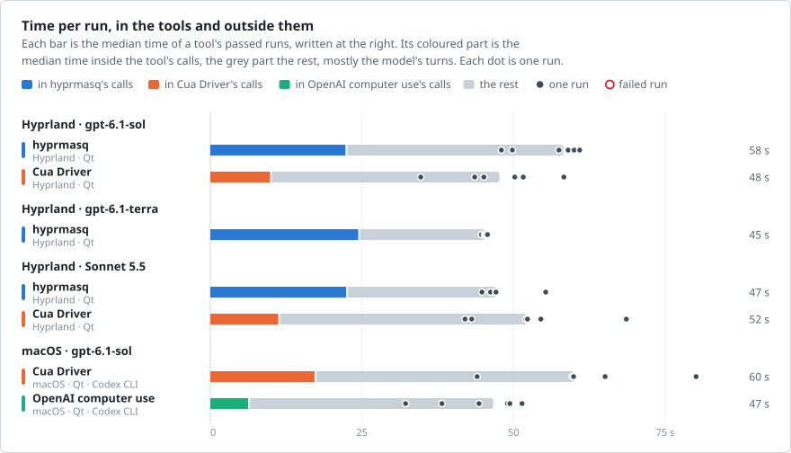
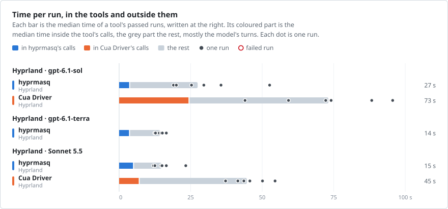
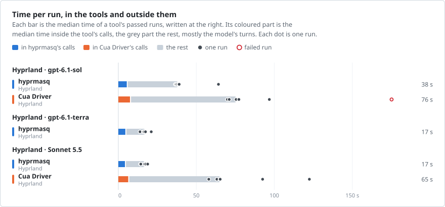

# Comparisons with other computer-use tools

hyprmasq beside [Cua Driver](https://github.com/trycua/cua) on an Omarchy laptop, and Cua Driver beside OpenAI's
computer use on a Mac, where hyprmasq does not run. Each tool ran as its authors document it, six times per task,
agent and tool (three in the ChatGPT app), run by hyprmasq's author. Tasks other than these four, such as using a
website in a browser, were not compared. Every run is in [comparison/data](comparison/data), and
[bench/laptop](../bench/laptop/README.md) has the runners to repeat them on your own machine. [Method](#method) has
the setups.

## Form with dropdowns

A 25-question Qt questionnaire whose dropdowns open popups, as menus and pickers do in real apps.

<!-- render omarchy-form-qt-codex,omarchy-form-qt-claude,macos-form-qt,macos-form-qt-openai comparison form -->
<picture>
  <source media="(prefers-color-scheme: dark)" srcset="comparison/comparison-form-dark.svg">
  
</picture>
<!-- /render -->

<!-- render omarchy-form-qt-codex,omarchy-form-qt-claude,macos-form-qt,macos-form-qt-openai comparison-time form -->
<picture>
  <source media="(prefers-color-scheme: dark)" srcset="comparison/comparison-time-form-dark.svg">
  
</picture>
<!-- /render -->

Notes: what the user saw, why, and the failed runs

Dropdowns stand for the menus and pickers of real apps. What the user saw while the agent worked:

- **hyprmasq:** nothing. Its input reaches the app from the compositor, so the lists opened as popups of the hidden
  window.
- **Cua Driver:** the questionnaire with the focus, on the user's workspace on Hyprland and in front on macOS, once
  Cua had fallen back to foreground input to pick from a list.
- **OpenAI's computer use:** the lists, drawn over the user's window while the agent chose from them. The focus
  stayed with the user.

Why each platform's lists behave this way

| What the platform does | hyprmasq | Cua Driver | OpenAI computer use |
| --- | --- | --- | --- |
| Qt on Wayland opens a list as a popup only after the app has had input from the compositor. Otherwise it opens the list as a window of its own, which Hyprland puts on the workspace in view, the user's, and focuses. | Its input reaches the app from the compositor, over libei, so its lists opened as popups of the hidden window. | Its background input reaches the app through accessibility, so in 8 of its 12 laptop runs a list opened as a window, 6 times on the user's workspace. | Not on Linux. |
| Qt's list items take no accessibility selection, on either platform. | Uses no accessibility. | It pressed or selected a list item, reported success, and the dropdown kept its old value. It then switched to foreground input, which on Hyprland focuses the questionnaire and moves the user to its workspace, as Cua's documentation says, and on macOS brings the questionnaire to the front. | |
| On macOS a list is a window of its own, which an app behind the user's window draws in front of it. | Not on macOS. | It took the focus in five of its six Mac runs, and showed lists over the user's window. | It never took the focus, but each list it opened stayed over the user's window while the agent chose from it. |

Failed runs

| Tool | Agent | What happened |
| --- | --- | --- |
| hyprmasq | Terra | Two runs left question 5's checkbox `7` unticked with the other 24 answers right. The event logs show no change to that checkbox, and neither run had a tool error or a focus change. |
| Cua Driver, laptop | Sol, Sonnet | Four runs failed, two with each agent. Three submitted with dropdowns unset after Cua had reported their selection as done. The fourth, with Sonnet, stopped, saying that selecting a list item through accessibility only highlighted it. The retries grew the context and the cost. |

<!-- render omarchy-form-qt-codex,omarchy-form-qt-claude,macos-form-qt,macos-form-qt-openai comparison-table form -->

Numbers: Form with dropdowns

**Outcome and time**

| Agent | Tool | Where | Passed | Time s | In tools s | Calls | Failed calls | Focus away s | Windows over user s |
| --- | --- | --- | --- | --- | --- | --- | --- | --- | --- |
| gpt-6.1-sol | hyprmasq | Hyprland · Qt | 6/6 | 87 (70–112) | 25 (24–26) | 10 (10–12) | 0 (0–0) | 0 (0–0) | – |
| gpt-6.1-sol | Cua Driver | Hyprland · Qt | 4/6 | 225 (174–249) | 32 (30–35) | 32 (9–41) | 6 (1–8) | 164 (123–196) | – |
| gpt-6.1-terra | hyprmasq | Hyprland · Qt | 4/6 | 83 (79–84) | 41 (38–42) | 17 (12–19) | 0 (0–0) | 0 (0–0) | – |
| Sonnet 5.5 | hyprmasq | Hyprland · Qt | 6/6 | 72 (56–107) | 28 (22–36) | 14 (11–21) | 0 (0–1) | 0 (0–0) | – |
| Sonnet 5.5 | Cua Driver | Hyprland · Qt | 4/6 | 187 (149–217) | 26 (19–31) | 67 (10–85) | 7 (0–20) | 126 (119–165) | – |
| gpt-6.1-sol | Cua Driver | macOS · Qt · Codex CLI | 6/6 | 152 (126–337) | 37 (30–49) | 26 (21–43) | 0 (0–1) | 52 (1–225) | 67 (44–238) |
| gpt-6.1-sol | OpenAI computer use | macOS · Qt · ChatGPT app | 3/3 | 109 (75–118) | 13 (9–16) | 22 (16–27) | 1 (0–3) | 0 (0–0) | 38 (27–80) |
| gpt-6.1-sol | OpenAI computer use | macOS · Qt · Codex CLI | 6/6 | 86 (71–131) | 15 (10–24) | 18 (15–28) | 1 (0–2) | 0 (0–0) | 38 (22–63) |

**Tokens and cost**

| Agent | Tool | Where | Input k | Uncached k | Peak context k | Cost $ |
| --- | --- | --- | --- | --- | --- | --- |
| gpt-6.1-sol | hyprmasq | Hyprland · Qt | 207 (195–240) | 24 (13–30) | 21 (20–21) | 0.08 (0.06–0.09) |
| gpt-6.1-sol | Cua Driver | Hyprland · Qt | 2189 (463–2556) | 82 (42–99) | 85 (49–102) | 0.42 (0.14–0.47) |
| gpt-6.1-terra | hyprmasq | Hyprland · Qt | 432 (233–448) | 33 (21–65) | 29 (21–32) | 0.06 (0.04–0.09) |
| Sonnet 5.5 | hyprmasq | Hyprland · Qt | 367 (252–703) | 31 (19–41) | 37 (29–50) | 0.13 (0.09–0.21) |
| Sonnet 5.5 | Cua Driver | Hyprland · Qt | 5092 (951–7018) | 145 (105–176) | 145 (105–176) | 1.02 (0.38–1.24) |
| gpt-6.1-sol | Cua Driver | macOS · Qt · Codex CLI | 1399 (1094–2773) | 59 (51–76) | 68 (60–84) | 0.28 (0.23–0.48) |
| gpt-6.1-sol | OpenAI computer use | macOS · Qt · ChatGPT app | 1226 (764–1414) | 42 (32–56) | 63 (52–71) | 0.24 (0.15–0.24) |
| gpt-6.1-sol | OpenAI computer use | macOS · Qt · Codex CLI | 640 (467–1189) | 50 (38–98) | 46 (37–59) | 0.18 (0.13–0.33) |

<!-- /render -->

## Form without dropdowns

The same questionnaire with checkboxes, sliders and text fields only: every tool works on it in the background.

<!-- render omarchy-form-nodrop-codex,omarchy-form-nodrop-claude,macos-form-nodrop comparison form-no-dropdowns -->
<picture>
  <source media="(prefers-color-scheme: dark)" srcset="comparison/comparison-form-no-dropdowns-dark.svg">
  
</picture>
<!-- /render -->

<!-- render omarchy-form-nodrop-codex,omarchy-form-nodrop-claude,macos-form-nodrop comparison-time form-no-dropdowns -->
<picture>
  <source media="(prefers-color-scheme: dark)" srcset="comparison/comparison-time-form-no-dropdowns-dark.svg">
  
</picture>
<!-- /render -->

Notes: why the tools differ

The like-for-like comparison: every tool worked in the background, and only one Cua run, with Sonnet, disturbed
the user, bringing the questionnaire to the front for 33 s. Cua and OpenAI's computer use read the app's
accessibility tree and act on its controls, so they spend less time in their tools: Cua filled the questionnaire in
4 to 7 calls with Codex. hyprmasq works from screenshots and input alone, which takes longer in its tools and less
input to the model.

Sol's startup waits: the first series and the rule

The rule took the first six runs whose first desktop call came within 20 s. All six qualified, and no other row's
runs were selected by a rule. The first series had a 168 s median from four waits of 88 to 230 s before the first
call, and is kept in full.

Task success and total time did not affect the selection, and a failed run that met the startup rule would have
counted. All first six attempts qualified and passed, so no attempt was excluded or replaced. Their wall-time
median was 58.2 s.

The [superseded six-run series](comparison/data/omarchy-form-nodrop-codex-original-sol.json)
is retained in full. It had a 168.4 s median, driven by four initial waits of 88 to 230 s.
After the first desktop call, its median remaining time was 60.8 s. The task, prompt, model,
effort and product commit were the same, but those records do not identify the cause of the
initial waits.

A separate 12-trial diagnostic compared main at `d2dac52` with the head of the runs, `fa3f170`, using
Codex 0.163.0 at medium effort and the same Qt desktop. Three physical clients each
ran one matched pair for each form variant. The prompt, binary, account, home and
working-directory labels were held constant, and all clients used the same MCP bridge.

| Client | Form | `d2dac52` wall s | `fa3f170` wall s |
| --- | --- | --- | --- |
| Laptop, Wi-Fi | With dropdowns | 85.6 | 79.3 |
| Laptop, Wi-Fi | Without dropdowns | 60.8 | 55.5 |
| Wired client 1 | With dropdowns | 64.9 | 55.1 |
| Wired client 1 | Without dropdowns | 62.2 | 54.0 |
| Wired client 2 | With dropdowns | 85.4 | 74.2 |
| Wired client 2 | Without dropdowns | 76.6 | 49.4 |

All 12 passed with no focus changes. First desktop calls arrived in 5.4 to 9.4 s.
The long initial interval did not recur, and `fa3f170` was faster in all six matched pairs.
This is one pair per client and variant, not a general speed estimate. The clients
share one internet connection, so these trials do not identify the cause of the
earlier waits. The [diagnostic data](comparison/data/sol-timing-control.json) remain
separate from the six samples per tool in the comparison above.

<!-- render omarchy-form-nodrop-codex,omarchy-form-nodrop-claude,macos-form-nodrop comparison-table form-no-dropdowns -->

Numbers: Form without dropdowns

**Outcome and time**

| Agent | Tool | Where | Passed | Time s | In tools s | Calls | Failed calls | Focus away s | Windows over user s |
| --- | --- | --- | --- | --- | --- | --- | --- | --- | --- |
| gpt-6.1-sol | hyprmasq | Hyprland · Qt | 6/6 | 58 (48–61) | 22 (22–22) | 9 (6–9) | 0 (0–0) | 0 (0–0) | – |
| gpt-6.1-sol | Cua Driver | Hyprland · Qt | 6/6 | 48 (35–58) | 10 (8–12) | 6 (4–7) | 0 (0–1) | 0 (0–0) | – |
| gpt-6.1-terra | hyprmasq | Hyprland · Qt | 6/6 | 45 (45–46) | 24 (24–25) | 7 (7–7) | 0 (0–0) | 0 (0–0) | – |
| Sonnet 5.5 | hyprmasq | Hyprland · Qt | 6/6 | 47 (45–55) | 22 (22–24) | 9 (7–10) | 0 (0–0) | 0 (0–0) | – |
| Sonnet 5.5 | Cua Driver | Hyprland · Qt | 6/6 | 52 (42–69) | 11 (10–12) | 10 (8–11) | 0 (0–1) | 0 (0–33) | – |
| gpt-6.1-sol | Cua Driver | macOS · Qt · Codex CLI | 6/6 | 60 (44–80) | 17 (16–18) | 10 (7–13) | 0 (0–0) | 0 (0–0) | 0 (0–0) |
| gpt-6.1-sol | OpenAI computer use | macOS · Qt · Codex CLI | 6/6 | 47 (32–51) | 6 (6–7) | 10 (8–11) | 0 (0–0) | 0 (0–0) | 0 (0–0) |

**Tokens and cost**

| Agent | Tool | Where | Input k | Uncached k | Peak context k | Cost $ |
| --- | --- | --- | --- | --- | --- | --- |
| gpt-6.1-sol | hyprmasq | Hyprland · Qt | 176 (132–176) | 13 (12–27) | 20 (20–21) | 0.05 (0.05–0.08) |
| gpt-6.1-sol | Cua Driver | Hyprland · Qt | 353 (213–370) | 42 (36–65) | 46 (43–51) | 0.12 (0.10–0.17) |
| gpt-6.1-terra | hyprmasq | Hyprland · Qt | 159 (157–159) | 30 (23–46) | 24 (22–24) | 0.04 (0.03–0.06) |
| Sonnet 5.5 | hyprmasq | Hyprland · Qt | 203 (162–212) | 19 (17–19) | 27 (27–28) | 0.08 (0.07–0.08) |
| Sonnet 5.5 | Cua Driver | Hyprland · Qt | 840 (702–1021) | 35 (27–38) | 94 (87–99) | 0.20 (0.16–0.22) |
| gpt-6.1-sol | Cua Driver | macOS · Qt · Codex CLI | 478 (268–535) | 45 (33–87) | 52 (44–57) | 0.14 (0.11–0.22) |
| gpt-6.1-sol | OpenAI computer use | macOS · Qt · Codex CLI | 276 (225–328) | 29 (25–31) | 31 (29–34) | 0.09 (0.08–0.10) |

<!-- /render -->

## Inkscape

Move a rectangle by 2 px and save the drawing, on the laptop.

<!-- render omarchy-inkscape-codex,omarchy-inkscape-claude comparison inkscape -->
<picture>
  <source media="(prefers-color-scheme: dark)" srcset="comparison/comparison-inkscape-dark.svg">
  
</picture>
<!-- /render -->

<!-- render omarchy-inkscape-codex,omarchy-inkscape-claude comparison-time inkscape -->
<picture>
  <source media="(prefers-color-scheme: dark)" srcset="comparison/comparison-time-inkscape-dark.svg">
  
</picture>
<!-- /render -->

Notes: why Cua went to the foreground

Inkscape is Cua's best case on Omarchy, one of the two apps whose package its input plugin admits for background
input. Cua still went to the foreground in 9 of its 12 runs: its background keys go to the window's top level,
which it asked the agent to click into first, and its background clicks are single or double only, so a triple
click to select a field's text went to the foreground.

<!-- render omarchy-inkscape-codex,omarchy-inkscape-claude comparison-table inkscape -->

Numbers: Inkscape

**Outcome and time**

| Agent | Tool | Where | Passed | Time s | In tools s | Calls | Failed calls | Focus away s | Windows over user s |
| --- | --- | --- | --- | --- | --- | --- | --- | --- | --- |
| gpt-6.1-sol | hyprmasq | Hyprland | 6/6 | 27 (19–53) | 4 (3–4) | 4 (3–4) | 0 (0–0) | 0 (0–0) | – |
| gpt-6.1-sol | Cua Driver | Hyprland | 6/6 | 73 (44–96) | 24 (7–43) | 10 (8–12) | 1 (0–2) | 23 (0–46) | – |
| gpt-6.1-terra | hyprmasq | Hyprland | 6/6 | 14 (12–16) | 3 (3–4) | 3 (3–3) | 0 (0–0) | 0 (0–0) | – |
| Sonnet 5.5 | hyprmasq | Hyprland | 6/6 | 15 (12–23) | 5 (4–8) | 3 (3–5) | 0 (0–0) | 0 (0–0) | – |
| Sonnet 5.5 | Cua Driver | Hyprland | 6/6 | 45 (37–54) | 7 (5–11) | 18 (9–23) | 2 (1–3) | 24 (0–37) | – |

**Tokens and cost**

| Agent | Tool | Where | Input k | Uncached k | Peak context k | Cost $ |
| --- | --- | --- | --- | --- | --- | --- |
| gpt-6.1-sol | hyprmasq | Hyprland | 81 (67–84) | 14 (8–32) | 15 (15–17) | 0.04 (0.03–0.07) |
| gpt-6.1-sol | Cua Driver | Hyprland | 575 (313–897) | 64 (36–75) | 71 (42–83) | 0.19 (0.11–0.24) |
| gpt-6.1-terra | hyprmasq | Hyprland | 67 (66–67) | 13 (13–22) | 15 (15–16) | 0.02 (0.02–0.03) |
| Sonnet 5.5 | hyprmasq | Hyprland | 61 (60–99) | 10 (10–12) | 17 (17–20) | 0.03 (0.03–0.05) |
| Sonnet 5.5 | Cua Driver | Hyprland | 832 (624–1066) | 33 (29–37) | 89 (86–94) | 0.19 (0.15–0.23) |

<!-- /render -->

## File manager

Rename a file and move it into a folder in Nautilus, on the laptop.

<!-- render omarchy-files-codex,omarchy-files-claude comparison files -->
<picture>
  <source media="(prefers-color-scheme: dark)" srcset="comparison/comparison-files-dark.svg">
  
</picture>
<!-- /render -->

<!-- render omarchy-files-codex,omarchy-files-claude comparison-time files -->
<picture>
  <source media="(prefers-color-scheme: dark)" srcset="comparison/comparison-time-files-dark.svg">
  
</picture>
<!-- /render -->

Notes: why Cua went to the foreground

Nautilus is not an app that Cua admits for background input, and its accessibility could not tell whether a click
had worked, so every Cua run went to the foreground. Its failed run renamed the file and left it where it was.

<!-- render omarchy-files-codex,omarchy-files-claude comparison-table files -->

Numbers: File manager

**Outcome and time**

| Agent | Tool | Where | Passed | Time s | In tools s | Calls | Failed calls | Focus away s | Windows over user s |
| --- | --- | --- | --- | --- | --- | --- | --- | --- | --- |
| gpt-6.1-sol | hyprmasq | Hyprland | 6/6 | 38 (36–64) | 5 (5–6) | 6 (5–7) | 0 (0–0) | 0 (0–0) | – |
| gpt-6.1-sol | Cua Driver | Hyprland | 5/6 | 76 (70–97) | 8 (7–11) | 14 (13–30) | 3 (3–14) | 45 (32–66) | – |
| gpt-6.1-terra | hyprmasq | Hyprland | 6/6 | 17 (14–21) | 4 (4–5) | 5 (4–6) | 0 (0–0) | 0 (0–0) | – |
| Sonnet 5.5 | hyprmasq | Hyprland | 6/6 | 17 (14–19) | 4 (4–6) | 4 (4–7) | 0 (0–2) | 0 (0–0) | – |
| Sonnet 5.5 | Cua Driver | Hyprland | 6/6 | 65 (58–122) | 6 (3–7) | 30 (19–40) | 8 (3–15) | 47 (25–113) | – |

**Tokens and cost**

| Agent | Tool | Where | Input k | Uncached k | Peak context k | Cost $ |
| --- | --- | --- | --- | --- | --- | --- |
| gpt-6.1-sol | hyprmasq | Hyprland | 113 (96–126) | 15 (9–17) | 16 (16–17) | 0.04 (0.03–0.05) |
| gpt-6.1-sol | Cua Driver | Hyprland | 818 (628–1844) | 63 (42–79) | 63 (47–84) | 0.21 (0.16–0.37) |
| gpt-6.1-terra | hyprmasq | Hyprland | 94 (78–109) | 21 (13–27) | 15 (15–16) | 0.03 (0.02–0.03) |
| Sonnet 5.5 | hyprmasq | Hyprland | 80 (71–107) | 9 (9–11) | 17 (16–19) | 0.03 (0.03–0.04) |
| Sonnet 5.5 | Cua Driver | Hyprland | 1605 (964–3066) | 41 (28–42) | 98 (85–99) | 0.31 (0.19–0.47) |

<!-- /render -->

## Method

Scope

- **Same session:** the agent works in the user's own session, beside them. Cua's separate desktop, a Cua Space,
  is not tested.
- **Cua on Hyprland** ran its opt-in input build, which its documentation calls experimental. The plugin package it
  documents for Arch sends no input of its own: with it, Cua filled text fields and sliders through accessibility,
  but could not tick checkboxes or pick from dropdowns ([run data](comparison/data/omarchy-form-codex-cua-documented.json)). OpenAI's
  computer use offers no desktop tool on Linux.
- **Six runs for each task, agent and tool,** three in the ChatGPT app. They describe these runs, not a general
  ranking, and the laptop's times do not compare with the Mac's.
- **Models:** Sol and Terra are OpenAI's `gpt-6.1-sol` and `gpt-6.1-terra` in Codex, Sonnet is Claude Sonnet 5.5 in
  Claude Code, all at medium effort. Costs are at the providers' API list prices.

Reading the figures

Time runs from the agent's start to its end, the median of the passed runs. Uncached input is the input tokens the
provider did not serve from its cache, summed over a run's requests. Cost is what the requests would cost at the
provider's list prices, cache reads at their lower price, for Codex too, which ran on a ChatGPT subscription. Peak
context is the largest single request. The user was disturbed while the focus was away from their window, or while
the task app's windows were drawn over it: the figures count the passed runs that did, with the median seconds of
those runs. Tokens, cost and calls count every run, failed ones too. The tables give the range in brackets, and the
per-run data is in [comparison/data](comparison/data).

Hyprland: hyprmasq and Cua Driver

- **Machine:** ThinkPad T14 Gen 1 (Ryzen 7 PRO 4750U, Radeon Vega), Omarchy 4.0.4, Hyprland 0.56.2-2 from Arch,
  1920×1080. Nobody used it during the runs.
- **hyprmasq** 0.1.0 at [fa3f170](https://github.com/nyrda/hyprmasq/commit/fa3f1707359ec7cc260f951b2c8634e7ae10cc20),
  with six runs per task and agent on October 25 and 26, 2026. The Sol series without dropdowns took the first six runs
  that met a startup rule fixed beforehand, see [Sol's startup waits](#form-without-dropdowns). The input tool was built on the machine and the MCP
  server from the same source with Nix. The loaded plugin's source was unchanged. `hyprmasq-mcp` was registered
  as [Installation](installation.md#mcp-server) shows, in fresh agent homes. The Cua and macOS samples are unchanged.
- **Cua Driver** 0.38.0 from its installer, with its skill installed by `cua-driver skills install`, all of its
  MCP tools, and `CUA_DRIVER_RS_ENABLE_WAYLAND=1`, which its Linux guide asks for on Wayland. Its Hyprland plugin
  0.38.0 was built from the release source with `-DCUA_HYPRLAND_INPUT=ON`, the opt-in input build, and loaded into
  a fresh Hyprland session. Linux is not Cua's main platform. The plugin package Cua documents for Arch is the discovery-only build, which sends no
  input: with it, Cua filled the questionnaire's text fields and sliders through accessibility and could not set
  its checkboxes or dropdowns ([run data](comparison/data/omarchy-form-codex-cua-documented.json)).
- **What each tool sees:** hyprmasq works from screenshots of the window and libei input alone, and uses no
  accessibility API. Cua also reads the app's accessibility tree over AT-SPI and acts through it.
- **Agents:** Codex CLI 0.163.0 with `gpt-6.1-sol` and `gpt-6.1-terra` at medium effort, and Claude Sonnet 5.5
  at medium effort through the Anthropic API. Claude Code was 2.1.310 for the new hyprmasq samples and 2.1.302
  for the retained Cua samples. Each had only its desktop tool: no shell, so none could
  reach the desktop another way. Cua's skill was loaded by naming it in the prompt (`$cua-driver` in Codex,
  `/cua-driver` in Claude Code), as the shell that would read it was off.
- **Prompt:** the same for both tools. The user works in another window, and has authorized foreground input
  and focus changes if a tool needs them.
- **Not tested:** a Cua Space, a separate desktop where Cua can use foreground input freely. That is a different
  setup from working in the user's own session.
- **The user:** a terminal with the keyboard focus on workspace 1. The task window opens on a hidden workspace,
  and a run does not start unless the user is on workspace 1 with the task window out of view.
- **Measured disturbance:** Hyprland's events, logged for each run: the time the focus was away from the user's
  terminal. A run fails when a window of another app opens. The questionnaire's lists that Qt opened as windows
  are the questionnaire's own and do not fail a run: the focus they took counts as disturbance. The hyprmasq form
  checks identify these windows by their process, and the retained Cua form checks by the questionnaire's app id.
  No agent launched an app.

Tasks

- **Form:** the [form task](benchmarks.md#form) with 25 questions, in its Qt port (`form_qt.py`, PySide6 6.8.3),
  which the Mac also runs. It passes when every answer is right and Submit was pressed. Without dropdowns, the
  questionnaire asks 25 questions of the other three kinds.
- **Inkscape:** move a rectangle in an open drawing from x=120 to x=122 px and save it. Inkscape 1.4.4-6 from Arch
  is one of the two apps whose exact package Cua's input plugin admits for background input. The other,
  `libreoffice-fresh` 26.2.5-3, is older than the 26.8.0 that Omarchy installs.
- **File manager:** in Nautilus 50.3.1, Omarchy's file manager, rename `report-draft.txt` to `report-final.txt` and
  move it into the folder `Archive`, leaving every other file as it was. The grade compares every file's contents
  and place.

macOS: OpenAI's computer use and Cua Driver

- **Machine:** MacBook Pro (M1 Max, 32 GB), macOS 26.5.2. The user's window is TextEdit, in front, with the
  questionnaire open behind it. macOS has no hidden workspace.
- **Agent:** `gpt-6.1-sol` at medium effort, from the Codex CLI 0.163.0-alpha.10.2 that the ChatGPT app
  26.1013.31256 bundles, run by `run_mac_form.py` with each tool from its own home. The same app's Codex also ran
  OpenAI's computer use three times from its window, with the ChatGPT app as the user's window, started by hand.
  OpenAI's computer use runs only OpenAI's models, so Sonnet did not run on the Mac.
- **OpenAI's computer use:** the ChatGPT app's Computer Use plugin 1.0.1001501, through its `js` tool. It offers
  no desktop tool on Linux: with Codex's `computer_use` feature enabled there, the model was offered none.
- **Cua Driver** 0.38.0 from its installer, with its MCP server and skill. The app's Codex runs in code mode, so
  the agent called Cua's tools from JavaScript in its `exec` tool, several in one script where it chose to.
- **App:** the questionnaire's Qt port, run by a copy of Homebrew's framework `Python.app` named Questionnaire,
  so that macOS and the tools see an app of that name. The GTK app cannot be used here: Homebrew builds GTK without
  AccessKit, its only accessibility backend on macOS, so the tools would see none of its controls.
- **Measured disturbance:** the frontmost app and the questionnaire's windows drawn over the user's window,
  including normal-layer windows that overlap it and positive-layer popup lists. Focus-away and visible-window
  intervals are combined without counting their overlap twice. A run fails when an app other than the user's and the
  questionnaire comes to the front while the agent works.

The Mac's runs and the laptop's share the Qt questionnaire and its PySide6 version, and differ in machine, operating
system and harness, so they show how each tool behaves more than which is faster.

